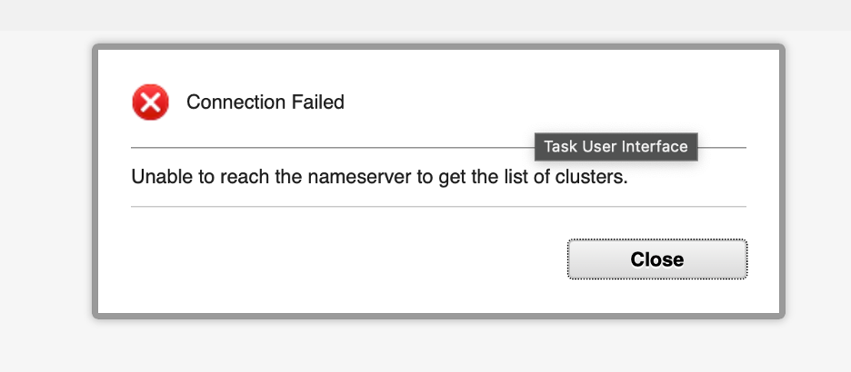

## 11. Granting users access to Impact

In a fresh Impact installation, the only Impact user is `impactadmin`, which is created during the installation process. All other users must be explicitly granted access before they can do anything in the Impact GUI.

Impact authenticates users against a configured user repository. In this lab, Impact is configured to authenticate against the OMNIbus EVENTS ObjectServer. This means any user defined in the ObjectServer — including `ncoadmin`, which you have been using throughout the lab to log into the OMNIbus Web GUI and manipulate events — can present valid credentials at the Impact login page. However, being able to authenticate is not the same as having access: a user who can log in but has no Impact role mappings is presented with a completely blank workspace.

> **Note:** ObjectServer-based authentication is used in this lab for simplicity. Impact also supports authentication via LDAP and via Keycloak/OIDC for environments with centralized identity management.

Access is controlled through role mappings, managed from the command line using `mapRoles.sh`, located in `/opt/IBM/tivoli/impact/install/security/`. Each mapping associates a username with one or more Impact roles that determine which parts of the GUI are visible and what actions the user can perform. Roles are additive — a user can hold a narrow functional role and a broader administrative role at the same time. Changes take effect at the next login with no server restart required.

This section walks through the role-mapping workflow using the `ncoadmin` account: first observing the blank experience of an unmapped user, then granting a scoped functional role, and finally granting full administrative access.

### 11.1 Observe the default experience of an unmapped user

#### Objective

In this exercise, you will log in to the Impact GUI as `ncoadmin` and observe what an unmapped user sees. By the end of the exercise, you will understand the distinction between authentication and access in Impact, and why role mapping is required before a user can work with the product.

#### Prerequisites

- You are currently logged in to the Impact GUI as `impactadmin` in your private/incognito browser session.

#### Background

`ncoadmin` is an ObjectServer user that you have used throughout this lab to log into the OMNIbus Web GUI. Because Impact in this lab is configured to authenticate against the EVENTS ObjectServer, `ncoadmin` can also log into the Impact GUI — but authentication alone grants no access. The user has no Impact role mappings, so Impact has nothing to display.

This two-layer model — authenticate first, then authorize via role mappings — is standard Impact behavior. It means that adding a new user to Impact does not require creating a separate Impact account; you simply map an existing authenticated identity to the appropriate roles.

#### Tasks

1. In your private/incognito browser, click the user menu in the top-right corner of the Impact GUI and select **Logout**. Confirm you are returned to the login page.

2. Log in with the following credentials:

   - **Username**: `ncoadmin`
   - **Password**: `netcool`

   > **If you see a "Connection Failed — Unable to reach the nameserver to get the list of clusters" error**, the browser is carrying stale session state from the previous login. Click **Close**, then close the private/incognito browser window entirely and open a fresh one. Navigate back to the Impact GUI URL and log in again. This clears the cached session and the error will not recur. The same applies to any subsequent login in this section.
   >
   > 

3. Observe the result. The workspace is blank — no tabs, no navigation, no content. Authentication succeeded, but `ncoadmin` has no Impact role mappings, so there is nothing to show.

4. Log out of the Impact GUI.

#### Validation

The exercise is successful when all of the following are true:

- You were able to log in as `ncoadmin` without an authentication error.
- The workspace was blank with no tabs or navigation visible.
- You can explain why `ncoadmin` can authenticate but sees a blank page.
- You can explain why no separate Impact account was needed for `ncoadmin` to log in.

#### Expected result

You have confirmed the default state for an unmapped user and understand the distinction between authentication and access. The next exercise grants `ncoadmin` a scoped functional role and demonstrates the resulting change in access.

---

### 11.2 Grant Maintenance Window Manager access

#### Objective

In this exercise, you will use `mapRoles.sh` to grant `ncoadmin` the Impact Maintenance Window Manager roles, then log in to confirm the access. By the end of the exercise, you will understand what the Maintenance Window Manager function does and how scoped role mapping works.

#### Prerequisites

- Completion of section 11.1.
- SSH access to the lab server.
- You are logged out of the Impact GUI.

#### Background

##### Maintenance Window Manager

The **Maintenance Window Manager** (MWM) is a built-in Impact feature that lets operators schedule and manage maintenance windows — defined time periods during which event processing rules or escalation policies are suppressed or modified. During a maintenance window, events from a node or group of nodes that would normally trigger policies can be held back, preventing alert storms during planned outages such as patching, reboots, or infrastructure changes.

The MWM has two associated roles:

| Role | Purpose |
|---|---|
| `impactMWMUser` | Allows the user to view maintenance windows and their schedules |
| `impactMWMAdminUser` | Allows the user to create, edit, and delete maintenance windows |

Both roles are typically granted together so that operators can both view and manage windows.

##### mapRoles.sh

`mapRoles.sh` is the command-line tool for adding and removing Impact role mappings. It is located in `/opt/IBM/tivoli/impact/install/security/` and must be run as `root` on the Impact server. The basic syntax for adding roles is:

```bash
./mapRoles.sh -add -user <username> -roles "<role1>|<role2>"
```

Multiple roles are separated by a pipe character (`|`) within the quoted string. Changes take effect at the next login.

#### Tasks

1. SSH into the lab server as `root` and navigate to the security directory:

   ```bash
   cd /opt/IBM/tivoli/impact/install/security
   ```

2. Grant `ncoadmin` the Maintenance Window Manager roles:

   ```bash
   ./mapRoles.sh -add -user ncoadmin -roles "impactMWMAdminUser|impactMWMUser"
   ```

   You should see the following confirmation:

   ```
   Adding user ncoadmin to role impactMWMAdminUser
   Adding user ncoadmin to role impactMWMUser
   ```

3. Return to your private/incognito browser and log in to the Impact GUI as `ncoadmin` / `netcool`.

4. Observe the result. The **Maintenance Window** tab is now visible in the top navigation bar. `ncoadmin` can view and manage maintenance windows, but no other areas of Impact are accessible.

5. Explore the **Maintenance Window** tab briefly — note that it is the only tab present. The Policies, Services, Data Model, and other administrative tabs are not visible because `ncoadmin` has not been granted the corresponding roles.

6. Log out of the Impact GUI.

#### Validation

The exercise is successful when all of the following are true:

- The `mapRoles.sh` command completed without errors.
- Logging in as `ncoadmin` shows the **Maintenance Window** tab and no other tabs.
- You can explain the difference between `impactMWMUser` and `impactMWMAdminUser`.
- You can explain why the Policies and Services tabs are not visible.

#### Expected result

You have granted a scoped functional role and confirmed the result. `ncoadmin` can now manage maintenance windows and nothing else. The next exercise grants full administrative access.

---

### 11.3 Grant full administrative access

#### Objective

In this exercise, you will grant `ncoadmin` the `impactAdminUser` role and confirm that full access is available. By the end of the exercise, you will understand how the administrative role relates to the narrower functional roles already assigned.

#### Prerequisites

- Completion of section 11.2.
- You are logged out of the Impact GUI.

#### Background

The `impactAdminUser` role grants access to all areas of the Impact GUI — Policies, Services, Data Model, Operator View, Maintenance Window, and administrative functions. It is the equivalent of the built-in `impactadmin` account's access level and is appropriate for Impact administrators and developers who need full control over the environment.

Assigning `impactAdminUser` to a user who already holds narrower roles (such as `impactMWMAdminUser`) is additive — the narrower role mappings remain in place and the user simply gains the additional access that `impactAdminUser` provides.

#### Tasks

1. In your SSH session, confirm you are still in the `/opt/IBM/tivoli/impact/install/security` directory, then grant `ncoadmin` the administrative role:

   ```bash
   ./mapRoles.sh -add -user ncoadmin -roles "impactAdminUser"
   ```

   You should see:

   ```
   Adding user ncoadmin to role impactAdminUser
   ```

2. Return to your private/incognito browser and log in to the Impact GUI as `ncoadmin` / `netcool`.

3. Observe the result. The full navigation bar is now visible — **Policies**, **Services**, **Data Model**, **Operator View**, **Maintenance Window**, and **Reports** tabs are all present. `ncoadmin` now has the same level of access as `impactadmin`.

4. Browse the **Policies** tab and confirm the lab policies are visible. Browse the **Services** tab and confirm the lab services are visible.

5. Log out of the Impact GUI in your private/incognito browser and log back in as `impactadmin` / `netcool` to restore the original session.

#### Validation

The exercise is successful when all of the following are true:

- The `mapRoles.sh` command completed without errors.
- Logging in as `ncoadmin` shows the full navigation bar with all tabs.
- You can confirm the lab policies and services are visible to `ncoadmin`.
- You can explain what `impactAdminUser` grants and how it relates to the narrower roles already assigned.
- You can describe a scenario where granting only `impactMWMAdminUser` — rather than `impactAdminUser` — is the correct choice.

#### Expected result

You have granted full administrative access to `ncoadmin` and confirmed the result. You understand the Impact role model: access is controlled entirely by role mappings, mappings are additive, and `/opt/IBM/tivoli/impact/install/security/mapRoles.sh` is the tool used to manage them from the command line.
