## 4. Event enrichment

> **Before you begin:** This section involves writing IPL policy code. If you have not already done so, review section 3 (Impact Policy Language) before starting — in particular sections 3.2 (accessing event data), 3.3 (querying data sources), and 3.4 (writing values back to the ObjectServer).

Event enrichment is the most common use case for Impact in OMNIbus environments. When a probe inserts a new alert into the ObjectServer, the alert typically contains only what the probe could detect — the node name, a summary message, and a severity. It has no knowledge of which customer owns that node, which business service it supports, or who is responsible for it. Enrichment solves this by automatically looking up that context from an inventory or CMDB source and writing it back to the alert, so operators see a fully populated event the moment it arrives.

The enrichment pattern has three steps:

1. **Read** — the policy reads key fields from the triggering alert (for example, `Node`).
2. **Look up** — the policy queries an inventory data source to find the record matching that node.
3. **Write back** — the policy writes the returned fields (`CustomerID`, `Service`, etc.) back to the alert in the ObjectServer.

### Workflow control with flag fields

A key design question in any enrichment implementation is: how does the service know which events still need to be processed? Filtering on `Severity > 0` would match every active alert — including ones that have already been enriched — causing the policy to run repeatedly on the same events.

The solution is a dedicated **workflow flag field** on `alerts.status`. This pattern is common across Impact deployments and is not limited to enrichment:

- An enrichment flag controls which events have been looked up in the CMDB.
- A ticketing flag tracks whether a ticket has been raised for an alert.
- A notification flag records whether an on-call notification has been sent.
- A maintenance flag marks alerts that were suppressed during a planned outage window.

In each case, the flag starts at a default value (typically `0`) for every new event, and the policy updates it when it acts on the alert. The service filter targets only events where the flag is still at its default value, ensuring each event is processed exactly once.

In this lab, you will add an `ImpactFlag` integer column to `alerts.status` with a default value of `0`. The enrichment policy will set it to `1` when enrichment succeeds, and to `2` when enrichment is attempted but no inventory record is found. You will then create a service — the component in Impact that watches the ObjectServer and triggers policies — configured to match only alerts where `ImpactFlag = 0`, so that each event is passed to the enrichment policy exactly once.

This section walks through the complete end-to-end implementation: add the flag field, write the policy, configure the service, connect them, and validate the result with live test events.

### 4.1 Write the enrichment policy

#### Objective

In this exercise, you will create the enrichment policy in the Impact GUI. By the end of the exercise, you will have a saved, enabled policy that reads the `Node` field from the triggering alert, looks up the matching record in the `DEVICE_INVENTORY` table, and writes `CustomerID` and `Service` back to the alert.

#### Prerequisites

- Completion of sections 1, 2, and 3.
- The `defaultobjectserver` ObjectServer DSA is configured and connected (section 2.1).
- The `EVENTS` data type is configured in the Data Model, using the `defaultobjectserver` DSA against the `alerts.status` table (section 2.1).
- The `CMDB` DB2 DSA is configured and connected (section 2.2).
- The OMNIbus ObjectServer is running.

#### Tasks

1. SSH into the lab server and add the `ImpactFlag` column to the `alerts.status` table. This column will be used to track whether each alert has been processed by Impact:

   ```bash
   $OMNIHOME/bin/nco_sql -server EVENTS -user root -password netcool << 'EOF'
   ALTER TABLE alerts.status ADD COLUMN ImpactFlag INTEGER;
   go
   EOF
   ```

   > **Note:** Integer fields that are not explicitly set by a probe rule are automatically populated with `0` when an event is inserted into the ObjectServer. This means any new alert will have `ImpactFlag = 0` without requiring any changes to probes or gateways.

2. Verify the column was added:

   ```bash
   $OMNIHOME/bin/nco_sql -server EVENTS -user root -password netcool << 'EOF'
   DESCRIBE alerts.status;
   go
   EOF
   ```

   Confirm that `ImpactFlag` appears in the column list with type `integer`.

3. Open a **private/incognito browser window** and navigate to the Impact GUI at `http://<your-server>:17311/ibm/console`. Log in as `impactadmin` with password `netcool`.

   > **Note:** A private window is used throughout this lab to keep the Impact GUI session separate from other browser sessions. Keep this window open for all remaining tasks in this section.

4. Select the **Policies** tab from the top navigation bar. The policies list will appear in the left pane. In the toolbar at the top of the list, click the **dropdown arrow** next to the New Policy icon and select **IPL Policy**.

   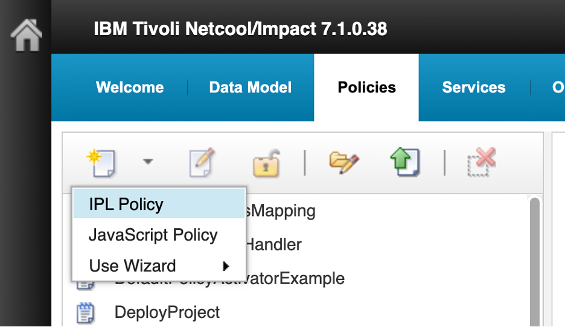

5. A blank IPL code editor opens titled **New IPL Policy**. Before entering any code, click the **Save** icon (floppy disk, top-left). A **Save** dialog appears with a single **Policy Name** field. Enter `AA_EnrichAlert` and click **Save**.

   > **Note:** The `AA_` prefix causes the policy to sort to the top of the alphabetical policy list, making it easy to find during this lab. This is a common convention when working in shared Impact environments that contain many pre-existing policies.

   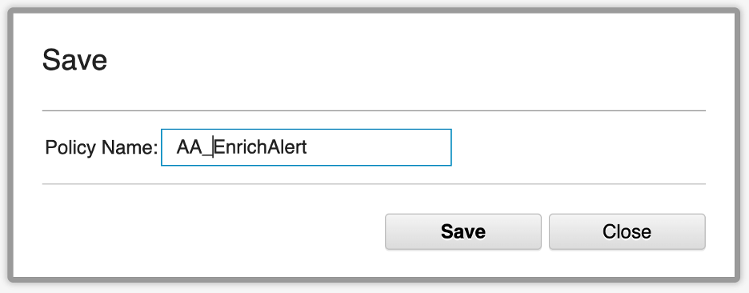

6. The editor tab updates to show `AA_EnrichAlert`. Notice that the policy now appears at the top of the policy list in the left pane with a **lock icon** (🔒) next to its name. The lock indicates that the policy is currently open for editing by you. Other users cannot edit it while it is locked. The lock is released when you close the editor tab.

   Now enter the following IPL code in the editor:

   ```ipl
   // Policy: AA_EnrichAlert
   //
   // Prerequisites:
   //   - CustomerID, Service, and ImpactFlag exist in the ObjectServer table.
   //   - Those fields are included in the OMNIbusEventReader event mapping.
   //   - DEVICE_INVENTORY is an Impact data type using the CMDB datasource.
   //   - DEVICE_INVENTORY exposes NODE_NAME, CUSTOMER_ID, and SERVICE.

   if (EventContainer.ImpactFlag != 0) {
       Log("AA_EnrichAlert: Serial=" + EventContainer.Serial
           + " already processed; ImpactFlag=" + EventContainer.ImpactFlag);
   } else {

       nodeValue = EventContainer.Node;

       Log("AA_EnrichAlert: enrichment started for Serial="+ EventContainer.Serial + ", Node=" + nodeValue);

       // Escape embedded single quotes before building the SQL filter string.
       nodeFilterValue = Replace(nodeValue, "'", "''");
       filter = "NODE_NAME = '" + nodeFilterValue + "'";

       // GetByFilter(DataType, Filter, CountOnly)
       inventoryRows = GetByFilter("DEVICE_INVENTORY", filter, False);

       if (Length(inventoryRows) > 0) {
           inventoryRow = inventoryRows[0];

           EventContainer.CustomerID = inventoryRow.CUSTOMER_ID;
           EventContainer.Service = inventoryRow.SERVICE;
           EventContainer.ImpactFlag = 1;

           Log("AA_EnrichAlert: enrichment applied for Serial=" + EventContainer.Serial
               + ", CustomerID=" + EventContainer.CustomerID
               + ", Service=" + EventContainer.Service);
       } else {
           EventContainer.CustomerID = "NOT_FOUND";
           EventContainer.Service = "NOT_FOUND";
           EventContainer.ImpactFlag = 2;

           Log("AA_EnrichAlert: no inventory record found for Serial="
               + EventContainer.Serial + ", Node=" + nodeValue
               + "; ImpactFlag set to 2");
       }

       ReturnEvent(EventContainer);
   }
   ```

   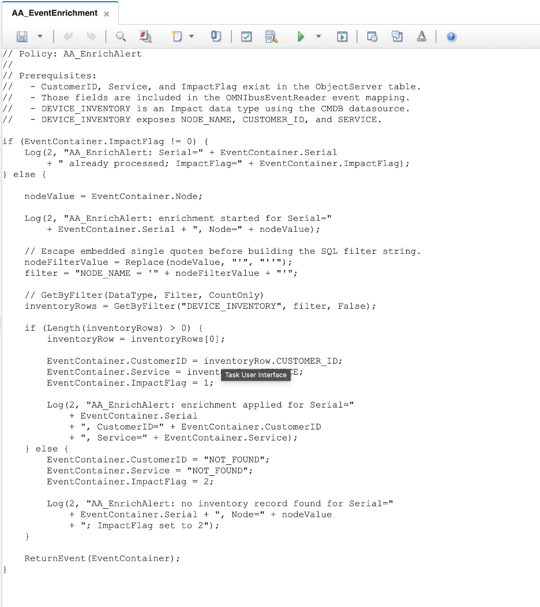

7. Before saving, click the **Syntax Check** icon in the toolbar (the green checkmark icon). The syntax checker parses the IPL code and reports any errors — mismatched braces, invalid function calls, or malformed expressions — without executing the policy. A successful check confirms the code is syntactically valid and ready to run. An **Information** dialog will appear with the message **Syntax check successful. No errors found.** Click **Close**.

   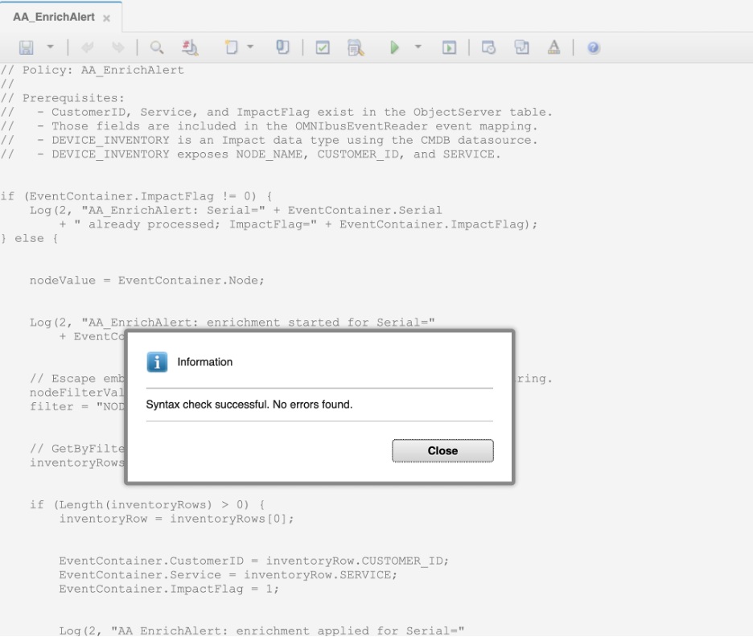

8. Click the **Save** icon to save the policy code. Confirm that `AA_EnrichAlert` appears at the top of the policies list in the left pane.

#### Validation

The exercise is successful when all of the following are true:

- The `ImpactFlag` column exists in `alerts.status` with type integer.
- The `AA_EnrichAlert` policy is saved and visible at the top of the policies list.
- You can explain the purpose of the `if (@ImpactFlag != 0)` guard at the top of the policy.
- You can describe the difference between `@FieldName` (direct field assignment) and the `GetByFilter` / `ReturnEvent` pattern used here.
- You can explain what `ImpactFlag` is set to in each outcome and why both non-zero values prevent re-processing.

#### Expected result

You now have a complete enrichment policy saved in Impact. It is not yet connected to a service, so it will not run automatically. The next exercise creates the OMNIbusEventReader service and wires it to this policy.

### 4.2 Create and configure the OMNIbusEventReader service

#### Objective

In this exercise, you will create an OMNIbusEventReader service, configure it to poll the ObjectServer, and assign the `AA_EnrichAlert` policy to it. By the end of the exercise, the service will be running and ready to trigger the policy when new alerts arrive.

#### Prerequisites

- Completion of section 4.1.
- The `AA_EnrichAlert` policy is saved and enabled.

#### Background

A policy on its own does nothing — it needs a service to trigger it. Impact supports several service types, each designed for a different trigger source or integration pattern:

| Service type | Trigger source | Typical use |
|---|---|---|
| **OMNIbusEventReader** | OMNIbus ObjectServer (`alerts.status`) | Event enrichment, correlation, escalation, ticket automation, suppression, and lifecycle processing. The standard service type for OMNIbus-to-Impact integrations. |
| **DatabaseEventReader** | External SQL database table or view | Polling a CMDB, inventory, or OSS table; importing workflow items; or reacting to externally staged events. |
| **PolicyActivator** | Time / schedule | Periodic housekeeping, aged-event escalation checks, cache refresh, CMDB synchronization, and reconciliation jobs. |
| **KafkaMessageListener** | Apache Kafka topics | Modern streaming and event-bus integration — telemetry, application events, or a CP4AIOps-adjacent event pipeline. |
| **JMSMessageListener** | JMS topic or queue | IBM MQ / WebSphere enterprise messaging integration. |
| **EmailReader** | POP3 or IMAP mailbox | Email-based acknowledgements, approval workflows, or ingestion from legacy systems that only emit email. |
| **EventListener** | Impact event-listener endpoint | Custom integrations where an external application submits an Impact-compatible event directly. |
| **OMNIbusEventListener** | OMNIbus AEN fast-track channels | Specialized low-latency handling for explicitly fast-tracked ObjectServer events. Legacy or special-purpose use. |

For enrichment, the **OMNIbusEventReader** is the right choice. When an alert appears or changes in `alerts.status` and matches the service's filter, the service passes all fields of that alert to the assigned policy through the `EventContainer` object. The service configuration has two tabs:

- **General Settings**: sets the service name, the ObjectServer data source to poll, and the polling interval.
- **Event Mapping**: defines one or more filter conditions that determine which events are matched, and maps each filter to the policy that should run when it matches. All fields of a matching event are automatically passed to the assigned policy.

#### Tasks

1. Select the **Services** tab from the top navigation bar. The services list will appear in the left pane.

2. In the toolbar at the top of the services list, click the **dropdown arrow** next to the New Service icon and select **OMNIbusEventReader**. The **New OMNIbusEventReader Service** configuration page opens showing the **General Settings** tab.

   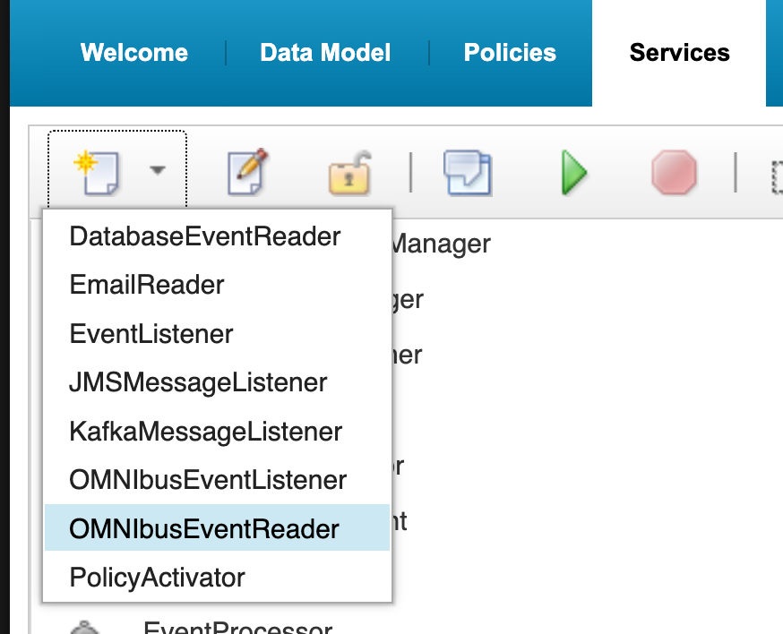

3. On the **General Settings** tab, configure the following:
   - **Service Name**: `EnrichmentEventReader`
   - **Data Source Name**: `defaultobjectserver`
   - **Polling Interval (milliseconds)**: `3000` (default)
   - Leave **Starts automatically when server starts** unchecked.

   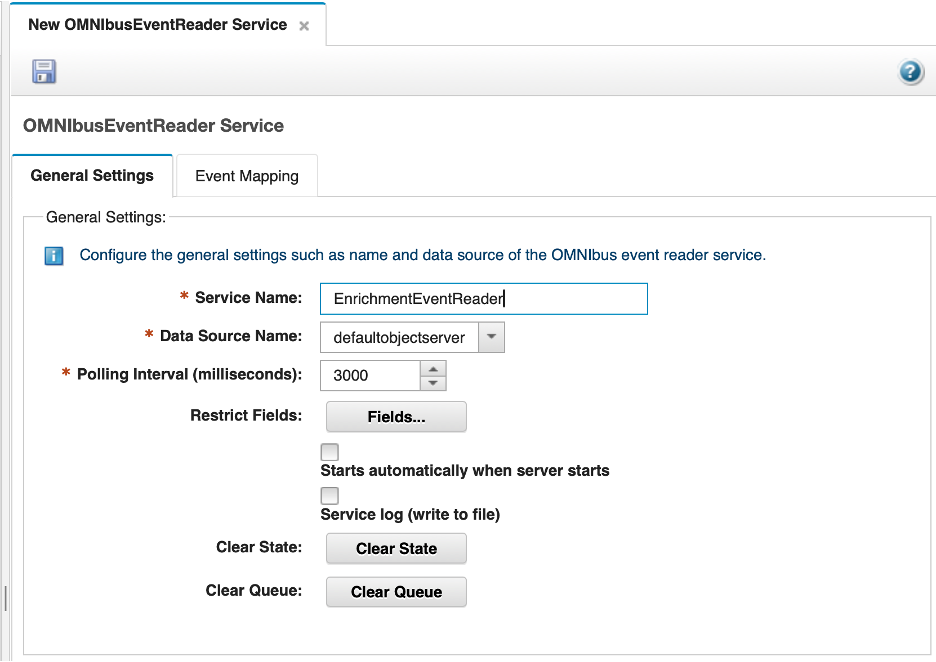

4. Click the **Event Mapping** tab. Review the sections:
   - **Event Matching**: leave set to **Stop testing after first match**.
   - **Action**: leave **Get updated events** and **Get Status Events** unchecked — the service will process newly created events only.
   - **Deletion** and **Event Locking**: leave at defaults.

5. In the **Event Mapping Table**, click **New** to add a mapping row. Configure the row as follows:
   - **Restriction Filter**: `ImpactFlag = 0`
   - **Policy Name**: select `AA_EnrichAlert` from the dropdown
   - **Active**: ensure this is checked

   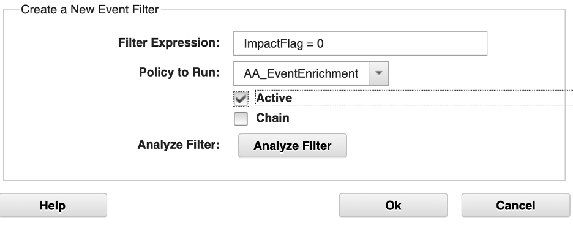

   Click **OK** to confirm the row.

   > **Note:** The filter `ImpactFlag = 0` targets only alerts that have not yet been processed by Impact. Once the policy runs and sets `ImpactFlag` to `1` or `2`, the alert no longer matches the filter and will not be re-processed on subsequent polling cycles.

   Confirm that the new row appears in the **Event Mapping Table** at the bottom of the page, showing `ImpactFlag = 0` in the Restriction Filter column and `AA_EnrichAlert` in the Policy Name column.

   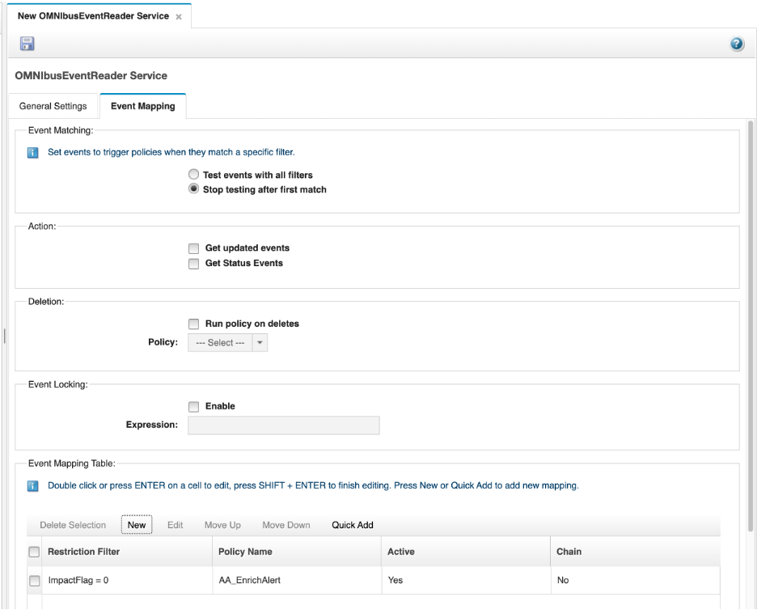

6. Click the **Save** icon (floppy disk, top-left) to save the service.

7. With the `EnrichmentEventReader` service selected in the left pane, click the **Start** button (green triangle in the toolbar) to start the service. Confirm the service state changes to **Running**.

   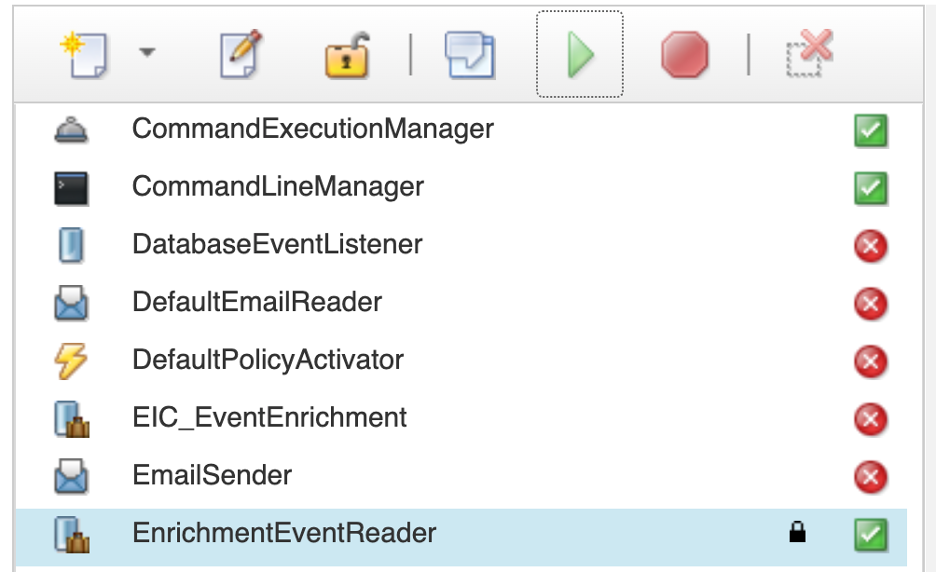

#### Validation

The exercise is successful when all of the following are true:

- The `EnrichmentEventReader` service is saved with data source `defaultobjectserver`.
- The Event Mapping Table contains one row: filter `ImpactFlag = 0` mapped to `AA_EnrichAlert`, Active.
- The service state is **Running**.
- You can explain why `ImpactFlag = 0` is a better filter than `Severity > 0` for an enrichment service.

#### Expected result

The enrichment pipeline is now active. Any new alert that enters the ObjectServer will have `ImpactFlag = 0` by default, which will be picked up by the service and passed to the `AA_EnrichAlert` policy. Once processed, `ImpactFlag` is updated and the alert is not re-processed.

### 4.3 Configure the policy logger

#### Objective

In this exercise, you will configure the Impact PolicyLogger service to write each policy's log output to its own dedicated log file. By the end of the exercise, any `Log()` call in a policy will write to a dedicated file under `$IMPACT_HOME/logs/`, making it straightforward to isolate and review the output from a specific policy without wading through a shared log.

#### Background

By default, all `Log()` calls from all policies write to the shared `ImpactServer.log` file. When several policies are running simultaneously, their output is interleaved and can be difficult to follow. The PolicyLogger service has an option — **Append policy name to log file name** — that causes each policy to write to its own file instead. With this option enabled, a policy named `AA_EnrichAlert` writes to `$IMPACT_HOME/logs/NCI_policylogger_AA_EnrichAlert.log`, a policy named `AA_EscalatePlatinum` writes to `$IMPACT_HOME/logs/NCI_policylogger_AA_EscalatePlatinum.log`, and so on. You configure this once and it applies to all policies on the server.

#### Prerequisites

- Completion of section 4.2.
- You are logged in to the Impact GUI in your private browser window.

#### Tasks

1. Select the **Services** tab from the top navigation bar.

2. In the services list, locate the **PolicyLogger** service. It is a built-in service that is present on every Impact server by default.

   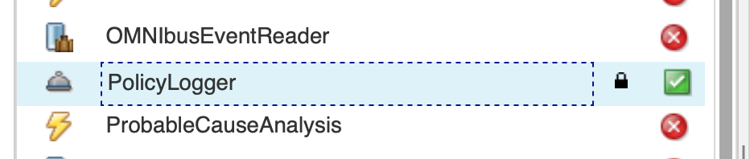

3. Double-click the **PolicyLogger** service to open its configuration page.

4. Check the **Append policy name to log file name** checkbox.

   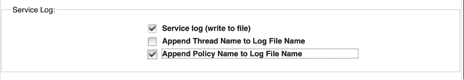

5. Click the **Save** icon (floppy disk, top-left) to save the configuration.

6. SSH into the lab server as root and stop the Impact server:

   ```bash
   $IMPACT_HOME/bin/stopImpactServer.sh
   ```

   Wait for the command to return. The Impact GUI session in your browser will become unresponsive — this is expected.

7. Start the Impact server:

   ```bash
   $IMPACT_HOME/bin/startImpactServer.sh
   ```

   You should see:

   ```
   Starting server NCI.
   Server NCI started with process ID 526361.
   ```

   > **Note:** The process ID in your output will differ from the example above.

   Wait approximately 60 seconds, then refresh the Impact GUI in your private browser window and log back in as `impactadmin` / `netcool`. Confirm that the **Services** tab shows the `PolicyLogger` and `EnrichmentEventReader` services in a **Running** state.


#### Validation

The exercise is successful when all of the following are true:

- The **Append policy name to log file name** checkbox is checked and saved.
- The Impact server has been restarted and the GUI is accessible.
- The `PolicyLogger` and `EnrichmentEventReader` services are both in a **Running** state after the restart.
- You can explain why per-policy log files are more useful than a single shared log when multiple policies are running.

#### Expected result

From this point on, every `Log()` call in any policy will write to a dedicated file in `$IMPACT_HOME/logs/`. When you run test events in the next exercise, you will be able to check `$IMPACT_HOME/logs/NCI_policylogger_AA_EnrichAlert.log` directly to see the output from the enrichment policy.

### 4.4 Run test events and validate enrichment

#### Objective

In this exercise, you will insert test events into the ObjectServer and confirm that the `AA_EnrichAlert` policy correctly enriches matching alerts and handles nodes with no inventory record.

#### Prerequisites

- Completion of section 4.3.
- The `EnrichmentEventReader` service is running.
- The `DEVICE_INVENTORY` table in the `CMDB` database is populated (section 2.2).

#### Tasks

1. Return to your original OMNIbus Web GUI browser window (non-private) at `https://<your-server>:16311/ibm/console`. Log in as `ncoadmin` with password `netcool` if your login has timed out.


2. Open the event viewer again, and create an event filter named `ImpactLabEvents` with the condition `Manager = 'ImpactLab'` and apply it.

3. Create an event view named `EnrichmentView` with the following columns in order: `Severity`, `Acknowledged`, `Customer`, `Location`, `Service`, `Node`, `Summary`, `FirstOccurrence`, `Contact`. Apply it.

4. SSH into the lab server. Switch to the `db2inst1` user and confirm that `db-tok-01` exists in the `DEVICE_INVENTORY` table:

   ```bash
   su - db2inst1
   ```

   Then run:

   ```bash
   db2 "CONNECT TO CMDB"
   db2 "SELECT NODE_NAME, CUSTOMER_ID, SERVICE FROM DEVICE_INVENTORY WHERE NODE_NAME = 'db-tok-01'"
   ```

   You should see one row with `CUSTOMER_ID = CUST-1005` and `SERVICE = Database Services`. This record was inserted in section 2.2.

5. Type `exit` to return to your root shell, then use the `nco_sql` tool to insert a test alert for `db-tok-01` into the ObjectServer:
   ```bash
   $OMNIHOME/bin/nco_sql -server EVENTS -user root -password netcool << 'EOF'
   INSERT INTO alerts.status (Node, Summary, AlertKey, AlertGroup, Severity, Type, Identifier, Manager, OwnerUID)
   VALUES ('db-tok-01', 'Enrichment test event', 'enrich-key-01', 'TrainingAlerts', 4, 1, 'db-tok-01:enrich-key-01:TrainingAlerts', 'ImpactLab', 65534);
   go
   EOF
   ```
   Confirm you see that one row has been affected (your insert).
   

6. Switch to the OMNIbus Web GUI. The `db-tok-01` alert should appear in the `ImpactLabEvents` filter view. Within a few seconds the enrichment fields should populate. Confirm that the `Enrichment View` columns show:
   - `Customer` shows `CUST-1005`
   - `Service` shows `Database Services`

   Double-click the alert to open the full event details and confirm `ImpactFlag` shows `1`.

   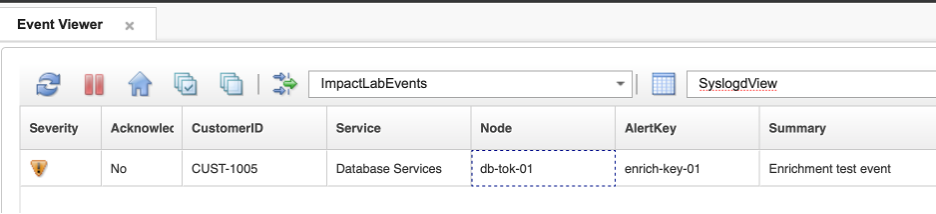

7. Check the policy log to confirm the enrichment message was written:
   ```bash
   tail -30 $IMPACT_HOME/logs/NCI_policylogger_AA_EnrichAlert.log
   ```
   Look for: `AA_EnrichAlert: enrichment applied for Serial=..., CustomerID=CUST-1005, Service=Database Services`

8. Now test the not-found path. Insert a test alert for a node that does not exist in the inventory:
   ```bash
   $OMNIHOME/bin/nco_sql -server EVENTS -user root -password netcool << 'EOF'
   INSERT INTO alerts.status (Node, Summary, AlertKey, AlertGroup, Severity, Type, Identifier, Manager, OwnerUID)
   VALUES ('unknownhost99', 'Event from unknown node', 'unknown-key-01', 'TrainingAlerts', 3, 1, 'unknownhost99:unknown-key-01:TrainingAlerts', 'ImpactLab', 65534);
   go
   EOF
   ```

9. In the event list, locate the `unknownhost99` alert and confirm the `Enrichment View` columns show:
   - `Customer` shows `NOT_FOUND`
   - `Service` shows `NOT_FOUND`

   Double-click the alert and confirm `ImpactFlag` shows `2`.

   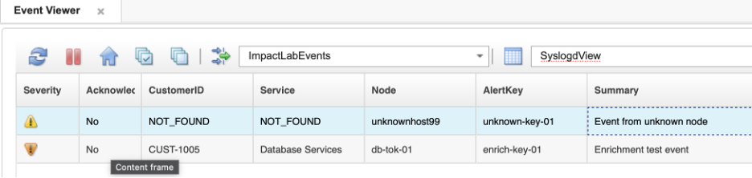

10. Confirm in the policy log that the warning message was written:
    ```bash
    tail -30 $IMPACT_HOME/logs/NCI_policylogger_AA_EnrichAlert.log
    ```
    Look for: `AA_EnrichAlert: no inventory record found for Serial=..., Node=unknownhost99; ImpactFlag set to 2`

#### Validation

The exercise is successful when all of the following are true:

- A test alert for `db-tok-01` results in `CustomerID = CUST-1005`, `Service = Database Services`, and `ImpactFlag = 1` on the alert.
- The Impact server log shows the enrichment confirmation message for `db-tok-01`.
- A test alert for `unknownhost99` results in `CustomerID = NOT_FOUND`, `Service = NOT_FOUND`, and `ImpactFlag = 2` on the alert.
- The Impact server log shows the warning message for `unknownhost99`.
- You can describe the complete path an event takes from ObjectServer insertion to enriched alert: probe → `alerts.status` → OMNIbusEventReader service → `AA_EnrichAlert` policy → `ReturnEvent` → updated alert.
- You can explain what the three `ImpactFlag` values mean and why this pattern prevents re-processing.

#### Expected result

You now have a working end-to-end event enrichment pipeline. New alerts that arrive in the ObjectServer are automatically enriched with customer and service context within seconds of insertion, without any manual intervention. This is the core automation pattern that Impact is built around.
