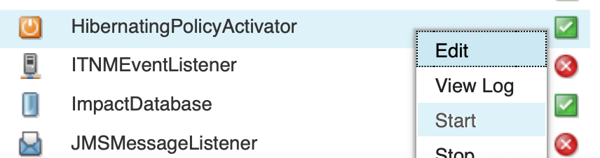
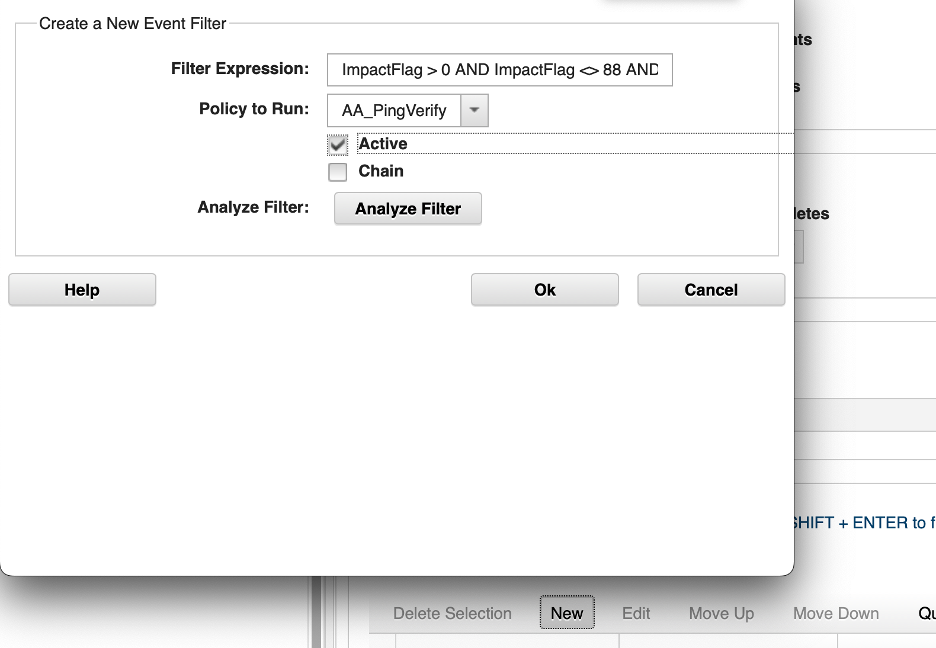
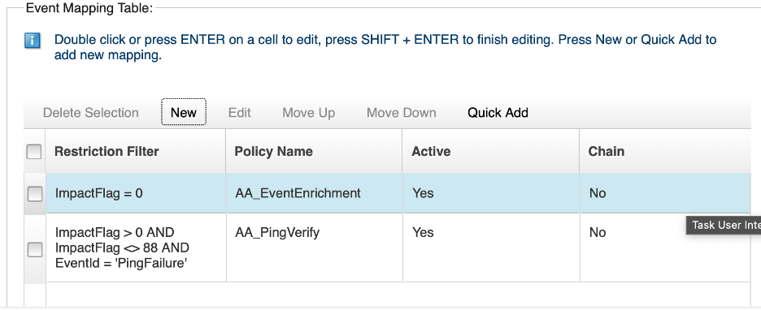
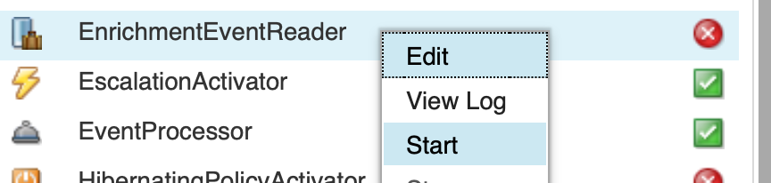
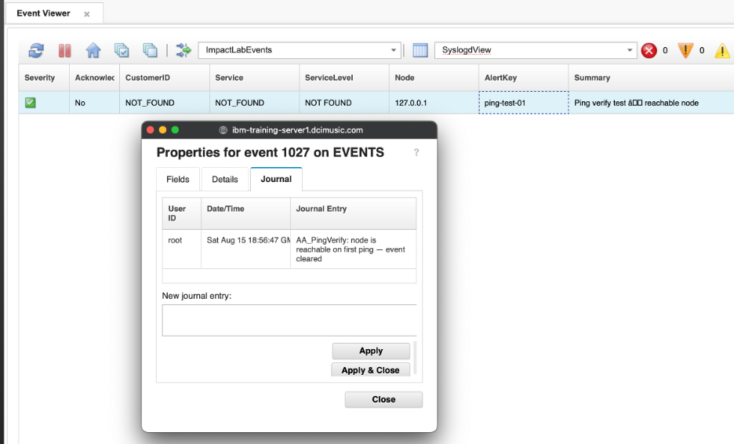
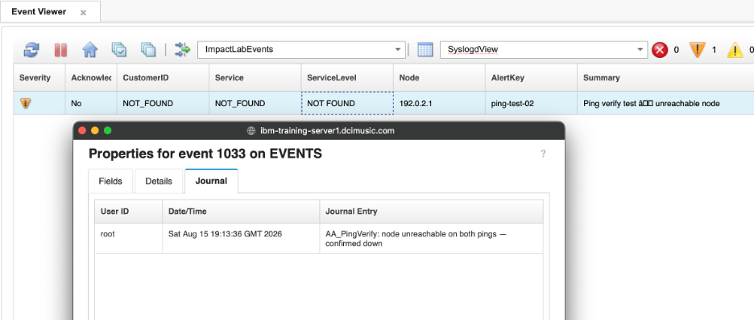

## 7. Automation and hibernation

Not every alert that arrives in the ObjectServer represents a genuine, persistent fault. Network devices can throw transient errors that clear within seconds — a momentary link flap, a brief CPU spike, or a probe timeout that does not repeat. Treating every one of these as a real incident wastes operator time and generates noise.

Impact can handle this automatically using **hibernation**. A policy can set a flag on an event, pause mid-execution for a specified number of seconds, and then resume exactly where it left off — at which point it can re-test the condition and decide what to do. This section uses a ping verification scenario to demonstrate the pattern: when a down event is received, Impact pings the node immediately, waits 60 seconds, and pings again. Only if the node is still unreachable after the second check does the event remain open.

This section also introduces **JRExecAction**, the IPL function for running local commands and scripts on the Impact server and capturing their output.

### 7.1 Write the hibernation ping policy

#### Objective

In this exercise, you will write a policy that pings the node from a down event, hibernates for 60 seconds if the first ping fails, pings again after waking up, and updates the event with a journal entry recording the outcome. By the end of the exercise, you will understand how `Hibernate`, `RemoveHibernation`, `JRExecAction`, and a re-entry guard work together in a single policy.

#### Prerequisites

- Completion of sections 4 and 5.
- The `ImpactFlag` integer field exists in `alerts.status` (added in section 4.1). Verify with:

  ```bash
  $OMNIHOME/bin/nco_sql -server EVENTS -user root -password netcool << 'EOF'
  describe alerts.status;
  go
  EOF
  ```

  Confirm `ImpactFlag` appears as an `INTEGER` column. If it is missing, add it:

  ```bash
  $OMNIHOME/bin/nco_sql -server EVENTS -user root -password netcool << 'EOF'
  ALTER TABLE alerts.status ADD COLUMN ImpactFlag INTEGER;
  go
  EOF
  ```

- The `HibernatingPolicyActivator` service is running. This service is not started by default and must be started manually before any policy that uses `Hibernate` can wake up. In the Impact GUI, select the **Services** tab, locate `HibernatingPolicyActivator` in the list, right-click it, and select **Start**. Confirm the state changes to **Running**.

  

- The `nci_jrexec` process is running on the Impact server. This is a background process launched from the command line — it does not appear in the Impact GUI Services tab. SSH into the lab server and run:

  ```bash
  nohup "$IMPACT_HOME/bin/nci_jrexec" \
    > "$IMPACT_HOME/logs/nci_jrexec.out" 2>&1 &
  ps -ef | grep '[n]ci_jrexec'
  ```

  The `ps` output should show a running `nci_jrexec` process. If no output is returned, the process did not start — check `$IMPACT_HOME/logs/nci_jrexec.out` for errors.

- The value of the `Node` field in your test events must be pingable from the Impact server (or deliberately unpingable, to test the down path).

#### Background

##### JRExecAction

`JRExecAction` runs a local command on the Impact server and returns the output as a string:

```ipl
output = JRExecAction("/path/to/command", {arg1, arg2, ...}, false, timeoutSeconds);
```

For ping, the command path is `/usr/sbin/ping` and the node name is passed as the first argument. The output string will contain the full ping response, including newline characters. Use `Strip(output, "\n")` to collapse newlines before doing a pattern match.

##### Hibernate and RemoveHibernation

```ipl
Hibernate(ActionKey, Reason, TimeoutSeconds);
```

`Hibernate` suspends the executing policy thread at that exact line for `TimeoutSeconds` seconds. When the timer expires, execution continues on the very next line — the policy does not restart. All variables set before `Hibernate` are still available after waking up.

- `ActionKey` must be a unique string across all simultaneously hibernating policies. A common pattern combines a fixed prefix with `GetDate()` in combination with the `Identifier` field of the alert to make it unique per invocation.
- `Reason` is a descriptive string written to the audit log. It can be `null`.
- `RemoveHibernation(ActionKey)` cleans up the hibernation record after the policy resumes. Always call it.

The `HibernatingPolicyActivator` service manages the hibernation timer queue. Without it running, policies that call `Hibernate` will sleep indefinitely.

##### Re-entry guard

The OMNIbusEventReader fires on every insert or update to a matching event. If the policy sets `ImpactFlag = 88` and calls `ReturnEvent` *before* hibernating, that write triggers an update on the event — which would normally cause the EventReader to fire again. Setting `ImpactFlag = 88` as the guard value ensures the sleeping event is excluded by the `ImpactFlag <> 88` clause in the ping mapping filter, preventing the policy from being triggered a second time on the same event while it sleeps.

##### Ping output pattern

On Linux/Unix, a successful `ping` produces output that includes `0% packet loss` when the host responds. The `Strip` + `like` pattern used in the policy collapses newlines and then matches against this string:

```ipl
If (Strip(PingOutput, "\n") like ".*received, 0% packet loss.*")
```

#### Tasks

1. Select the **Policies** tab from the top navigation bar. In the toolbar, click the **dropdown arrow** next to the New Policy icon and select **IPL Policy**.

2. Click the **Save** icon, enter `AA_PingVerify` in the **Policy Name** field, and click **Save**.

3. Enter the following policy code in the editor:

   ```ipl
   /*
    * Policy: AA_PingVerify
    * Purpose: When a down event is received, ping the node immediately.
    *          If the first ping fails, hibernate for 60 seconds then ping again.
    *          Update the event with a journal entry recording the outcome.
    *          ImpactFlag values:
    *            0 = unprocessed (EventReader filter target)
    *           88 = in progress (set before hibernating — excluded by mapping filter)
    *            2 = processing complete
    * Trigger: OMNIbusEventReader (event-driven).
    */

   /* Set ImpactFlag = 88 immediately to prevent the EventReader from
    * re-triggering this policy while it is sleeping. */

   EventContainer.ImpactFlag = 88;
   ReturnEvent(EventContainer);

   Log("AA_PingVerify: first ping attempt for Node=" + EventContainer.Node);

   /* Ping the node. Output is returned as a string. */

   PingOutputOne = JRExecAction("/usr/sbin/ping", { "-c", "1", "-W", "2", EventContainer.Node}, false, 120);

   /* Strip newlines and check whether the node responded. */

   if (Strip(PingOutputOne, "\n") like ".*received, 0% packet loss.*") {

       /* Node is reachable — clear the event and mark complete. */

       EventContainer.Severity = 0;
       EventContainer.JournalEntry = "AA_PingVerify: node is reachable on first ping — event cleared";

       Log("AA_PingVerify: Node=" + EventContainer.Node + " is alive on first ping");

   } else {

       /* First ping failed — hibernate for 60 seconds then try again. */

       Log("AA_PingVerify: Node=" + EventContainer.Node + " did not respond — hibernating 60s");

       ActionKey = "PingVerify:" + EventContainer.Identifier + GetDate();
       WaitTime = 60;
       Hibernate(ActionKey, "Waiting 60s before second ping", WaitTime);

       /* ---- Policy resumes here after 60 seconds ---- */

       Log("AA_PingVerify: woke up — second ping attempt for Node=" + EventContainer.Node);

       PingOutputTwo = JRExecAction("/usr/sbin/ping", { "-c", "1", "-W", "2", EventContainer.Node}, false, 120);

       if (Strip(PingOutputTwo, "\n") like ".*received, 0% packet loss.*") {

           /* Node recovered during the wait — clear the event. */

           EventContainer.Severity = 0;
           EventContainer.JournalEntry = "AA_PingVerify: node recovered — alive on second ping";

           Log("AA_PingVerify: Node=" + EventContainer.Node + " recovered on second ping");

       } else {

           /* Node is still unreachable — increase severity, mark complete. */
           if(EventContainer.Severity == 5) {
            EventContainer.Flash = 1;
           } else {
            EventContainer.Severity = EventContainer.Severity + 1;
           }
           EventContainer.JournalEntry = "AA_PingVerify: node unreachable on both pings — confirmed down";

           Log("AA_PingVerify: Node=" + EventContainer.Node + " still unreachable after second ping");
       }

       RemoveHibernation(ActionKey);
   }

   /* Commit all field changes back to the ObjectServer. */

   ReturnEvent(EventContainer);
   ```

4. Click the **Syntax Check** icon. Confirm the **Syntax check successful** dialog appears, then click **Close**.

5. Click the **Save** icon. Confirm `AA_PingVerify` appears in the policy list.

### 7.2 Configure the EnrichmentEventReader to trigger the ping policy

#### Objective

In this exercise, you will extend the existing `EnrichmentEventReader` service to also trigger `AA_PingVerify`. Rather than creating a new service, you will enable **Get Updated Events** on the service and add a second event mapping row that targets enriched ping-failure events by their `EventId` and `ImpactFlag` value. By the end of the exercise, a single OMNIbusEventReader handles both the enrichment mapping and the ping verification mapping.

#### Prerequisites

- Completion of section 7.1.
- The `AA_PingVerify` policy is saved.
- The `EnrichmentEventReader` service exists and is running (created in section 4.2).

#### Background

An OMNIbusEventReader service can hold multiple rows in its Event Mapping table. Each row has its own filter and its own policy. When an event is inserted or updated, the service evaluates every row in order and invokes the policy for each row whose filter matches.

By default, an OMNIbusEventReader only fires on **inserted** events. Enabling **Get Updated Events** causes it to also fire whenever an existing event is updated — which is necessary here because `AA_PingVerify` is triggered by an update to an already-enriched event (when `ImpactFlag` is written back by `AA_EnrichAlert`), not by the original insert.

The filter `ImpactFlag > 0 AND ImpactFlag <> 88 AND EventId = 'PingFailure'` targets events that:

- Have already been processed by the enrichment policy (`ImpactFlag > 0` — not new/unprocessed)
- Have not been excluded by an administrative hold (`ImpactFlag <> 88` — a sentinel value reserved for events that should be left alone)
- Specifically identify themselves as ping failure events (`EventId = 'PingFailure'`)

This means `AA_PingVerify` will only run on events that have been enriched first and carry the `PingFailure` identifier — not on every event the service sees.

#### Tasks

1. Select the **Services** tab from the top navigation bar. Double-click `EnrichmentEventReader` to open it.

2. In the **Event Mapping** tab, check the **Get Updated Events** checkbox to enable firing on event updates as well as inserts.

3. In the Event Mapping table, add a second mapping row beneath the existing `AA_EnrichAlert` row:
   - **Filter**: `ImpactFlag > 0 AND ImpactFlag <> 88 AND EventId = 'PingFailure'`
   - **Policy**: `AA_PingVerify`

   

4. Confirm the Event Mapping table now shows both rows — the original `AA_EnrichAlert` row and the new `AA_PingVerify` row with its filter:

   

5. Click the **Save** icon to save the service changes.

6. Right-click `EnrichmentEventReader` and select **Stop**. Wait for the state to change to **Stopped**, then right-click again and select **Start**. Confirm the state returns to **Running**.

   

   > **Note:** A stop/start is required whenever you change an OMNIbusEventReader's Event Mapping configuration. The service loads its mapping table at startup; changes made while the service is running do not take effect until it is restarted.

#### Validation

The exercise is successful when all of the following are true:

- The `EnrichmentEventReader` service has **Get Updated Events** enabled.
- The Event Mapping table contains two rows: the existing `AA_EnrichAlert` row and the new `AA_PingVerify` row with filter `ImpactFlag > 0 AND ImpactFlag <> 88 AND EventId = 'PingFailure'`.
- The service has been stopped and restarted and is in **Running** state.
- The `HibernatingPolicyActivator` service is **Running** and the `nci_jrexec` process is running on the Impact server.
- You can explain why **Get Updated Events** is needed for this mapping.
- You can explain what `ImpactFlag <> 88` guards against.

### 7.3 Validate the hibernation policy

#### Objective

In this exercise, you will insert test events for a reachable node and an unreachable node and observe the policy outcome in both cases. You will also verify the hibernation behavior through the policy log.

#### Prerequisites

- Completion of section 7.2.
- At least one hostname that is pingable from the Impact server and one that is not.

#### Background

Test events need `EventId = 'PingFailure'` set at insert time so the `EnrichmentEventReader` mapping filter matches them. The enrichment policy (`AA_EnrichAlert`) runs first (on `ImpactFlag = 0`), sets `ImpactFlag = 1`, and calls `ReturnEvent`. That update then triggers the second mapping row, which fires `AA_PingVerify` because `ImpactFlag > 0 AND ImpactFlag <> 88 AND EventId = 'PingFailure'` now matches. A ping falure alert that is hibernating will have their ImpactFlag set to 88 to ensure it is not processed whilst already being worked on.

#### Tasks

1. In the OMNIbus Web GUI (open in your private/incognito browser), navigate to the **Event Viewer**. Select the **ImpactLab Events** filter and the **SyslogdView** view. Leave this window visible so you can observe events being processed in real time as you work through the tasks below.

2. Insert a test event for a **reachable** node. Use `localhost` — the Impact server can always ping itself:

   ```bash
   $OMNIHOME/bin/nco_sql -server EVENTS -user root -password netcool << 'EOF'
   INSERT INTO alerts.status (Node, Summary, AlertKey, AlertGroup, Severity, Type, Identifier, Manager, OwnerUID, EventId)
   VALUES ('127.0.0.1', 'Ping verify test — reachable node', 'ping-test-01', 'TrainingAlerts', 3, 1, 'localhost:ping-test-01:TrainingAlerts', 'ImpactLab', 65534, 'PingFailure');
   go
   EOF
   ```

3. Wait 30–60 seconds for enrichment to run, then wait a further 30–60 seconds for `AA_PingVerify` to complete. Check the event in the OMNIbus Web GUI. Confirm:
   - `Severity` has been set to `0` (cleared).
   - `ImpactFlag` is `2`.
   - The journal entry reads `AA_PingVerify: node is reachable on first ping — event cleared`.

   

   This event was cleared on the first ping without hibernating.

4. Insert a test event for an **unreachable** node:

   ```bash
   $OMNIHOME/bin/nco_sql -server EVENTS -user root -password netcool << 'EOF'
   INSERT INTO alerts.status (Node, Summary, AlertKey, AlertGroup, Severity, Type, Identifier, Manager, OwnerUID, EventId)
   VALUES ('192.0.2.1', 'Ping verify test — unreachable node', 'ping-test-02', 'TrainingAlerts', 3, 1, '192.0.2.1:ping-test-02:TrainingAlerts', 'ImpactLab', 65534, 'PingFailure');
   go
   EOF
   ```

   > **Note:** `192.0.2.1` is from the TEST-NET-1 range (RFC 5737), reserved for documentation and unlikely to be routable in most environments. However, depending on your network configuration it may respond. If the policy clears the event instead of hibernating, choose a different address that is definitively unreachable from the Impact server and repeat this task with that address.

5. Watch the policy log to observe the hibernation in real time:

   ```bash
   tail -f $IMPACT_HOME/logs/NCI_policylogger_AA_PingVerify.log
   ```

   You should see the following sequence of entries:
   - `AA_PingVerify: first ping attempt for Node=192.0.2.1`
   - `AA_PingVerify: Node=192.0.2.1 did not respond — hibernating 60s`
   - *(~60 second pause)*
   - `AA_PingVerify: woke up — second ping attempt for Node=192.0.2.1`
   - `AA_PingVerify: Node=192.0.2.1 still unreachable after second ping`

   Press `Ctrl+C` to stop tailing the log once you have seen all entries.

6. After the policy completes, confirm in the OMNIbus Web GUI that:
   - `Severity` has been raised from `3` to `4` (the policy bumped it on the confirmed-down path).
   - The journal entry reads `AA_PingVerify: node unreachable on both pings — confirmed down`.

   

#### Validation

The exercise is successful when all of the following are true:

- `127.0.0.1` was enriched, then resolved on the first ping and the event was cleared immediately (no hibernation).
- `192.0.2.1` was enriched, failed both pings, and the policy log shows the 60-second gap between ping attempts.
- After the second failed ping, the event severity was raised by one and the correct journal entry was set.
- A second `192.0.2.1` event triggered the full pipeline again.
- You can explain why `EventId = 'PingFailure'` must be set in the insert for the mapping filter to match.
- You can explain why **Get Updated Events** is required for `AA_PingVerify` to fire.
- You can explain why `ImpactFlag = 88` is set and `ReturnEvent` is called *before* `Hibernate`.
- You can explain what would happen if `RemoveHibernation` were not called.
- You can explain why the `HibernatingPolicyActivator` service must be running.

#### Expected result

You have built a verification loop that uses hibernation to add a deliberate delay between two checks. Events for genuinely reachable nodes are cleared on the first pass with no hibernation at all. Events for truly unreachable nodes go through the full 60-second wait, re-check, and are confirmed as down. The same guard-hibernate-resume-cleanup pattern applies to any scenario where a policy needs to wait before acting — retry logic, deferred notifications, or staged remediation workflows.
