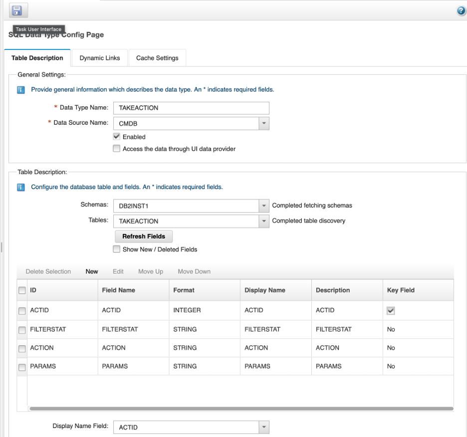
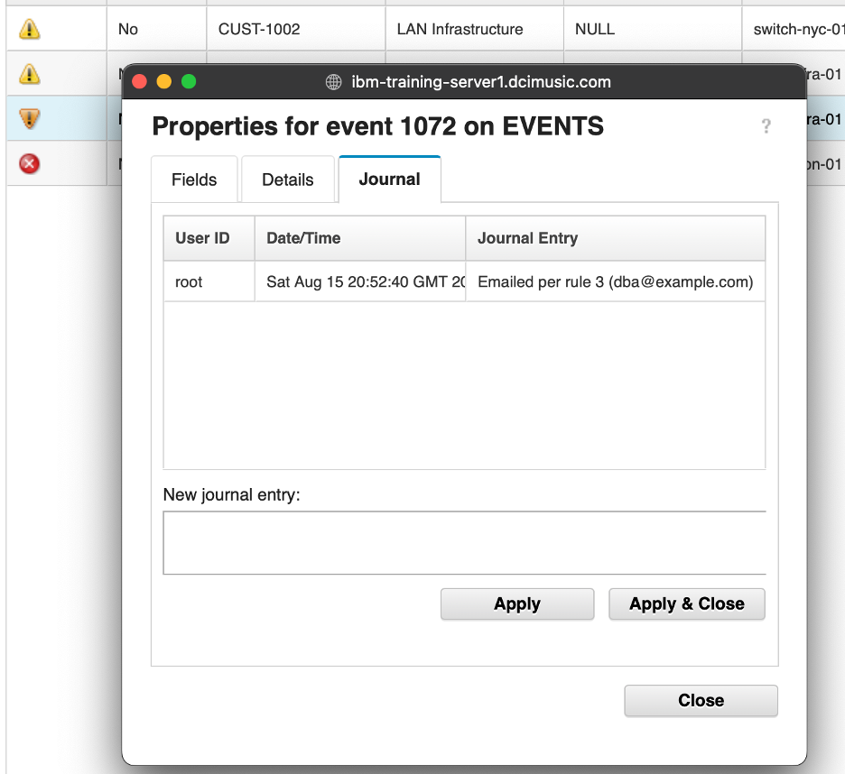

## 9. Using the Eval function

The `Eval` function evaluates an IPL filter expression against an event or object at runtime, returning `true` if the object matches the expression and `false` if it does not. This inverts the normal query direction: instead of querying a data source for records that match a known filter, you query for *filter expressions* and test the current event against each one.

The practical effect is powerful: you can drive policy behavior entirely from a database table. Adding a new row to the table adds a new action rule — no policy edits required. This makes `Eval`-based policies suitable for environments where the rules change frequently or need to be managed by operators rather than developers.

This section builds a data-driven event action policy. A `TAKEACTION` table in the existing DB2 CMDB database holds filter expressions and associated action types. For each incoming event, the policy loops through the table, evaluates the event against each filter, and takes the corresponding action if a match is found.

### 9.1 Prepare the data source

#### Objective

In this exercise, you will create the `TAKEACTION` table in the existing DB2 CMDB database, create a matching Impact data type, and populate the table with two test rules. By the end of the exercise, you will have a data-driven rule store that the escalation policy can query.

#### Prerequisites

- Completion of sections 4 through 6.
- The `CMDB` DB2 DSA is configured and connected.
- You are logged in to the Impact GUI and have SSH access to the lab server.

#### Background

The `TAKEACTION` table stores one row per action rule. Each row contains:

| Column | Type | Purpose |
|---|---|---|
| `ACTID` | INTEGER | Primary key — uniquely identifies the rule |
| `FILTERSTAT` | VARCHAR(255) | An IPL filter expression evaluated against each event |
| `ACTION` | VARCHAR(32) | What to do when the filter matches (`email` or `suppress`) |
| `PARAMS` | VARCHAR(255) | Action-specific parameters (see below) |

For the `email` action, `PARAMS` contains the recipient address and email subject separated by a `|` character:

```
oncall@example.com|Alert on @Node: @Summary
```

For the `suppress` action, `PARAMS` contains the integer value to write to the `SuppressEscl` field (e.g. `4` for suppressed).

#### Tasks

1. SSH into the lab server and switch to the DB2 instance user:

   ```bash
   su - db2inst1
   ```

2. Create the `TAKEACTION` table in the `CMDB` database:

   ```bash
   db2 connect to CMDB
   db2 "CREATE TABLE TAKEACTION (
       ACTID     INTEGER NOT NULL PRIMARY KEY,
       FILTERSTAT VARCHAR(255),
       ACTION    VARCHAR(32),
       PARAMS    VARCHAR(255)
   )"
   db2 connect reset
   ```

   You should see `DB20000I  The SQL command completed successfully.` after the `CREATE TABLE` statement.

3. Insert two test rules:

   ```bash
   db2 connect to CMDB
   db2 "INSERT INTO TAKEACTION VALUES (1,
       '(Node=\"router-lon-01\") AND (Severity=5)',
       'email',
       'oncall@example.com|Critical alert on router-lon-01')"
   db2 "INSERT INTO TAKEACTION VALUES (2,
       '(Node=\"switch-nyc-01\") AND (Severity=3)',
       'suppress',
       '4')"
   db2 connect reset
   exit
   ```

   Rule 1 sends an email when `router-lon-01` reaches severity 5. Rule 2 suppresses events from `switch-nyc-01` at severity 3 by setting `SuppressEscl = 4`.

4. In the Impact GUI, create a data type for the new table:

   - Select the **Data Model** tab.
   - Locate the `CMDB` DSA in the left-hand tree, right-click it, and select **New Data Type**.
   - Set **Data Type Name** to `TAKEACTION`.
   - Set **Table** to `TAKEACTION`.
   - Click on the **Refresh Fields** button
   - Mark `ACTID` as the **Key** field.
   - Click **Save**.

   

#### Validation

The exercise is successful when all of the following are true:

- The `TAKEACTION` table exists in the `CMDB` database with four columns.
- Both rows are present in the table.
- The `TAKEACTION` data type is visible in the Impact Data Model under the `CMDB` DSA.
- You can explain why the filter expressions in `FILTERSTAT` use escaped double quotes (`\"`) when inserted from the DB2 command line.

#### Expected result

The `TAKEACTION` table is ready to use as a rule store. The next exercise writes the policy that queries this table and uses `Eval` to match each rule against the incoming event.

### 9.2 Write the Eval-based action policy

#### Objective

In this exercise, you will write a policy that queries the `TAKEACTION` table, loops through every row, and evaluates the `FILTERSTAT` expression against the current event using `Eval`. When a match is found, the policy executes the corresponding action — either sending an email or suppressing the event. By the end of the exercise, you will understand how `Eval` inverts the normal query direction and why this pattern is useful for data-driven automation.

#### Prerequisites

- Completion of section 9.1.
- The `TAKEACTION` data type is configured in the Impact Data Model.
- The `NotifyFlag` integer field has been added to `alerts.status` and the `EVENTS` data type has been refreshed in Impact. Complete both steps now:

  **1. Add the column to the ObjectServer:**

  ```bash
  $OMNIHOME/bin/nco_sql -server EVENTS -user root -password netcool << 'EOF'
  ALTER TABLE alerts.status ADD COLUMN NotifyFlag INTEGER;
  go
  EOF
  ```

  You should see `0 rows affected.` confirming the column was added.

  **2. Refresh the EVENTS data type in Impact:**

  - In the Impact GUI, select the **Data Model** tab.
  - Locate the `EVENTS` data type in the left-hand tree under the `defaultobjectserver` data source and double-click on it to bring up its configuration
  - In the **Table Description** section of the data type configuration page, click **Refresh Fields**.
  - Confirm that `NotifyFlag` now appears in the field list.
  - Click **Save** and close the EVENTS configuration tab.

#### Background

##### EmailSender configuration

In a production environment, the `email` action path would call `SendEmail` via a configured **EmailSender** service in Impact. To set one up, you would go to **Services → New Service → EmailSender** and supply the SMTP host, port, sender address, and credentials. In this lab the SMTP infrastructure is not available, so `SendEmail` is commented out in the policy below and replaced with a `Log` statement that records what the call *would* have done. The functional behavior of the `Eval` loop, the `Split`, and the action dispatch is identical — only the final delivery step is simulated.

##### How Eval works

```ipl
Eval(filterExpression, objectToEvaluate)
```

`Eval` takes a string containing an IPL filter expression and an object (typically `EventContainer` or a row returned by `GetByFilter`) and returns `true` if the object satisfies the expression, `false` otherwise.

The filter expressions stored in `TAKEACTION.FILTERSTAT` use the same syntax as OMNIbusEventReader event mappings — field names, comparison operators, `AND`, `OR`, `LIKE`, etc. This means the same filter language you use when configuring services can be driven from a database row.

##### Why this pattern scales

Without `Eval`, adding a new action rule means editing a policy — checking the code into source control, testing, deploying. With `Eval`, adding a rule means inserting a row into a table. The policy itself never changes. This separation of logic (the policy) from configuration (the table) is one of the most powerful patterns in Impact automation.

#### Tasks

1. Select the **Policies** tab from the top navigation bar. In the toolbar, click the **dropdown arrow** next to the New Policy icon and select **IPL Policy**.

2. Click the **Save** icon, enter `AA_EvalActionPolicy` in the **Policy Name** field, and click **Save**.

3. Enter the following policy code in the editor:

   ```ipl
   /*
    * Policy: AA_EvalActionPolicy
    * Purpose: Query the TAKEACTION rule table and evaluate the current event
    *          against each filter expression using Eval(). When a match is found,
    *          execute the corresponding action (email or suppress).
    * Trigger: OMNIbusEventReader (event-driven).
    */

   /* Query all rows from the TAKEACTION table. */

   Actions = GetByFilter("TAKEACTION", "ACTID > 0", False);
   numActions = Length(Actions);

   Log("AA_EvalActionPolicy: " + numActions + " rule(s) loaded from TAKEACTION");

   i = 0;

   while (i < numActions) {

       /* Evaluate the current event against this row's filter expression. */

       if (Eval(Actions[i].FILTERSTAT, EventContainer)) {

           Log("AA_EvalActionPolicy: rule " + Actions[i].ACTID
               + " matched (action=" + Actions[i].ACTION + ") for Node=" + EventContainer.Node);

           if (Actions[i].ACTION == "email") {

               /* PARAMS format: "recipient|subject"
                * Split on | to get the two parts. */

               spParams = Split(Actions[i].PARAMS, "|");
               Contact = spParams[0];
               Subject = spParams[1];
               Message = EventContainer.Summary;

               EventContainer.NotifyFlag = 1;
               EventContainer.JournalEntry = "Emailed per rule " + Actions[i].ACTID
                   + " (" + Contact + ")";

               /* SendEmail is commented out — SMTP not available in this lab.
                * In production: SendEmail(null, Contact, Subject, Message, null, false); */

               Log("AA_EvalActionPolicy: [SIMULATED] email to " + Contact
                   + " | subject: " + Subject + " | body: " + Message);

           } elseif (Actions[i].ACTION == "suppress") {

               /* PARAMS contains the integer value for SuppressEscl. */

               EventContainer.SuppressEscl = Int(Actions[i].PARAMS);
               EventContainer.NotifyFlag = 1;
               EventContainer.JournalEntry = "Suppressed per rule " + Actions[i].ACTID
                   + " (SuppressEscl=" + Actions[i].PARAMS + ")";

               Log("AA_EvalActionPolicy: SuppressEscl set to " + Actions[i].PARAMS
                   + " for Node=" + EventContainer.Node);
           }
       }

       i = i + 1;
   }

   /* Commit any field changes back to the ObjectServer. */

   ReturnEvent(EventContainer);
   ```

4. Click the **Syntax Check** icon. Confirm the check passes.

5. Click the **Save** icon to save your policy.

#### Validation

The exercise is successful when all of the following are true:

- The `AA_EvalActionPolicy` policy is saved and the syntax check passes.
- You can trace through the policy and explain what happens for each of the two rows in the `TAKEACTION` table.
- You can explain what `Eval` returns for an event that does not match any row.
- You can explain why `ReturnEvent` is placed at the very end of the policy rather than inside each action branch.
- You can describe how to add a new action rule without touching the policy code.

#### Expected result

You have a fully data-driven action policy. Rules live in the database, not in the policy. Adding, changing, or removing rules is as simple as modifying rows in the `TAKEACTION` table.

### 9.3 Create the service and validate

#### Objective

In this exercise, you will create an OMNIbusEventReader service that triggers `AA_EvalActionPolicy` on incoming events, insert test alerts that match each rule, and confirm that the email and suppress actions fire correctly.

#### Prerequisites

- Completion of section 9.2.
- The `AA_EvalActionPolicy` policy is saved.
- You have viewed the default EmailSender service in Impact. Take a moment to do this now:

  - Select the **Services** tab and locate the **EmailSender** service in the service list.
  - Double-click it to open its configuration. You will see fields for SMTP host, port, sender address, and SSL configuration — the setup is straightforward.
  - Note that the service is stopped and leave it that way. In a production environment you would fill in the SMTP details and start it, and the `SendEmail` call in `AA_EvalActionPolicy` would deliver real email. In this lab, SMTP is not available, so the call remains commented out — but the policy code shows exactly what a live implementation would look like.
  - Close the EmailSender configuration without making any changes.

#### Tasks

1. Select the **Services** tab. Click the **dropdown arrow** next to the New Service icon and select **OMNIbusEventReader**.

2. Configure the service:
   - **Service Name**: `EvalActionEventReader`
   - **ObjectServer DSA**: `defaultobjectserver`
   - **Event Mapping filter**: `NotifyFlag = 0`
   - **Policy**: `AA_EvalActionPolicy`
   - **Active**: checked


3. Click **Save**, then right-click the service and select **Start**. Confirm the state changes to **Running**.

4. Switch to the OMNIbus Web GUI in your private/incognito browser. Select the **ImpactLab Events** filter and the **SyslogdView** view. Select all existing events and delete them so the list is clear before inserting the test alerts.

5. Insert a severity 5 test alert for `router-lon-01` — this should match rule 1 and trigger the email action:

   ```bash
   $OMNIHOME/bin/nco_sql -server EVENTS -user root -password netcool << 'EOF'
   INSERT INTO alerts.status (Node, Summary, AlertKey, AlertGroup, Severity, Type, Identifier, Manager, OwnerUID)
   VALUES ('router-lon-01', 'Critical interface failure', 'eval-test-01', 'TrainingAlerts', 5, 1, 'router-lon-01:eval-test-01:TrainingAlerts', 'ImpactLab', 65534);
   go
   EOF
   ```

6. Insert a severity 3 test alert for `switch-nyc-01` — this should match rule 2 and set `SuppressEscl = 4`:

   ```bash
   $OMNIHOME/bin/nco_sql -server EVENTS -user root -password netcool << 'EOF'
   INSERT INTO alerts.status (Node, Summary, AlertKey, AlertGroup, Severity, Type, Identifier, Manager, OwnerUID)
   VALUES ('switch-nyc-01', 'Minor link degradation', 'eval-test-02', 'TrainingAlerts', 3, 1, 'switch-nyc-01:eval-test-02:TrainingAlerts', 'ImpactLab', 65534);
   go
   EOF
   ```

7. Insert a severity 3 test alert for `server-fra-01` — this should not match any rule and no action should be taken:

   ```bash
   $OMNIHOME/bin/nco_sql -server EVENTS -user root -password netcool << 'EOF'
   INSERT INTO alerts.status (Node, Summary, AlertKey, AlertGroup, Severity, Type, Identifier, Manager, OwnerUID)
   VALUES ('server-fra-01', 'Disk usage warning', 'eval-test-03', 'TrainingAlerts', 3, 1, 'server-fra-01:eval-test-03:TrainingAlerts', 'ImpactLab', 65534);
   go
   EOF
   ```

8. Check the policy log to confirm the rules fired as expected:

   ```bash
   tail -30 $IMPACT_HOME/logs/NCI_policylogger_AA_EvalActionPolicy.log
   ```

   You should see:
   - A log entry for `router-lon-01` showing `action=email` matched and the email was sent.
   - A log entry for `switch-nyc-01` showing `action=suppress` matched and `SuppressEscl` was set.
   - A log entry for each alert showing `2 rule(s) loaded from TAKEACTION`.
   - No match log entries for `server-fra-01`.

9. In the OMNIbus Web GUI, locate the `switch-nyc-01` test alert. Double-click it and confirm `SuppressEscl = Suppressed` in the event details.

10. Add a new rule to the `TAKEACTION` table — no policy changes needed. First, switch to the DB2 instance user:

    ```bash
    su - db2inst1
    ```

11. Insert the new rule and exit:

    ```bash
    db2 connect to CMDB
    db2 "INSERT INTO TAKEACTION VALUES (3,
        '(Severity >= 4) AND (Node LIKE \"server-fra.*\")',
        'email',
        'dba@example.com|High severity alert on Frankfurt server')"
    db2 connect reset
    exit
    ```

12. Insert a fresh severity 4 test alert for `server-fra-01` — this should now match rule 3 and trigger the email action. Note the distinct `AlertKey` and `Identifier` (`eval-test-04`) to ensure this arrives as a new event rather than deduplicating against the earlier severity 3 insert:

    ```bash
    $OMNIHOME/bin/nco_sql -server EVENTS -user root -password netcool << 'EOF'
    INSERT INTO alerts.status (Node, Summary, AlertKey, AlertGroup, Severity, Type, Identifier, Manager, OwnerUID)
    VALUES ('server-fra-01', 'High disk utilisation', 'eval-test-04', 'TrainingAlerts', 4, 1, 'server-fra-01:eval-test-04:TrainingAlerts', 'ImpactLab', 65534);
    go
    EOF
    ```

    Check the policy log and confirm the email action for rule 3 appears — with no policy edits made:

    ```bash
    tail -20 $IMPACT_HOME/logs/NCI_policylogger_AA_EvalActionPolicy.log
    ```

13. In the OMNIbus Web GUI, check the journal entries on the actioned alerts to confirm the policy wrote them correctly:

    - Double-click the `router-lon-01` alert and open the **Journal** tab. You should see an entry reading `Emailed per rule 1 (oncall@example.com)`.
    - Double-click the `switch-nyc-01` alert and open the **Journal** tab. You should see an entry reading `Suppressed per rule 2 (SuppressEscl=4)`.
    - Double-click the `server-fra-01` (severity 4) alert and open the **Journal** tab. You should see an entry reading `Emailed per rule 3 (dba@example.com)`.

    

#### Validation

The exercise is successful when all of the following are true:

- `router-lon-01` (sev 5) triggered the email action.
- `switch-nyc-01` (sev 3) had `SuppressEscl` set to `4`.
- `server-fra-01` (sev 3) produced no action entries in the policy log.
- After adding rule 3, a severity 4 alert from `server-fra-01` triggered the email action without any policy edits.
- Journal entries are visible on all three actioned alerts, correctly identifying the rule and action taken.
- You can explain how `Eval` enables this data-driven approach.

#### Expected result

You have built a data-driven action policy where all rules live in a database table. The policy code handles the loop, the `Eval` call, and the action dispatch — but the *rules themselves* are data. This is one of the most flexible patterns in Impact: it lets operators or administrators add, modify, or retire automation rules without involving a policy developer or a deployment cycle.
