## 3. The OMNIbus ObjectServer database

The OMNIbus ObjectServer database is the core data store of the OMNIbus environment. It is an in-memory relational database that receives alert information from probes and gateways, stores and manages that data in database tables, and makes it available to operators, client tools, and automation.

The database is made up of several categories of tables, including alerts tables, service tables, system catalog tables, statistics tables, security tables, and client tool support tables. In the sections that follow, the focus will be on the tables and fields that are most important for everyday event management, especially the `alerts.status` table and the event data it contains.

### 3.1 The ObjectServer users table

#### Objective

In this exercise, you will use Netcool/OMNIbus Administrator to examine ObjectServer users and create a new user account. You will then use the Web GUI to assign application roles to that user and verify that the new account can log in and interact with events by using the expected tools and views.

#### Background

ObjectServer security is based on users, groups, and roles stored in the ObjectServer database. Users are assigned to groups, and those groups carry the permissions that determine what the user can see and do within the ObjectServer. OMNIbus supports multiple authentication models: user accounts can be managed directly inside the ObjectServer security tables, or authentication can be delegated to the operating system via PAM, or to an external directory such as LDAP.

In this lab, we are working with ObjectServer-authenticated users. By default, OMNIbus environments commonly include administrative accounts such as `ncoadmin` and `root`, with `root` functioning as the primary superuser account for ObjectServer administration in this lab environment.

Note that the `root` user referred to throughout this lab is the **ObjectServer** administrative account, not the Linux `root` system account. Similarly, `ncoadmin` is an ObjectServer account, not an OS account. Although the lab server may also have OS-level accounts with the same names, these are independent credentials managed by different systems. When logging in to `nco_config`, the event list, or the Web GUI, the credentials used are ObjectServer credentials unless stated otherwise.

#### Tasks

1. Launch the Netcool/OMNIbus Administration tool on the Windows workstation and log in to the `EVENTS` ObjectServer as `root` with password `netcool`.

    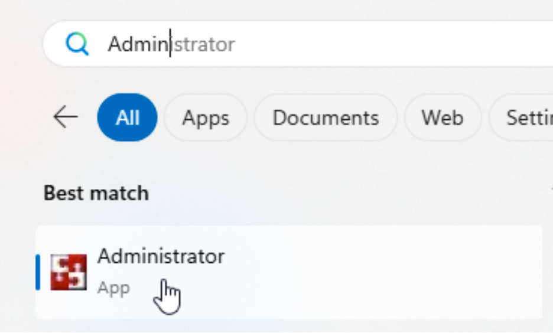

2. In Netcool/OMNIbus Administrator, open the **User** window/drawer at the left, select **Users** icon, and review the existing users. Note that these users are stored in the ObjectServer security configuration data and are used to control access to the database and client tools.

   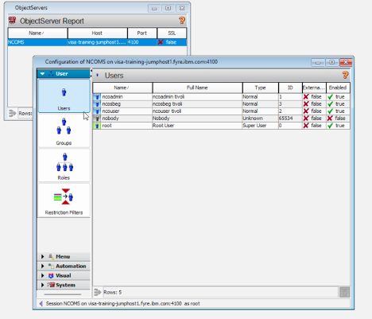

3. Make note of the default `ncoadmin` user and the `root` user. In this lab environment, `root` is the primary superuser and main administrative user of the ObjectServer. The `ncoadmin` user is created upon installation of the WebGUI component.
4. Add a user. Right-click in the **Users** window and select **Add User**.

   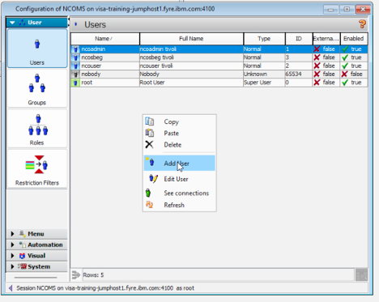

5. In the user details window, set:
   - **Username**: `netcool`
   - **Full name**: `Net Cool`
   - **User ID**: leave the default value, or set it explicitly if you need a specific numeric ID. The next available user ID is selected automatically when creating a user.

   The user details window also includes standard ObjectServer group options:
   - **System**: Has SuperUser role and unrestructed ObjectServer permissions. Do not assign to normal operators.
   - **Administrator**: grants full administrative access to ObjectServer configuration and management functions. Use only for OMNIbus administrators.
   - **Normal**: basic user access for standard event viewing and read-only ObjectServer operations.
   - **Probe**: rights required by probes to insert events into the ObjectServer. Not an interactive operator group.
   - **Gateway**: permissions needed by gateways to transfer and synchronize alert data between ObjectServers. Not an interactive operator group
   - **ISQLWrite**: allows command line tool (nco_sql) SQL write access to the ObjectServer for tools and scripts that modify tables.
   - **ISQL**: allows command line tool SQL read access for queries and inspection without write privileges.
   - **Netcool_OMNIbus_Admin**: broad Netcool/OMNIbus administrative permissions, typically used for users who manage the OMNIbus system.
   - **Netcool_OMNIbus_User**: standard operational access for Web GUI and event list users who need to view and manage alerts without full administrative rights.


6. On the **Groups** tab, highlight `Netcool_OMNIbus_User` and move it to the **Assigned Groups** list by using the single right arrow button. Confirm that **Assigned Groups** now shows `Netcool_OMNIbus_User`.

   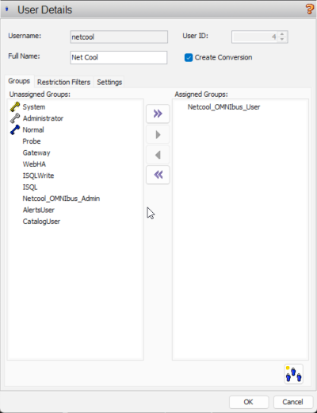
7. Select the **Settings** tab and enter the password `netcool` in both the **Password** and **Verify** fields, then click **OK** to create the user. (Do **not** click the "Change" button as this will simply clear out the password you have entered.)

   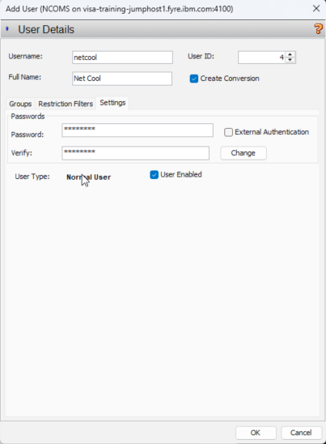

   > **Note:** The **External Authentication** checkbox is used when the user account should authenticate through an external identity source such as PAM (Unix OS authentication) or LDAP. When enabled, the ObjectServer delegates authentication to the external system instead of validating the password against the internal ObjectServer user database.

9. We are now going to assign Web GUI application roles to the `netcool` user. These Web GUI roles are distinct from the ObjectServer group membership assigned in the previous steps — ObjectServer groups control database and event access, while Web GUI roles control what functionality the user can access inside the browser-based interface.

   Return to your browser and open the Web GUI at:
   `https://<your-server>:16311/ibm/console`
   If your session has timed out, log in again as `ncoadmin` with password `netcool`.
10. Click the gear icon in the lower-left corner and open **User Roles**.

   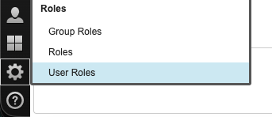

11. Leave the existing entry boxes blank and click **Search** to search and display **all** users.

    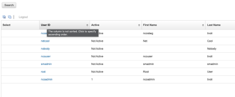

    Note: performing a search with an empty search string returns all ObjectServer users in the Web GUI search results. There are also Web GUI users stored in the federated WebSphere repository, such as `smadmin`, which is the WebSphere/JazzSM administrative account used for managing the application server and the JazzSM-based Web GUI environment. These users are not replicated down to the ObjectServer database, which is why you see more users here than you saw in the OMNIbus Administrator Client.

    - `smadmin`  is used to administer the underlying JazzSM/WebSphere stack that hosts Web GUI, including LDAP and SSO configuration, certificate and trust management, application/server tuning, profile and deployment maintenance, and other platform-level integration tasks.

12. Select the `netcool` user and review the available Web GUI roles.

    Web GUI roles control what the user can do inside the Web GUI application: log in, view event lists, run event tools, edit dashboards, manage gauges, administer Web GUI settings, and so on. ObjectServer roles, conversely, control what the user can do in the ObjectServer database itself: read/write alert tables, manage users/groups/roles, create tools, modify desktop objects, run SQL, and administer server-side security.

    How they relate:
    - Web GUI roles are application-layer permissions. They decide whether the Web GUI shows menus, widgets, dashboards, event actions, and admin pages.
    - ObjectServer roles are data/database permissions. They decide whether the backend account can read or update `alerts.status`, manipulate security objects, run SQL, or create tools and desktop artifacts.

    Practical example:
    - A typical read-only operator might have `ncw_user` to use the Web GUI and `netcool_ro` to view events but not change them.
    - A backend ObjectServer administration account might have `CatalogUser` plus `SecurityAdmin` or `AlertsUser`, depending on what it needs to do in the database.

    That means a user can appear to be an admin in the Web GUI while still having limited ObjectServer rights, or vice versa. The two role systems overlap in purpose, but they operate at different layers.

    Short rule of thumb:
    - **Web GUI roles** = UI and feature access.
    - **ObjectServer roles** = backend data and security access.

    Common default Web GUI roles include:
    - **ncw_user** – Base Web GUI role: makes the account a Web GUI user. By itself it lets the user log in and see the UI, but you pair it with other roles to define access level.
    - **netcool_ro** – Read-only event management: can view event lists and events, but cannot run tools or change event data. Must be combined with `ncw_user`.
    - **netcool_rw** – Read/write event management: can run event list tools and modify event data (ack, clear, update fields, etc.). Also combined with `ncw_user`.
    - **operator** – Typically used as an ObjectServer-side role (combined with CatalogUser/AlertsUser, etc.) to give basic operator permissions; in many deployments this is mapped in LDAP or user groups and then combined with the Web GUI roles above.

    Other Web GUI roles include:
    - **ncw_admin** – Web GUI admin: full admin access to Web GUI configuration (views, filters, tools, widgets) plus everything from `ncw_user`.
    - **chartAdministrator / chartCreator / chartViewer** – Roles for managing and viewing chart/gauge resources and dashboards. Admin/Creator can define charts and gauges; Viewer can only see and use gauges.
    - **ncw_dashboard_editor** – Allows editing of Event Dashboard layouts and widgets.
    - **ncw_gauges_editor / ncw_gauges_viewer** – Editor can administer gauge definitions; Viewer can only see and use gauges.
    - **ncw_sbeg_editor / ncw_sbeg_view** – Roles tied to scope-based event grouping configuration and viewing grouped events. Editor can manage grouping policies; View can see the results.
    - **administrator** – Often a legacy or general admin role depending on version; many shops rely on `ncw_admin` instead and leave this unused.
    - **monitor, iscadmns, samples, suppressmonitor** – Environment-specific or sample/demo roles; IBM ships some for example dashboards or integrations, and many teams add custom ones.

13. Scroll down, locate, and assign the following Web GUI roles to the user, then confirm the selections using the screenshot below:
    - `ncw_user`
    - `netcool_rw`
    - `operator`

    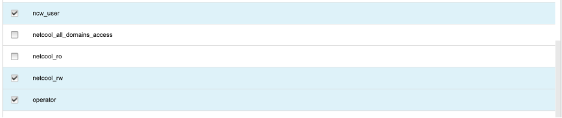

14. Click **Save** at the bottom-left of the window to apply the Web GUI role assignments.
15. Log out of the Web GUI:
    - Find the **User** menu icon in the lower-left corner of the Web GUI.
    - Click the **User** menu icon and select **Logout** from the popup menu.

    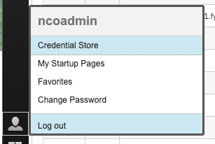
16. Log back in as user `netcool` with password `netcool`.
17. As before, click the flag icon to open the event list and verify that the user can access events, filters, views, and right-click tools.
18. Log out of the Web GUI by using the logout control in the lower-left corner, then log back in again as the `netcool` user to confirm that access persists after a fresh login.
19. Users can also be added and managed from the command line by using the nco_sql utility. This utility provides an interactive SQL interface to the OMNIbus ObjectServer, allowing administrators to query and modify ObjectServer data and configuration, including users, groups, roles, and permissions. The nco_sql utility can also be used for automating object server administrative and query tasks in scripts as well.

    Open a terminal on the workstation or lab server and connect to the EVENTS ObjectServer as the root administrator account:

      ```bash
      $OMNIHOME/bin/nco_sql -server EVENTS -user root -password netcool
      ```

20. At the `nco_sql` prompt (**1>**), inspect the ObjectServer security tables to confirm their structure and column names:

      ```sql
      DESCRIBE security.users;
      go
      ```
      The table **security.users** contains the relevant user configuration data such as `UserName`, encrypted `Password`, and other relevant fields we saw when configuring the user with the OMNIbus Administrator client.
    ```sql
      select * from security.users where UserName='netcool';
      go
      ```
      Here you can see the full relevant user details for the user we created in the Administrator client.
    ```sql
      DESCRIBE security.groups;
      go
      ```
      The **security.groups** table contains the relevant group information including `GroupID`, `GroupName`, whether or not the group is considered a `SystemGroup`, and other information.

    ```sql
      select * from security.groups;
      go
      ```
      Here you can see the actual group records currently defined in the EVENTS ObjectServer. The result contains 13 groups. The first nine are standard OMNIbus groups created when the ObjectServer database is initialized, while the remaining groups—such as Netcool_OMNIbus_User, Netcool_OMNIbus_Admin, Network_Manager_IP_Admin, and Network_Manager_User—were added by installed products, integrations, or local configuration. IBM documents the standard groups, including Normal, Probe, Gateway, WebHA, ISQLWrite, and ISQL. 

      It is important to note that this table does not show which users belong to each group or what permissions the group grants. Membership is stored in the security.group_members table, which maps UserID values to GroupID values. IBM identifies security.groups as the table containing the group name and ID, and security.group_members as the mapping table between users and groups.

21. Create a new user `jdoe` and make him a User as well as an Administrator by assigning the two relevant ObjectServer groups:

    Create the user:
      ```sql
      CREATE USER 'jdoe' FULL NAME 'John Doe' PASSWORD 'SecretPass123';
      go
      ```
      
      *Note: When you execute this command, you will see a response indicating `(0 rows affected)`. This is expected and does **not** indicate that the command failed. Commands like `CREATE USER` and `ALTER GROUP` modify the ObjectServer configuration data but do not return rows from a table query. The "(0 rows affected)" message simply indicates that no rows were returned from a SELECT operation, which is normal for data modification commands. If the command were unsuccessful, you would instead receive an error message describing what went wrong, such as a duplicate user name or an invalid group name. As long as you do not see an error message, the command was executed successfully.*


      Add `jdoe` to the `Netcool_OMNIbus_User` group:
    ```sql
      ALTER GROUP 'Netcool_OMNIbus_User' ASSIGN MEMBERS 'jdoe';
      go
      ```
      And finally, add him to the `Netcool_OMNIbus_Admin` group:
    ```sql
      ALTER GROUP 'Netcool_OMNIbus_Admin' ASSIGN MEMBERS 'jdoe';
      go
      ```

22. Verify that the new user was created successfully, and validate group membership. Start by checking the *security.users* table:

      ```sql
      SELECT * FROM security.users WHERE UserName = 'jdoe';
      go
      ```
      Review the user data that was returned from your `SELECT` statement.

      Next, query the security.group_members table to check membership. This query checks membership across three related security tables. It first locates the GroupID associated with the Netcool_OMNIbus_Admin group in security.groups. It then uses that group ID to find the user IDs assigned to the group in security.group_members. Finally, it checks whether the user named jdoe has a matching user ID in the security.users table.

    ```sql
      SELECT UserName FROM security.users WHERE UserName = 'jdoe' AND UserID IN (SELECT UserID FROM security.group_members WHERE GroupID IN (SELECT GroupID FROM security.groups WHERE GroupName = 'Netcool_OMNIbus_Admin'));
      go
      ```

      If jdoe is a member of the group, the query returns the username:
    ```text
      UserName
      --------
      jdoe
      ```


#### Validation

The exercise is successful when all of the following are true:

- You can view existing users in Netcool/OMNIbus Administrator.
- The `netcool` user is created successfully.
- The `netcool` user is assigned to the `Netcool_OMNIbus_User` group.
- The `netcool` user is found in the Web GUI **User Roles** interface.
- The Web GUI roles are saved successfully for the `netcool` user.
- The `netcool` user can log in to the Web GUI and open the event list.
- The `netcool` user has access to filters, views, and right-click event tools.
- The `jdoe` user has been created using `nco_sql` command line utility, and group membership for the user assigned

#### Expected result

At the end of this exercise, you understand that ObjectServer access is controlled through users, groups, and roles, and that Web GUI capabilities are controlled through separate Web GUI role assignments. You also have a working non-administrative user account that can be used in later labs to validate operator-level access and event interaction.


### 3.2 The alerts.status table and important event fields

#### Objective

In this exercise, you will examine the `alerts.status` table in the ObjectServer, review the most important event fields used in everyday OMNIbus event handling, and observe how the table can be extended with custom fields. By the end of this exercise, you will understand where active alert data is stored, what key fields mean, and how additional columns can be added when custom event data must be provided.

#### Prerequisites

- Completion of section 3.1.
- The ObjectServer is running.
- Netcool/OMNIbus Administrator is available on Windows (or `nco_config` on Unix/Linux with X-Windows).

#### Background

The `alerts.status` table is the primary active-alert table in the ObjectServer and the central focus of this exercise. It is one of several tables that make up the `alerts` database. The other key tables in that database are `alerts.details`, which stores supplementary event text that does not fit in the main alert row; `alerts.journal`, which holds operator and automated journal entries associated with individual alerts; and `alerts.col`, which is used to record parent-child relationships between alerts for correlation purposes.

Because the ObjectServer is an in-memory database, event data in tables such as `alerts.status` can be inserted, updated, deduplicated, correlated, and queried with very low latency. This design is particularly well suited to large IT and service management environments, where probes and gateways may deliver large volumes of alerts and operators need the event list to update immediately. The ObjectServer maintains its active data in memory for performance, but it also persists the database to disk through checkpoint files and transaction logs. When an ObjectServer restarts, it reloads the most recent checkpoint and replays subsequent transaction-log entries to restore the database to its most recent consistent state.

Each row in the `alerts.status` table represents one active alert. The schema is defined at startup and is consistent across all alerts stored in the table. Administrators can extend the schema by adding custom columns to add additional data to the alerts, such as business context. This exercise focuses on the fields most commonly used to identify the event source, summarize the condition, categorize the event, and support deduplication and event handling.

#### Tasks

1. Launch Netcool/OMNIbus Administrator on the Windows workstation and log in to the `EVENTS` ObjectServer as `root` with password `netcool`.
2. In Netcool/OMNIbus Administrator, open the **System** menu drawer on the left, and select the **Databases** icon. In the database list, open the **alerts** database by clicking on the "plus" sign (`+`), then select the **status** table to open the definition of the `alerts.status` table:

   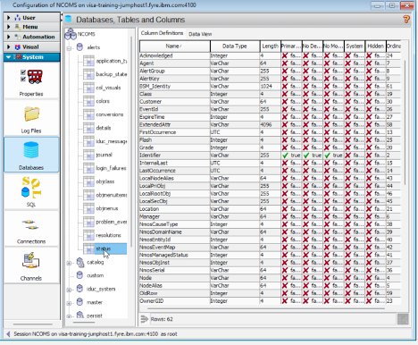

3. Review the columns that make up the active alert schema. For each column, note the column name, data type, and defined length or precision. The data type determines what kind of values the column can store, such as text, numeric, or timestamp values. The length or precision defines the storage limit for that field. Most data types have a fixed size, while `VarChar` is variable-length and must be defined with a maximum size up front.

   **The following fields are some of the most important in the ObjectServer event schema because they are commonly used for identification, grouping, deduplication, and operational handling. Review the purpose of each field as part of the table definition:**

   - **Node**: Identifies the host, device, or source associated with the event.
   - **Summary**: Provides a short text description of the event.
   - **AlertGroup**: Identifies the general event category or class.
   - **AlertKey**: Typically identifies the specific resource, sub-component, or object associated with the event (interface, disk, cpu, etc)
   - **Severity**: Indicates the event severity level and supports operational prioritization.
   - **Type**: Identifies the event type and is commonly used in event handling and correlation logic.
   - **Identifier**: Uniquely identifies the event condition and is used for deduplication behavior.
   - **Server**: Assigned and maintained by the ObjectServer to identify the source or server context of the record; it is not typically set by the user.
   - **ServerSerial**: Assigned and maintained by the ObjectServer as the unique record identifier within that server; it is not typically set by the user.
4. Next, return to the Web GUI event list and compare the visible event columns with the field names observed in the `alerts.status` table. As noted earlier, the event list view typically shows only a subset of all available alert fields. Select an alert and **double-click** to open the full event details and confirm that values displayed in the event list correspond to fields stored in the `alerts.status` table, such as `Node`, `Summary`, and `Severity`. 

   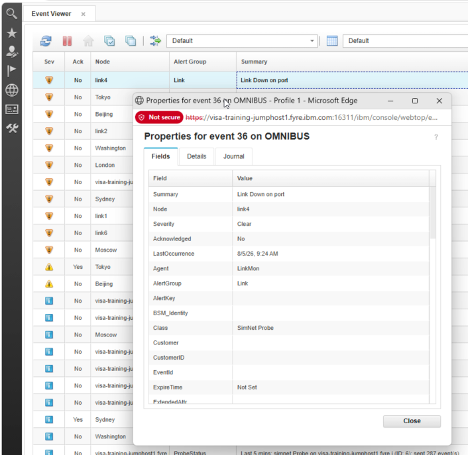

5. Next, we will add a custom field to the alert schema. We will use this field in upcoming tasks to add business context to our alerts.

     Return to the Netcool/OMNIbus Administrator client, **Column Definitions** view. Add the new field by right-clicking in the **Column Definitions** data view and selecting **Add Column**.

   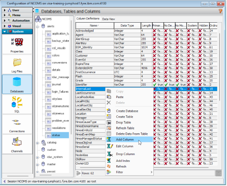

   Give the new column the name `CustomerID`, set the size of the text to `64`, and click **OK**.

   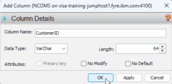

   > **Note:** ObjectServer column names are **case-sensitive**. When writing queries or update statements, you must use the exact column-name capitalization defined in the table schema.

6. Validate that the new `CustomerID` column appears in the **Column Definitions** view of the Administrator client:

     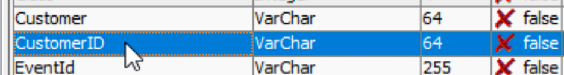

7. Open the Web GUI event list and double-click on an alert to bring up the alert properties. Note that the new `CustomerID` field is now available in the event data shown by Web GUI. You may need to click the "refresh" icon at the top left of the event viewer for the new field to show.

    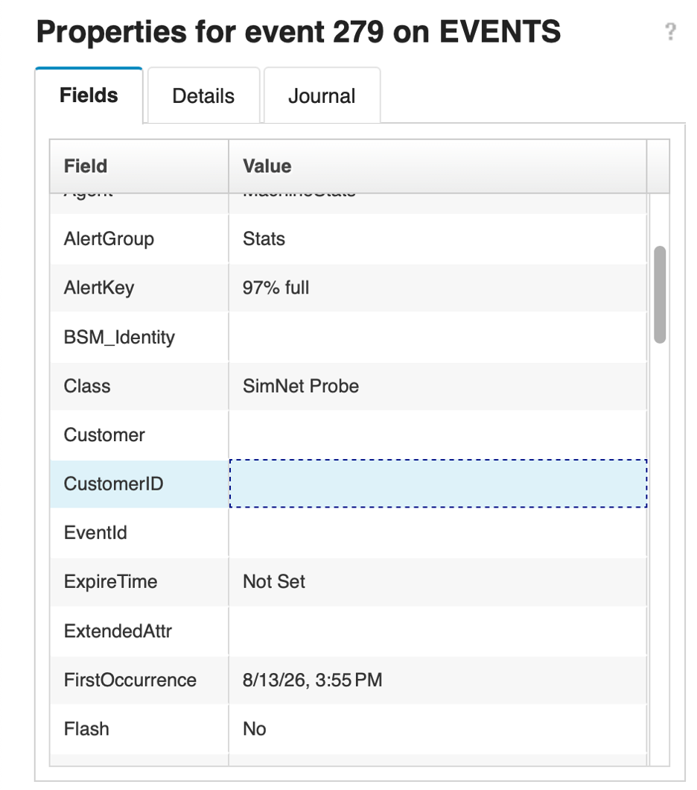

8. As with adding users, you can also use the command line equivalent tool to add custom colums. Open a terminal on your Netcool/OMNIbus lab server and run the following command:

   ```bash
   $OMNIHOME/bin/nco_sql -server EVENTS -user root -password netcool
   ```

   At the `nco_sql` prompt, run the following commands to describe the `alerts.status` schema to inspect the current the column definitions and their data types:

   ```sql
   DESCRIBE alerts.status;
   go
   ```
   Issue the following command to add another custom column called `CircuitID` to the alerts.status schema. It will also be a variable character length  data type with a maximum length of 64 characters (`varchar(64)`):
    ```sql
   ALTER TABLE alerts.status ADD COLUMN CircuitID varchar(64);
   go
   ```
   Finally, check the `alerts.status` schema to ensure your new field exists:
    ```sql
   DESCRIBE alerts.status;
   go
   ```

> **Note:** Custom fields in `alerts.status` are commonly used in production environments to carry business-specific or integration-specific data that has no equivalent in the default schema. A telecommunications provider might add a `CircuitID` field to tie alerts directly to provisioned network circuits. A financial services organization might add a `CostCenter` or `ApplicationOwner` field to support automatic ticket routing. Managed service providers often add a `CustomerID` or `TenantID` field so that a shared ObjectServer can store alerts from multiple clients while keeping event ownership clear. In each case, the custom field is populated by the probe rules file or a gateway at ingestion time and flows through the ObjectServer alongside the standard alert data. We will use the CustomerID field to enrich events in upcoming labs.

#### Validation

The exercise is successful when all of the following are true:

- You can navigate through **System -> Databases -> alerts -> status** and open the `alerts.status` table definition.
- You can identify `Node`, `Summary`, `AlertGroup`, `AlertKey`, `Severity`, `Type`, and `Identifier` in the table.
- You can explain the operational purpose of the key event fields.
- You can correlate event-list columns with fields in the `alerts.status` table.
- You can add a custom field to `alerts.status` by using Netcool/OMNIbus Administrator.
- You can confirm that the new `CustomerID` column appears in the **Column Definitions** view.
- You can confirm that the new `CustomerID` field is available in the Web GUI event data or event list configuration.

#### Expected result

At the end of this exercise, you understand that the `alerts.status` table is the central active-alert table in the ObjectServer and that its fields define how OMNIbus stores and presents event information. You also understand that the ObjectServer schema can be extended with custom columns when additional event attributes are required.

### 3.3 Reviewing ObjectServer triggers

#### Objective

In this exercise, you will review standard ObjectServer triggers in Netcool/OMNIbus Administrator and examine how they support deduplication, event clearing, and event expiration. By the end of this exercise, you will understand how triggers are grouped, where to inspect their configuration, and what the `deduplication`, `generic_clear`, and `expire` triggers do in a default OMNIbus environment.

#### Prerequisites

- Completion of section 3.2.
- The ObjectServer is running.
- `Netcool/OMNIbus Administrator` is accessible on the Windows workstation.

#### Background

The ObjectServer automation framework is built around triggers, which are units of SQL logic that run automatically in response to defined conditions. There are three types of triggers in OMNIbus: database triggers, temporal triggers, and signal triggers.

**Database triggers** are bound to a specific table and a specific database action. The supported actions are insert, update, reinsert, and delete. A database trigger can be configured to run either before or after the database modification takes place, giving it the ability to inspect, modify, or cancel the operation depending on the trigger logic. The `deduplication` trigger is an example of a database trigger — it is bound to the `alerts.status` table and fires as a pre-action on reinsert, meaning it runs before the ObjectServer processes an incoming event that matches an existing alert key (@Identifier).

**Temporal triggers** run on a repeating schedule rather than in response to a database event. The interval between executions is defined as part of the trigger configuration. Temporal triggers are typically used for housekeeping tasks such as scanning the alert table for conditions that need to be acted on periodically. The `generic_clear` trigger is an example — it runs on a schedule and looks for resolution events that can be matched against open problem events in order to clear both.

**Signal triggers** run when a named signal is raised within the ObjectServer, either by another trigger, a procedure, or an external process. They are used to coordinate automation across components or to respond to custom-defined events that do not map naturally to a database action or a schedule.

Trigger groups are used to organize related triggers so they can be enabled or disabled together as a single unit. This makes it straightforward to activate or deactivate a set of related automation behaviors without having to manage each trigger individually.

#### Tasks

1. Launch `Netcool/OMNIbus Administrator` on the Windows workstation and log in to the `EVENTS` ObjectServer as `root` with password `netcool`.
2. In Netcool/OMNIbus Administrator, open the **Automation** drawer and select **Triggers**:

   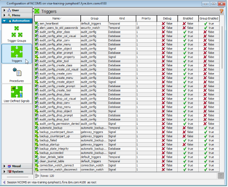

3. Review the list of triggers that are provided out of the box. Note that many of these are internal ObjectServer maintenance or automation triggers.
4. Observe that the trigger list includes both the trigger name and the trigger group. Trigger groups are used to organize related triggers so they can be enabled or disabled together as one unit. The list also shows other key configuration details for each trigger, including the trigger kind (such as Temporal, Signal, or Database), the trigger priority, and whether debug mode is active. Finally, the Enabled and Group Enabled columns indicate if the individual trigger is currently running and whether its trigger group is enabled, which together determine if the trigger actually executes.
5. Locate the `deduplication` trigger and double-click it to open its configuration. Note the tabs in the trigger configuration dialog: **Settings / When / Action / Comment**.

   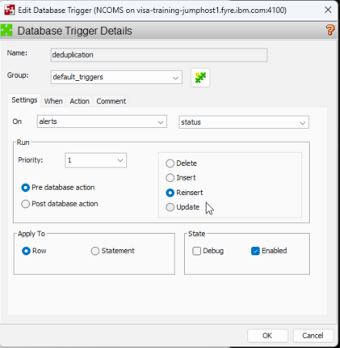
6. On the **Settings** tab, note that the trigger is configured against the `alerts.status` table as a **pre-database action** on `reinsert`.

   When a probe sends an event to the ObjectServer, the ObjectServer checks whether an alert with the same value for the `Identifier` field already exists in `alerts.status`.

   - If no matching alert is found, the event is treated as a new `insert`.
   - If a matching alert already exists, the event is treated as a `reinsert`, which means the event is another occurrence of an existing condition rather than a brand-new alert.

   The deduplication trigger fires before the ObjectServer processes the reinsert, allowing it to update the existing alert appropriately. Deduplication of alerts ensure that the event list is not cluttered with duplicate and redundant events, and helps keep operators focused on the current state of the environment.

7. Select the **When** tab and note that the field is empty. The **When** clause is an optional SQL condition that can be added to a trigger to restrict when it fires. If a When clause is present, the trigger will only execute when both the trigger condition and the When clause evaluate to true. An empty When clause means the trigger fires unconditionally whenever its defined database action or schedule occurs.
8. Select the **Action** tab and review the SQL trigger code. This is the SQL code that is executed when the criter of this trigger is met (re-insert of an existing event):

   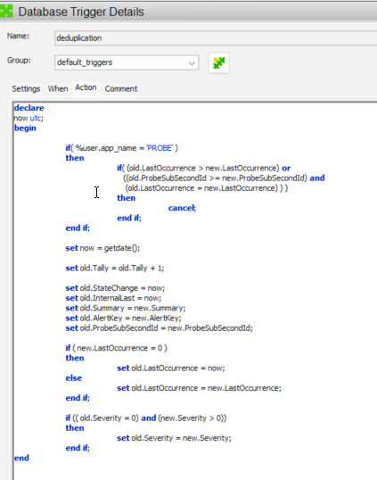

   At the top of the trigger, there is a check on the application name:

   ```sql
   if (%user_app_name = 'PROBE')
   then
       if ( (old.LastOccurrence >= new.LastOccurrence) or
            ((old.ProbeSubSecondId >= new.ProbeSubSecondId) and
             (old.LastOccurrence = new.LastOccurrence)) )
       then
           cancel;
       end if;
   end if;
   ```

   - This logic only applies when the event comes from a **probe**.
   - It compares the **existing** alert’s time (`old.LastOccurrence` and `old.ProbeSubSecondId`) with the **incoming** event’s time (`new.LastOccurrence` and `new.ProbeSubSecondId`).
   - If the existing alert is **newer or equal** to the incoming event, the trigger calls `cancel;`, which stops the reinsert from updating the alert. In other words, older or duplicate events from the probe are ignored. (rare)

   Next, the trigger records the current time, assigning it to the variable `now`, and updates key fields on the existing alert:

   ```sql
   set now = getdate();
   set old.Tally = old.Tally + 1;

   set old.StateChange   = now;
   set old.InternalLast  = now;
   set old.Summary       = new.Summary;
   set old.AlertKey      = new.AlertKey;
   set old.ProbeSubSecondId = new.ProbeSubSecondId;
   ```

   - `old.Tally` is incremented to indicate the existing alert has been seen again.
   - `StateChange` and `InternalLast` fields are refreshed to the current time.
   - Text and identification fields such as `Summary` and `AlertKey` are updated from the incoming event. 
   - `ProbeSubSecondId` is updated so future comparisons use the latest precise timestamp.

   The trigger then updates the `LastOccurrence` time based on the incoming event:

   ```sql
   if (new.LastOccurrence = 0)
   then
       set old.LastOccurrence = now;
   else
       set old.LastOccurrence = new.LastOccurrence;
   end if;
   ```

   - If the incoming event doesn’t provide a `LastOccurrence` time (zero), the trigger uses the current time.
   - Otherwise, it copies the event’s `LastOccurrence` into the alert.

   > Note: in general, the time of an event is not set or managed by the source or the rules, but rather the time that the event was received in the ObjectServer is used. However, there are cases where you may want or need to reflect the time that the source generated the alert, rather than when the ObjectServer eventually received it. In these cases you can explicitly set LastOccurrence in the probe rules (described in the next section). Otherwise, if it is not explicitly set, it will be '0'.

   Finally, the trigger updates the severity if it has changed:

   ```sql
   if ((old.Severity = 0) and (new.Severity > 0))
   then
       set old.Severity = new.Severity;
   end if;
   ```

   - If the existing alert has a severity of 0 and the incoming event has a non‑zero severity, the alert’s severity is raised to match the new event.

   ### `old.<column>` vs `new.<column>`

   In this trigger:

   - `old.<column>` refers to the values already stored in the alert row **before** the reinsert is processed.
   - `new.<column>` refers to the values from the **incoming event** that caused the reinsert.

   The trigger uses `old.` values to read and update the existing alert, and uses `new.` values to bring in information from the latest event. This distinction is important because it lets the ObjectServer compare the current alert state to the new event and decide whether to ignore the event, update a few fields, or change severity, all without creating a new row.

9. Close the `deduplication` trigger, locate the `generic_clear` trigger, and review its configuration on the **Settings** tab. Note that it is a **temporal** trigger and that its repeat interval is set to 5 seconds, meaning the ObjectServer runs this trigger continuously every 5 seconds as long as the ObjectServer is running.
10. Select the **Action** tab and review the trigger code.

    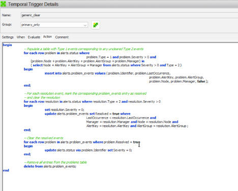

    The **generic_clear** trigger is a temporal trigger that periodically scans for related events and clears them when their associated resolution events have arrived. It uses a helper table called `alerts.problem_events` to track which problem alerts should be cleared.

    For example, when a router interface goes down, OMNIbus receives and stores an interface-down problem event. The generic_clear trigger records that event in the alerts.problem_events helper table so it can be tracked as an active condition. When the monitoring system later sends a matching interface-up resolution event for the same router interface, the trigger identifies the related interface-down event and clears it automatically. This keeps the event list focused on unresolved conditions while preserving the original event history.

    Inspect the **Action** for the `deduplication` trigger. At the start of the trigger, a loop populates the `alerts.problem_events` ObjectServer table:

    ```sql
    -- Populate a table with Type 1 events corresponding to any uncleared Type 2 events
    for each row problem in alerts.status where
        problem.Type = 1 and problem.Severity > 0 and
        (problem.Node + problem.AlertKey + problem.AlertGroup + problem.Manager) in
            (select Node + AlertKey + AlertGroup + Manager from alerts.status where Severity > 0 and Type = 2)
    begin
        insert into alerts.problem_events values (
            problem.Identifier,
            problem.LastOccurrence,
            problem.AlertKey,
            problem.AlertGroup,
            problem.Node,
            problem.Manager,
            false
        );
    end;
    ```

    - This loop finds **Type 1 problem events** with non‑zero severity that have a matching **Type 2 resolution event** (same node, key, group, and manager).
    - For each matching problem event, it inserts a row into `alerts.problem_events`, storing key fields like `Identifier`, `LastOccurrence`, and ownership information, plus a `Resolved` flag initially set to `false`.
    - This step builds a working list of problem alerts that are candidates to be cleared when their resolution appears.

    Next, the trigger marks problem events as resolved and clears the resolution alerts:

    ```sql
    -- For each resolution event, mark the corresponding problem_events entry as resolved and clear the resolution
    for each row resolution in alerts.status where resolution.Type = 2 and resolution.Severity > 0
    begin
        set resolution.Severity = 0;
        update alerts.problem_events set Resolved = true where
            LastOccurrence < resolution.LastOccurrence and
            Manager      = resolution.Manager and Node  = resolution.Node and
            AlertKey     = resolution.AlertKey and AlertGroup = resolution.AlertGroup;
    end;
    ```

    - This loop scans **Type 2 resolution events**.
    - It immediately clears the resolution alert itself by setting `resolution.Severity = 0`.
    - It then updates matching rows in `alerts.problem_events`, setting `Resolved = true` for problem alerts that occurred **before** the resolution and share the same node, manager, key, and group.
    - At this point, `alerts.problem_events` knows which problem alerts should be cleared.

    The trigger then clears the resolved problem alerts:

    ```sql
    -- Clear the resolved events
    for each row problem in alerts.problem_events where problem.Resolved = true
    begin
        update alerts.status via problem.Identifier set Severity = 0;
    end;
    ```

    - This loop walks the `alerts.problem_events` table and finds entries marked as resolved.
    - For each one, it locates the corresponding alert in `alerts.status` by `Identifier` and sets its `Severity = 0`, effectively clearing the original problem alert.

    Finally, the trigger cleans up the helper table:

    ```sql
    -- Remove all entries from the problems table
    delete from alerts.problem_events;
    ```

    - After processing, all rows are removed from `alerts.problem_events` so the next run starts with a clean slate.

    This trigger reduces noise by automatically clearing problem alerts when a matching resolution event arrives. In our previous example of a router interface down/up, a **Type 1** problem event might describe `Node='router01'`, `AlertGroup='LinkStatus'`, `Manager='MTTrapd Probe'` and `AlertKey='GigabitEthernet0/0'` when that interface goes down. When the corresponding **Type 2** resolution event arrives with the same `Node`, `AlertGroup`, `AlertKey`, and `Manager`, the trigger clears the original problem alert.

    Another example would be a server disk issue such as `Node='server12'`, `AlertGroup='DiskError'`, `Manager='Instana'`, and `AlertKey='/dev/sda1'` when that drive or partition reports errors. When a matching **Type 2** resolution event arrives for the same disk partition after the error condition has cleared, the trigger clears the original problem alert as well. In both cases, the ObjectServer keeps the event list current so operators can focus on issues that are still active rather than manually clearing related alerts one by one.

12. Close the `generic_clear` trigger, locate the `expire` trigger, and review its configuration on the **Settings** tab. Then select the **Action** tab and review the trigger code.

    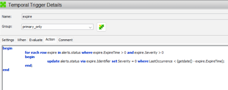

    The **expire** trigger is also a **temporal** trigger that periodically clears alerts that have passed their configured expiry time. Compared to the deduplication and generic_clear triggers, its logic is much simpler.

    The trigger loops over alerts in `alerts.status` that have both an expiry time and a non‑zero severity:

    ```sql
    for each row expire in alerts.status where expire.ExpireTime > 0 and expire.Severity > 0
    begin
        update alerts.status via expire.Identifier set Severity = 0
        where LastOccurrence < (getdate() - expire.ExpireTime);
    end;
    ```

    - The loop selects alerts where `ExpireTime` is greater than zero (meaning an expiry period has been set) and `Severity` is greater than zero (the alert is currently active).
    - For each such alert, it checks whether `LastOccurrence` is **older than** the current time minus the `ExpireTime` value.
    - If the alert is older than its expiry window, the trigger updates the alert in `alerts.status` using its `Identifier` and sets `Severity = 0`, effectively clearing the alert.

    Because this trigger doesn’t track problem/resolution pairs or update multiple fields, it is much easier to follow: it simply enforces time‑based expiry for alerts that have been quiet for longer than their configured `ExpireTime`.

    The expire trigger is important because it automatically clears stale alerts that have not been updated for a defined period. This is especially useful for alerts that do **not** have a matching resolution alert, such as some status, threshold, or informational alerts that simply age out over time rather than being explicitly cleared by another event. For example, if an interface or disk alert has an `ExpireTime` of 2 hours and no new events occur in that window, the trigger will clear the alert so it no longer appears as an active problem. This prevents long-forgotten issues from cluttering the event list and helps operators focus on current conditions rather than alerts that should have aged out of view. Ultimately, the cleared alert is then removed by the `delete_clears` trigger, which completes the cleanup process.

14. Compare the purposes of the three triggers:
   - `deduplication` handles repeated inserts of the same event by updating an existing alert instead of creating a duplicate row. It uses the event’s identifying fields, such as Identifier, to decide whether the incoming event is a new problem or another occurrence of one that is already being tracked.
   - `generic_clear` runs every 5 seconds and looks for Type 2 resolution events that match Type 1 problem events. When it finds a match, it clears the related problem alert and the resolution event so the event list reflects that the issue has been resolved.
   - `expire` clears events when their ExpireTime is reached. This is useful for alerts that do not have a matching resolution event, because it allows the ObjectServer to age out alerts that are no longer relevant and prevent stale entries from remaining active indefinitely.
   - `delete_clears` deletes cleared alerts from alerts.status (where Severity = 0 and StateChange is older than 120 seconds), which keeps the ObjectServer database from growing without bound and ensures that only recent and active alert history is retained.

#### Validation

The exercise is successful when all of the following are true:

- You can navigate through **Automation -> Triggers** in Netcool/OMNIbus Administrator.
- You can identify that trigger groups are used to organize related triggers for grouped management.
- You can open and review the `deduplication` trigger.
- You can explain why the `deduplication` trigger is configured as a **pre database action** on **reinsert**.
- You can describe the main behavior of the deduplication trigger action code.
- You can open and review the `generic_clear` trigger, identify it as a temporal trigger running every 5 seconds, and explain the four-step logic it uses to match and clear problem and resolution events.
- You can open and review the `expire` trigger, explain that it acts on events where `ExpireTime` is set, and describe how it uses `LastOccurrence` and `ExpireTime` to determine when to clear an alert.

#### Expected result

At the end of this exercise, you understand how to inspect ObjectServer triggers in the Administrator client and can explain the operational role of three important default triggers: `deduplication`, `generic_clear`, and `expire`. You also have a working understanding of how the ObjectServer automation framework responds to database events, scheduled intervals, and signals — a foundation that can be applied directly when designing or modifying automation logic to meet specific business requirements.

### 3.4 ObjectServer properties

#### Objective

In this exercise, you will examine ObjectServer properties using Netcool/OMNIbus Administrator, understand how properties control component behavior, and enable the ObjectServer REST interface by modifying the relevant properties. By the end of this exercise, you will be able to navigate the properties list, identify editable and immediate properties, apply a configuration change, and verify the result using a curl test against the REST API.

#### Prerequisites

- Completion of section 3.3.
- The ObjectServer is running.
- `Netcool/OMNIbus Administrator` is accessible on the Windows workstation.
- SSH access to the lab server.

#### Background

ObjectServer properties are named configuration settings that control the runtime behavior of the ObjectServer. Each property has a name, a current value, and a description. The properties list in Netcool/OMNIbus Administrator also shows two important flags for each property: **Editable** and **Immediate**.


The **Editable** flag indicates whether the property can be changed at runtime through `nco_config` (unix/Linux), `Netcool/OMNIbus Administrator` (Windows), or the `nco_sql` command line tool. Properties that are not editable cannot be changed while the ObjectServer is running and must be set in the properties file before startup.

The **Immediate** flag indicates whether a change to the property takes effect right away or only after the ObjectServer is restarted. Properties that are not immediate can still be changed, but the new value will not take effect until after a restart. Properties that are immediate take effect as soon as they are changed. For example, changing the ObjectServer MessageLevel from ```warn``` to ```debug``` takes effect immediately, while changing a property such as MessageLog (the ObjectServer log file path) typically requires a restart before the new location is used.

Properties can be set in two ways. The ObjectServer properties file — typically named `EVENTS.props` and located in the `/opt/IBM/tivoli/netcool/omnibus/etc/` directory — is only read at startup and sets the initial values for all properties. Properties can also be modified at runtime through `nco_config` or `Netcool/OMNIbus Administrator` for properties that are marked as editable, with the caveat that non-immediate changes will not take effect until the next restart.

The ObjectServer includes an embedded HTTP server and REST API that can be used to query alert data programmatically. This interface is controlled by the `NHttpd.*` and `NRestOS.*` ObjectServer properties. By default, `NRestOS.Enable` is set to `false` and `NHttpd.ListeningPort` is set to `0`, meaning the REST interface is disabled. Enabling it requires setting `NRestOS.Enable` to `true`, `NHttpd.EnableHTTP` to `true`, and `NHttpd.ListeningPort` to a valid port number, then restarting the ObjectServer.

To illustrate managing OMNIbus ObjectServer properties, we will enable the REST API and test it.

#### Tasks

1. Launch `Netcool/OMNIbus Administrator` on the Windows workstation and log in to the `EVENTS` ObjectServer as `root` with password `netcool`.
2. In Netcool/OMNIbus Administrator, open the **System** drawer item on the left menue and select **Properties**.

    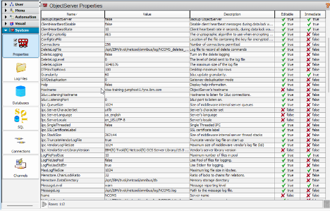

3. Review the properties list. Note that it is a flat list of all ObjectServer properties, each with a **Name**, **Value**, **Description**, **Editable**, and **Immediate** column.
4. Scroll through the list and observe that the majority of properties show `false` in the **Immediate** column, confirming that most configuration changes require an ObjectServer restart to take effect.
5. Locate the property `NRestOS.Enable` and confirm that its current value is `false`. Note that this property controls whether the embedded REST API is active.
6. Locate the property `NHttpd.EnableHTTP` and confirm that its current value is `false`. Note that this property controls whether the embedded HTTP server is active.
7. Locate the property `NHttpd.ListeningPort` and confirm that its current value is `0`. This value of `0` indicates that no HTTP port is assigned because the HTTP server is currently disabled.
8. Double-click `NRestOS.Enable` to edit it. Change the value to `true` and click **OK**.

    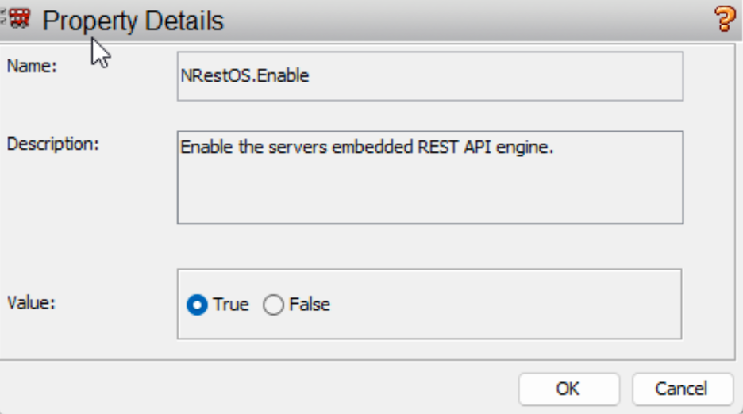
9. Double-click `NHttpd.EnableHTTP` to edit it. Change the value to `true` and click **OK**.
10. Double-click `NHttpd.ListeningPort` to edit it. Change the value to `8888` and click **OK**.
    > Note: take care to select `NHttpd.ListeningPort` and not `NHttpd.SSLListeningPort` as we are just working with HTTP for the lab.
11. Note that none of these properties are marked as **Immediate**, so the changes will not take effect until the ObjectServer is restarted. Connect to the lab server by using SSH and stop the ObjectServer, and run the `nco_sql` tool:

    ```bash
    $OMNIHOME/bin/nco_sql -server EVENTS -user root -password netcool
    ```
    Once connected to the EVENTS ObjectServer `nco_sql` at the `1>` prompt, issue the following commands to gracefully shut down the ObjectServer:
    ```sql
    1> alter system shutdown
    2> go
    (0 rows affected)
    1> go
    ```
    The expected output is:
    ```text
    CT-LIBRARY error:
        ct_results(): network packet layer: internal net library error: Net-Library operation terminated due to disconnect...
    ```
    This output confirms that `nco_sql` lost its connection because the ObjectServer has shut down successfully.
12. In the SSH session on the lab server, wait a moment for the ObjectServer process to terminate. The Netcool Process Agent (PA) will automatically restart the ObjectServer. Validate that it shows running by executing the following command:

    ```bash
    nco_pa_status
    ```
    Expected output:
    ```text
    --------------------------------------------------------------------------------------------------------------
    Service Name         Process Name         Hostname                           User        Status           PID
    --------------------------------------------------------------------------------------------------------------
    Core                 MasterObjectServer   ibm-training-server1.dcimusic.com  root        RUNNING       463880
    --------------------------------------------------------------------------------------------------------------
    ```
13. Verify that the ObjectServer is accepting connections with the following command:
    ```bash
    $OMNIHOME/bin/nco_ping EVENTS
    ```

    Confirm that the output includes: `NCO_PING: Server available.`
14. Return to `Netcool/OMNIbus Administrator` on your Windows workstation. Note that the connection to `EVENTS` will have dropped during the restart — reconnect by logging in again as `root` with password `netcool`. Navigate to **System → Properties** and confirm that `NRestOS.Enable`, `NHttpd.EnableHTTP`, and `NHttpd.ListeningPort` now show the updated values.
16. From the SSH session on the lab server, run the following curl command to test the REST interface. `curl` is a command-line tool used to send HTTP requests — the `-u` flag supplies the username and password for basic authentication:
    ```bash
    curl -u root:netcool http://localhost:8888/objectserver/restapi/alerts/status
    ```
17. Confirm that the command returns a JSON response containing alert data from the `alerts.status` table. The response will include a list of current alerts in JSON format.

#### Validation

The exercise is successful when all of the following are true:

- You can navigate to **System → Properties** in Netcool/OMNIbus Administrator and describe the purpose of the **Editable** and **Immediate** columns.
- You can identify `NRestOS.Enable`, `NHttpd.EnableHTTP`, `NHttpd.ListeningPort`, and `NHttpd.BasicAuth` in the properties list and explain what each one controls.
- The properties `NRestOS.Enable`, `NHttpd.EnableHTTP`, `NHttpd.ListeningPort`, and `NHttpd.BasicAuth` are updated to `true`, `true`, `8888`, and `true` respectively.
- The ObjectServer restarts successfully and `nco_ping EVENTS` returns `NCO_PING: Server available.`
- The curl command against `http://localhost:8888/objectserver/restapi/alerts/status` returns a valid JSON response containing alert data.

#### Expected result

At the end of this exercise, you understand how ObjectServer properties control component behavior, know the difference between editable and immediate properties, and have successfully enabled and tested the ObjectServer REST interface. You also understand that the REST API provides a programmatic way to access alert data that can be used in integrations and custom tooling to meet specific business requirements.

