## 4. Probes

Probes are the event collection layer that receives information from external sources and turns that information into alerts that the ObjectServer can store and manage. Depending on the probe type, a probe may **listen** for incoming events on a network port, **connect** to an external system and poll or receive events, or **watch** files and create events from new log entries.

Although probes differ in the protocols and sources they support, they follow a common processing model. A probe receives raw event data, breaks that data into tokens, applies rules to determine whether the event should be kept and how it should be mapped, and then forwards the resulting alert to the ObjectServer, where it is stored in the `alerts.status` table and displayed to operators.

### 4.0 Lab setup — event filter and view configuration

#### Objective

Before you start the probe exercises, you’ll set yourself up with a dedicated event filter and a custom event list view in the Web GUI. The filter will show only alerts generated by the syslogd probe, and the view will focus on the fields you need to check that your rules are working in sections 4.1 through 4.3.

Doing this first means that every time you change a rule, you can immediately see the impact in a clean, focused event list, without scrolling through unrelated alerts or constantly adding and removing columns as you go.

#### Prerequisites

- Completion of section 3.4.
- The ObjectServer is running.
- The Web GUI application server is running.
- The student can log in to the Web GUI and open an event list.

#### Background

The Web GUI event list supports **filters** and **views** that can be configured independently and saved for reuse. A filter controls which alerts are displayed — it is essentially a SQL `WHERE` clause applied against `alerts.status`. A view controls which columns are displayed and in what order.

For the probe labs, a filter that shows only events where `Manager` contains the probe name will keep the event list focused on the alerts you are generating. A custom view with the fields used throughout the rules exercises will make it straightforward to confirm that each field is being populated correctly as the rules file is built up.

Note that the `Tally` field in `alerts.status` is the underlying field name for what the Web GUI typically displays as **Count**. When adding this field to the view, select `Tally` as the field name.

#### Tasks

1. Open a browser and log in to the Web GUI at:
   `https://<your-server>:16311/ibm/console`
   Log in as `ncoadmin` with password `netcool`.

2. Select the flag icon in the upper-left and open the event viewer.

3. Open the filter editor by selecting the filter editor icon (three green/blue arrows) at the top of the event list and choosing **Edit Filters**.

    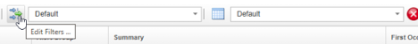

4. Create a new filter by clicking on the "New Filter" icon in the filter editor window:

    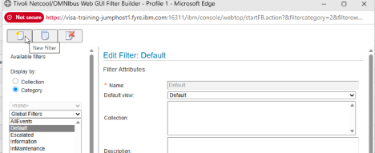

5. You are first asked to choose who can use this filter. You can make it **global** (available to all users), **system** (available only to administrators), assign it to specific **users**, or assign it to one or more **groups**. For now, assign it to Netcool_OMNIbus_Admin and Netcool_OMNIbus_User, and click **OK**:

    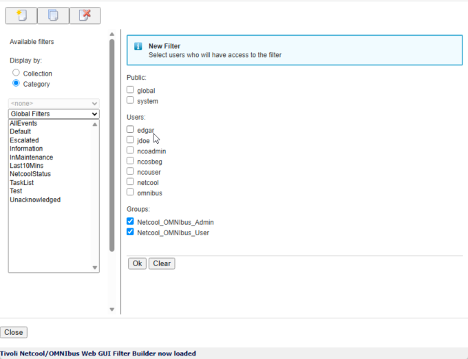

6. The Web GUI filter builder lets you define exactly which alerts appear in an event list, from very simple filters to quite complex ones.

   At the top, you set the **filter attributes** — the filter **Name**, the **Default view** it uses, and an optional **Description** so others know what it’s for.

   Below that, in **Filter Conditions**, you build the actual logic. On the **Basic** tab you add simple conditions by choosing a **Field**, a **Comparator** (such as `=`, `like`, `>`, `<`), and a **Value`. You can add multiple rows and choose whether **All** conditions must match (AND) or **Any** condition can match (OR).

   The other tabs (**Advanced**, **Dependent**, **Metric**) allow more sophisticated filters, such as expressions, filters that depend on other filters, or conditions based on metrics, so you can create complex, reusable filters tailored to different operational needs.

7. Configure your new filter with the following settings:
   - **Name**: `SyslogdProbe`
   - **Filter condition**: `Manager like 'MyProbe'`
   This filter will display only alerts where the `Manager` field contains `MyProbe` — the value we will set in the `@Manager` assignment in upcoming section 4.3.1. Alerts from other probes or sources will not appear while this filter is active.

    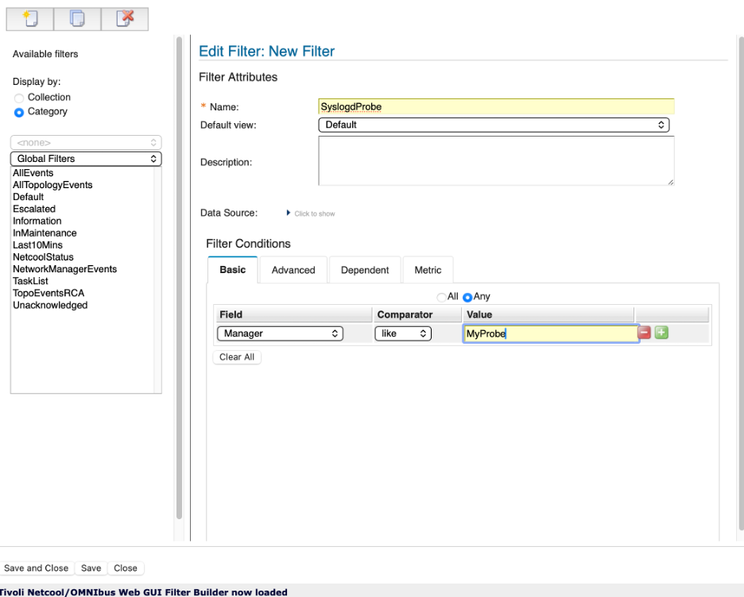

8. Save and close the filter by clicking on the **Save and Close** button at the lower left.

9. Next we will create a custom view. Open the view editor by clicking on the **Edit Views** icon to the left of the view dropdown:

    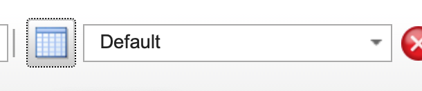

10. Click the "New View" icon at the upper-left of the window. Again, you will be asked to grant access to this view, for our purposes select **Global**, and click "Ok".

    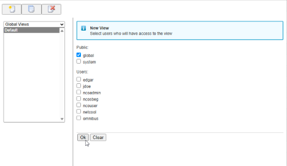


11. The View Builder lets you control how alerts are displayed in the event list — which columns you see, their order, and some additional custom layout options.

    At the top, you give the view a **Name** and optionally specify a **Data Source** (the data source can be used for multiple ObjectServers, not relevant for these labs).

    The main area is split into tabs:

    - **Display Columns**  
      On this tab, you choose which fields will appear as columns in the event list. The **Available fields** list on the left shows all fields from `alerts.status`. The **Event list view** list on the right shows the columns currently in the view.  
      Use the arrow buttons between the lists to add or remove fields and to change their order. You can also:
      - Tick **Lock column** to prevent a column from being moved or resized in the event list.
      - Set the **Column title** (what the user sees in the header, overriding the ObjectServer column name).
      - Choose text alignment for the displayed column with **Justify title** and **Justify data**.
      - Adjust **Column width** if needed.

    - **Sort Columns**  
      This tab controls the default sort order for the view. Select one or more fields and specify whether each field is sorted in ascending or descending order so that the most relevant alerts appear first. The initial row order in the Event Viewer is determined by the applied view, although users may be able to perform temporary custom sorting by selecting column headers if that feature is enabled for their account.
 
      Common sorting choices include:

      - Severity descending, so Critical and Major events appear before lower-priority events.
      - LastOccurrence descending, so the most recently received or updated events appear first.
      - FirstOccurrence ascending, so the oldest unresolved events are prioritized.
      - Count descending, to highlight frequently recurring or repeatedly received events.
      - Node, Location, Customer, or Service ascending, to keep events from the same device, site, customer, or service together.
      - Acknowledged ascending, so unacknowledged events appear before events already being worked.\
      - OwnerUID or OwnerGID ascending, to group alerts by assigned operator or support team.

      A common operational order is Severity descending followed by LastOccurrence descending. This places the highest-priority alerts at the top of the view, with the most recently updated alerts shown first within each severity level. Note that some fields, including Acknowledged and OwnerUID, may be sorted by their displayed conversion value rather than their underlying numeric ObjectServer value.

    - **Group Columns**  
      Here you define how alerts are grouped in the event list (for example, by `Node` or `AlertGroup`). Grouping can make it easier to see related alerts together. For example, if you add the "Location" field to this, all alerts will be grouped by the unique value of the Location field in all of the alerts that match the filter of this view (For example, "New York" and "Los Angeles").

    - **Relationships**  
      This tab allows you to enable alert grouping and rollup of alerts that are correlated by the IBM Tivoli Network Manager (ITNM) Root Cause Analysis engine.

      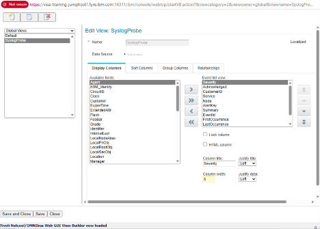


12. Add the following fields to the view in the order listed by selecting the field under "Available sort fields", and clicking the single "Arrow" icon. Change the Column Widths for each field as noted. This order is arranged by operational relevance — the most actionable fields appear first, followed by temporal fields, categorisation fields, and finally technical fields that are useful for validating rules behavior:

      | Order | Field name | Notes | Column Width |
      |-------|-----------|-------|------------:|
      | 1 | `Severity` | Alert severity level | 5 |
      | 2 | `Acknowledged` | Acknowledgement state | 5 |
      | 3 | `CustomerID` | Custom field added in section 3.2 | 10 |
      | 4 | `Service` | Service level from lookup table | 10 |
      | 5 | `Node` | Source device | 10 |
      | 6 | `AlertKey` | Specific resource or condition | 10 |
      | 7 | `Summary` | Event description | 40 |
      | 8 | `EventId` | Extracted event type identifier | 10 |
      | 9 | `FirstOccurrence` | When the alert was first seen | 10 |
      | 10 | `LastOccurrence` | When the alert was most recently updated | 10 |
      | 11 | `Tally` | Number of occurrences — displayed as **Count** in the event list | 5 |
      | 12 | `AlertGroup` | Event category | 10 |
      | 13 | `ExpireTime` | Expiry timer value in seconds | 5 |
      | 14 | `Manager` | Probe or management system that generated the alert | 10 |
      | 15 | `Identifier` | Deduplication key — (useful for validating rules, less relevant in production operations views) | 20 |

      > Note: First, move all required fields from Available fields to Event list view using the left/right buttons to move them back and forth. Then use the move controls beside the Event list view list to arrange the fields in the desired order. If the arrangement controls are not visible, enlarge the editor window or adjust the browser zoom level. After arranging the fields, set each field’s justification and width.
      


13. Name your new view `SyslogdView` and save the view by clicking on the **Save and Close** button at the bottom-left of the view builder window.

14. Before applying the training filter, try switching the view independently of the filter. Switch to the **Default** or **AllEvents** filter while applying the **SyslogdView** view. If the Simnet probe is running or other events are present, they will now appear with the new column layout — confirming that views and filters are independent controls that can be mixed and matched freely.

    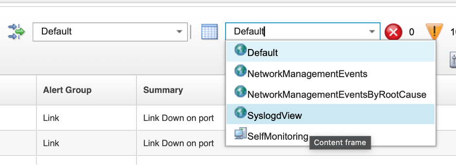

15. Apply the **Syslogd Training** filter and the **Syslogd Training** view to the event list. The event list will be empty at this stage — this is expected. The filter condition `Manager like 'MyProbe'` will only match alerts generated once the training rules file is in place from section 4.3.1 onwards. The **SyslogdView** view will be visible and correctly configured even before any matching events exist.

16. Leave the **SyslogdProbe** filter and **SyslogdView** view active for all exercises in sections 4.1 through 4.3. The filter and view can be switched back to the defaults at the end of the probe labs.

    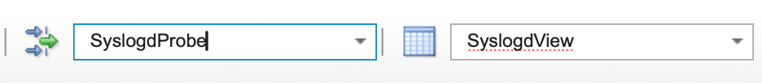

#### Validation

The exercise is successful when all of the following are true:

- You have created the **SyslogdProbe** filter with the condition `Manager like 'MyProbe'`.
- You have created the **SyslogdView** view containing all fifteen fields in the specified order.
- You can confirm that the view can be applied independently of the filter by switching to the **Default** or **AllEvents** filter while the **SyslogdView** view is active.
- The event list shows the **SyslogdProbe** filter and view as active, and you understand why it is empty at this stage.
- You can explain the purpose of having a dedicated filter and view before beginning the rules exercises.

#### Expected result

Filters and views help operators focus on the right event information in the OMNIbus event list. A filter determines which alerts are returned from the ObjectServer—for example, only Critical and Major events, events for a specific customer or location, or alerts received within the last 10 minutes. A view determines how those returned alerts are presented, including the displayed columns, their order, sorting, grouping, and formatting. Together, filters reduce event noise while views present the fields most useful for a specific task, helping operators assess impact, prioritize work, and investigate issues more efficiently.

By completing this exercise, you have created two essential tools that will support your work throughout sections 4.1, 4.2, and 4.3:

- **SyslogdProbe filter**: You created a reusable filter that displays only alerts where the `Manager` field contains `MyProbe`. This filter isolates the events you will generate with the syslogd probe, keeping unrelated alerts (such as Simnet probe events) out of view. This focused view allows you to immediately see the impact of each rules file change without scrolling through noise or constantly toggling filters.

- **SyslogdView** view: You created a custom event list view with fifteen specific fields in a deliberate order. This view is tailored to the fields you will be working with in the rules exercises — Node, Summary, AlertKey, Manager, and others — making it easy to validate that each field is being populated correctly by your rules.

- **Filter and view independence**: You discovered that filters and views operate independently. You can apply a view to any filter and vice versa, giving you flexibility when exploring and troubleshooting event data.

The combination of a focused filter and a tailored view creates an ideal development environment where you can iterate quickly on probe rules, see results immediately, and understand exactly which field assignments are working and which need adjustment.

### 4.1 Probe overview and architecture

#### Objective

In this section, you will be introduced to the role of probes in the OMNIbus architecture and how they communicate with the ObjectServer. By the end of this section, you will understand the common probe processing flow, the major types of probes, and the relationship between tokens, rules, and ObjectServer fields.

#### Prerequisites

- Completion of section 3.4.
- Completion of Lab 4 setup.
- The ObjectServer is running.
- SSH access to the lab server.

#### Background

Probes can obtain data in several ways. Some probes listen for events on a network port, some connect to external services or message buses, and others open or tail files and convert new log entries into events. Because all probes share the same general architecture and rule-processing model, learning how one probe creates tokens and maps fields provides a strong foundation for working with many other probes.

The probe processing pipeline works as follows:

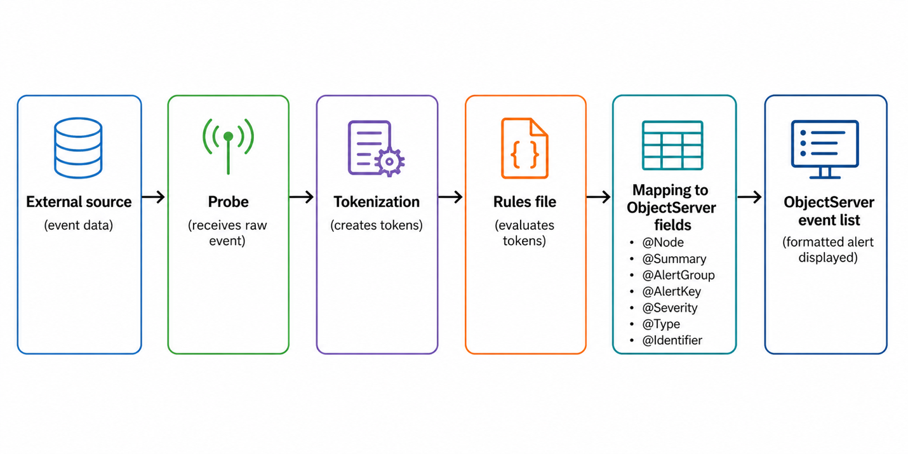

1. An external source sends or exposes event data.
2. The probe receives the raw event.
3. The probe creates tokens from the incoming data.
4. The rules file evaluates those tokens.
5. The rules map selected values into ObjectServer fields such as `@Node`, `@Summary`, `@AlertGroup`, `@AlertKey`, `@Severity`, `@Type`, and `@Identifier`.
6. The formatted event is sent to the ObjectServer and appears in the event list.

Each probe is controlled by two key files: a **properties file** and a **rules file**. The properties file controls runtime behavior such as which ObjectServer to connect to, the log level, and whether raw event capture is enabled. The rules file controls how incoming event data is interpreted, which fields are populated, and whether an event is kept or discarded.

Probes also share a common set of properties regardless of the source they monitor. Properties such as `Server`, `MessageLevel`, `RulesFile`, and `RawCapture` appear across virtually all probe types and behave consistently. This makes it straightforward to apply knowledge of one probe's configuration to another.

#### Tasks

_Environment variables for the lab are already defined earlier in this guide; proceed with the exercises below._

1. On the lab server, list the contents of the main probes directory to review the probe binaries available in the environment:

   ```bash
   ls $OMNIHOME/probes/
   ```

   > **Note:** The probes in this directory are often symlinks to `nco_probe`, a wrapper script that sets up the probe environment before invoking the actual binary under `$OMNIHOME/probes/linux2x86`.

2. Note the `nco_p_syslogd` binary in probes directory. This is the syslogd probe that will be used throughout Section 4.
3. List the platform-specific probe configuration files to locate the syslogd properties and rules files:
   ```bash
   ls $OMNIHOME/probes/linux2x86/syslogd*
   ```
4. Note that the syslogd probe has two key files in the `linux2x86` directory:
   - `syslogd.props` — the properties file that controls probe runtime behavior and ObjectServer connectivity.
   - `syslogd.rules` — the rules file that controls how incoming syslog events are parsed and mapped into OMNIbus alert fields.
5. Review the contents of the rules file:
   ```bash
   cat $OMNIHOME/probes/linux2x86/syslogd.rules
   ```
6. Note that the rules file contains field assignments that map parsed syslog tokens into ObjectServer fields. At this stage, review the structure rather than the detail — the rules development labs in section 4.3 will cover syntax and behavior in depth.
7. Review the contents of the properties file:
   ```bash
   cat $OMNIHOME/probes/linux2x86/syslogd.props
   ```
8. Locate and note the following key **commented** properties in the properties file:
   - `Server` — specifies the ObjectServer the probe will connect to. The default is `NCOMS`.
   - `MessageLevel` — controls the verbosity of the probe log output.
   - `RawCapture` — controls whether incoming raw event data is written to a capture file.
   - `RulesFile` — specifies the path to the rules file the probe will use.

#### Validation

The exercise is successful when all of the following are true:

- You can identify the `nco_p_syslogd` binary and its location.
- You can locate the `syslogd.props` and `syslogd.rules` files under the `linux2x86` directory.
- You can explain the role of the properties file and the rules file.
- You can identify the `Server`, `MessageLevel`, `RawCapture`, and `RulesFile` properties in the properties file and explain what each one controls.

#### Expected result

By the end of this exercise, you will understand the two-file structure used by OMNIbus probes, know how to navigate to the relevant probe files on the lab server, and have a clear mental model of the probe processing pipeline before you start hands-on probe configuration and rules development.

### 4.2 Syslogd probe configuration and testing

#### Objective

In this exercise, you will configure and start the `nco_p_syslogd` probe, send a test event with the `logger` command, verify the resulting alert in the event list, and review the raw and debug output produced by the probe. The goal is for you to see how a probe receives and forwards events before any custom rules-based formatting has been added, and to establish the debug and raw capture workflow that you’ll use later to support rules development.

#### Prerequisites

- Completion of section 4.1.
- The ObjectServer is running.
- SSH access to the lab server.
- Basic familiarity with a shell text editor such as `vi` or `nano`.

#### Background

Each probe reads its configuration from a properties file at startup. The properties file controls how the probe connects to the ObjectServer, where it writes its log output, how verbose that output is, and whether raw event capture is active. For the syslogd probe, the properties file also controls the UDP port on which the probe listens for incoming syslog messages.

When a probe starts, it connects to the ObjectServer specified in the `Server` property, loads the rules file specified in the `RulesFile` property, and begins listening for or collecting events. Events that pass through the rules file without being discarded are forwarded to the ObjectServer as alerts.

Debug logging and raw capture are two important diagnostic tools for probe administration and rules development. Increasing `MessageLevel` to `debug` causes the probe to write detailed processing information to its log file. Enabling `RawCapture` causes the probe to write the original raw event data and the tokens it generates to a capture file, which is stored under `$OMNIHOME/var/`. This token output is the primary input used when writing and testing rules, since it shows exactly what values are available for extraction and field mapping.

#### Tasks

1. On the lab server, run the syslogd probe with the `-dumpprops` flag to display all available properties and their default values:
   ```bash
   $OMNIHOME/probes/nco_p_syslogd -dumpprops
   ```
2. Review the output and note properties such as `Server`, `MessageLevel`, `RawCapture`, `RulesFile`, and `Port`. These are the primary properties used to control probe behavior in this lab. When running -dumpprops, the probe will read its property file, and then dump out the value of each property here. Any property that is not explicitly set (or commented out) in the properties file shows the default value for the probe.
3. Open the syslogd properties file in a text editor: 
   ```bash
   vi $OMNIHOME/probes/linux2x86/syslogd.props
   ```
   Note that all properties are commented out initially. Properties are listed and commented out in the properties file for reference, your configured properties should be added to the end of the file, after the section indicating "Add your settings here". Add the following line to the end of the file to direct the probe to connect to the EVENTS object server:
   ```text
   Server :       'EVENTS'
   ```
   Write and close the file.

4. Validate that the configuration change has taken effect by running the probe with the `-dumpprops` flag and grepping for the `Server` property:
   ```bash
   $OMNIHOME/probes/nco_p_syslogd -dumpprops 2>&1 | grep Server
   ```

   Expected output:

   ```text
   PollServer: 0 # INTEGER (No description available)
   Server: 'EVENTS' # STRING (No description available)
   ServerBackup: '' # STRING (No description available)
   SSLServerCommonName: '' # STRING (No description available)
   ```

   The key line to verify is `Server: 'EVENTS'`, which confirms that your property file change is now active. This validates that the probe will connect to the `EVENTS` ObjectServer when started.

5. Start the syslogd probe using the default properties file:
   ```bash
   $OMNIHOME/probes/nco_p_syslogd -propsfile $OMNIHOME/probes/linux2x86/syslogd.props &
   ```

   > **Note:** Specifying an explicit `-propsfile` is optional when using the default properties file, but it is good practice and becomes important when running multiple instances of the same probe. This applies to virtually all OMNIbus probes — by pointing each instance at a different properties file, it is possible to run several copies of the same probe binary simultaneously with different ports, different rules files, or connections to different ObjectServers — for example, to collect events from separate network segments or customers.

6. Verify that the probe process is running:

   ```bash
   ps -ef | grep nco_p_syslogd | grep -v grep
   ```

   Confirm that the output shows a running `nco_p_syslogd` process with a PID. For example:

   ```text
   root     1464458 1463499  1 16:21 pts/3    00:00:00 /opt/IBM/tivoli/netcool/omnibus/platform/linux2x86/probes64/nco_p_syslogd -propsfile /opt/IBM/tivoli/netcool/omnibus/probes/linux2x86/syslogd.props
   ```
7. Generate a test syslog event using the `logger` command:

   ```bash
   logger -n 127.0.0.1 "Test event from syslogd probe lab"
   ```

   The `logger` command sends a syslog message using the local system’s syslog facility, which delivers the message to the host’s configured syslog destination. In this lab, the `nco_p_syslogd` probe is acting as the syslog receiver and is listening directly on UDP port 514. The probe receives the incoming syslog message, tokenizes it, applies the rules file, and forwards the resulting alert to the ObjectServer. This chain — `logger` → syslog facility → syslogd probe → ObjectServer — is how syslog-sourced events flow into OMNIbus in this lab environment.

8. Open the Web GUI event viewer and change the **filter** to `AllEvents`. Then, in the quick filter box in the upper-right portion of the event viewer window, type "Test event" and press the **Enter** key. This will create a quick filter that matches any field that contains the text "Test event". You should see the test event that you just sent in:

   Note that the event appears with minimal formatting — the field values will reflect whatever default mappings exist in the current rules file rather than a fully developed field set.

   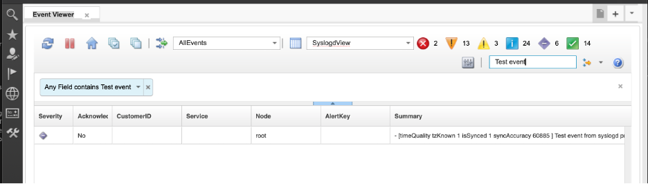

9. Review the alert fields, particularly `Node`, `Summary`, `Severity`, and `Identifier`. Note the default or incomplete field presentation and observe that without custom rules, the event data is not yet in a form that would be useful to an operator. 

10. Stop the probe:
      ```bash
      kill $(pgrep nco_p_syslogd)
      ```

11. Open the syslogd properties file again in a text editor:
    ```bash
    vi $OMNIHOME/probes/linux2x86/syslogd.props
    ```
    Scroll to the end of the file and add the following lines. The convention in OMNIbus properties files is to place custom settings after the server entry for EVENTS at the end of the file, as shown below:
    ```text
       
    MessageLevel            : 'debug'
    RawCapture              : 1
    ```
    
      - Setting the probe `MessageLevel` to `debug` causes the probe to log *everything* it is doing — transport activity, tokenization, rules evaluation, and any errors. This is ideal when you are building or troubleshooting rules, but it generates a lot of output, so you should turn it back down (for example, to `warn`) in production. 

      - Most probes support a **raw capture mode** in addition to debug logging. Raw capture saves the *unprocessed* event stream to a file, exactly as it was received from the source, without applying the rules file. You can then replay that file later using the Standard Input probe (`nco_p_stdin`) to test new rules without waiting for real events. 

      - When a rules file contains syntax errors or logic problems, the probe’s debug log will usually show:
         - The **first error encountered**.
         - The **line number** or section of the rules file where it occurred.
         - The event data that triggered the problem.  
         
      This makes debug mode one of the primary tools for fixing rules and understanding how they behave. 

      - Debug logs can also be used for **performance tuning**. By looking at how many events are processed over a period and how long certain rules sections take, you can identify expensive logic (for example, unnecessary database lookups) and optimize your rules for higher event rates.

      > Remember: use debug mode while you are developing and testing, and then reduce the logging level once your probe and rules are stable.

12. Now that we have enabled debug mode and raw capture, restart the probe:
    ```bash
    $OMNIHOME/probes/nco_p_syslogd -propsfile $OMNIHOME/probes/linux2x86/syslogd.props &
    ```

13. Generate another test event:
    ```bash
    logger -n 127.0.0.1 "Test event from syslogd probe lab"
    ```

14. Review the probe log file to observe the debug output:

    ```bash
    cat $OMNIHOME/log/syslogd.log
    ```

    In debug mode, the syslogd probe logs much more detail than at the default message level. In particular, it shows how the incoming syslog message is broken down into **tokens**.

    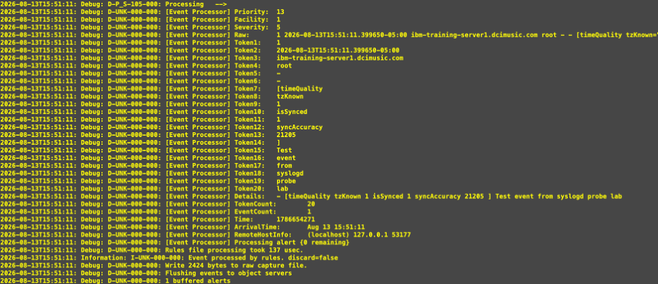

    From the debug output above, you can see the probe reporting:

    - A **Facility** (`1`), **Priority** (`13`), and **Severity** (`5`), derived from the syslog header.
    - A **Raw** token that contains the entire syslog message as received (timestamp, host, program, structured data, and the text `Test event from syslogd probe lab`).
    - A series of **`TokenX`** entries (`Token1` through `Token20`). For this probe, the message body is split on whitespace, so each word or structured element becomes a separate token (for example, `Token3` is the host name, `Token15`–`Token20` are the words of your test message).
    - Additional tokens such as **`Details`** (a reconstructed message body), **`TokenCount`** (total number of tokens created), **`Time`**, **`ArrivalTime`**, and **`RemoteHostInfo`** (source host and port information).

    These tokens are what you will reference in your rules file to populate ObjectServer fields (such as `@Node`, `@Summary`, `@AlertGroup`, `@AlertKey`, `@Severity`, and `@Type`) for each event.

15. Review the raw capture file to inspect the original event data and the tokens generated by the probe:
    ```bash
    cat $OMNIHOME/var/syslogd.cap
    ```

16. In the capture file output, identify the following:
    - The original raw syslog message as received by the probe.
    - The individual tokens generated from that message, such as `$1`, `$2`, and `$*` (the full raw message).

    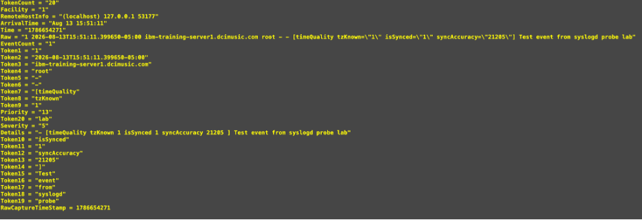

17. Compare the token values in the capture file with the field values shown in the event list alert properties. Note which tokens were mapped to which fields by the current rules, and identify where the mapping is incomplete or missing.

#### Validation

The exercise is successful when all of the following are true:

- You can use `-dumpprops` to display available probe properties.
- You can verify and confirm the `Server` property in the syslogd properties file.
- You can start and verify the `nco_p_syslogd` process.
- You can generate a syslog event with `logger` and locate the resulting alert in the event list.
- You can explain why the initial event formatting is incomplete without custom rules.
- You can enable `MessageLevel` debug and `RawCapture` by editing the properties file.
- You can identify the raw message and generated tokens in the raw capture file.
- You can relate the token output in the capture file to the field values visible in the event list.

#### Expected result

At the end of this exercise, you understand the basic files and properties used by the syslogd probe, can start and test the probe, and can use debug logging and raw capture to inspect incoming event data. You also understand the gap between raw token output and a fully formatted OMNIbus alert, which establishes the need for the rules development work in section 4.3.

### 4.3 Probe rules by example

#### Objective

In this section, you’ll learn how probe rules transform raw event data into useful OMNIbus alerts. You’ll start with a conceptual explanation of rules structure and field mapping, then work through a series of hands-on labs that incrementally build a working rules file. Each lab introduces one concept — field mapping, token extraction, switch/case logic, deduplication, correlation, conditional severity, and more — and you’ll test each one immediately against live events that you generate with the `logger` command.

#### Prerequisites

- Completion of section 4.2.
- The ObjectServer is running.
- SSH access to the lab server.
- Basic familiarity with a shell text editor such as `vi` or `nano`.

#### Background

As we have learned, when a probe receives an event, it creates tokens from the raw input. The rules file evaluates those tokens and determines two things: whether the event should be discarded or forwarded to the ObjectServer, and if it is to be forwarded, how it should be mapped into ObjectServer alert fields.

Some of the key ObjectServer fields that rules are responsible for populating are:

- **`@Identifier`** — controls deduplication. Must be designed carefully so that only truly matching events deduplicate against each other.
- **`@Type`** — distinguishes problem events (`1`) from resolution events (`2`) and drives the `generic_clear` correlation behavior reviewed in section 3.3.
- **`@Node`** — the host or device the event relates to.
- **`@AlertGroup`** — the event category or class.
- **`@AlertKey`** — the specific resource or condition within the node.
- **`@Summary`** — the operator-facing description of the event.
- **`@Severity`** — the operational priority, using the 0–5 scale covered in section 2.2.
- **`@Manager`** — identifies the probe or management system that generated the alert.
- **`@Agent`** — identifies the probe agent name.

Raw capture is the primary tool for rules development. It provides the original token stream — including the `$Raw` token which contains the full original message — that can be used to design extraction patterns and validate rule changes. For our tasks using the syslogd probe, working with the `$Raw` token is more reliable than depending on positional tokens such as `$1` and `$2`, because syslog messages are tokenized on whitespace and the position of any given value can vary between message types. For probes that receive structured data such as SNMP traps with well-defined varbinds, positional tokens will be more predictable — but for free-form text-based sources like syslog, regular expression extraction from `$Raw` is the recommended approach.

Rules files also support a `log()` function that writes diagnostic output to the probe log file. This is invaluable during development for confirming which code path an event is taking and what values are being set.

#### 4.3.1 Basic rules and first mapped fields

**Objective**

Create a new blank rules file for the syslogd probe, add the standard ProbeWatch stanza, set basic fields, and verify that events reach the ObjectServer correctly.

**Background**

Rather than modifying the default syslogd rules file, this lab creates a new training-specific rules file at:
`$OMNIHOME/probes/linux2x86/syslogd-training.rules`

This approach preserves the default `syslogd probe` rules file and makes it clear which content belongs to this training exercise.

All OMNIbus probes generate internal self-monitoring events known as ProbeWatch events. These are sent by the probe itself to the ObjectServer to indicate that the probe has started, is running, or is shutting down. The `@Manager` field of these events is set to `"ProbeWatch"` by the probe, which makes it straightforward to identify and handle them separately from real events. The ProbeWatch stanza must always be present in a rules file, irrespective of the probe type.

**Tasks**

1. On the lab server, create the new training rules file using a text editor:
   ```bash
   vi $OMNIHOME/probes/linux2x86/syslogd-training.rules
   ```

2. Enter the following content as the starting rules file. This is the minimum viable rules file — it handles ProbeWatch events and provides an empty `else` block where all real event processing will be added:

   ```text
   if( match( @Manager, "ProbeWatch" ) )
   {
           switch(@Summary)
           {
           case "Running ...":
                   @Severity = 1
                   @AlertGroup = "probestat"
                   @Type = 2
           case "Going Down ...":
                   @Severity = 5
                   @AlertGroup = "probestat"
                   @Type = 1
           default:
                   @Severity = 1
           }
           @AlertKey = @Agent
           @Summary = @Agent + " probe on " + @Node + ": " + @Summary
   }
   else
   {
      # event processing begins here
   }
   ```

   Review the structure of the rules file and identify the two main blocks: the ProbeWatch block, which handles the probe's own self-monitoring events, and the empty `else` block, which is where all real incoming event processing will be added in the labs that follow.

   Save and close the file.

3. Stop the syslogd probe if it is still running:
   ```bash
   kill $(pgrep nco_p_syslogd)
   ```

4. Use the probe rules syntax checker to validate your new rules file.


    The `nco_p_syntax` utility is a standalone **rules syntax checker** for Netcool probes. It reads a rules file, checks the syntax, connects to the requested ObjectServer to validate the existence of fields referenced in the rules, and reports any errors without having to start the actual probe.

    ```bash
    $OMNIHOME/probes/nco_p_syntax -server EVENTS -rulesfile $OMNIHOME/probes/linux2x86/syslogd-training.rules
    ```

    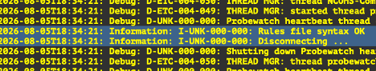

    If the syntax is correct, the command exits without error and prints no syntax error messages. You will see the entry "Rules file syntax OK".
    
     If errors are reported, note the line numbers that are shown to be in error, open the rules file, and correct the problems before proceeding.

5. Start the probe with the training rules file, using the `-rulesfile` command line switch to specify our custom rules file:
   ```bash
   $OMNIHOME/probes/nco_p_syslogd -rulesfile $OMNIHOME/probes/linux2x86/syslogd-training.rules \
   -messagelog $OMNIHOME/log/syslogd-training.log &
   ```

6. Verify that the probe is running:
   ```bash
   ps -ef | grep nco_p_syslogd
   ```

   If the probe is not running, you can check the log file for errors:
   ```bash
   cat $OMNIHOME/log/syslogd-training.log
   ```

7. Next, re-open our `syslogd-training.rules` file and add the following lines to the `else` block in the rules file. Open the file in a text editor and place these lines between the `else` block's `{` and `}`:

   ```text
           log(DEBUG, "===== Entering my rules file section")
           @Manager = "MyProbe running on " + hostname()
           @AlertGroup = "Network"
           log(DEBUG, "===== Exiting my rules file section")
   ```

   The `log(DEBUG, ...)` statements write diagnostic output to the probe log file. The `hostname()` function returns the hostname of the server the probe is running on. The full `else` block should now look like this:

   ```text
   else
   {
         # event processing begins here

           log(DEBUG, "===== Entering my rules file section")
           @Manager = "MyProbe running on " + hostname()
           @AlertGroup = "Network"
           log(DEBUG, "===== Exiting my rules file section")
   }
   ```

   In this case, we are setting the Manager field of the alert to the value of the hostname() function, and setting the AlertGroup field to the literal string "Network". Note that event fields are referenced with the `@` symbol preceding the name. Tokens are referenced with the `$` symbol.

   Save and close the file.

8. Stop the probe, syntax-check the updated rules file, and restart the probe:
   ```bash
   kill $(pgrep nco_p_syslogd)
   ```
   ```bash
   $OMNIHOME/probes/nco_p_syntax -server EVENTS -rulesfile $OMNIHOME/probes/linux2x86/syslogd-training.rules
   ```
   ```bash
   $OMNIHOME/probes/nco_p_syslogd -rulesfile $OMNIHOME/probes/linux2x86/syslogd-training.rules -messagelog $OMNIHOME/log/syslogd-training.log &
   ```

9. Next, generate a test event using the following `logger` command:
    ```bash
    logger -n 127.0.0.1 'ALERT - LinkDown: Received a link down alert from routerA interface GigabitEthernet0/0 : unknown reason code'
   ```

10. Open the Web GUI event list, change your filter and views to the ones you created in the previous lab (SyslogdProbe) and locate the resulting alert. Note that `@Manager` and `@AlertGroup` are now populated, but other fields such as `@Node`, `@Summary`, `@AlertKey`, and `@Identifier` are not yet set by the rules. `@Severity` is also **indeterminate**.

    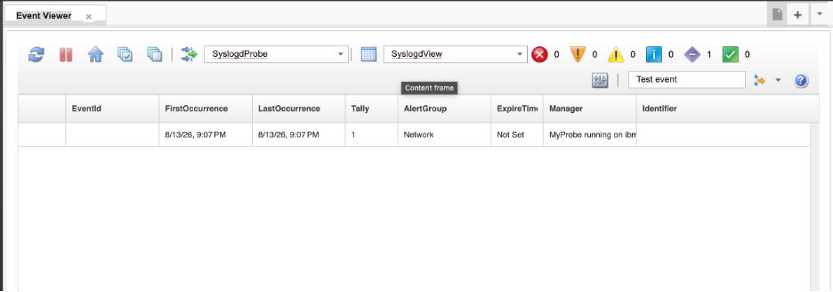

11. Examine the raw capture file to review the tokens generated from the incoming syslog message:
    ```bash
    cat $OMNIHOME/var/syslogd.cap
    ```

    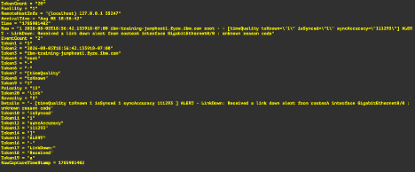

    Note the `$Raw` token, which contains the full original message text, and the positional tokens such as `$1`, `$2`, and so on, which are generated by splitting the message on whitespace. Note that because syslog messages vary in structure, positional tokens are unreliable for extracting specific values — the same piece of information may appear at a different position in a different message type. For this reason, the labs that follow will use regular expression extraction from `$Raw` rather than positional tokens.

**Validation**

- The `syslogd-training.rules` file exists and passes syntax check.
- The probe starts successfully using the training rules file.
- A test event generated with `logger` appears in the event list with `@Manager` and `@AlertGroup` populated.
- The raw capture file shows the `$Raw` token containing the full original syslog message.

**Expected result**

At the end of this lab, the student has a working training rules file, understands the role of the ProbeWatch stanza, and has observed the difference between what raw token output looks like and what a fully mapped alert should look like. The student also understands why `$Raw` and regular expression extraction are preferred over positional tokens for syslog-based event processing.

#### 4.3.2 Extracting EventId

**Objective**

Use the `extract()` function to populate the `@EventId` field from the raw syslog message, and understand the difference between greedy and non-greedy regular expression matching.

**Background**

The `extract()` function applies a regular expression to a string and returns the content of the first capture group `()`. It is the primary tool for pulling specific values out of unstructured text such as syslog messages. Regular expressions are used heavily in processing events and alerts in rules.

In this lab example alert for our purposes, the convention is that the event **type** always follows the text `ALERT - ` in the message, and ends at the first colon (`:`). A regular expression is used to extract whatever appears between those two boundaries and assign it to `@EventId`, which will then be used in subsequent labs to drive a switch/case structure.

> **Note** Event types can be used to classify alerts according to the condition they report. Common examples that indicate issues might be LINK DOWN, INTERFACE UP, DISK FULL, HIGH CPU, MEMORY THRESHOLD, and APPLICATION UNAVAILABLE. Classifying events in this way makes it easier to apply consistent processing rules. In later labs, the extracted @EventId value will be used in a switch or case structure to apply event-specific logic, such as assigning a severity, setting an alert group, identifying a resolution event, or adding enrichment fields.

> **Note:** Understanding the difference between greedy and non-greedy matching is important when writing extraction patterns. A greedy quantifier such as `.*` will match as much text as possible — so `.*:` would match all the way to the *last* colon in the string. A non-greedy quantifier such as `.*?` will match as little text as possible — stopping at the *first* colon. In a message like `ALERT - LinkDown: Received a link down alert from routerA interface GigabitEthernet0/0 : unknown reason code`, using a greedy match to the colon would extract `LinkDown: Received a link down alert from routerA interface GigabitEthernet0/0 ` — far more than intended. The non-greedy `.*?` stops at the first colon and correctly extracts `LinkDown`.

**Tasks**

1. Open the training rules file in a text editor:
   ```bash
   vi $OMNIHOME/probes/linux2x86/syslogd-training.rules
   ```

2. Add the following line to the `else` block, after the `@AlertGroup` assignment:
   ```text
           @EventId = extract($Raw, ".*ALERT - (.*?):.*")
   ```
   The full `else` block should now look like this:
   ```text
   else
   {
      # event processing begins here

           log(DEBUG, "===== Entering my rules file section")
           @Manager = "MyProbe running on " + hostname()
           @AlertGroup = "Network"
           @EventId = extract($Raw, ".*ALERT - (.*?):.*")
           log(DEBUG, "===== Exiting my rules file section")
   }
   ```
   Save and close the file.

3. Stop the probe, syntax-check, and restart:
   ```bash
   kill $(pgrep nco_p_syslogd)
   ```

   ```bash
   $OMNIHOME/probes/nco_p_syntax -server EVENTS -rulesfile $OMNIHOME/probes/linux2x86/syslogd-training.rules
   ```

   ```bash
   $OMNIHOME/probes/nco_p_syslogd -rulesfile $OMNIHOME/probes/linux2x86/syslogd-training.rules \
    -messagelog $OMNIHOME/log/syslogd-training.log &
   ```
   If the syntax check reports errors, open the log file for details:
   ```bash
   cat $OMNIHOME/log/syslogd-training.log
   ```

4. Delete the previous alert from the event list so the result is clear before testing. Right-click on the alert and select the `Delete` tool:

   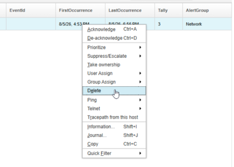

5. Generate the test event again:
   ```bash
   logger -n 127.0.0.1 'ALERT - LinkDown: Received a link down alert from routerA interface GigabitEthernet0/0 : unknown reason code'
   ```

6. Locate the alert in the event list and confirm that the `@EventId` field now shows `LinkDown`. This confirms that the non-greedy extraction correctly stopped at the first colon rather than continuing to the last.

   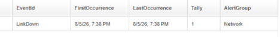

**Validation**

- The rules file passes syntax check.
- The `@EventId` field in the resulting alert shows `LinkDown`.
- The student can explain why `.*?` is used instead of `.*` in this extraction pattern.

**Expected result**

At the end of this lab, the student can use `extract()` to pull specific values from unstructured text and understands the practical difference between greedy and non-greedy matching.

#### 4.3.3 Switch/case field mapping

**Objective**

Add a `switch/case` structure to the rules file to handle multiple event types, map additional alert fields for the `LinkDown` event type, and provide a default handler for unrecognized events.

**Background**

Now that `@EventId` is populated, a `switch/case` structure can be used to branch the rules logic based on the event type. Each `case` handles one specific event type and maps the fields appropriate for that type. The `default` case handles any event type that does not match a defined case, ensuring that unrecognized events are still forwarded to the ObjectServer with a minimal but informative field set rather than being silently dropped or left unmapped.

**Tasks**

1. Open the training rules file in a text editor:
   ```bash
   vi $OMNIHOME/probes/linux2x86/syslogd-training.rules
   ```

2. Replace the content of the `else` block with the following. The `switch` is placed after the `@EventId` extraction so that the switch can branch on the extracted value:
   ```text
   else
   {
           log(DEBUG, "===== Entering my rules file section")
           @Manager = "MyProbe running on " + hostname()
           @AlertGroup = "Network"
           @EventId = extract($Raw, ".*ALERT - (.*?):.*")

           switch(@EventId)
           {
                   case "LinkDown":
                           log(INFO, "===== Entering LinkDown segment")
                           @Node = extract($Raw, ".* alert from (.*?) .*")
                           @Summary = extract($Raw, ".* ALERT - LinkDown: (.*)")
                           @AlertKey = extract($Raw, ".* interface (.*?) .*")
                           @Type = 1
                           @Severity = 5
                   default:
                           log(INFO, "===== Found an unknown/unhandled event")
                           @Summary = "Unhandled event: " + $Raw
                           @Severity = 1
           }

           log(DEBUG, "===== Exiting my rules file section")
   }
   ```
Here we perform the following extractions and OMNIbus field assignments when we receive an event where the @EventId is `LinkDown`:

- `@Node = extract($Raw, ".* alert from (.*?) .*")`
  - Searches for the phrase `alert from`.
  - Captures the shortest sequence of characters after `alert from` up to the next space using parentheses for the capture group `(.*?)`.
  - In our example alert, this yields `routerA`, so `@Node` is set to the router name.

- `@Summary = extract($Raw, ".* ALERT - LinkDown: (.*)")`
  - Matches everything up to `ALERT - LinkDown: `.
  - Captures everything after that prefix on the line using `(.*)`.
  - For our example alert, it captures `Received a link down alert from routerA interface GigabitEthernet0/0 : unknown reason code`, so `@Summary` becomes the full descriptive text.

- `@AlertKey = extract($Raw, ".* interface (.*?) .*")`
  - Finds the word `interface`.
  - Captures the shortest sequence of characters immediately after `interface` up to the next space using `(.*?)`.
  - In the example alert, this is `GigabitEthernet0/0`, so `@AlertKey` uniquely identifies the interface that went down.

- `@Type = 1`
  - Assigns a numeric type code of `1`.
  - This is used to classify the alert as a `problem` alert for correlating pairs (more on this later).

- `@Severity = 5`
  - Sets the numeric severity level to `5` for any `LinkDown` alert.


   Save and close the file.

3. Stop the probe, syntax-check, and restart:
   ```bash
   kill $(pgrep nco_p_syslogd)
   ```

   ```bash
   $OMNIHOME/probes/nco_p_syntax -server EVENTS -rulesfile $OMNIHOME/probes/linux2x86/syslogd-training.rules
   ```

   ```bash
   $OMNIHOME/probes/nco_p_syslogd -rulesfile $OMNIHOME/probes/linux2x86/syslogd-training.rules -messagelog $OMNIHOME/log/syslogd-training.log &
   ```
   If the syntax check fails, examine the log file:
   ```bash
   cat $OMNIHOME/log/syslogd-training.log
   ```

4. Return to the WebGUI event viewer and delete the previous alert from the event list.

5. Generate the test event:
   ```bash
   logger -n 127.0.0.1 'ALERT - LinkDown: Received a link down alert from routerA interface GigabitEthernet0/0 : unknown reason code'
   ```

6. Locate the alert in the event list and confirm that `@Node`, `@Summary`, `@AlertKey`, `@Type`, and `@Severity` are now populated correctly from the `LinkDown` case statement.

   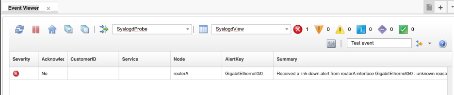

7. Now test the default case by generating an event that does not match any defined case:
   ```bash
   logger -n 127.0.0.1 'ALERT - LinkUp: Received a link up alert from routerA interface GigabitEthernet0/0 : peer re-established'
   ```

   Confirm that this event appears in the event list with a summary of `Unhandled event:` followed by the full raw message text, and a severity of `1`. Also have a look at the `Count` field and see that it has incremented. This shows how the `default:` case acts as a catch‑all for any event that does not match one of the specific patterns. However, it deduplicated with the existing LinkDown alert. This is due to the fact we have not yet set the `@Identifier` for our alerts in the rules.

**Validation**

- The rules file passes syntax check.
- The `LinkDown` event populates `@Node`, `@Summary`, `@AlertKey`, `@Type = 1`, and `@Severity = 5`.
- An unrecognized event type hits the `default` case and appears with `@Severity = 1` and a summary beginning with `Unhandled event:`.

**Expected result**

At the end of this lab, the student understands how to use `switch/case` to branch rules logic by event type, and has a working structure that can be extended with additional cases in subsequent labs.

#### 4.3.4 Deduplication with Identifier

**Objective**

Add an `@Identifier` value to the `LinkDown` case and observe deduplication behavior in the ObjectServer.

**Background**

As covered in section 3.3, the `deduplication` trigger fires when an incoming event matches an existing alert by `@Identifier`. Without an `@Identifier` set in the rules, all alerts with no @Identifier would simply deduplicate into one row. Conversely, with an @Identifer that is too unique (for example, containing a time stamp), each occurrence of the same event will be inserted as a new row in `alerts.status`, quicly filling up the view with redundant alarms. Once an appropriate `@Identifier` is set, repeated occurrences of the same condition update the existing alert rather than creating duplicates — incrementing the `Count` field and updating `LastOccurrence`.

The `@Identifier` should be composed of fields that together uniquely identify the specific condition: typically `@Node`, `@AlertKey`, `@EventId`, and `@Manager`. Including `@Manager` ensures that the same condition reported by different probes or management systems does not incorrectly deduplicate.

> **Note:** In this lab the `LinkDown` `@Identifier` does not include `@Type`. This is intentional at this stage — the next lab (4.3.5) introduces the `LinkUp` resolution event, which uses a distinct `@EventId` value (`"LinkUp"` vs `"LinkDown"`), meaning the two events will never share the same `@Identifier` regardless of whether `@Type` is included. You could choose to append `@Type` to the `LinkDown` identifier for consistency, and it would make no difference to the outcome — the problem and resolution events would still not deduplicate against each other.

**Tasks**

1. Open the training rules file in a text editor:
   ```bash
   vi $OMNIHOME/probes/linux2x86/syslogd-training.rules
   ```

2. Add the `@Identifier` assignment statement to the case statement for the `LinkDown` alert:
   ```text
                   case "LinkDown":
                           log(INFO, "===== Entering LinkDown segment")
                           @Node = extract($Raw, ".* alert from (.*?) .*")
                           @Summary = extract($Raw, ".* ALERT - LinkDown: (.*)")
                           @AlertKey = extract($Raw, ".* interface (.*?) .*")
                           @Type = 1
                           @Severity = 5
                           @Identifier = @Node + " : " + @AlertKey + ":" + @EventId + ":" + @Manager
   ```
   This identifier combines the most important pieces of context for the alert: the device (`@Node`), the specific resource on that device (`@AlertKey`), the event type (`@EventId`), and the source probe (`@Manager`). Putting these together into one string makes it much easier to deduplicate repeated events for the same interface and device, while still distinguishing different event types and probes. It also produces an identifier that is human‑readable, which helps when troubleshooting in the event list.
   
   Save and close the file.

3. Stop the probe, syntax-check, and restart:
   ```bash
   kill $(pgrep nco_p_syslogd)
   ```

   ```bash
   $OMNIHOME/probes/nco_p_syntax -server EVENTS -rulesfile $OMNIHOME/probes/linux2x86/syslogd-training.rules
   ```

   ```bash
   $OMNIHOME/probes/nco_p_syslogd -rulesfile $OMNIHOME/probes/linux2x86/syslogd-training.rules -messagelog $OMNIHOME/log/syslogd-training.log &
   ```

4. Return to the Web GUI event viewer and delete the previous alert from the event list.

5. Generate the `LinkDown` event:
   ```bash
   logger -n 127.0.0.1 'ALERT - LinkDown: Received a link down alert from routerA interface GigabitEthernet0/0 : unknown reason code'
   ```

6. Locate the alert in the event list. Note the values of `FirstOccurrence`, `LastOccurrence`, and `Tally`.

7. Generate the same event two or three more times:
   ```bash
   logger -n 127.0.0.1 'ALERT - LinkDown: Received a link down alert from routerA interface GigabitEthernet0/0 : unknown reason code'
   ```

8. Refresh the event list and observe that no new rows were created. Instead, the existing alert has been updated — `LastOccurrence` has advanced and `Count` has incremented for each repeated occurrence. This is the deduplication behavior driven by the `@Identifier` field and the `deduplication` trigger reviewed in section 3.3.

9. Now send a second `LinkDown` event from a different device and interface to confirm that a different `@Identifier` produces a separate alert row:
   ```bash
   logger -n 127.0.0.1 'ALERT - LinkDown: Received a link down alert from routerB interface GigabitEthernet1/11 : unknown reason code'
   ```

   Refresh the event list again and confirm that the new alert appears as a separate row because the value of `@Identifier` is different for `routerB` and `GigabitEthernet1/11`.

   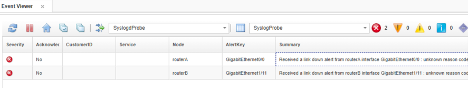

**Validation**

- The rules file passes syntax check.
- Sending the same event multiple times results in a single alert in the event list, not multiple rows.
- The `Count` field increments and `LastOccurrence` updates with each repeated occurrence.
- The student can explain how `@Identifier` drives this behavior through the ObjectServer `deduplication` trigger.

**Expected result**

By the end of this lab, you understood how to design a meaningful `@Identifier` value and why it matters. You saw how the ObjectServer uses `@Identifier` to **deduplicate** events, so repeated alerts for the same device and interface updated a single record instead of creating multiple separate ones. This gave you a concrete example of how good identifier design improves both event quality and operator usability.

#### 4.3.5 Down/Up correlation

**Objective**

Add a `LinkUp` case to the rules file and observe how a resolution event correlates with and clears the earlier `LinkDown` problem event through the `generic_clear` ObjectServer automation.

**Background**

As covered in section 3.3, the `generic_clear` trigger matches Type 2 resolution events against Type 1 problem events using the combination of `@Node`, `@AlertGroup`, `@AlertKey`, and `@Manager`. For correlation to work, all four of these fields must match between the problem and resolution events, and the resolution event must have a later `LastOccurrence` than the problem event.

The `@Identifier` for the resolution event should be distinct from the problem event's `@Identifier` to prevent the two from deduplicating against each other. Appending `@Type` to the `@Identifier` achieves this — the problem event (`@Type = 1`) and resolution event (`@Type = 2`) will have different `@Identifier` values and will not deduplicate, but they will still correlate and clear through `generic_clear`.

**Tasks**

1. Open the training rules file in a text editor:
   ```bash
   vi $OMNIHOME/probes/linux2x86/syslogd-training.rules
   ```

2. Add a new case statement for our `LinkUp` case to the `switch` block, immediately after the `LinkDown` case and before the `default` case statement:
   ```text
                   case "LinkUp":
                           log(INFO, "===== Entering LinkUp segment")
                           @Node = extract($Raw, ".* alert from (.*?) .*")
                           @Summary = extract($Raw, ".* ALERT - LinkUp: (.*)")
                           @AlertKey = extract($Raw, ".* interface (.*?) .*")
                           @Type = 2
                           @Severity = 1
                           @Identifier = @Node + " : " + @AlertKey + ":" + @EventId + ":" + @Manager + ":" + @Type
   ```
   Note that we have set the `@Type` field of this alert to `2`, which indicates that it is a `resolution` alert, and we have set the `@Severity` to `1`, which is in turn set to `0` by the `generic clear` automation once the original problem alert has been set to clear. We also append the `@Type` field to the end of the `@Identifier`.
   
   Save and close the file.

3. Stop the probe, syntax-check, and restart:
   ```bash
   kill $(pgrep nco_p_syslogd)
   ```

   ```bash
   $OMNIHOME/probes/nco_p_syntax -server EVENTS -rulesfile $OMNIHOME/probes/linux2x86/syslogd-training.rules
   ```

   ```bash
   $OMNIHOME/probes/nco_p_syslogd -rulesfile $OMNIHOME/probes/linux2x86/syslogd-training.rules -messagelog $OMNIHOME/log/syslogd-training.log &
   ```

4. Return to the WebGUI event viewer and delete any existing alerts from your event list.

5. Generate the `LinkDown` **problem** event:
   ```bash
   logger -n 127.0.0.1 'ALERT - LinkDown: Received a link down alert from routerA interface GigabitEthernet0/0 : unknown reason code'
   ```

6. Confirm that the `LinkDown` alert appears in the event list with `@Severity = 5` and `@Type = 1`. If it does not appear immediately, refresh the event list periodically until it does.

7. Generate the `LinkUp` resolution event:
   ```bash
   logger -n 127.0.0.1 'ALERT - LinkUp: Received a link up alert from routerA interface GigabitEthernet0/0 : unknown reason code'
   ```

8. Observe the event list. Within the next `generic_clear` cycle (which runs every 5 seconds), both the `LinkDown` and `LinkUp` events will be cleared — their severity will be set to 0. If they are not visible after clearing, confirm that the event list filter is set to show cleared events, or note that they have been removed from the active view as expected.

   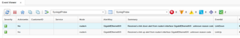

   This clearing behavior is entirely driven by the ObjectServer `generic_clear` trigger reviewed in section 3.3 — no additional probe rules or ObjectServer configuration was required beyond setting `@Type`, `@Node`, `@AlertGroup`, `@AlertKey`, and `@Manager` correctly and consistently between the two events.

**Validation**

- The `LinkDown` event appears in the event list with `@Severity = 5` and `@Type = 1`.
- The `LinkUp` event appears in the event list with `@Severity = 1` and `@Type = 2`.
- Both events are cleared within seconds of the `LinkUp` event arriving, driven by the `generic_clear` trigger.
- You understand which fields must match between the problem and resolution events for `generic_clear` to work.

**Expected result**

At the end of this lab, the student understands how to design problem and resolution event pairs in probe rules so that they correlate and clear automatically through the ObjectServer `generic_clear` automation.

#### 4.3.6 Conditional logic

**Objective**

Add a `LinkUtilization` case that uses `if / else if / else` logic to set event severity based on the extracted utilization value, and understand how conditional rules logic enables dynamic severity assignment.

**Background**

Not all events have a fixed severity based on the event time — some may carry a value in the event text that should determine how the event is classified. Probe rules support `if / else if / else` conditional logic to handle these cases. In this lab, a utilization percentage is extracted from the event text and used to set `@Severity` and `@Type` according to defined thresholds.

Note that when comparing extracted values numerically, they must be cast to `int()` before the comparison. Extracted values are strings by default, and using `<`, `>`, or `<=` on strings will cause a parse error.

Also note that in this scenario the `@Identifier` includes `@Type`. Unlike `LinkDown` and `LinkUp` which are distinct event types, `LinkUtilization` has no separate and distinct clearing event — the same event type serves as both the problem and the resolution depending on the utilization value. If `@Type` were not included in the `@Identifier`, a resolution event (Type 2) would deduplicate against a problem event (Type 1) and the existing alert would not be cleared correctly. Appending `@Type` to the `@Identifier` keeps problem and resolution events separate in the ObjectServer.

**Tasks**

1. Open the training rules file in a text editor:
   ```bash
   vi $OMNIHOME/probes/linux2x86/syslogd-training.rules
   ```

2. Add the `LinkUtilization` case to the `switch` block, after the `LinkUp` case and before the `default` case:
   ```text
                   case "LinkUtilization":
                           log(INFO, "===== Entering LinkUtilization segment")
                           @Node = extract($Raw, ".* link utilization for (.*?) .*")
                           @Summary = extract($Raw, ".* ALERT - LinkUtilization: (.*)")
                           @AlertKey = extract($Raw, ".* ALERT.* interface (.*?) is.*")
                           # extract the utilization value from the alert into a token named $utilval, which will be used for the conditional
                           $utilval = extract($Raw, ".* ALERT.* is (.*)%.*")
                           log(INFO, "$utilval is " + $utilval)
                           if (int($utilval) < 70)
                           {
                                   # less than 70% is a resolution — clears previous alerts
                                   @Severity = 1
                                   @Type = 2
                           }
                           else if (int($utilval) <= 80)
                           {
                                   # 70–79% is a warning
                                   @Severity = 3
                                   @Type = 1
                           }
                           else if (int($utilval) <= 95)
                           {
                                   # 80–94% is major
                                   @Severity = 4
                                   @Type = 1
                           }
                           else if (int($utilval) <= 100)
                           {
                                   # 95–100% is critical
                                   @Severity = 5
                                   @Type = 1
                           }
                           else
                           {
                                   # unknown or non-integer value — flag as critical
                                   @Summary = @Summary + " (unknown or non-integer utilization value)"
                                   @Type = 1
                                   @Severity = 5
                           }
                           @Identifier = @Node + " : " + @AlertKey + ":" + @EventId + ":" + @Manager + @Type
                           update(@Severity)
   ```
   Save and close the file.

   > **Note:**  The `update(@Severity)` statement explicitly instructs the ObjectServer to overwrite the `@Severity` field of the existing alert with the value from the incoming event when deduplication occurs. Without this, only `@Summary` and `@AlertKey` are updated automatically on deduplication (refer back to the deduplication trigger) — all other fields retain their original values. For `LinkUtilization`, where severity changes with each new reading, this statement is essential to ensure the alert @Summary reflects the current condition.

3. Stop the probe, syntax-check, and restart:
   ```bash
   kill $(pgrep nco_p_syslogd)
   ```

   ```bash
   $OMNIHOME/probes/nco_p_syntax -server EVENTS -rulesfile $OMNIHOME/probes/linux2x86/syslogd-training.rules
   ```

   ```bash
   $OMNIHOME/probes/nco_p_syslogd -rulesfile $OMNIHOME/probes/linux2x86/syslogd-training.rules -messagelog $OMNIHOME/log/syslogd-training.log &
   ```
   If the syntax check fails, examine the log file for clues:
   ```bash
   cat $OMNIHOME/log/syslogd-training.log
   ```

   Restart the probe when the sytax check succeeds:
   ```bash
   $OMNIHOME/probes/nco_p_syslogd -rulesfile $OMNIHOME/probes/linux2x86/syslogd-training.rules -messagelog $OMNIHOME/log/syslogd-training.log &
   ```

4. Return to the Web GUI and delete any existing alerts from the event list.

5. Generate a warning-level utilization event (77% — falls in the 70–79% range, Severity 3):
   ```bash
   logger -n 127.0.0.1 'ALERT - LinkUtilization: Average link utilization for routerA interface GigabitEthernet0/0 is 77%'
   ```
   Confirm the alert appears in the event list with `@Severity = 3`, and make note of the @Summary. (You may need to refresh the list a few times for it to show up)

   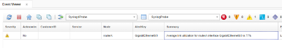

6. Generate a major-level utilization event (84% — falls in the 80–94% range, Severity 4):
   ```bash
   logger -n 127.0.0.1 'ALERT - LinkUtilization: Average link utilization for routerA interface GigabitEthernet0/0 is 84%'
   ```
   Because both the 77% and 84% events produce `@Type = 1` and share the same `@Node`, `@AlertKey`, `@EventId`, and `@Manager`, their `@Identifier` values are identical. This means the 84% event deduplicates against the 77% alert rather than creating a new row. Because `update(@Severity)` is explicitly set in the rules, the existing alert's severity is updated from 3 to 4, reflecting the worsening condition. This is intentional — the alert maintains state as the utilization level changes over time, rather than creating a new alert for each new reading. 

   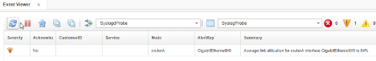

7. Generate a critical-level event at 98% again:
   ```bash
   logger -n 127.0.0.1 'ALERT - LinkUtilization: Average link utilization for routerA interface GigabitEthernet0/0 is 98%'
   ```
   Confirm that the alert @Summary and @Severity change to reflect our rules criteria.

   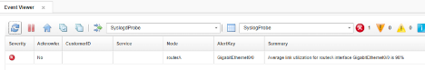

8. Finally, generate a resolution event (25% — below 70%, Severity 1, Type 2):
   ```bash
   logger -n 127.0.0.1 'ALERT - LinkUtilization: Average link utilization for routerA interface GigabitEthernet0/0 is 25%'
   ```

   Observe that the resolution event is forwarded to the ObjectServer, indicated by falling below our threshold, and within the next `generic_clear` cycle, the problem event is cleared. Subsequently the delete_clears will reap the event if it doesn't occur again (within 120 seconds of being cleared):

   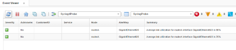

**Validation**

- The rules file passes syntax check.
- A 77% utilization event produces `@Severity = 3`.
- An 84% utilization event produces `@Severity = 4`.
- An 98% utilization event produces `@Severity = 5`.
- A 25% utilization event triggers clearing of the earlier problem alert via `generic_clear`.
- You can explain why `int()` is required when comparing extracted values.
- Youcan explain why `@Type` is included in the `@Identifier` for this event type.

**Expected result**

At the end of this lab, the student can write conditional rules logic to assign severity dynamically based on extracted values, understands the importance of `int()` casting, and understands how `@Type` in the `@Identifier` prevents incorrect deduplication between problem and resolution events of the same type.

#### 4.3.7 Lookup tables

**Objective**

Create a lookup file that maps device names to customer data, declare the table in the rules file, and use it to enrich incoming alerts with the `@CustomerID` field populated from external data.

**Background**

Lookup tables allow probe rules to enrich events with data that is not present in the original event message. Rather than embedding customer, location, or service data in the rules file itself, a lookup table stores that data in an external file and makes it available to the rules at processing time. The rules file declares the table and then performs a lookup using a key value extracted from the event — typically `@Node`, `@AlertKey`, or another identifying field — to retrieve the associated data and assign it to one or more alert fields.

This pattern is widely used in production OMNIbus environments. Common examples include:

- **Customer enrichment** — mapping device hostnames to customer names, account numbers, or service tiers in a managed services environment.
- **Location data** — mapping node names to physical site, building, or data centre location so operators can immediately see where a fault is occurring.
- **Contact information** — mapping nodes or alert groups to on-call team names or escalation contacts.
- **Service classification** — mapping devices or alert groups to business service names so events can be correlated to the services they affect.
- **Severity overrides** — mapping specific node and alert group combinations to a predefined severity, allowing business rules to be applied at ingestion time without modifying the probe rules logic.

In this lab, a lookup table maps router names to customer names and service levels. The `@CustomerID` field — added to `alerts.status` in section 3.2 — will be populated from the lookup result.

**Prerequisites**

- Completion of section 4.3.6.
- The `CustomerID` custom column must exist in `alerts.status`. If section 3.2 has not been completed, return to that section and add the `CustomerID` column before proceeding.

**Tasks**

1. On the lab server, create the lookup file:
   ```bash
   vi $OMNIHOME/probes/linux2x86/CUSTOMERS.lookup
   ```

   Enter the following content. Each line consists of three fields separated by a single tab character: the node name, the customer name, and the service level. Take care not to leave any extraneous lines in the file, only these three lines. Blank or any lines that do not match three tab-separated lines will cause the syntax checker to fail:
   ```text
   routerA	ACME, Inc.	Gold
   routerB	Candy's Candies	Platinum
   routerC	Mad Martin's Menagerie	Silver
   ```
   Save and close the file.

   > **Note:** The separators between fields must be literal tab characters, not spaces. If spaces are used instead, the lookup will fail silently and the fields will not be populated. You can use the `set list` directive in the `vi` editor to validate that the separaters are actual tabs, showing as `^I` when set list is enabled:

   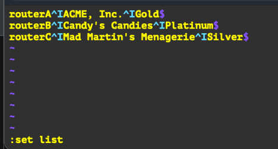

   > **Note:** Also be aware of any extraneous blank lines and remove them, or your syntax checker will fail with an **"incorrect column count"** error when validating the lookup file.

2. Open the training rules file in a text editor:
   ```bash
   vi $OMNIHOME/probes/linux2x86/syslogd-training.rules
   ```

3. Add the following table declaration at the very top of the rules file, before any other content. The table must be declared before any event processing occurs:
   ```text
   table custdata = "/opt/IBM/tivoli/netcool/omnibus/probes/linux2x86/CUSTOMERS.lookup"
   ```
   The top few lines the rules file should now look like this:
   ```text
   table custdata = "/opt/IBM/tivoli/netcool/omnibus/probes/linux2x86/CUSTOMERS.lookup"

   if( match( @Manager, "ProbeWatch" ) )
   {
   ...
   ```

   > **Note:** The path inside the `table` declaration must be the full absolute path. The `$OMNIHOME` shell variable is not expanded inside rules file string literals without extra configuration — the probe reads the path as written, not through the shell environment.

4. Add the following lookup statement to the `else` block, after the `switch` statement and before the closing `log(DEBUG, ...)` line. This performs the lookup using `@Node` as the key and assigns the results to `@CustomerID` and `@Service`, and runs on every event since it is outside of the switch/case statement and is the last directive in the rules:
   ```text
           [ @CustomerID, @Service ] = lookup(@Node, custdata)
   ```
   The end of the `else` block should now look like this:
      ```text
           }

           [ @CustomerID, @Service ] = lookup(@Node, custdata)
           log(DEBUG, "===== Exiting my rules file section")
   }
   ```
   Save and close the file.

   > **Note:** `@CustomerID` maps to the custom column added to `alerts.status` in section 3.2. `@Service` is a standard string field in the default `alerts.status` schema and does not require a custom column. The lookup assigns both values in a single operation using the multi-field assignment syntax `[ field1, field2 ] = lookup(key, table)`.

5. Stop the probe, syntax-check, and restart:
   ```bash
   kill $(pgrep nco_p_syslogd)
   ```

   ```bash
   $OMNIHOME/probes/nco_p_syntax -server EVENTS -rulesfile $OMNIHOME/probes/linux2x86/syslogd-training.rules
   ```

   ```bash
   $OMNIHOME/probes/nco_p_syslogd -rulesfile $OMNIHOME/probes/linux2x86/syslogd-training.rules -messagelog $OMNIHOME/log/syslogd-training.log &
   ```
   If the syntax check fails, examine the log file:
   `cat $OMNIHOME/log/syslogd-training.log`

6. Return to the Web GUI and delete any existing alerts from the event list.

7. Generate test events for each of the three nodes defined in the lookup file:
   ```bash
   logger -n 127.0.0.1 'ALERT - LinkUtilization: Average link utilization for routerA interface GigabitEthernet0/0 is 77%'
   ```
   ```bash
   logger -n 127.0.0.1 'ALERT - LinkUtilization: Average link utilization for routerB interface GigabitEthernet0/0 is 84%'
   ```
   ```bash
   logger -n 127.0.0.1 'ALERT - LinkUtilization: Average link utilization for routerC interface GigabitEthernet0/0 is 98%'
   ```

8. Open the event list and locate the three resulting alerts. Confirm that the `@CustomerID` and `@Service` fields are populated for each event:
   - `routerA` — `CustomerID: ACME, Inc.` / `Service: Gold`
   - `routerB` — `CustomerID: Candy's Candies` / `Service: Platinum`
   - `routerC` — `CustomerID: Mad Martin's Menagerie` / `Service: Silver`

   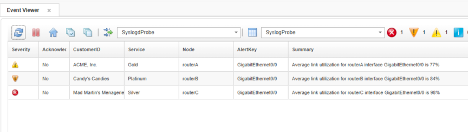

9. Generate a test event for a node that does not exist in the lookup file:
   ```bash
   logger -n 127.0.0.1 'ALERT - LinkUtilization: Average link utilization for routerX interface GigabitEthernet0/0 is 77%'
   ```
   Observe that the resulting alert has empty `@CustomerID` and `@Service` fields. This is expected behavior — when a lookup key has no matching entry in the table, the target fields are left empty rather than causing an error.

**Validation**

- The `CUSTOMERS.lookup` file exists with three entries separated by tab characters.
- The `table` declaration appears at the top of the rules file before any event processing.
- The rules file passes syntax check.
- Events from `routerA`, `routerB`, and `routerC` produce alerts with correctly populated `@CustomerID` and `@Service` fields.
- An event from an unknown node produces an alert with empty `@CustomerID` and `@Service` fields.
- You are able to explain the business value of lookup table enrichment and give examples of other data that could be stored in a lookup file.

**Expected result**

You now understand how to create and declare a lookup table, use an event field as the key to perform a lookup, and enrich alerts with external data at ingestion time. You also see how this pattern can be applied to a wide range of business enrichment use cases in a production OMNIbus environment.

#### 4.3.8 Discarding events

**Objective**

Add a `discard` statement to the rules file to suppress unwanted events and verify that discarded events do not appear in the ObjectServer event list.

**Background**

Not every event that reaches a probe needs to be forwarded to the ObjectServer. Some events are informational noise, low-value status messages, or event types that are simply not relevant to the operations team. Rather than letting these events flow through to the event list and contribute to alert noise, probe rules can use the `discard` statement to suppress them at the probe level before they are ever sent to the ObjectServer.

When a `discard` statement is encountered, the probe marks the event for suppression. However, it is important to understand that the probe continues to process the event through the remainder of the rules file — the event is not immediately dropped at the point the `discard` statement is reached. This means it is possible to recover a discarded event later in the rules using the `recover` statement if subsequent logic determines the event should be kept after all. If `discard` has been called and `recover` is not called before the end of the rules file, the event is silently dropped and never forwarded to the ObjectServer.

Common uses for discard in production environments include suppressing keepalive or heartbeat messages, dropping low-severity informational events that have no operational value, and filtering out event types that are handled by a different probe or management system.

**Tasks**

1. Open the training rules file in a text editor:
   ```bash
   vi $OMNIHOME/probes/linux2x86/syslogd-training.rules
   ```

2. Add a `WirelessAssociation` case to the `switch` block to handle inactionable WAP association events. It can be placed in any position within the switch, but by convention discard cases are often grouped together. Add the following after the `LinkUtilization` case and before the `default` case:
   ```text
                   case "WirelessAssociation":
                           log(INFO, "===== Discarding wireless association alert")
                           discard
   ```
   Save and close the file.

3. Stop the probe, syntax-check, and restart:
   ```bash
   kill $(pgrep nco_p_syslogd)
   ```

   ```bash
   $OMNIHOME/probes/nco_p_syntax -server EVENTS -rulesfile $OMNIHOME/probes/linux2x86/syslogd-training.rules
   ```

   ```bash
   $OMNIHOME/probes/nco_p_syslogd -rulesfile $OMNIHOME/probes/linux2x86/syslogd-training.rules -messagelog $OMNIHOME/log/syslogd-training.log &
   ```
   If the syntax check fails, examine the log file for clues:
   ```bash
   cat $OMNIHOME/log/syslogd-training.log
   ```

4. Generate the following test event:
   ```bash
   logger -n 127.0.0.1 'ALERT - WirelessAssociation: 802.11 association for SSID abc123 from client 00:00:00:00:00'
   ```

5. Open the event list and confirm that no new alert has appeared for this event. The `WirelessAssociation` event should not be present in the ObjectServer.

6. To confirm the event was received and processed by the probe, check the probe log file and verify that the `log(INFO, ...)` message appears, showing that the rules did execute for this event before it was discarded:
   ```bash
   cat $OMNIHOME/log/syslogd-training.log
   ```

   Look for the line `===== Discarding wireless association alert` in the log output. This confirms the event was received, the correct case was matched, and the `discard` statement was applied.

**Validation**

- The rules file passes syntax check.
- A `WirelessAssociation` event generated with `logger` does not appear in the ObjectServer event list.
- The probe log file shows the `===== Discarding wireless association alert` log message, confirming the event was received and the discard case was matched.
- The student can explain the difference between `discard` and `recover` and describe when each would be used.

**Expected result**

At the end of this lab, you understand how to suppress unwanted events at the probe level using `discard`, know that the rules file continues to process after a `discard` statement, and understand that `recover` can be used to reinstate an event if later logic determines it should be kept.

#### 4.3.9 Expire timers

**Objective**

Add an `@ExpireTime` value to the `LinkUtilization` case and observe how the ObjectServer automatically clears the alert after the specified time has elapsed.

**Background**

The `@ExpireTime` field is a special ObjectServer field that controls how long an alert remains active before it is automatically cleared, irrespective of the event `@Severity` or any other criteria. When `@ExpireTime` is set to a non-zero value, the ObjectServer `expire` trigger — reviewed in section 3.3 — periodically scans `alerts.status` for alerts whose `LastOccurrence` is older than the current time minus the `@ExpireTime` value. When that condition is met, the trigger sets the alert's `@Severity` to 0, effectively clearing it without any operator or probe intervention.

Setting `@ExpireTime` to `0` disables the expiry behavior — the alert will remain active indefinitely unless it is cleared by another mechanism such as a resolution event, operator action, or another trigger. Understand that if an `@ExpireTime` is not set in the rules explicitly, it defaults to `0`.

This is particularly useful for event types that are known to be transient or self-resolving, where a distinct clearing event is not always guaranteed to arrive. Rather than leaving stale alerts in the event list, `@ExpireTime` ensures they are cleaned up automatically after a defined window. In a production environment, typical values range from a few minutes to several hours depending on the nature of the event. In this lab a value of 30 seconds is used so the behavior can be observed quickly.

**Tasks**

1. Open the training rules file in a text editor:
   ```bash
   vi $OMNIHOME/probes/linux2x86/syslogd-training.rules
   ```

2. Add `@ExpireTime = 30` as the first line of the `LinkUtilization` case, before any other field assignments. The beginning of the case should now look like this:
   ```text
                   case "LinkUtilization":
                           @ExpireTime = 30
                           log(INFO, "===== Entering LinkUtilization segment")
                           @Node = extract($Raw, ".* link utilization for (.*?) .*")
                           @Summary = extract($Raw, ".* ALERT - LinkUtilization: (.*)")
                           @AlertKey = extract($Raw, ".* ALERT.* interface (.*?) is.*")
                           $utilval = extract($Raw, ".* ALERT.* is (.*)%.*")
                           log(INFO, "$utilval is " + $utilval)
                           ...
   ```
   The rest of the `LinkUtilization` case remains unchanged. Save and close the file.

3. Stop the probe, syntax-check, and restart:
   ```bash
   kill $(pgrep nco_p_syslogd)
   ```

   ```bash
   $OMNIHOME/probes/nco_p_syntax -server EVENTS -rulesfile $OMNIHOME/probes/linux2x86/syslogd-training.rules
   ```

   ```bash
   $OMNIHOME/probes/nco_p_syslogd -rulesfile $OMNIHOME/probes/linux2x86/syslogd-training.rules -messagelog $OMNIHOME/log/syslogd-training.log &
   ```
   If the syntax check fails, examine the log file:
   `cat $OMNIHOME/log/syslogd-training.log`

4. Return to the WebGUI and delete any existing alerts from the event list so we don't deduplicate with the previous alert.

5. Generate the following critical-level utilization event:
   ```bash
   logger -n 127.0.0.1 'ALERT - LinkUtilization: Average link utilization for routerA interface GigabitEthernet0/0 is 99%'
   ```

6. Locate the alert in the event list and confirm that it appears with `@Severity = 5` and that the `@ExpireTime` field is set to `30`. (You may need to refresh the event list a few times before it shows up)

7. Wait approximately 30 seconds without generating any further events for this alert. Observe that the alert is automatically cleared by the `expire` trigger — its severity will be set to 0. If the event list does not show cleared events by default, adjust the filter to show all severities including 0 to confirm the clearing has occurred.

8. Note that this clearing behavior is driven entirely by the `expire` trigger reviewed in section 3.3, which runs on a schedule and checks `LastOccurrence` against the current time minus `@ExpireTime`. No probe action, operator action, or resolution event was needed.

9. Generate the same event again and observe that the 30-second timer resets each time a new occurrence arrives, because the `deduplication` trigger updates `LastOccurrence` with each reinsert. This means an alert that continues to be refreshed by incoming events will not be cleared while the condition is still active.

**Validation**

- The rules file passes syntax check.
- A `LinkUtilization` event at 99% appears in the event list with `@Severity = 5` and `@ExpireTime = 30`.
- The alert is automatically cleared approximately 30 seconds after the last occurrence, without any operator or probe intervention.
- The student can explain how the `expire` trigger uses `LastOccurrence` and `@ExpireTime` to determine when to clear an alert.
- The student can explain why generating a new occurrence of the same event resets the expiry timer.

**Expected result**

At the end of this lab, the student understands how `@ExpireTime` works in conjunction with the ObjectServer `expire` trigger to automatically clear transient alerts, and can apply this pattern to event types that do not have a guaranteed resolution event.

#### 4.3.10 Additional rules functions and capabilities

**Objective**

This section provides a reference overview of additional probe rules functions and capabilities that are commonly used in production OMNIbus environments. No hands-on tasks are included — the purpose is to make the student aware of what is available so they can apply these tools when building or maintaining rules files beyond the training exercises.

**Include files**

Probe rules files support `include` statements that load a secondary rules file into the current rules file at processing time. This is useful for organizing large rulesets into smaller, maintainable files — for example, separating different event source types into individual include files that are all called from a single master rules file.

When an event reaches an include statement in the main rules file, processing jumps into the included rules at that exact point, and those rules are executed for the current event. After the included rules finish, control returns to the main rules file and processing continues from the line after the include, unless the event is discarded in the included rules.

The format of an include statement is:
```text
include "/path/to/rulesfile.rules"
```

For example, to include a secondary rules file from the same platform directory:
```text
include "/opt/IBM/tivoli/netcool/omnibus/probes/linux2x86/my-secondary.rules"
```

The path in an include statement can point to a rules file on a web server (a base URL) or to a file on disk using an absolute or relative directory path, depending on how you’ve set up your environment. Include files are commonly used with the Netcool Knowledge Library (NcKL), which ships pre-built master rules and include files for a wide range of vendor-specific SNMP traps. You’ll see this pattern in more detail later, when you work through the section on SNMP trap processing and NcKL-based trap rules.

**`regreplace()`**

The `regreplace()` function applies a regular expression substitution to a string, replacing matches with a specified replacement value. It is useful for cleaning up or normalising string tokens and field values before they are stored in the ObjectServer.

Replace multiple consecutive spaces with a single space:
```text
$x = regreplace($x, " +", " ")
```

Strip all occurrences of specific characters (in this example `$`, `!`, and `'`):
```text
$x = regreplace($x, "[$!']", "")
```

**Date and time functions**

The following date and time functions are available in probe rules:

- **`datetotime()`** — converts a textual representation of a timestamp into a UNIX epoch time integer. Useful when the source event contains a human-readable timestamp that needs to be stored as a numeric value.
- **`timetodate()`** — converts a UNIX epoch timestamp into a human-readable string. Useful for populating summary or detail fields with a formatted date.
- **`getdate()`** — takes no arguments and returns the current time as a UNIX epoch integer. Note that `@FirstOccurrence` and `@LastOccurrence` are set automatically by the probe and ObjectServer if not explicitly set in the rules — there is no requirement to manage these manually. `getdate()` is more commonly used in conditional processing, for example to compare the current time against a value in the event data, or to calculate a relative time offset for use in other fields.

Full reference: [IBM Documentation — Date and time functions](https://www.ibm.com/docs/en/netcoolomnibus/8.1.0?topic=operators-date-time-functions)

**`ltrim()` and `rtrim()`**

`ltrim()` removes leading whitespace from the left side of a string. `rtrim()` removes trailing whitespace from the right side of a string. Both are useful for cleaning up extracted values that may have surrounding spaces due to the structure of the source message.

**`printable()`**

The `printable()` function replaces all non-printable characters in a string with a space. This is useful when processing event data from sources that may include control characters or binary content in their messages, which would otherwise cause display or storage issues in the ObjectServer.

**`gethostname()` and `gethostaddr()`**

`gethostname()` performs a reverse DNS lookup and returns the hostname for a given IP address. `gethostaddr()` performs a forward DNS lookup and returns the IP address for a given hostname.

> **Note:** DNS lookups can take an appreciable amount of time to complete, and performing them on every incoming event can severely impact probe performance — particularly at high event rates. While the mttrapd probe can do dns caching, it may be prudent in your enviornment to use a lookup table in the rules file instead, and only fall back to `gethostaddr()` or `gethostname()` when the host is not found in the table.

**`length()`**

The `length()` function returns the number of bytes in a string. This can be useful for validating that an extracted value is within an expected range before assigning it to an alert field, or for conditional logic that depends on the size of a token.

**`upper()` and `lower()`**

`upper()` converts all characters in a string to uppercase. `lower()` converts all characters to lowercase. These are particularly useful for normalising field values across event sources that may use inconsistent casing — for example, ensuring that `@Node` values from different probes are stored in a consistent case so that deduplication and correlation work correctly.

**`exists()`**

The `exists()` function tests whether a token exists in the current event. It returns `TRUE` if the token is present and `FALSE` if it is not. This is useful when dealing with event sources that produce variable token sets — some events may include a token that others do not, and `exists()` allows the rules to handle both cases gracefully:

```text
if (exists($alarmcode))
{
        @EventId = $alarmcode
}
```

**Full function reference**

A complete list of probe rules functions and operators is available in the IBM Documentation:
[IBM Netcool/OMNIbus 8.1 — Rules file functions and operators](https://www.ibm.com/docs/en/netcoolomnibus/8.1.0?topic=development-rules-file-functions-operators)

---

#### 4.3.11 Dynamic RawCapture control

**Objective**

Use the `%RawCapture` rules variable to selectively enable raw event capture for unhandled or unknown events, without capturing every event that passes through the probe.

**Background**

In section 4.2 you set `RawCapture : 1` in the syslogd properties file to enable raw capture globally — every incoming event was written to the capture file. This is useful during initial development, but in a production probe processing thousands of events per minute it would produce a very large capture file very quickly and provide little diagnostic value.

The probe rules engine provides a way to control raw capture dynamically on a per-event basis using the `%RawCapture` variable. Setting `%RawCapture = 0` in the rules file turns capture off for the current event. Setting `%RawCapture = 1` turns it back on. This means you can disable capture globally in the properties file and then selectively enable it only for the specific events you want to capture — such as events that hit the `default` case of a `switch` block, meaning they arrived with an event type your rules do not yet know how to handle.

This is a valuable production pattern: it gives you automatic capture of novel or unexpected events without the overhead of capturing everything.

> **Note:** The `%RawCapture` assignment near the top of the rules file (after tables and arrays are defined) sets the default for all events. Assignments within `switch/case` or `if/else` blocks then override that default selectively for specific event types. The last assignment in the rules processing chain wins for each event.

**Tasks**

1. Open the training rules file:

   ```bash
   vi $OMNIHOME/probes/linux2x86/syslogd-training.rules
   ```

2. Locate the section after your `table` declaration but before the main processing logic begins. Add the following lines to turn raw capture off by default for all events:

   ```text
   # Turn %RawCapture property off dynamically
   # Note that this will override the setting in the properties file or command line
   %RawCapture = 0
   ```

3. Now locate the `default:` case inside your `switch(@EventId)` block. Add `%RawCapture = 1` to selectively re-enable capture for any event type that your rules do not recognize:

   ```text
   default:
           log(INFO, "==== Found an unknown/unhandled event")
           @Summary = "Unhandled event: " + $Raw
           @Severity = 1
           @Type = 1
           %RawCapture = 1
   ```

4. Save the file and run a syntax check:

   ```bash
   $OMNIHOME/probes/nco_p_syntax -server EVENTS -rulesfile $OMNIHOME/probes/linux2x86/syslogd-training.rules
   ```

5. Restart the probe:

   ```bash
   kill $(pgrep nco_p_syslogd)
   ```

   ```bash
   $OMNIHOME/probes/nco_p_syslogd -rulesfile $OMNIHOME/probes/linux2x86/syslogd-training.rules -capturefile $OMNIHOME/var/syslogd-training.cap -messagelog $OMNIHOME/log/syslogd-training.log &
   ```

6. Clear the existing capture file so you can see only new captures:

   ```bash
   cat /dev/null > $OMNIHOME/var/syslogd-training.cap
   ```

7. Generate a known event type that your rules handle — for example a `LinkDown` event:

   ```bash
   logger -n 127.0.0.1 'ALERT - LinkDown: Port Gi0/1 on router-01 is down'
   ```

   Now check the capture file:

   ```bash
   cat $OMNIHOME/var/syslogd-training.cap
   ```

   The capture file should be **empty** — the `LinkDown` event matched a defined case and `%RawCapture` remained `0`.

8. Now generate an event with an unknown type that will hit the `default` case:

   ```bash
   logger -n 127.0.0.1 'ALERT - UnknownEvent: This is an unrecognized event type'
   ```

   Check the capture file again:

   ```bash
   cat $OMNIHOME/var/syslogd-training.cap
   ```

   This time the raw event **should be present** in the capture file — the `default` case set `%RawCapture = 1`, so the probe wrote the raw event data before forwarding it to the ObjectServer.

**Validation**

- Known event types (LinkDown, LinkUp, etc.) do not appear in the capture file.
- Unknown event types hitting the `default` case do appear in the capture file.
- The probe log shows `==== Found an unknown/unhandled event` for the unknown event type.
- The event appears in the Web GUI with `@Severity = 1` and a `Summary` beginning with `Unhandled event:`.

**Expected result**

At the end of this lab, you now understand how to use `%RawCapture` as a targeted diagnostic tool rather than a blunt instrument. This pattern — capture off by default, selectively enabled for unhandled events — is directly applicable in production probe deployments where blanket raw capture is impractical.


---

