## 5. SNMP Trap Processing with MTTrapd and NcKL

Network devices — routers, switches, servers, storage arrays, and countless other managed systems — communicate fault conditions using the **Simple Network Management Protocol (SNMP)**. When a device detects a problem, it does not wait for a management system to poll it. Instead, it sends an unsolicited notification called a **trap** to a pre-configured management address. Traps are the backbone of network event management, and processing them reliably and meaningfully is one of the most important functions Netcool/OMNIbus performs in a real environment.

In this section you will work with two components that together form the OMNIbus SNMP processing pipeline: the **MTTrapd probe**, which receives and decodes SNMP trap PDUs, and **NcKL (Netcool Knowledge Library)**, which provides an enterprise-grade rules framework that already understands thousands of device-specific trap definitions. You will also build and load a custom MIB using the **MIB Manager** tool, then write rules to process its traps — giving you end-to-end understanding of the complete SNMP ingestion pipeline.

---

### 5.0 Lab Setup

Before starting the SNMP labs, you will create a dedicated event filter and custom view in the Web GUI so that trap events are easy to identify and work with independently of the syslogd events from Section 4.

**Objective:** Create a *SNMP Traps* filter and a matching event list view to isolate trap events during the labs.

**Prerequisites:** Web GUI accessible at `https://<your-server>:16311/ibm/console`, and you are logged into as `ncoadmin`. ObjectServer running. 

#### Create the SNMP Traps filter

1. In the Web GUI, open the **Event List** and click the filter dropdown at the top of the view.
2. Select **New Filter**.
3. Name the filter **SNMP Traps**.
4. Set the condition to:

   | Field | Operator | Value |
   |-------|----------|-------|
   | Manager | like | MTTrapd |
5. Set the default view to the view we created prevously: **SyslogdProbe**
6. Click **Save and Close**.

   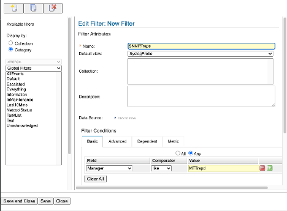

This filter matches events whose `Manager` field contains the string `MTTrapd`. The MTTrapd probe sets `@Manager` to include its own process name by default, so this will cleanly separate trap events from syslogd events.

> **Note:** The `Manager` field will show the MTTrapd process name, not `MyProbe` — so your existing syslogd filter will remain clean and will not show trap events. The two filters give you independent visibility into each event source.

---

### 5.1 SNMP and MTTrapd Overview

#### What is SNMP?

SNMP is a standards-based protocol defined by the IETF for managing and monitoring networked devices. It operates over UDP (User Datagram Protocol), traditionally on port **161** for polling (GET/SET operations) and port **162** for unsolicited trap notifications.

The three most common versions in production environments are:

| Version | Key characteristics |
|---------|-------------------|
| SNMPv1 | Original standard. Simple community-string authentication. Limited trap PDU structure. |
| SNMPv2c | Adds 64-bit counters, bulk operations, and an improved trap PDU format. Community-string auth. |
| SNMPv3 | Adds authentication (MD5/SHA) and privacy (DES/AES) encryption. Most secure. |

For most lab and production trap processing use cases you will encounter SNMPv1 and SNMPv2c. SNMPv3 is used in high-security environments and requires additional configuration.

#### Traps, OIDs, and MIBs

Every SNMP trap is identified by an **Object Identifier (OID)** — a hierarchical dotted-decimal number such as `1.3.6.1.2.1.11.5`. OIDs are globally unique and form a tree structure maintained by standards bodies and individual vendors.

A **Management Information Base (MIB)** is a text file written in a formal language called **SMI (Structure of Management Information)** that provides human-readable names, descriptions, and types for OIDs. Without a MIB, a trap arrives as a string of dotted numbers. With a MIB loaded, those same numbers are translated into meaningful names and values.

When a device sends a trap it may also include **variable bindings (varbinds)** — additional name-value pairs that carry supplementary data about the event. For example, a `linkDown` trap from a router may include varbinds containing the interface index (ifIndex), interface administrative status (ifAdminStatus), and interface operational status (ifOperStatus). 

#### The MTTrapd probe

The **MTTrapd probe** (`nco_p_mttrapd`) is the component that receives SNMP traps and feeds them into the OMNIbus event pipeline. Its responsibilities are:

1. **Listen** on UDP port 162 (or TCP 162) for incoming trap PDUs.
2. **Decode** the raw PDU using loaded MIB definitions to resolve OIDs to names.
3. **Map** the decoded trap fields into OMNIbus `alerts.status` column tokens.
4. **Process** the mapped tokens through a rules file to produce a normalized alert.
5. **Forward** the finalized alert to the ObjectServer.

The MTTrapd probe binary is located at `$OMNIHOME/probes/nco_p_mttrapd`. Its properties file is `$OMNIHOME/probes/linux2x86/mttrapd.props` and its default rules file is `$OMNIHOME/probes/linux2x86/mttrapd.rules`.


#### NcKL — Netcool Knowledge Library

**NcKL** (Netcool Knowledge Library) is an IBM-provided add-on package installed at `/opt/IBM/tivoli/NcKL`. It ships with:

- **Pre-built rules files for 39 vendors and approximately 2,300 MIB definitions**, covering IETF/IEEE RFC traps as well as vendor-specific traps from Cisco, Juniper, HP, IBM, and many others.
- **A master rules file** at `/opt/IBM/tivoli/NcKL/rules/snmptrap.rules` that acts as the top-level dispatcher — it determines the trap version, routes enterprise-specific traps to their vendor rules file, and handles generic traps via a common path.
- **Per-MIB rules and lookup files** — for each exported MIB, NcKL creates several files: a main rules file (`.include.snmptrap.rules`), a severity lookup file (`.sev.snmptrap.lookup`) that controls `@Severity`, `@Type`, and `@ExpireTime`, and a user include file (`.user.include.snmptrap.rules`) for site-specific customizations. There may also be an enumeration lookup file (`.include.snmptrap.lookup`) for varbind enumeration mappings.
- **A `$NC_RULES_HOME` environment variable** that points to the NcKL rules directory root — this is used throughout NcKL path references.

> **Note:** The severity lookup file and user include file are key NcKL concepts. Rather than hardcoding `@Severity`, `@Type`, and `@ExpireTime` in the rules, NcKL stores these as lookup table entries. Likewise, any custom rules logic for specific SNMP traps can be applied iin the `.user.include.snmptrap.rules`, which is included at the end of each MIB include file. This means you can tune severity and expiry for any trap by editing the lookup file without touching the rules code itself, and perform custom logic without editing or modifying the base NcKL rules. This makes upgrades to the NcKL easier to maintain. 


#### NcKL high-level process flow

When a trap arrives, the NcKL rules process it as follows:

1. Determine the SNMP version (v1/v2) and normalize the tokens to a common format.
2. Check whether it is an enterprise-specific trap (generic trap type 6) or a generic trap (types 0–5).
3. **For generic traps:** switch on generic trap type (0–5), create the appropriate event, then look up `@Severity`, `@Type`, and `@ExpireTime` in the `snmptrap.sev.lookup` file.
4. **For enterprise-specific traps:** switch on enterprise ID. If a matching case is found, switch on the specific trap number, build the event, look up severity/type/expiry in the appropriate per-MIB lookup file, then run through the per-MIB user include file for any site-specific customizations. If no matching enterprise case is found, NcKL creates a Severity 1 "No Rules Found" event identifying the enterprise ID.

NcKL process flow:


   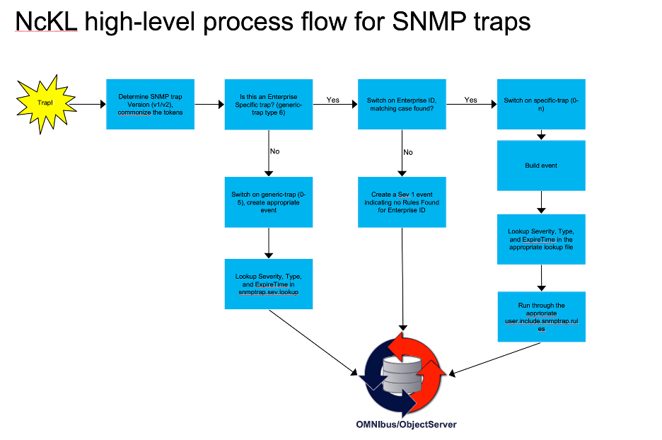

---

### 5.2 Configure MTTrapd with NcKL

In this lab you will configure MTTrapd to use the NcKL rules framework, start the probe for the first time, and verify that it is connected to the ObjectServer and ready to receive traps.

**Objective:** Start MTTrapd, verify connectivity to the ObjectServer, and point it at the NcKL rules framework.

**Prerequisites:** ObjectServer running. You are logged in to the lab VM as `root`. `$OMNIHOME` and `$NCHOME` are exported in your shell.

#### Step 1 — Inspect the MTTrapd properties file

Open the MTTrapd properties file and review the key settings before making any changes:

```bash
cat $OMNIHOME/probes/linux2x86/mttrapd.props
```

The properties you will work with are:

| Property | Default value | Purpose |
|----------|---------------|---------|
| `Server` | `'NCOMS'` | Default ObjectServer to connect to |
| `Port` | `4100` | Default ObjectServer listener port |
| `MessageLevel` | `'warn'` | Probe log verbosity |
| `RulesFile` | `'$OMNIHOME/probes/linux2x86/mttrapd.rules'` | Default rules file to process traps |


> **Note:** Like all probe properties files, MTTrapd stores paths as string literals. The `$OMNIHOME` variable notation in the default value is resolved at startup by the probe binary itself — but when you add entries that reference NcKL, you must use the full absolute path because the NcKL installation is outside `$OMNIHOME`.

#### Step 2 — Setting up the NcKL environment

Before updating MTTrapd, prepare the ObjectServer schema for NcKL and configure the NcKL environment variable.

1. Run the NcKL database schema correction script in the lab environment to add the custom fields NcKL requires in `alerts.status`, and the addition of triggers supporting NcKL:
   ```bash
   $OMNIHOME/bin/nco_sql -server ALERTS -user root -password 'netcool' < /opt/IBM/tivoli/NcKL/advcorr.sql
   ```

   Expected output is similar to:
   ```text
   ERROR=Object not found on line 114 of statement
   '--###############################################################################...', at or near 'AdvCorr_SetCauseType'
   ERROR=Object not found on line 1 of statement 'drop trigger AdvCorr_LPC_RC;...',
   at or near 'AdvCorr_LPC_RC'
   ERROR=Object not found on line 1 of statement 'drop trigger
   AdvCorr_LPC_Sym;...', at or near 'AdvCorr_LPC_Sym'
   ERROR=Object not found on line 4 of statement '-- Drop tables in case they
   already exists from a previous installation...', at or near 'AdvCorrLpcSymCand'
   ERROR=Object not found on line 1 of statement 'drop table
   alerts.AdvCorrLpcRcCand;...', at or near 'AdvCorrLpcRcCand'
   (0 rows affected)
   (0 rows affected)
   (0 rows affected)
   (0 rows affected)
   (0 rows affected)
   (0 rows affected)
   (0 rows affected)
   (0 rows affected)
   (0 rows affected)
   (0 rows affected)
   (10 rows affected)
   (0 rows affected)
   (0 rows affected)
   (0 rows affected)
   (0 rows affected)
   (0 rows affected)
   ```

   The errors are expected: the script drops any existing triggers before recreating them. The important indicators are the final row counts, especially the `10 rows affected` line.

2. Persist `NC_RULES_HOME` in your shell profile and reload it, then verify the value:
   ```bash
   echo 'export NC_RULES_HOME="/opt/IBM/tivoli/NcKL/rules"' >> ~/.bash_profile
   source ~/.bash_profile
   echo $NC_RULES_HOME
   ```
   The final command should output `/opt/IBM/tivoli/NcKL/rules`.

3. Add the same environment variable to MTTrapd's probe environment file so the probe inherits it when started by Process Agent:
   ```bash
   echo 'export NC_RULES_HOME="/opt/IBM/tivoli/NcKL/rules"' >> $OMNIHOME/probes/linux2x86/nco_p_mttrapd.env
   ```

#### Step 3 — Update the properties file to send alerts to our lab ObjectServer, and to use NcKL

You need to tell MTTrapd to use:
- Our ObjectServer **EVENTS**
- The NcKL master rules file as its rules engine.
- The NcKL MIB directory so that OIDs in incoming traps are resolved against NcKL's bundled MIB library.

Add the following lines at the end of `$OMNIHOME/probes/linux2x86/mttrapd.props`:

```text
Server : 'EVENTS'
MessageLevel : 'debug'
RulesFile : '/opt/IBM/tivoli/NcKL/rules/snmptrap.rules'
MessageLog  : '/opt/IBM/tivoli/netcool/omnibus/log/mttrapd-training.log'
RawCapture : 1
```

Save the file. The `MessageLevel` change to `debug` will give you verbose output in the probe log during the labs, making it easy to trace exactly how each trap is decoded and processed.

#### Step 4 — Syntax check the NcKL rules, and start the MTTrapd probe

Run the nco_p_syntax checker to validate the NcKL rules. This will evaluate the top level snmptrap.rules file and any included `include` files that are uncommented in the snmptrap.rules. You will note that the output of the syntax check in this case is much more extensive (more on this later):

```bash
$OMNIHOME/probes/nco_p_syntax -server EVENTS -rulesfile /opt/IBM/tivoli/NcKL/rules/snmptrap.rules
```

Start MTTrapd in the background, sending its log output to a dedicated log file:

```bash
$OMNIHOME/probes/nco_p_mttrapd &
```

> **Note:** Unlike the syslogd probe in Section 4, we will not be using the `-rulesfile` on the command line here to explicitly set a custom rules file — the rules file path is already set in the properties file pointing to the NcKL location. You could override it on the command line if needed, but for NcKL it is cleaner to manage it in the props file.

#### Step 5 — Confirm the probe started

Verify that the MTTrapd probe process is running and that it is listening on UDP port 162:

```bash
netstat -anlp | grep udp | grep 162
```

You should see a line similar to:

```text
udp        0      0 0.0.0.0:162             0.0.0.0:*                           1890598/nco_p_mttrapd
```

Then verify the process name directly:

```bash
pgrep -a nco_p_mttrapd
```

You should see the process listed with its PID. If the probe does not appear to be running or listening on port 162, consult our log file and inspect it for startup errors:

```bash
vi $OMNIHOME/log/mttrapd-training.log
```


#### Step 6 — Verify probe operation with the MTTrapd heartbeat event

Switch back to the Web GUI and open the Event Viewer.

1. Select the **NetcoolStatus** filter.
2. Locate the `Probe Heartbeat Message` event for `mttrapd`.

   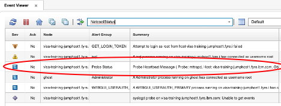

The `Probe Heartbeat Message` is a periodic status event that confirms the probe is alive and connected to the ObjectServer. The MTTrapd sends the heartbeat alarm every minute to the ObjectServer, so its presence in the NetcoolStatus view is a strong validation that the probe is running normally. 

Use this event to verify probe operation as follows:
- If the heartbeat is present and recent, MTTrapd is active and able to communicate with the ObjectServer.
- If the heartbeat is missing or stale, the probe may have stopped, failed to start, or lost ObjectServer connectivity.
- If you see repeated heartbeat failures, review the probe configuration and check for port conflicts or environment variable issues.

Only consult the probe log if the heartbeat does not appear or if the probe fails to start.

---

### 5.3 Test with Standard IF-MIB Traps

Before working with a custom MIB, you will send standard SNMP traps defined in the **IF-MIB** (Interfaces MIB, RFC 2863). This confirms that the MTTrapd / NcKL pipeline is working end to end, and gives you a reference point for the trap structure you will see in subsequent labs.

**Objective:** Generate `linkDown` and `linkUp` traps using `snmptrap` and observe how NcKL processes them into events in the ObjectServer.

**Prerequisites:** MTTrapd running and connected. `net-snmp-utils` installed (`snmptrap` command available). ObjectServer running.

#### Background — linkDown and linkUp

`linkDown` and `linkUp` are two of the most fundamental SNMP traps defined in the original IF-MIB standard. Every SNMP-capable network device is expected to generate these traps when a network interface changes state.

- **linkDown** OID: `1.3.6.1.6.3.1.1.5.3` (SNMPv2c notification)
- **linkUp** OID: `1.3.6.1.6.3.1.1.5.4` (SNMPv2c notification)

Both carry a standard varbind — `ifIndex` — that identifies which interface changed state. In a real network event, the management system would look up `ifIndex` against the device's interface table to determine exactly which physical port or logical circuit is affected.

#### Step 1 — Send a linkDown trap

Use the `snmptrap` utility to send a simulated `linkDown` trap to `localhost`:

```bash
ssnmptrap -v 2c -c public localhost '' 1.3.6.1.6.3.1.1.5.3 \
  1.3.6.1.2.1.2.2.1.1 i 1 \
  1.3.6.1.2.1.2.2.1.7 i 1 \
  1.3.6.1.2.1.2.2.1.8 i 2
```

Breaking down the command:

| Argument | Meaning |
|----------|---------|
| `-v 2c` | Use SNMPv2c format |
| `-c public` | Community string (like a password) |
| `localhost` | Send to the local machine (where MTTrapd is listening) |
| `''` | Empty sysUpTime — probe will substitute current time |
| `1.3.6.1.6.3.1.1.5.3` | The linkDown notification OID |
| `1.3.6.1.2.1.2.2.1.1` | The ifIndex OID (the varbind name) |
| `i 1` | Integer value 1 (interface index 1) |
| `1.3.6.1.2.1.2.2.1.7` | the ifAdminStatus for ifIndex 1
| `i 1` | Integer value 1 (1=up, 2=down, 3=testing) - interface is admin UP
| `1.3.6.1.2.1.2.2.1.8` | the ifOperStatus for ifIndex 1
| `i 2` | Integer value 2 (2=down, 1=up, 3=testing, 4=unknown, 5=dormant, 6=notPresent, 7=lowerLayerDown)

#### Step 2 — Observe the event in the Web GUI

Switch to the Web GUI and apply the **SNMP Traps** filter. You should see a new event in the **SNMP Traps View** with:

- `Node` set to `127.0.0.1` (or `localhost`, depending on NcKL hostname resolution)
- `AlertGroup` reflecting the IF-MIB or the trap category
- `Summary` containing a human-readable description of the linkDown trap
- `Type` set to `1` (problem event)

> **Note:** The exact field values depend on the NcKL rules for the IF-MIB. NcKL maps OID components to `@AlertGroup`, `@AlertKey`, and `@Summary` according to its built-in knowledge of the IF-MIB. Reviewing the event fields tells you how NcKL has classified the trap.

#### Step 3 — Examine the MTTrapd rawcapture output

Open the MTTrapd rawcapture output and review the tokens generated for the `linkDown` trap:

```bash
cat $OMNIHOME/var/mttrapd.cap
```

Note the tokens that are created by the mttrapd probe. The table below shows the various tokens that were generated by the probe for this particular trap:


| Aspect          | rawcapture Tokens                                                                                  | Meaning                                           |
|-----------------|-----------------------------------------------------------------------------------------|---------------------------------------------------|
| SNMP version    | `SNMP_Version = "2"`                                                                    | SNMPv2c trap                                     |
| Community       | `community = "public"`                                                                  | Community string `public`                        |
| Source IP       | `IPaddress = "127.0.0.1"`, `PeerIPaddress = "127.0.0.1"`, `PeerAddress = "127.0.0.1"`, `Node = "127.0.0.1"` | Trap came from localhost                         |
| Protocol/port   | `Protocol = "UDP"`, `ReceivedPort = "162"`                                              | UDP on standard trap port 162                    |
| Trap type OID   | `notify = ".1.3.6.1.6.3.1.1.5.3"`, `.1.3.6.1.6.3.1.1.4.1.0 = ".1.3.6.1.6.3.1.1.5.3"`    | IF‑MIB `linkDown` notification                   |
| Device uptime   | `.1.3.6.1.2.1.1.3.0 = "(35172831) 4 days, 1:42:08.31"`, `UpTime = "35172831"`, `Uptime = "1:42:08.31"` | Device had been up ~4 days when trap sent        |
| Capture time    | `ReceivedTime = "1786042759"`, `RawCaptureTimeStamp = 1786042759`                       | Time probe received the trap (UNIX timestamp)    |
| Request ID      | `ReqId = "1388912577"`                                                                  | SNMP request ID for this trap packet             |
| Event count     | `EventCount = "6"`                                                                      | Internal count of parsed tokens/varbinds         |

Varbinds (OID1, OID2, OID3)

| Varbind index | OID                           | Name           | rawcapture Tokens                                                                                 | Meaning                          |
|--------------|-------------------------------|----------------|----------------------------------------------------------------------------------------------|----------------------------------|
| `OID1`       | `.1.3.6.1.2.1.2.2.1.1`         | `ifIndex`      | `1 = "1"`, `1_raw = "1"`, `1_text = "1"`, `1_hex = "1"`; `.1.3.6.1.2.1.2.2.1.1 = "1"`        | Interface index = **1**          |
| `OID2`       | `.1.3.6.1.2.1.2.2.1.7`         | `ifAdminStatus`| `2 = "1"`, `2_raw = "1"`, `2_text = "1"`, `2_hex = "1"`; `.1.3.6.1.2.1.2.2.1.7 = "1"`        | Admin status = **1 (up)**        |
| `OID3`       | `.1.3.6.1.2.1.2.2.1.8`         | `ifOperStatus` | `3 = "2"`, `3_raw = "2"`, `3_text = "2"`, `3_hex = "2"`; `.1.3.6.1.2.1.2.2.1.8 = "2"`        | Oper status = **2 (down)**       |

#### Step 4 — Send a linkUp trap (resolution)

```bash
snmptrap -v 2c -c public localhost '' 1.3.6.1.6.3.1.1.5.4 \
  1.3.6.1.2.1.2.2.1.1 i 1 \
  1.3.6.1.2.1.2.2.1.7 i 1 \
  1.3.6.1.2.1.2.2.1.8 i 1
```


The only differences is the OID `1.3.6.1.6.3.1.1.5.4` which is the `linkUp` trap, and the varbind `1.3.6.1.2.1.2.2.1.8` which is `ifOperStatus` of "UP". NcKL includes built-in rules for the IF-MIB and does correlate `linkUp` against `linkDown` — it sets `@Type = 2` on the `linkUp` event with a matching `@AlertKey`, so the `generic_clear` trigger in the ObjectServer will clear the original `linkDown` problem event automatically.

Observe the event list — the `linkDown` event should go to clear once `generic_clear` runs (within a few seconds). If it does not clear, check that both events have the same `Node`, `AlertGroup`, `AlertKey`, and `Manager` values — all four must match for `generic_clear` to fire.

   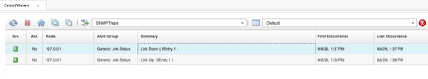


---

### 5.4 Build and Load a Custom MIB with MIB Manager

In production environments you will regularly encounter network devices whose MIBs are not part of the Netcool Knowledge Library. Vendor-specific MIBs must be loaded into the NcKL before the probe can resolve the OIDs in the traps they generate.

In this lab you will:
1. Review the **IBM-TRAINING-MIB** — a purpose-built custom MIB that you will use throughout the remaining labs.
2. Load it into the **MIB Manager** tool on your Windows workstation, and export it as NcKL-compatible rules files.
3. Verify that the MIB is correctly loaded and that OIDs are now resolved.

**Objective:** Load the IBM-TRAINING-MIB into MIB Manager, export it for use with NcKL, integrate the exported rules into the NcKL rules framework, and verify end-to-end OID resolution and event generation.

**Prerequisites:** MTTrapd running on the lab VM. `$OMNIHOME` and `$NC_RULES_HOME` exported in your shell. ObjectServer running.

First, set the `$NC_RULES_HOME` variable if it is not already set:

```bash
export NC_RULES_HOME=/opt/IBM/tivoli/NcKL/rules
```

#### 5.4.1 The IBM-TRAINING-MIB

The IBM-TRAINING-MIB defines three notification types that model realistic IT infrastructure events:

| Trap name | OID suffix | Severity intent | Type |
|-----------|-----------|----------------|------|
| `serverDown` | `.1` | Critical | Problem (Type 1) |
| `serverUp` | `.2` | Clear | Resolution (Type 2) |
| `diskUtilization` | `.3` | Warning or Critical (depends on value) | Problem (Type 1) |

The MIB also defines supporting objects (varbinds) carried in each trap:

| Object | OID suffix | Syntax | Description |
|--------|-----------|--------|-------------|
| `ibmTrainingServerName` | `.4` | DisplayString | Hostname of the affected server |
| `ibmTrainingServerIP` | `.5` | IpAddress | IP address of the affected server |
| `ibmTrainingDiskMount` | `.6` | DisplayString | Mount point of the disk being reported |
| `ibmTrainingDiskPercent` | `.7` | Integer32 (0–100) | Disk utilization percentage |
| `ibmTrainingEventSeverity`| `.8` | Integer32 | Severity hint from device (maps to OMNIbus scale) |

The full MIB text is below. You will save this to a file on the lab VM for loading into MIB Manager:

```text
IBM-TRAINING-MIB DEFINITIONS ::= BEGIN

IMPORTS
    MODULE-IDENTITY, OBJECT-TYPE, NOTIFICATION-TYPE, Integer32,
    enterprises
        FROM SNMPv2-SMI
    DisplayString
        FROM SNMPv2-TC;

ibmTraining MODULE-IDENTITY
    LAST-UPDATED "202601010000Z"
    ORGANIZATION "IBM Training"
    CONTACT-INFO "IBM Training Lab Environment"
    DESCRIPTION  "Custom MIB for OMNIbus training exercises."
    REVISION     "202601010000Z"
    DESCRIPTION  "Initial version."
    ::= { enterprises 99999 }

-- Object definitions

ibmTrainingObjects OBJECT IDENTIFIER ::= { ibmTraining 1 }

ibmTrainingServerName OBJECT-TYPE
    SYNTAX      DisplayString (SIZE (0..255))
    MAX-ACCESS  read-only
    STATUS      current
    DESCRIPTION "The hostname of the server generating the event."
    ::= { ibmTrainingObjects 4 }

ibmTrainingServerIP OBJECT-TYPE
    SYNTAX      IpAddress
    MAX-ACCESS  read-only
    STATUS      current
    DESCRIPTION "The IP address of the server generating the event."
    ::= { ibmTrainingObjects 5 }

ibmTrainingDiskMount OBJECT-TYPE
    SYNTAX      DisplayString (SIZE (0..255))
    MAX-ACCESS  read-only
    STATUS      current
    DESCRIPTION "The filesystem mount point being reported."
    ::= { ibmTrainingObjects 6 }

ibmTrainingDiskPercent OBJECT-TYPE
    SYNTAX      Integer32 (0..100)
    MAX-ACCESS  read-only
    STATUS      current
    DESCRIPTION "Disk utilization as a percentage (0-100)."
    ::= { ibmTrainingObjects 7 }

ibmTrainingEventSeverity OBJECT-TYPE
    SYNTAX      Integer32 (0..5)
    MAX-ACCESS  read-only
    STATUS      current
    DESCRIPTION
        "Severity of the event, mapped to OMNIbus scale:
         0=Clear, 1=Indeterminate, 2=Warning, 3=Minor, 4=Major, 5=Critical."
    ::= { ibmTrainingObjects 8 }

-- Notification definitions

ibmTrainingNotifications OBJECT IDENTIFIER ::= { ibmTraining 2 }

serverDown NOTIFICATION-TYPE
    OBJECTS {
        ibmTrainingServerName,
        ibmTrainingServerIP,
        ibmTrainingEventSeverity
    }
    STATUS  current
    DESCRIPTION
        "A server has gone down or become unreachable."
    ::= { ibmTrainingNotifications 1 }

serverUp NOTIFICATION-TYPE
    OBJECTS {
        ibmTrainingServerName,
        ibmTrainingServerIP
    }
    STATUS  current
    DESCRIPTION
        "A server has recovered and is reachable."
    ::= { ibmTrainingNotifications 2 }

diskUtilization NOTIFICATION-TYPE
    OBJECTS {
        ibmTrainingServerName,
        ibmTrainingServerIP,
        ibmTrainingDiskMount,
        ibmTrainingDiskPercent,
        ibmTrainingEventSeverity
    }
    STATUS  current
    DESCRIPTION
        "Disk utilization on a server has crossed a threshold."
    ::= { ibmTrainingNotifications 3 }

END
```

Copy this text and paste it into notepad on your Windows workstation as `IBM-TRAINING-MIB.txt` (e.g. on the Desktop).

#### 5.4.2 Load and export the MIB using MIB Manager

**MIB Manager** is the Windows and Linux tool used to load MIB files, browse the OID tree, and export trap definitions as NcKL-compatible rules and lookup files. It is installed as part of the OMNIbus core package which is installed on your Windows workstation.

MIB files that you add are stored locally on the workstation under the OMNIbus installation's MIB directory — typically `%OMNIHOME%\var\mibmanager\mibs`. Exported rules and supporting files are placed in `%OMNIHOME%\var\mibmanager\exports`.

#### Launch MIB Manager

On Windows, the MIB Manager is launched from a .bat file located at `%OMNIHOME%\bin\nco_mibmanager.bat`. The default %OMNIHOME% is `C:\IBM\tivoli\netcool`. If you installed OMNIbus core package in another location, use that path instead. 

Locate the nco_mibmanager.bat in the file explorer, and double-click to start:

  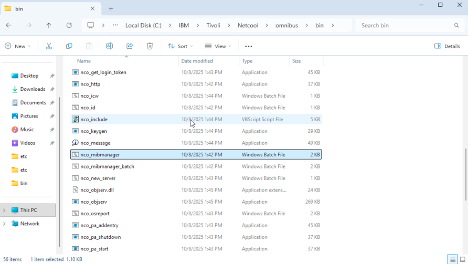


The MIB Manager window opens showing three key panels: a MIB module list on the left, an OID tree on the right, and a details/console panel at the bottom. There is also a Device panel that allows you to define and manage “devices” as collections of MIB modules, so you can work in a device‑centric way.

  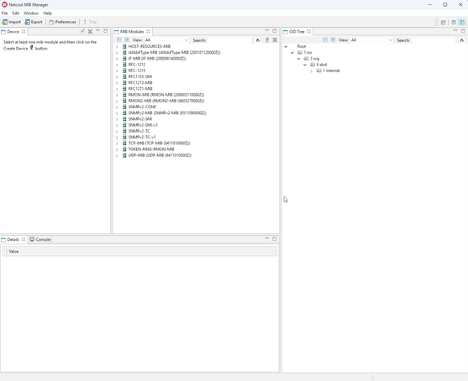

#### Import the IBM-TRAINING-MIB

1. Copy the `IBM-TRAINING-MIB.txt` file from the Desktop to the MIB Manager mibs directory:
   `%OMNIHOME%\var\mibmanager\mibs\`

2. Click the **Import** button in the upper left of the MIB Manager window.

    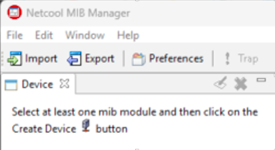

3. The import dialog shows a directory field. Leave the default path pointing to the mibs directory and click **Import**.

   MIB Manager will parse all MIB files in that directory. If there are import errors for missing dependent MIBs, they will be listed in the Import Status dialog. The IBM-TRAINING-MIB only imports from standard SNMPv2-SMI and SNMPv2-TC, which are already present — you should see a clean import.

   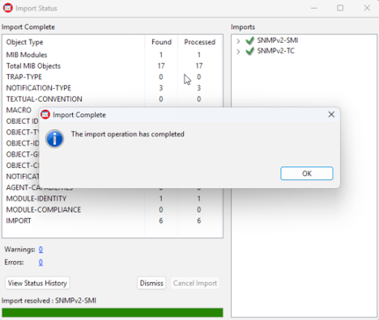

4. After import, locate `IBM-TRAINING-MIB` in the MIB module list, and select it.
5. Expand it in the OID tree on the right and confirm you can see:
   - `ibmTrainingObjects` with the five object definitions `ibmTrainingServerName`, `ibmTrainingServerIP`, `ibmTrainingDiskMount`, `ibmTraininingDiskPercent`, and `ibmTrainingEventSeverity`
   - `ibmTrainingNotifications` with `serverDown`, `serverUp`, and `diskUtilization` - these are our trap definitions as indicated by the `!` exclamation point.

     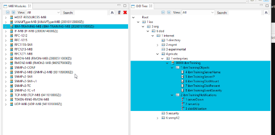
6. Click on `serverDown` in the tree. The details panel at the bottom should show its full OID (`1.3.6.1.4.1.99999.2.1`), object type, and the description text from the MIB.

    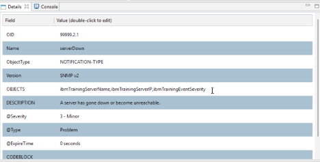

#### Export the MIB for NcKL

7. Highlight (select) the **IBM-TRAINING-MIB** entry in the MIB module list to ensure the entire MIB tree is selected:

    

8. Click the **Export** button in the upper left of the window.

   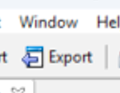

9. In the Export dialog, set the following options:
   - **Directory:** leave as the default exports directory
   - **File Type:** `Netcool Knowledge Library version 3.x`
   - **Scope:** `Traps only`
   - Check **Selected Subtree(s) only**

      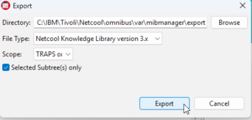

10. Click **Export**. A confirmation dialog will report the number of objects exported (should be 3 — one for each trap type).

      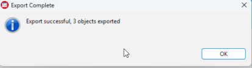

#### Transfer the exported files to the lab VM

11. On the Windows workstation, open the exports directory:
    `%OMNIHOME%\var\mibmanager\exports\`

    You will see a directory named: \<timestamp>_nckl_3_0, where \<timestamp> is the time that you exported the traps. Open it, then open the `ibmtraining` subdirectory. It contains the following files:

| File name                                             | Purpose                                                     |
|-------------------------------------------------------|------------------------------------------------------------------------|
| ibmTraining-IBM-TRAINING-MIB.adv.include.snmptrap.rules | Advanced/optional SNMP trap rules that add extra behavior on top of the base IBM-TRAINING-MIB mapping. |
| ibmTraining-IBM-TRAINING-MIB.include.snmptrap.rules      | Main SNMP trap rules that recognize IBM-TRAINING-MIB trap OIDs and map varbinds into OMNIbus event fields. |
| ibmTraining-IBM-TRAINING-MIB.sev.snmptrap.lookup         | Lookup table that assigns severity, event type, and expiry to IBM-TRAINING-MIB events. |
| ibmTraining-IBM-TRAINING-MIB.user.include.snmptrap.rules | User customization rules, used to override or extend the vendor’s base IBM-TRAINING-MIB rules. |
| ibmTraining-preclass.include.snmptrap.rules              | Pre‑classification rules that run before main mapping, doing early generic classification and setup. |
| ibmTraining-preclass.snmptrap.lookup                     | Lookup table used by the pre‑classification rules (e.g., initial alert group/type/category). |
| ibmTraining.m2r.master.include.lookup                    | Master lookup include file that pulls together all IBM‑training lookup tables (sev, preclass, etc.). |
| ibmTraining.m2r.master.include.rules                     | Master rules include file that pulls together all IBM‑training rules files in the correct order. |


12. Copy the entire `ibmtraining` directory to the lab VM using SCP. Open a PowerShell or Command Prompt window and run:

    ```bash
    scp -r "%OMNIHOME%\var\mibmanager\export\<timestamp>_nckl_3_0\ibmTraining" root@<your-server>:/tmp/
    ```

    Replace `<timestamp>` with the actual directory name containing the timestamp of when you exported the traps, and `<your-server>` with your lab VM hostname or IP.

13. Switch to your SSH session on the lab VM and confirm the files arrived:

    ```bash
    ls /tmp/ibmTraining/
    ```

    You should see all five files listed in the table above.

#### 5.4.3 Integrate the exported rules into NcKL

Now that MIB Manager has generated the rules and lookup files, you need to integrate them into the NcKL rules framework. This is a five-step process.

**Step 1 — Move the ibmTrianing include files to the NcKL rules include directory**


```bash
mv /tmp/ibmTraining $NC_RULES_HOME/include-snmptrap/
```


**Step 2 — Add the lookup reference to the NcKL snmptrap.rules**

Cat the following file to obtain the include file location for our ibmTraining rules:
```bash
cat $NC_RULES_HOME/include-snmptrap/ibmTraining/ibmTraining.m2r.master.include.lookup
```

copy the last line from the output of that command:

```text
###############################################################################
# ibmTraining.m2r.master.include.lookup
# Automatically created by MIB Manager
# Aug 6, 2026 1:34:33 PM
###############################################################################

include "$NC_RULES_HOME/include-snmptrap/ibmTraining/ibmTraining-preclass.snmptrap.lookup"

include "$NC_RULES_HOME/include-snmptrap/ibmTraining/ibmTraining-IBM-TRAINING-MIB.sev.snmptrap.lookup"
```

Using vi, open the top-level snmptrap.rules file:

```bash
vi $NC_RULES_HOME/snmptrap.rules
```

Locate the vendor "lookup includes" section in the top level rule:

```text
################################################################################
# Enter lookup table Includes below with the following syntax:
#
# include "<$NCHOME>/etc/rules/include-snmptrap/<vendor>/<vendor>.master.include
# .lookup"
################################################################################

```


In this section, you will see an alphabetized list of vendor "include.lookup" files. The lookup files provide mappings of OIDs to human readable variables as mapped in the relevant MIB files. As such, the operator will see the actual OID names (e.g. ifIndex, LinkDown, etc) instead of an OID number (1.3.6.1.4.1.x.x.x).

The best practice is to paste the lookup include in the appropriate alphabetized location as such:

```text
...
...
include "$NC_RULES_HOME/include-snmptrap/huawei/huawei.master.include.lookup"
include "$NC_RULES_HOME/include-snmptrap/IANA/IANA.master.include.lookup"
include "$NC_RULES_HOME/include-snmptrap/ibm/ibm.master.include.lookup"
include "$NC_RULES_HOME/include-snmptrap/ibmTraining/ibmTraining.m2r.master.include.lookup"
include "$NC_RULES_HOME/include-snmptrap/IEEE/IEEE.master.include.lookup"
include "$NC_RULES_HOME/include-snmptrap/IETF/IETF.master.include.lookup"
...
...
```

**Key line above:** `include "$NC_RULES_HOME/include-snmptrap/ibmTraining/ibmTraining.m2r.master.include.lookup"`


Save the file and exit.

**Step 3 — Add the "rules include" to the NcKL snmptrap.rules file**

In the same snmptrap.rules file, locate the vendor "rules includes" section:

```text
        switch($enterprise)
        {
            case "dummy case statement": ### This will prevent syntax errors in case no includes are added below.

            ################################################################################
            # Enter rules file Includes below with the following syntax:
            #
            # include "<$NCHOME>/etc/rules/include-snmptrap/<vendor>/<vendor>.master.include
            # .rules"
            ################################################################################
```

In this section, the **top‑level rules file** uses the trap’s **Enterprise ID** to decide *which* rules to apply when the trap is an **enterprise‑specific** trap (generic‑trap **`6`**).

Typically, what comes next is a list of enterprise **“master” include files**. Each master file:

- corresponds to one **vendor/enterprise**, and  
- in turn **includes many MIB‑specific include files** that contain the actual **trap OIDs to be processed**.  

For example, **Cisco** has a `master.include.rules` file that pulls in **hundreds of individual MIB include files**.

In our lab:

- We created our own enterprise with **Enterprise ID `99999`**.  
- For that enterprise, we currently have **only one MIB** referenced in `ibmTraining.m2r.master.include.rules`.  
- Conceptually, if we later add more MIBs for the **`ibmTraining`** enterprise, we would **add them to `ibmTraining.m2r.master.include.rules`**, *not* directly into the top‑level rules file.

The key idea is **modularity**:

- The **top‑level rules** only choose the right **enterprise master file**.
- Each **enterprise master file** then manages its own set of **MIB‑specific includes**.  

This keeps the configuration **clean, scalable, and easy to maintain** as more vendors or MIBs are added.

Much like the **lookup include section**, this section is an **alphabetized list of vendor MIB rules include files**.

Each line includes a vendor’s **master rules file**, which in turn pulls in that vendor’s **MIB‑specific trap definitions**.

For our lab, we need to include the **ibmTraining master rules file**, because it contains the include for the **IBM‑TRAINING‑MIB** trap definitions:

```text
include "$NC_RULES_HOME/include-snmptrap/hatteras/hatteras.master.include.rules"
include "$NC_RULES_HOME/include-snmptrap/huawei/huawei.master.include.rules"
include "$NC_RULES_HOME/include-snmptrap/IANA/IANA.master.include.rules"
include "$NC_RULES_HOME/include-snmptrap/ibm/ibm.master.include.rules"
include "$NC_RULES_HOME/include-snmptrap/ibmTraining/ibmTraining.m2r.master.include.rules"
include "$NC_RULES_HOME/include-snmptrap/IEEE/IEEE.master.include.rules"
include "$NC_RULES_HOME/include-snmptrap/IETF/IETF.master.include.rules"
include "$NC_RULES_HOME/include-snmptrap/infinera/infinera.master.include.rules"
```
**Key line above:** `include "$NC_RULES_HOME/include-snmptrap/ibmTraining/ibmTraining.m2r.master.include.rules"`

Once you have added our master.include.rules file as directed above, save and quit your editor.

**Step 4 — Run a syntax check on the top-level NcKL rules file**

```bash
$OMNIHOME/probes/nco_p_syntax -server EVENTS -rulesfile $NC_RULES_HOME/snmptrap.rules
```

When you run the **syntax checker**, it traverses the entire **NcKL include structure**, checking for:

- **Syntax errors** in all referenced rules files.
- **`@Column` assignments** to make sure they match the columns defined in the configured **ObjectServer**.

Any problems are reported in the syntax checker **output**.

If everything is valid, you’ll see output similar to:

```text
2026-08-06T15:15:18: Information: I-UNK-000-000: Rules file syntax OK
2026-08-06T15:15:18: Information: I-UNK-000-000: Disconnecting ...
```

If the syntax check fails, look in the output for the **filename** and **line number** of the error, then correct the issue in that rules file and run the checker again.


**Step 5 — Restart MTTrapd**

Stop the probe: 
```bash
 kill $(pgrep nco_p_mttrapd)
 ```

Start the probe:
```bash
$OMNIHOME/probes/nco_p_mttrapd &
```

Validate that the **mttrapd** probe is listening on UDP port **162**:

```bash
netstat -anlp | grep udp | grep 162
```

Expected output:

```text
udp        0      0 0.0.0.0:162             0.0.0.0:*                   1991508/nco_p_mttra
```


#### 5.4.4 Verify OID resolution

Now we will send a test trap using the raw OID of the `serverDown` notification, as defined in our **IBM-TRAINING-MIB** mib file:

```bash
snmptrap -v 2c -c public localhost '' 1.3.6.1.4.1.99999.2.1 \
  1.3.6.1.4.1.99999.1.4 s "web-server-01" \
  1.3.6.1.4.1.99999.1.5 a 192.168.1.10 \
  1.3.6.1.4.1.99999.1.8 i 5
```

Breaking down the command:

| Argument | Meaning |
|----------|---------|
| `1.3.6.1.4.1.99999.2.1` | The `serverDown` notification OID |
| `1.3.6.1.4.1.99999.1.4 s "web-server-01"` | `ibmTrainingServerName` varbind, string value |
| `1.3.6.1.4.1.99999.1.5 a 192.168.1.10` | `ibmTrainingServerIP` varbind, IP address value |
| `1.3.6.1.4.1.99999.1.8 i 5` | `ibmTrainingEventSeverity` varbind, integer 5 (Critical) |

Return to the Web GUI and observe your server down trap:

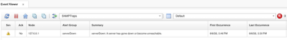


Check the MTTrapd RawCapture immediately after sending the trap:

```bash
tail -30 $OMNIHOME/var/mttrapd.cap
```

With the MIB loaded, you should see the token names resolved — `$ibmTrainingServerName`, `$ibmTrainingServerIP`, and `$ibmTrainingEventSeverity` — rather than raw OID strings. This confirms the MIB is correctly loaded and the probe is decoding the varbinds using your MIB definitions.

---

### 5.5 Customizing the NcKL-Generated Rules

When MIB Manager exports a MIB for NcKL, it generates a generic but functional set of rules. The generated rules build basic field mappings from the trap's OID components and varbind names, and they work out of the box — but the `@Summary` text is typically generic, and deduplication may not behave as expected until you examine and tune the `@Identifier` field. This lab walks through exactly the kind of customization you will do in production.

**Objective:** Review the NcKL-generated rules for the IBM-TRAINING-MIB, customize `@Summary` to include varbind values, fix the `@Identifier` to enable correct deduplication, and tune severity and expiry via the NcKL severity lookup file.

**Prerequisites:** IBM-TRAINING-MIB exported and integrated into NcKL (Section 5.4 complete). MTTrapd restarted and running. ObjectServer running.

#### 5.5.1 Review the generated rules file

Open the generated rules file and review what MIB Manager produced:

```bash
vi $NC_RULES_HOME/include-snmptrap/ibmTraining/ibmTraining-IBM-TRAINING-MIB.include.snmptrap.rules
```

At the top of this rules file you’ll see a **`case` statement** that uses the **OID** for our training MIB:

- `.1.3.6.1.4.1.99999.2`

This OID matches the **`switch($enterprise)`** statement in the top‑level **`snmptrap.rules`** file.

The flow is:

1. The **top‑level `snmptrap.rules`** file receives a trap and evaluates `switch($enterprise)`.
2. It hits the **include** for our **enterprise master include file**, which in turn includes **this** rules file.
3. Because the trap’s **enterprise ID** matches `.1.3.6.1.4.1.99999.2`, the **`case` block** in this file is selected and **processing continues here**.

So this MIB‑specific rules file only runs when the trap belongs to our training enterprise **`99999.2`**, keeping the logic clean and vendor‑scoped.
In this rules file you’ll see a **`switch/case` structure** — there is **one `case` block for each notification type** that MIB Manager exported from the MIB.

Inside each `case`, the rules typically:

- Set **`@AlertGroup`** – the high‑level category of the event.
- Set **`@AlertKey`** – the key that identifies the specific object instance (interface, disk, etc.).
- Set **`@EventId`** – a string ID for the event (for example, `SNMPTRAP-serverDown`).
- Build a generic **`@Summary`** using the MIB’s **DESCRIPTION** text.

### The `serverDown` case

Look specifically at the **`serverDown`** `case` block.

In this case, the rules set the **`@Identifier`** field using the NcKL default format:

```text
@Identifier = @Node + " " + @AlertKey + " " + @AlertGroup + " " +
              $DEFAULT_Type + " " + @Agent + " " + @Manager + " " +
              $specific-trap
```

This is the **NcKL default** way of constructing the identifier.  

Key point: **`@AlertKey` is part of `@Identifier`**. That matters when you look at **deduplication** later, because events with the **same `@Identifier`** are treated as repeats of the **same problem**.

### User include file (where you customize)

Open the **user include file**, which MIB Manager creates with a basic `switch/case` structure but no custom logic yet:

```bash
vi $NC_RULES_HOME/include-snmptrap/ibmTraining/ibmTraining-IBM-TRAINING-MIB.user.include.snmptrap.rules
```

This file provides a **`switch` on the `specific-trap` identifier**, giving you an empty `case` block for each notification type.  

It is **recommended** that all rule **customizations** are done here, rather than in the MIB‑generated rules file. In the user include file you can maintain changes such as:

- Adjusting `@Summary`, `@AlertGroup`, `@AlertKey`, or `@Identifier`.
- Adding extra fields or additional logic for lab exercises or site‑specific behavior.

**Important:**

- **Do not edit** the main generated rules file (`…IBM-TRAINING-MIB.include.snmptrap.rules`) directly — MIB Manager will **overwrite it** whenever you re‑export the MIB.
- Always put your changes in the **`.user.include.snmptrap.rules`** file so they **persist across re‑exports** and remain clearly separated from the auto‑generated content.

#### 5.5.2 Generate initial test events and check deduplication

In this step, send two `diskUtilization` traps with different utilization values:

```bash
snmptrap -v 2c -c public localhost '' 1.3.6.1.4.1.99999.2.3 \
  1.3.6.1.4.1.99999.1.4 s "db-server-02" \
  1.3.6.1.4.1.99999.1.5 a 192.168.1.20 \
  1.3.6.1.4.1.99999.1.6 s "/var" \
  1.3.6.1.4.1.99999.1.7 i 64 \
  1.3.6.1.4.1.99999.1.8 i 4

snmptrap -v 2c -c public localhost '' 1.3.6.1.4.1.99999.2.3 \
  1.3.6.1.4.1.99999.1.4 s "db-server-02" \
  1.3.6.1.4.1.99999.1.5 a 192.168.1.20 \
  1.3.6.1.4.1.99999.1.6 s "/var" \
  1.3.6.1.4.1.99999.1.7 i 77 \
  1.3.6.1.4.1.99999.1.8 i 4
```

Look at the **event list**:

- You see **two separate events**, not one event with `Tally = 2`.
- This means the events are **not being deduplicated**.

The reason is in the **NcKL‑generated `@Identifier`**:

- NcKL has included one of the **varbinds that carries the percent utilization** (from OID `…1.7`) in either `@AlertKey` or directly in `@Identifier`.
- Because `@Identifier` contains the **current utilization value**, each trap with a different percentage produces a **different identifier**.

So:

- First trap: utilization `64` → one `@Identifier`.
- Second trap: utilization `77` → a different `@Identifier`.

Since deduplication uses **`@Identifier`** as the key, those two events **cannot dedup** — they are treated as two distinct problems instead of the same disk filling up.


Examine the `Identifier` field on the events (add it to your view if needed). If the identifiers differ between the two events, note what component is changing. In the next step of the lab, you’ll adjust **`@AlertKey` / `@Identifier`** so they only use **stable identifiers** (host, disk path, etc.) and **exclude** the changing utilization value, allowing all disk‑utilization traps for `/var` on `db-server-02` to deduplicate into a single event.

#### 5.5.3 Customize the @Summary and fix @Identifier

Open the user include file for the IBM-TRAINING-MIB:

```bash
vi $NC_RULES_HOME/include-snmptrap/ibmTraining/ibmTraining-IBM-TRAINING-MIB.user.include.snmptrap.rules
```

The first thing we will do in this file is add the following line to add all of the tokens generated by the probe to the @ExtendedAttr field of the alert. This differs from the RawCapture file because the NcKL has the useful feature of creating tokens from the actual varbind names as defined in the MIB, rather than the raw OIDs that you only see in the RawCapture file. Add this line immediately after the log(DEBUG...) statement and before the switch($specific-trap) statement:

```text
@ExtendedAttr = nvp_add($*)
```

The nvp_add function is a special probe rules function that simply adds all of the current tokens (either generated by the probe or generated within the rules) to the @ExtendedAttr field of the alert.

Stop the mttrapd probe:
```bash
kill $(pgrep nco_p_mttrapd)
```

Perform a syntax check of the rules:
```bash
$OMNIHOME/probes/nco_p_syntax -server EVENTS -rulesfile $NC_RULES_HOME/snmptrap.rules
```
If you don't see the following lines in the syntax check output, scroll back to find the file and the lines in the file that the syntax checker is complaining about, and address any errors before proceeding.
```text
2026-08-06T17:43:39: Information: I-UNK-000-000: Rules file syntax OK
2026-08-06T17:43:39: Information: I-UNK-000-000: Disconnecting ...
```

And start the probe:
```bash
$OMNIHOME/probes/nco_p_mttrapd &
```
Validate that the **mttrapd** probe is listening on UDP port **162**:

```bash
netstat -anlp | grep udp | grep 162
```

Expected output:

```text
udp        0      0 0.0.0.0:162             0.0.0.0:*                   1991508/nco_p_mttra
```

Return to the Web GUI and delete any existing events from your SNMPTraps view to ensure we don't deduplicate our test alert with an existing alert.

Next, send a test event in again using `snmptrap`:

```bash
snmptrap -v 2c -c public localhost '' 1.3.6.1.4.1.99999.2.3   1.3.6.1.4.1.99999.1.4 s "db-server-02"   1.3.6.1.4.1.99999.1.5 a 192.168.1.20   1.3.6.1.4.1.99999.1.6 s "/var"   1.3.6.1.4.1.99999.1.7 i 77   1.3.6.1.4.1.99999.1.8 i 4
```

Find the new **diskUtilization** alert in the event list, and double-click on the alert to bring up the properties view. Scroll down to the ExtendedAttr field and note the tokens not only include the OIDs, but the human-readable MIB representation of the OID as well:

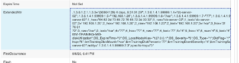

There are some items we shall fix here. First, given that the node name is coming from the host that ran the `logger` command (localhost), but the actual server name is in a varbind and token called **ibmTrainingServerName**, we will set the `@Node` field of the alert to the appropriate token. Second, we see that the disk that this alarm is associated with is in a token called **ibmTrainingDiskMount**, we will set the `@AlertKey` to the value of this token. To to fix deduplication, we will re-work the `@Identifier` field to include only the relevant fields and build from the following tokens: **ibmTrainingServerName**, **ibmTrainingDiskMount**, and the field that contains the alert identifier **@AlertGroup**. Finally, we will rebuild the `@Summary` field to be more useful to operation staff.

Open the user include file for our custom MIB:

```bash
vi $NC_RULES_HOME/include-snmptrap/ibmTraining/ibmTraining-IBM-TRAINING-MIB.user.include.snmptrap.rules
```

Since we know our MIB sets the varbind to the server name for all traps in this MIB, we'll set the `@Node` field to reflect the actual node that is reporting the problem at the top of the user includes, outside of the switch/case statement. Set the @Node field immediately before the switch/case statement:
```text
@Node = $ibmTrainingServerName
```

Locate the switch/case for the traps, and find the case statement for the **diskUtilization** trap. Add the following line to that case statement to build a more appropriate `@Identifier` field:

```text
@Identifier = $ibmTrainingServerName + " : " + $ibmTrainingDiskMount + " : " + @AlertGroup
```
note: we use the `+` symbol here to concatenate text, substituting tokens which are preceded with `$`, and the current value of `@AlertGroup`. We use literal text ` : ` to separate each value for legibility when examining the `@Identifier` field in the event list.

Key point: excluding the **$ibmTrainingDiskMount** from the identifier would result in any **diskUtilization** alarms from the same server deduplicating with each other. Likewise, excluding the `@Node` or **ibmTrainingServerName** token would result in any **diskUtilization** alarms from the */var* filesystem on *any server* to deduplicate with each other.

Next, we'll set the `@Node` field to reflect the actual node that is reporting the problem, which is in the varbind/token `$ibmTrainingServerName`:
```text
@Node = $ibmTrainingServerName
```

Next, we will modify the `@Summary` field to be more human friendly and to also include the drive and the actual disk utilization percentage value:

```text
@Summary = "Disk utilization alert for drive " + $ibmTrainingDiskMount + ", utilization is at " + $ibmTrainingDiskPercent
```

Next, as this alert does define a severity in the varbind/token **ibmTrainingEventSeverity**, let's set it here as well:

```text
@Severity = $ibmTrainingEventSeverity
```
note: depending on varying severity levels between sources, you may need to use additional logic to map the source severity to one of the five severities in the ObjectServer

While we are editing this file, let's set the @AlertKey appropriately for all event types. Since the **serverDown** and **serverUp** alerts are node/chassis level alarms, and have no associated subcomponent, set the `@AlertKey` for both of these alarms to `@Node` in the appropriate case statements:

```text
@AlertKey = @Node
```

Since the **diskUtilization** trap does have an associated subcomponent (the disk), let's set the `@AlertKey` to the **ibmTrainingDiskMount** varbind/token:

```text
@AlertKey = $ibmTrainingDiskMount
```

Finally, ensure that the **serverDown** and **serverUp** alerts share the same `@AlertGroup`. The generic_clear enforces the following fields to match between problem/resolution pairs: `@Node`, `@AlertGroup`, `@AlertKey`, `@Manager`. Set the following for each:

```text
@AlertGroup = "serverDownUp"
```

When finished, your `user.include.rules` file should look like this:

```text
###############################################################################
# ibmTraining-IBM-TRAINING-MIB
# Automatically created by MIB Manager
# Aug 6, 2026 1:34:33 PM
###############################################################################

log(DEBUG, "<<<<< Entering... ibmTraining-IBM-TRAINING-MIB.user.include.snmptrap.rules >>>>>")

@ExtendedAttr = nvp_add($*)
@Node = $ibmTrainingServerName

        switch($specific-trap) {
        case "1": ### - serverDown
                        @AlertKey = @Node
                        @AlertGroup = "serverDownUp"
        case "2": ### - serverUp
                        @AlertKey = @Node
                        @AlertGroup = "serverDownUp"
        case "3": ### - diskUtilization
                        @Identifier = $ibmTrainingServerName + " : " + $ibmTrainingDiskMount + " : " + @AlertGroup
                        @Summary = "Disk utilization alert for drive " + $ibmTrainingDiskMount + ", utilization is at " + $ibmTrainingDiskPercent + "% utilization"
                        @Severity = $ibmTrainingEventSeverity
                        @AlertKey = $ibmTrainingDiskMount
                default:
}

log(DEBUG, "<<<<< Leaving... ibmTraining-IBM-TRAINING-MIB.user.include.snmptrap.rules >>>>>")
```

Save the file and exit.


Stop the mttrapd probe:
```bash
kill $(pgrep nco_p_mttrapd)
```

Perform a syntax check of the rules:
```bash
$OMNIHOME/probes/nco_p_syntax -server EVENTS -server EVENTS -rulesfile $NC_RULES_HOME/snmptrap.rules
```

If you don't see the following lines in the syntax check output, scroll back to find the file and the lines in the file that the syntax checker is complaining about, and address any errors before proceeding:
```text
2026-08-06T18:05:39: Information: I-UNK-000-000: Rules file syntax OK
2026-08-06T18:05:39: Information: I-UNK-000-000: Disconnecting ...
```


Start the probe:
```bash
$OMNIHOME/probes/nco_p_mttrapd &
```
Validate that the **mttrapd** probe is listening on UDP port **162**:

```bash
netstat -anlp | grep udp | grep 162
```

Expected output:

```text
udp        0      0 0.0.0.0:162             0.0.0.0:*                   1991508/nco_p_mttra
```

Return to the Web GUI and delete any existing events from your SNMPTraps view to ensure we don't deduplicate our test alert with an existing alert

Next, send our diskUtilization test event in a few times with varying values for utilizaiton using `snmptrap`:

```bash
snmptrap -v 2c -c public localhost '' 1.3.6.1.4.1.99999.2.3   1.3.6.1.4.1.99999.1.4 s "db-server-02"   1.3.6.1.4.1.99999.1.5 a 192.168.1.20   1.3.6.1.4.1.99999.1.6 s "/var"   1.3.6.1.4.1.99999.1.7 i 77   1.3.6.1.4.1.99999.1.8 i 4
```

```bash
snmptrap -v 2c -c public localhost '' 1.3.6.1.4.1.99999.2.3   1.3.6.1.4.1.99999.1.4 s "db-server-02"   1.3.6.1.4.1.99999.1.5 a 192.168.1.20   1.3.6.1.4.1.99999.1.6 s "/var"   1.3.6.1.4.1.99999.1.7 i 84   1.3.6.1.4.1.99999.1.8 i 4
```
```bash
snmptrap -v 2c -c public localhost '' 1.3.6.1.4.1.99999.2.3   1.3.6.1.4.1.99999.1.4 s "db-server-02"   1.3.6.1.4.1.99999.1.5 a 192.168.1.20   1.3.6.1.4.1.99999.1.6 s "/var"   1.3.6.1.4.1.99999.1.7 i 65   1.3.6.1.4.1.99999.1.8 i 4
```


#### 5.5.4 Tune @Type, @Severity and @ExpireTime in the NcKL lookup file

In addition to the `*.user.include.snmptrap.rules` file for our MIB, NcKL also creates a **severity lookup file**.  

This lookup file lets you maintain **`@Severity`**, **`@Type`**, and **`@ExpireTime`** for each alert in one **simple table**, instead of hard‑coding them in the rules. The file is:

```bash
vi $NC_RULES_HOME/include-snmptrap/ibmTraining/ibmTraining-IBM-TRAINING-MIB.sev.snmptrap.lookup
```

#### Severity lookup file format

The file contains one entry per trap that MIB Manager exported, in this format:

```text
{"SNMPTRAP-ibmTraining-IBM-TRAINING-MIB-<trapname>","<severity>","<type>","<expiretime>"}
```

- `severity`  → numeric **`@Severity`** (0=Clear, 1=Indeterminate, 2=Warning, 3=Minor, 4=Major, 5=Critical, etc.).
- `type`      → numeric **`@Type`** (1=problem, 2=resolution).
- `expiretime`→ **`@ExpireTime`** in seconds (0 = no auto‑clear).

** note: setting the severity column to 6 will cause the rules to drop the alert if it is unwanted/inactionable.

By default, MIB Manager sets all entries to:

- `Severity = 3` (Minor)
- `Type = 1` (Problem)
- `ExpireTime = 0` (no expiry)

#### Lab changes: serverDown, serverUp, diskUtilization

For our lab, we want:

- **`serverDown`** to be more important (Critical problem).
- **`serverUp`** to act as a **clear/resolution**.
- **`diskUtilization`** to auto‑expire after **30 minutes** if no new traps arrive.

Update the entries as follows.

#### serverDown

Set `serverDown` to **Critical problem**:

```text
{"SNMPTRAP-IBM-TRAINING-MIB-serverDown","5","1","0"}
```

- Severity `5` → Critical  
- Type `1`     → Problem  
- Expire `0`   → No auto‑clear

#### serverUp

Set `serverUp` to a **resolution/clear**:

```text
{"SNMPTRAP-IBM-TRAINING-MIB-serverUp","1","2","0"}
```
note: for the generic_clear automation to work, the type 2 alert must have a severity of '1', which will then be set to '0' along with the original problem alert.

- Severity `1` → Indeterminate  
- Type `2`     → Resolution  
- Expire `0`   → No auto‑clear

#### diskUtilization

Set `diskUtilization` to **Major** with a **30‑minute expiry**:

```text
{"SNMPTRAP-IBM-TRAINING-MIB-diskUtilization","4","1","1800"}
```

- Severity `4`  → Major  
- Type `1`      → Problem  
- Expire `1800` → 1800 seconds = 30 minutes

#### Final table

When you’re done, the table in the lookup file should look like:

```text
table ibmTraining-IBM-TRAINING-MIB_sev =
{
        {"SNMPTRAP-IBM-TRAINING-MIB-serverDown","5","1","0"},
        {"SNMPTRAP-IBM-TRAINING-MIB-diskUtilization","4","1","1800"},
        {"SNMPTRAP-IBM-TRAINING-MIB-serverUp","1","2","0"}
}
```

> **Note:**  
> Adjusting severity and expiry in the **lookup file** (instead of in rules code) is the **NcKL‑recommended approach**. It keeps your rule logic clean and makes these operational parameters easy to change. You still need to **restart mttrapd** to pick up changes, but you don’t have to modify or re‑syntax‑check the rules themselves.


Save the file and exit the editor. 

Stop the mttrapd probe:
```bash
kill $(pgrep nco_p_mttrapd)
```

Perform a syntax check of the rules:
```bash
$OMNIHOME/probes/nco_p_syntax -server EVENTS -rulesfile $NC_RULES_HOME/snmptrap.rules
```

If you don't see the following lines in the syntax check output, scroll back to find the file and the lines in the file that the syntax checker is complaining about, and address any errors before proceeding.
```text
2026-08-06T17:43:39: Information: I-UNK-000-000: Rules file syntax OK
2026-08-06T17:43:39: Information: I-UNK-000-000: Disconnecting ...
```


Start the probe:
```bash
$OMNIHOME/probes/nco_p_mttrapd &
```
Validate that the **mttrapd** probe is listening on UDP port **162**:

```bash
netstat -anlp | grep udp | grep 162
```

Expected output:

```text
udp        0      0 0.0.0.0:162             0.0.0.0:*                   1991508/nco_p_mttra
```


Return to the Web GUI and delete any existing events from your SNMPTraps view before proceeding to the final tests.


#### 5.5.6 Test all trap types

#### Test 1 — serverDown

```bash
snmptrap -v 2c -c public localhost '' 1.3.6.1.4.1.99999.2.1 \
  1.3.6.1.4.1.99999.1.4 s "db-server-02" \
  1.3.6.1.4.1.99999.1.5 a 192.168.1.20 \
  1.3.6.1.4.1.99999.1.8 i 5
```

In the Web GUI you should see a **Critical** (red) event with:
- `Node` = `db-server-02`
- `AlertGroup` = `IBM-TRAINING-MIB`
- `AlertKey` = `serverDown`
- `Summary` = `Server db-server-02 (192.168.1.20) is DOWN`
- `Type` = `1`

#### Test 2 — diskUtilization (with ExpireTime)

```bash
snmptrap -v 2c -c public localhost '' 1.3.6.1.4.1.99999.2.3 \
  1.3.6.1.4.1.99999.1.4 s "db-server-01" \
  1.3.6.1.4.1.99999.1.5 a 192.168.1.22 \
  1.3.6.1.4.1.99999.1.6 s "/var" \
  1.3.6.1.4.1.99999.1.7 i 87 \
  1.3.6.1.4.1.99999.1.8 i 4
```

Expected event:
- `Node` = `db-server-01`
- `AlertKey` = `diskUtilization:/var`
- `Severity` = `4` (Major)
- `Summary` = `Disk /var on db-server-02 is at 87% utilization`
- `ExpireTime` = `1800`

#### Test 3 — Second diskUtilization (different mount point)

```bash
snmptrap -v 2c -c public localhost '' 1.3.6.1.4.1.99999.2.3 \
  1.3.6.1.4.1.99999.1.4 s "db-server-01" \
  1.3.6.1.4.1.99999.1.5 a 192.168.1.22 \
  1.3.6.1.4.1.99999.1.6 s "/home" \
  1.3.6.1.4.1.99999.1.7 i 92 \
  1.3.6.1.4.1.99999.1.8 i 5
```

This should produce a **separate** Critical event for `/home` rather than deduplicating with the `/var` event — confirming that the mount point in `@AlertKey` is working correctly.

#### Test 4 — serverUp (clears serverDown)

```bash
snmptrap -v 2c -c public localhost '' 1.3.6.1.4.1.99999.2.2 \
  1.3.6.1.4.1.99999.1.4 s "db-server-02" \
  1.3.6.1.4.1.99999.1.5 a 192.168.1.20
```

Watch the Web GUI — the `serverDown` Critical event for `db-server-02` should clear within a few seconds as `generic_clear` matches the Type 2 `serverUp` event against the Type 1 `serverDown` event.

**Validation:** After all four tests:
- Two disk utilization events remain (one for `/var`, one for `/home`) — `ExpireTime` of 1800 seconds is counting down.
- The `serverDown` event for `db-server-02` is cleared and no longer visible.
- No `serverDown` event exists for `db-server-02` in the event list.

---

### 5.6 Summary

In this section you have built a complete SNMP trap processing pipeline from the ground up. You have:

- Configured the **MTTrapd probe** to receive SNMP traps on UDP port 162 and forward them to the ObjectServer.
- Integrated MTTrapd with the **NcKL knowledge library**, providing immediate out-of-the-box handling for hundreds of vendor MIBs.
- Used **MIB Manager** to load a custom `IBM-TRAINING-MIB`, enabling MTTrapd to decode OIDs from a device type it had no prior knowledge of.
- Written probe **rules** that map decoded trap tokens to `alerts.status` fields, apply severity mapping from varbind values, implement `serverDown`/`serverUp` correlation using OMNIbus Type 1/Type 2 event pairs, and set expire timers for threshold conditions.
- Validated the end-to-end pipeline by generating test traps with `snmptrap` and observing correct event creation, deduplication, and auto-clear behavior in the Web GUI.

The patterns used here — MIB loading, varbind-driven field mapping, severity mapping via `switch`, Type 1/Type 2 correlation, and `@ExpireTime` for threshold events — are the fundamental building blocks of all production SNMP event management. Every vendor-specific MIB you encounter will follow the same workflow.

> **Note:** In a production environment, a single Netcool/OMNIbus deployment may process millions of SNMP traps per day from thousands of devices across hundreds of different MIBs. NcKL provides the breadth to handle vendor-specific traps out of the box, while the custom rules framework you have practiced here provides the flexibility to handle anything NcKL does not cover.
