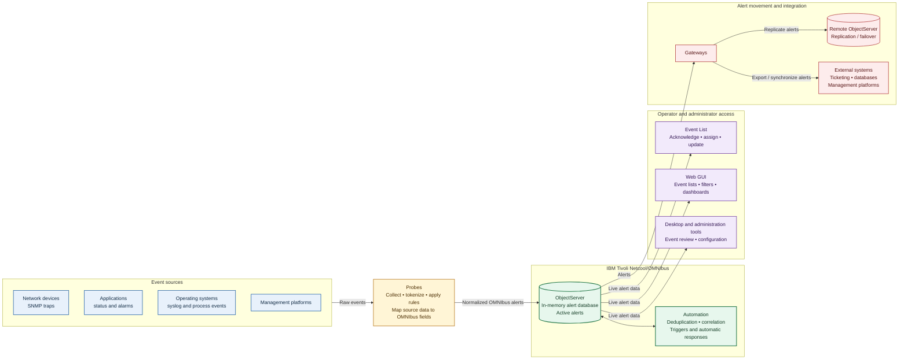

# IBM Tivoli Netcool/OMNIbus architecture

**Primary pipeline:** Event sources → Probes → ObjectServer → Automation and operator views.

**Integration path:** ObjectServer → Gateways → Remote ObjectServers and external systems.
