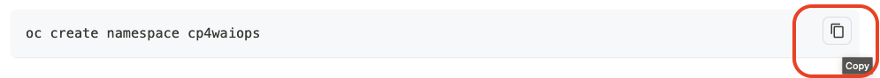
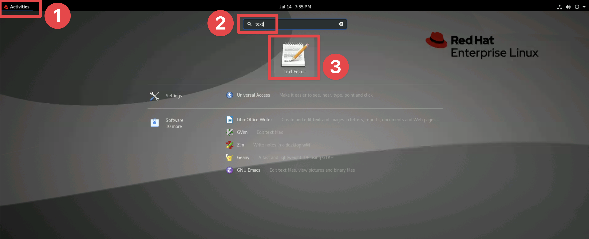
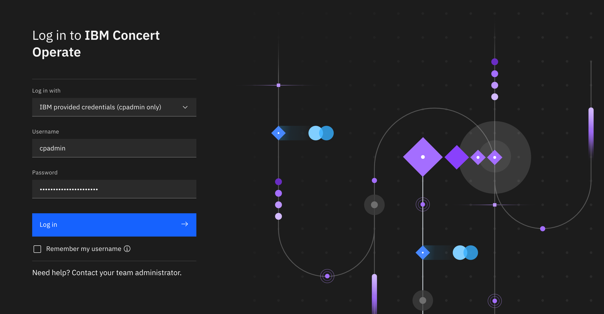

## 3.1: Overview

This module focuses on the initial deployment of Concert Operate on OpenShift. This deployment scenario will assume you are deploying onto the IBM Technology Zone, [Jam-in-a-Box for AIOps](https://techzone.ibm.com/collection/jam-in-a-box-for-aiops/environments) environments. Note that the same steps would generally apply to an OpenShift cluster deployed on another cloud provider, or on-premises.

## 3.2: Connect to the OpenShift cluster from bastion VM

In the previous section, we described how to access the bastion VM. Ensure you have access to the Concert Operate OpenShift system by running the following command:

```
export KUBECONFIG=/home/itzuser/kubeconfig
oc get pods --all-namespaces
```

If you have access to the OpenShift instance, you should see a listing of all pods currently running on the cluster output from the `oc` command.

## 3.3: Install the Concert Operate Operator

In this section, our objective will be to install the product Operator which will then pull down the Concert Operate software images to the cluster, so that we can deploy an instance of Concert Operate in the next section. You will be copying, pasting, and running the following commands from the **Terminal** window.

:::tip

- It is essential to ensure the indentation is correctly copied from the documentation.
- When you copy the commands, use the Copy helper on the right side as shown below: 

:::

:::caution

Concert Operate and Infrastructure Automation can co-exist on the same cluster, but you should not install multiple instances of Concert Operate or Infrastructure Automation on the same cluster.

:::

If interested, this install steps we will begin to follow are documented [**_here_**](https://www.ibm.com/docs/en/concert-operate/5.2.0?topic=installing-starter-installation#exp_namespace__title__1).

### Create a custom project (namespace)

Let us start by creating the project (namespace) where we will install the product. It is important to know which project/namespace you are in when issuing `oc` commands. Run the following command to create the namespace:

```
export PROJECT_CP4AIOPS=concert-operate
oc create namespace ${PROJECT_CP4AIOPS}
```

### Add a node selector annotation

Add a node-selector annotation to the IBM Concert Operate namespace to ensure that on a multi-architecture Red Hat OpenShift cluster, IBM Concert Operate workloads are only scheduled on nodes that have an architecture that IBM Concert Operate supports.

```
oc annotate namespace "${PROJECT_CP4AIOPS}" openshift.io/node-selector="kubernetes.io/arch=amd64"
```

### Create an Operator Group in your custom project (namespace)

The Operator requires an Operator Group, which provides multi-tenant configuration to installed Operators. An Operator group selects target namespaces in which to generate required RBAC (Role Base Access Control) access
for its member Operators. Run the following command:

```sh
cat << EOF | oc apply -f -
apiVersion: operators.coreos.com/v1
kind: OperatorGroup
metadata:
  name: concert-operate-operator-group
  namespace: ${PROJECT_CP4AIOPS}
spec:
  targetNamespaces:
    - "${PROJECT_CP4AIOPS}"
EOF

```

### Create the entitlement key pull secret

Now we will store the [entitlement key that you obtained previously](https://ibm.github.io/waiops-tech-jam/labs/cloud-pak-aiops/install-lab/lab-environment/#obtain-your-entitlement-key) into a secret. This secret will be used to pull installation images. Copy and paste the following command into the **Text Editor** in the bastion VM, add your entitlement key, and run the command from the **Terminal**:

```sh
oc create secret docker-registry ibm-entitlement-key \
    --docker-username=cp \
    --docker-password=<entitlement-key> \
    --docker-server=cp.icr.io \
    --namespace=${PROJECT_CP4AIOPS}
```

:::tip

To open the **Text Editor** in the bastion VM, click on **Applications**, type `text` into the search bar, and click on the **Text Editor** icon.



:::

If interested, this install step is documented [**_here_**](https://www.ibm.com/docs/en/concert-operate/5.2.0?topic=installing-starter-installation#exp_pull_secret__title__1).

### Usage data collection

To help the development of Concert Operate, daily aggregated usage data is collected to analyze how the product is used. The usage data is collected and sent to and stored in IBM controlled GDPR-compliant systems. We will disable usage collection for the purposes of this lab. Run the following commands to set the following environment variables and configure the system to disable usage collection:

```
export CUSTOMER_NAME=WidgetCom
export CUSTOMER_ICN=1234567890
export CUSTOMER_ENVIRONMENT=trial
oc create secret generic aiops-metrics-processor -n ${PROJECT_CP4AIOPS} --from-literal=customerName=${CUSTOMER_NAME} --from-literal=customerICN=${CUSTOMER_ICN} --from-literal=environment=${CUSTOMER_ENVIRONMENT} --from-literal=enableCollection=false 
```

If interested, this install step is documented [**_here_**](https://www.ibm.com/docs/en/concert-operate/5.2.0?topic=installing-starter-installation#disable_usage_secret__title__1).

### Create the catalog source

Run the following command to create the CatalogSource from which the Concert Operator software will be installed:

```sh
cat << EOF | oc apply -f -
apiVersion: operators.coreos.com/v1alpha1
kind: CatalogSource
metadata:
  name: ibm-aiops-catalog
  namespace: ${PROJECT_CP4AIOPS}
spec:
  displayName: ibm-aiops-catalog
  publisher: IBM Content
  sourceType: grpc
  image: icr.io/cpopen/ibm-aiops-catalog@sha256:dd001b156473070b5ea32b2e1968d844dc4df1da9c241a8776e24247c1359cf5
  grpcPodConfig:
    securityContextConfig: restricted
EOF
```

Run the following command to verify that the CatalogSource was created successfully:

```sh
oc get CatalogSource -n ${PROJECT_CP4AIOPS}
```

You should see something like the following in the output:

```sh
$ oc get CatalogSource -n concert-operate
NAME                     DISPLAY                      TYPE   PUBLISHER   AGE
ibm-aiops-catalog        ibm-aiops-catalog            grpc   IBM         2m 
```

If interested, this install step is documented [**_here_**](https://www.ibm.com/docs/en/concert-operate/5.2.0?topic=installing-starter-installation#exp_catalog__title__1).

:::tip

Note that the  _ibm-operator-catalog_ CatalogSource is fixed to a specific image digest, instead of _icr.io/cpopen/ibm-operator-catalog:latest_. This ensures that the ibm-operator-catalog CatalogSource pods do not inadvertently pull the latest image if a node reload or other issue causes them to restart.

:::

### Install Cert Manager

Concert Operate requires the presence of a certificate manager. The IBM Cloud Pak foundational services Cert Manager is recommended for this purpose.

Create the IBM Cloud Pak foundational services Cert Manager catalog:

```sh
cat << EOF | oc apply -f -
apiVersion: operators.coreos.com/v1alpha1
kind: CatalogSource
metadata:
  name: ibm-cert-manager-catalog
  namespace: openshift-marketplace
spec:
  displayName: ibm-cert-manager
  publisher: IBM
  sourceType: grpc
  image: icr.io/cpopen/ibm-cert-manager-operator-catalog@sha256:435b47b0441486d80c06c5cea6f2182367bc5bcedd2fb92bda24b3be9887e020
EOF
```

Verify that the ibm-cert-manager-catalog CatalogSource object is in the output that is returned by the following command:

```sh
oc get CatalogSources -n openshift-marketplace
```

You should see something like the following in the output:

```sh
oc get CatalogSources -n openshift-marketplace
NAME                     DISPLAY                      TYPE   PUBLISHER   AGE
ibm-cert-manager-catalog ibm-cert-manager             grpc   IBM         2m 
```

Run the following command to create the resource definitions that you need:

```sh
cat << EOF | oc apply -f -
apiVersion: v1
kind: Namespace
metadata:
  name: ibm-cert-manager
---
apiVersion: operators.coreos.com/v1
kind: OperatorGroup
metadata:
  name: ibm-cert-manager-operator-group
  namespace: ibm-cert-manager
---
apiVersion: operators.coreos.com/v1alpha1
kind: Subscription
metadata:
  name: ibm-cert-manager-operator
  namespace: ibm-cert-manager
spec:
  channel: v4.2
  installPlanApproval: Automatic
  name: ibm-cert-manager-operator
  source: ibm-cert-manager-catalog
  sourceNamespace: openshift-marketplace
EOF
```

Run the following command to ensure that the IBM Cloud Pak foundational services Cert Manager pods have a STATUS of Running before proceeding to the next step.

```sh
oc -n ibm-cert-manager get pods
```

Example output for a successful IBM Cloud Pak foundational services Cert Manager installation:

```sh
NAME                                        READY   STATUS    RESTARTS   AGE
cert-manager-cainjector-674854c49d-vstq4    1/1     Running   0          8d
cert-manager-controller-646d4bd6fd-zwmqm    1/1     Running   0          8d
cert-manager-webhook-8598787c8-s4lkt        1/1     Running   0          8d
ibm-cert-manager-operator-c96957695-dkxnm   1/1     Running   0          8d
```

:::warning

Ensure you see all pods in a **Running 1/1** state before proceeding to the next step.

:::

If interested, this install step is documented [**_here_**](https://www.ibm.com/docs/en/concert-operate/5.2.0?topic=installing-starter-installation#cert_mgr__title__1).

### Verify cluster readiness

:::note

For the purposes of this lab, there is no need to complete the cluster readiness checks unless you have time. You would completed these steps in any case, if this were a real world deployment.

:::

Run the following procedure to verify whether your environment is correctly set up for an IBM Concert Operate installation. Run the following commands to download and install the `aiopsctl` utility, then echo the version to the terminal:

```sh
AIOPSCTL_TAR=aiopsctl-linux_amd64.tar.gz
AIOPSCTL_INSTALL_URL="https://github.com/IBM/aiopsctl/releases/download/v5.2.0/${AIOPSCTL_TAR}"
curl -LO "${AIOPSCTL_INSTALL_URL}"
tar xf "${AIOPSCTL_TAR}"
sudo mv aiopsctl /usr/local/bin/aiopsctl
aiopsctl version
```

You should see something like the following echoed as the version output:

```sh
aiopsctl version: 5.2.0+5.2-38-ge6dcf39fc5
```

Run the following command to initiate the precheck:

```sh
aiopsctl server precheck -n ${PROJECT_CP4AIOPS} 
```

You should see something like the following at the end of the checks to verify that the system is ready for installation:

```sh
  o- [21 Oct 26 11:58 EDT] Precheck Summary Results
  Check                          Result
  Meets Hardware Requirements    Passed
  No Storage Issues              Passed
  Meets OCP Version Requirement  Passed
  Cert Mgr Operator Exists       Passed
  Certificates Valid             Passed
```

If interested, this install step is documented [**_here_**](https://www.ibm.com/docs/en/concert-operate/5.2.0?topic=installing-starter-installation#prereq_check__title__1).

### Install the Concert Operate Operator

Finally, we are ready to install the Concert Operate Operator. Run the following command to do this:

```sh
cat << EOF | oc apply -f -
apiVersion: operators.coreos.com/v1alpha1
kind: Subscription
metadata:
  name: ibm-aiops-orchestrator
  namespace: ${PROJECT_CP4AIOPS}
spec:
  channel: v5.2
  installPlanApproval: Automatic
  name: ibm-aiops-orchestrator
  source: ibm-aiops-catalog
  sourceNamespace: ${PROJECT_CP4AIOPS}
EOF
```

:::note

In a Concert Operate installation, the installPlanApproval setting must not be changed to Manual. Manual approval, which requires the manual review and approval of the generated InstallPlans, is not supported. Incorrect timing or ordering of manual approvals of InstallPlans can result in a failed installation.

:::


After a few minutes, the IBM Concert Operate operator is installed. Verify that the all of the components have a state of Succeeded by running the following command:

```
oc get csv -n ${PROJECT_CP4AIOPS} | egrep "ibm-aiops-orchestrator"
```

You should see **Succeeded** messages as shown below:

```sh
$ oc get csv -n ${PROJECT_CP4AIOPS} | egrep "ibm-aiops-orchestrator"
ibm-aiops-orchestrator.v5.2.0         IBM Concert Operate               5.2.0   Succeeded
```

If interested, this install step is documented [**_here_**](https://www.ibm.com/docs/en/concert-operate/5.2.0?topic=installing-starter-installation#exp_operator__title__1).

:::warning

Ensure you see the **Succeeded** status before proceeding to the next step.

:::

## 3.4: Deploy an instance of Concert Operate

This final step involves deploying a running instance of Concert Operate onto the OpenShift cluster. Note in the following command that we specify **accept** the license, that the installation size is **small**, and the name of the file and block **storage classes**. In a real deployment, you will have to define the storage classes in advance. We will get deeper into storage classes later in the lab.

Note also that we specify the **TopologyModel**. This is the terminology to use in the product when defining collections of topology resource groups. Valid values for TopologyModel are "application" or "service". Run the following commands:

```sh
export PROJECT_CP4AIOPS=concert-operate
export LICENSE_ACCEPT=true
export INSTALL_SIZE=small
export IR_CORE_POSTGRES_LOCAL_STORAGE_CLASS=''
export TOPOLOGY_POSTGRES_LOCAL_STORAGE_CLASS=''
export KAFKA_LOCAL_STORAGE_CLASS=''
export STORAGE_CLASS_FILE=ocs-storagecluster-cephfs
export STORAGE_CLASS_BLOCK=ocs-storagecluster-ceph-rbd
export TOPOLOGY_MODEL=application

cat << EOF | oc apply -f -
apiVersion: orchestrator.aiops.ibm.com/v1alpha1
kind: Installation
metadata:
  name: ibm-cp-aiops
  namespace: ${PROJECT_CP4AIOPS}
spec:
  imagePullSecret: ibm-entitlement-key
  license:
    accept: ${LICENSE_ACCEPT}
  pakModules:
  - name: aiopsFoundation
    enabled: true
  - name: applicationManager
    enabled: true
  - name: aiManager
    enabled: true
  - name: connection
    enabled: false
  - name: logAnomalyDetection
    enabled: false
  size: ${INSTALL_SIZE}
  storage:
    aiops-ir-core-postgres:
      storageClass: ${IR_CORE_POSTGRES_LOCAL_STORAGE_CLASS}
    aiops-ir-core-postgres-wal:
      storageClass: ${IR_CORE_POSTGRES_LOCAL_STORAGE_CLASS}
    aiops-topology-postgres:
      storageClass: ${TOPOLOGY_POSTGRES_LOCAL_STORAGE_CLASS}
    aiops-topology-postgres-wal:
      storageClass: ${TOPOLOGY_POSTGRES_LOCAL_STORAGE_CLASS}
    data-iaf-system-kafka:
      storageClass: ${KAFKA_LOCAL_STORAGE_CLASS}
  storageClass: ${STORAGE_CLASS_FILE}
  storageClassLargeBlock: ${STORAGE_CLASS_BLOCK}
  topologyModel: ${TOPOLOGY_MODEL}
EOF
```

Run the following command to check that the _PHASE_ of your installation is **Updating**:

```sh
oc get installations.orchestrator.aiops.ibm.com -n ${PROJECT_CP4AIOPS}
```

It takes around 60-90 minutes for the installation to complete (subject to the speed with which images can be pulled). When installation is complete and successful, the PHASE of your installation changes to **Running**.

:::tip

While you wait for the installation to finish, you can read through the following informational sections and come back to complete the installation tasks when you are finished.

- [Custom Sizing Tool](/labs/cloud-pak-aiops/install-lab/sizing-tool/)
- [Storage, HA, and FIPS Considerations](/labs/cloud-pak-aiops/install-lab/storage-ha/)
- [LDAP integration](/labs/cloud-pak-aiops/install-lab/LDAP-integration/)

:::

If your installation phase does not change to **Running** after 60-90 minutes, use the following command to find out which components are not ready:

```sh
oc get installation.orchestrator.aiops.ibm.com -o yaml -n ${PROJECT_CP4AIOPS} | grep 'Not Ready'
```

To see details about why a component is Not Ready, use the following example command to get more information about the affected service, for example, for `zenservice`:

```sh
oc get zenservice -o yaml -n ${PROJECT_CP4AIOPS}
```

If interested, this install step is documented [**_here_**](https://www.ibm.com/docs/en/concert-operate/5.2.0?topic=installing-starter-installation#exp_instance__title__1).


## 3.5: Log in to the Concert Operate console

Next, you will locate the console URL and the admin login credentials from your newly deployed instance of Concert Operate.

Find the URL to access the console with the following command:

```
oc get route -n ${PROJECT_CP4AIOPS} cpd -o jsonpath='{.spec.host}'
```

Find the password for the **cpadmin** username by running the following command:

```
oc -n ${PROJECT_CP4AIOPS} get secret platform-auth-idp-credentials -o jsonpath='{.data.admin_password}' | base64 -d ; echo -e "\n"
```

Open a Firefox browser window and copy & paste the **Concert Operate URL** that you got in the previous step. Note that you will get one or more security **Warning: Potential Security Risk Ahead**. This is because we have used
self-signed certificates for this Lab. Just accept the risk and continue.

Make sure you can login as **cpadmin**, as shown below, using the password from the previous command.

If interested, the cluster access step is documented [**_here_**](https://www.ibm.com/docs/en/concert-operate/5.2.0?topic=installing-starter-installation#exp_login__title__1).



---

After confirming you can login as **cpadmin**, read through the **Custom Sizing Tool**, **Storage, HA, and FIPS Considerations**, and **LDAP Integration** sections.
