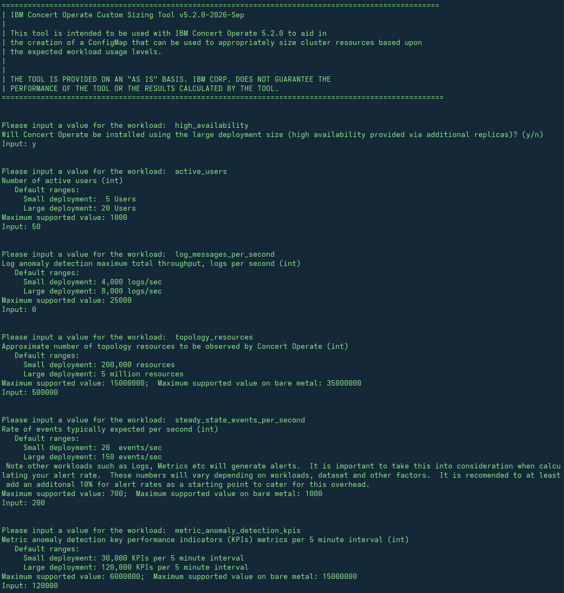
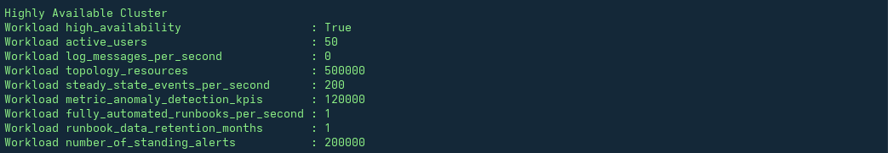
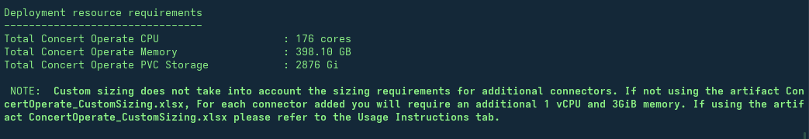
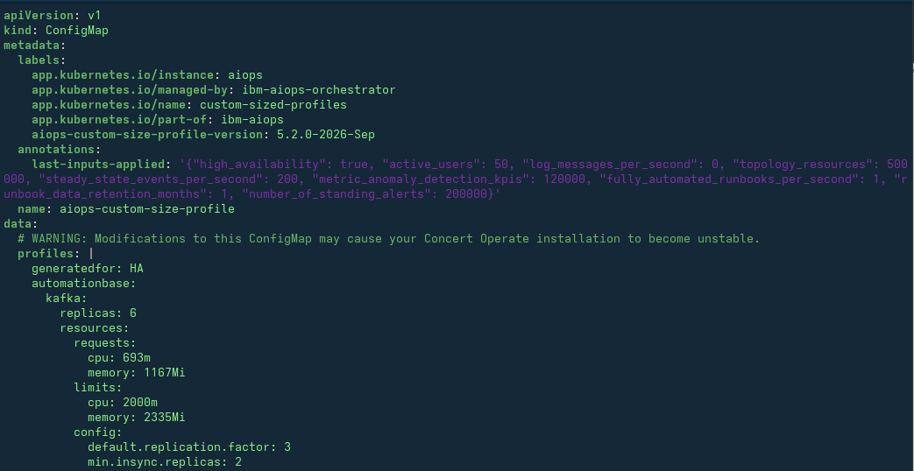

## 4.1: Overview

Both the OpenShift cluster and Concert Operate can be sized in two different ways: either based on a fixed T-Shirt sizing ("starter"/small or "production"/large) or it can be custom-sized based on actual workloads and functionality needs. For demo and POC environments, a starter sizing can be used but it is recommended to use a "production" sizing if the hardware is available, particularly in the case of a POC. This is because more often than not, a POC ends up having sizeable amounts of data pushed through it.

For production deployments, it is recommended to do a custom sizing using the Custom Sizing Tool to ensure the resulting system has sufficient capacity. Moreover, it is recommended to uplift the recommended hardware footprint by 20% to provide some additional headroom in case of an event or data storm. Finally, it is recommended to provision at least one additional worker node than is required, to avoid any outages during maintenance activities, such as patching either OpenShift or Concert Operate. The system has to be able to continue running if a worker node goes down, even intentionally, for example during maintenance.

Running the Concert Operate Custom Sizing Tool outputs an informational spreadsheet that outlines the CPU and memory requirements to run Concert Operate processes. The [product documentation](https://www.ibm.com/docs/en/concert-operate/5.2.0?topic=planning-hardware-requirements#ocp__title__1) outlines the resources required to run OpenShift, including master nodes and OpenShift processes running on worker nodes.

:::note

See [this blog](https://community.ibm.com/community/user/blogs/zane-bray1/2024/06/05/aiops-4-tips-ensure-openshift-resources) for further reading on ensuring sufficient hardware is provisioned to run OpenShift itself. Very often, OpenShift is overlooked and systems end up being under-provisioned as a result.

:::

The Custom Sizing Tool also generates a ConfigMap file that can be applied when creating the Concert Operate instance. It specifies the sizing configuration of the Concert Operate instance and is used to appropriately size pods, replicas, etc. based upon the expected workload and usage levels. This is applied **before** the installation of the Concert Operate instance.

Finally, the Custom Sizing Tool provides a list of adjustments to the PVC storage capacity, if needed. This is applied **after** the installation has completed.

The tool itself is standalone that is packaged as a binary executable. It can run on a local workstation, and it does not need to access to any external resources. There are binaries for Windows, macOS, and Linux.

:::note

Only IBM technical teams currently have access to the Custom Sizing Tool. Please contact your IBM representative for access.

:::

## 4.2 Running the Custom Sizing Tool (CST)

The tool will ask various workload questions as shown below:

Then it will summarise the values entered:

The tool will then summarise the CPU, memory, and storage sizing requirements:

The tool will create a Microsoft Excel spreadsheet where additional sizing elements can be input, such as how many Connectors you want to deploy as well as your server profile details, which will help you to finalise your hardware profile. The tool also generates a configMap file called `aiops-custom-size-profile.yaml` which can be used to deploy your Concert Operate instance, in-line with the specific sizing requirements.

The following is a preview of what the configMap file looks like:

