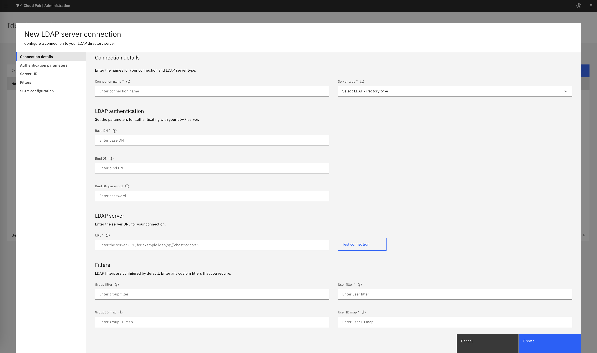
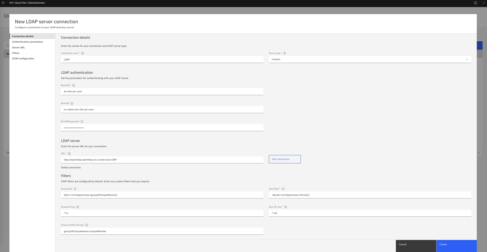
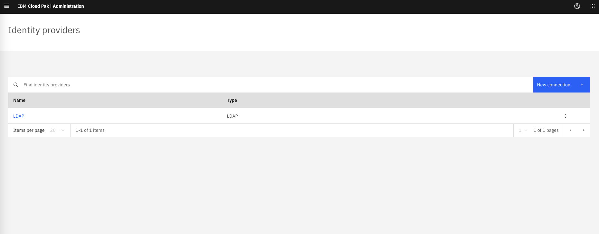
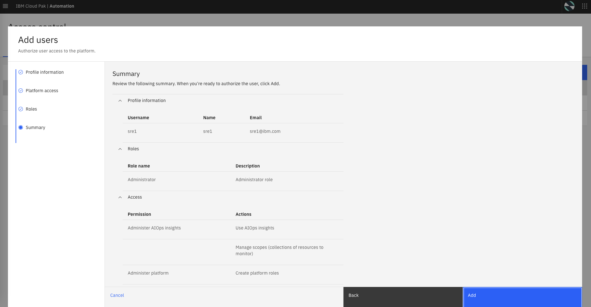

:::warning Information only

You are not required to follow or execute any of the commands in this section. This section is here for informational purposes only.

:::

## 6.1: Overview

In this chapter, we will review how to configure the integration with a Lightweight Directory Access Protocol (LDAP) server. With an LDAP connection created, we can add users from the LDAP directory to Concert Operate for accessing the different capabilities. When we are adding a user from an LDAP server to the product, we can search users by their name, email address, or username. The LDAP login ID for the user is considered to be the username for that user.

The following LDAP types are supported:

- IBM Tivoli Directory Server
- IBM Lotus Domino
- IBM SecureWay Directory Server
- Novell eDirectory
- Sun Java™ System Directory Server
- Netscape Directory Server
- Microsoft Active Directory
- Custom

## 6.2: Obtaining connection parameters

Obtain the password of the LDAP admin as well as the generic password for all users, if relevant.

## 6.3: Connecting to the LDAP directory

The LDAP integration is set according to the following steps:

- Log in to Concert Operate console using the admin credentials obtained previously
- From the navigation menu, click **Administration** > **Access control**
- From the Access control page, click **Identity provider configuration** in the top right
- On the Identity providers page, click **New connection**
- On the Identity providers **New connection** pop-up, select "LDAP" as protocol type and click "Next"

The "LDAP connection" page is displayed as shown below:

Using the following example, set up the LDAP connection parameters:

- Connection name: `LDAP`
- Server type: `Custom`
- Base DN: `dc=ibm,dc=com`
- Bind DN: `cn=admin,dc=ibm,dc=com`
- Bind DN password: _use the LDAP **admin** password from previous step_
- LDAP server URL: `ldap://openldap.openldap.svc.cluster.local:389`

Click _Test connection_; - you should get a successful connection message.

Fill out the rest of the fields according to the specifics of your LDAP server.

Example update:

- User filter: `(&(uid=%v)(objectclass=Person))`

Now the "LDAP connection" page should be filled as displayed below:

Click the **Create** button.

You should get a LDAP entry in the provider list, as shown below:

## 6.4: Creating a new user

After creating the LDAP integration, you can now begin creating users that leverage the LDAP connection you just created.

- From the navigation menu, click **Administration** > **Access control**
- From the Access control page under the Users tab, click **Add users**
- From the Add users - Profile information page, search for **sre** and select the **sre1** user
- Click on **Next**
- From the Add users - Platform access page, select **Assign roles directly**
- Click on **Next**
- From the Add users - Roles page, check the **Administrator** role
- Click on **Next**

You should see a final Add users - Summary page as shown below:

- Click on **Add**.

You will now have a new LDAP user that can log in to Concert Operate.

############################################

**This concludes the sections for the Concert Operate installation lab.**

############################################
