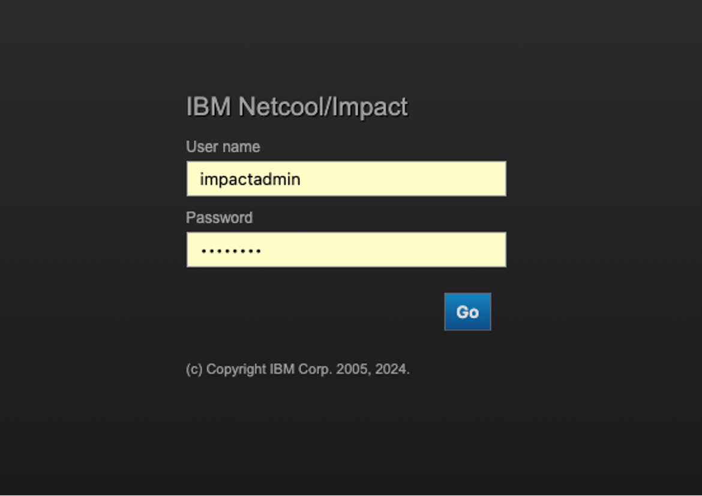
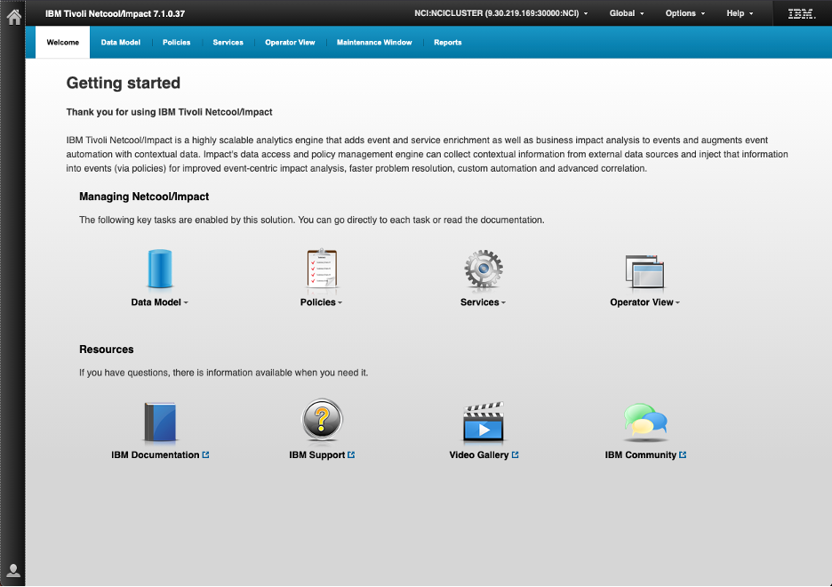
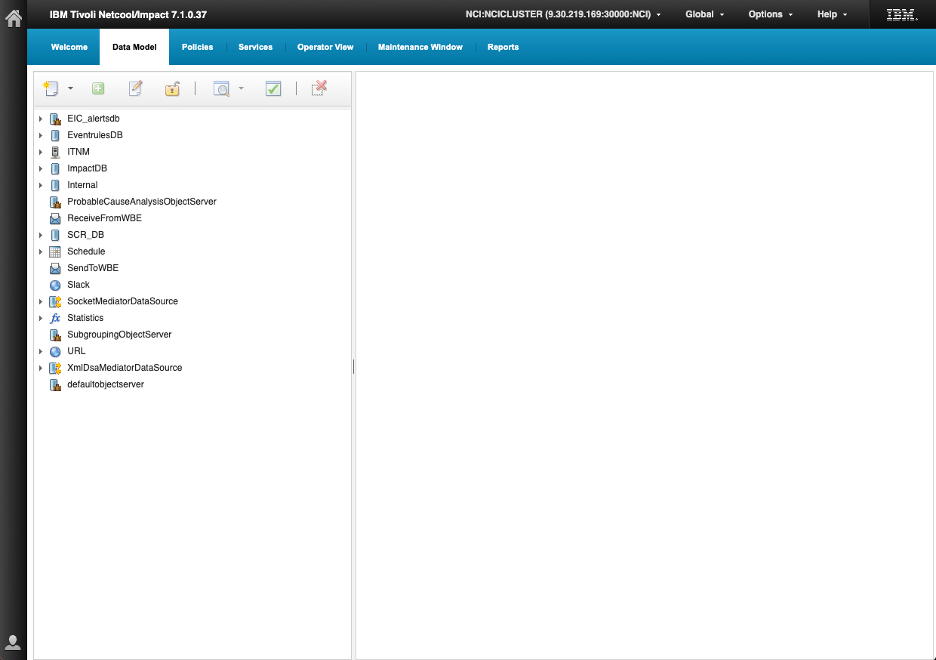
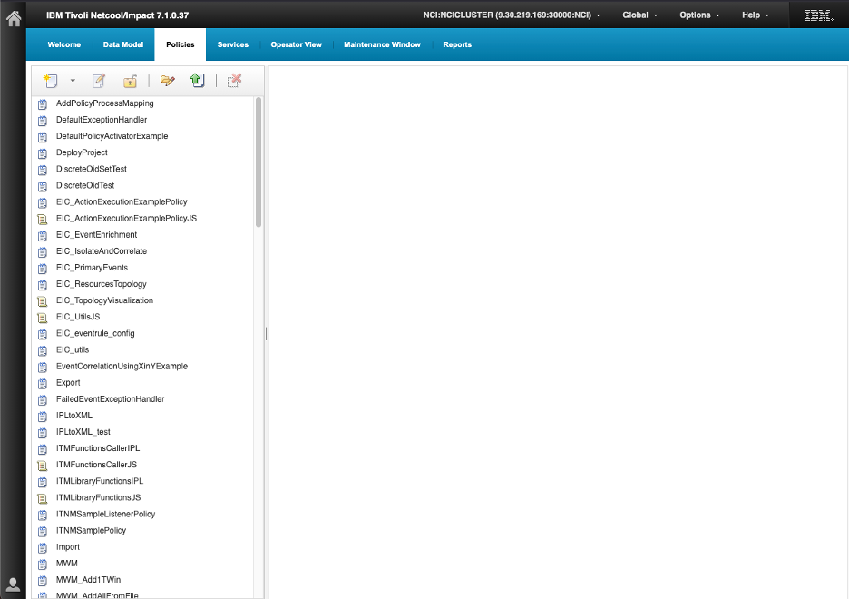
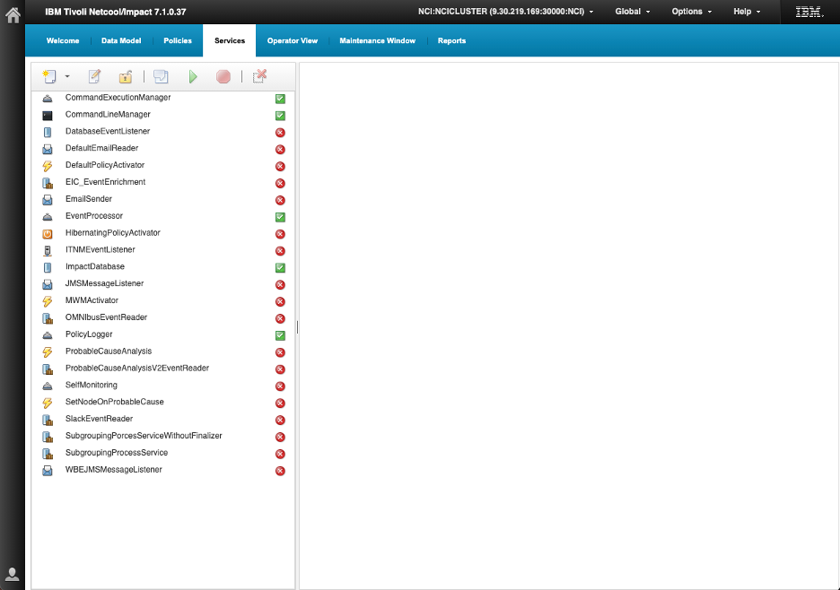
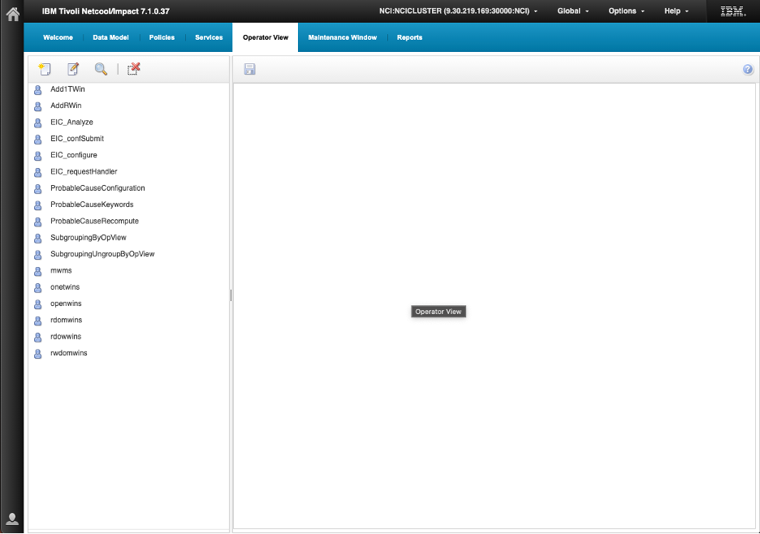
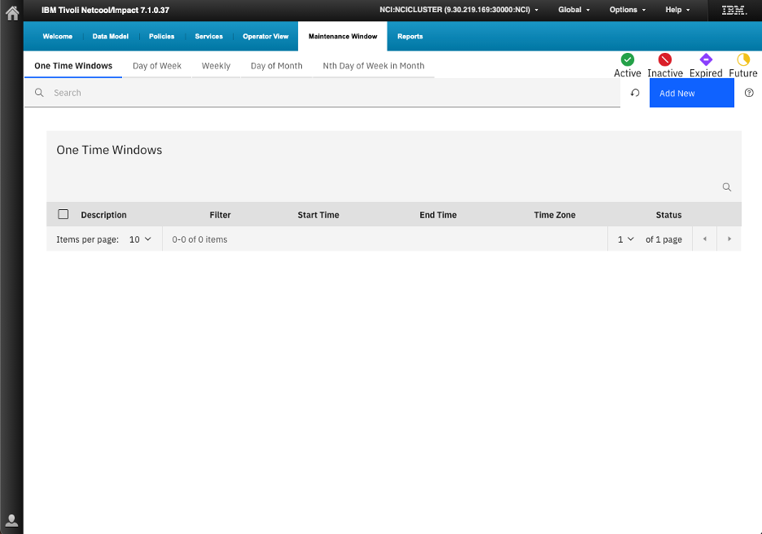

### 1.1 Netcool Impact overview

IBM Netcool Impact is an event enrichment and automation engine that extends the capabilities of Netcool/OMNIbus. While OMNIbus collects and consolidates events from across the IT environment, Impact adds intelligence to those events by retrieving external data, running policy-driven automation, and writing results back to the ObjectServer or to other target systems.

The core value of Impact is that it can reach outside the event stream and pull in contextual information that the probe or ObjectServer cannot provide on its own. A probe receives a raw event from a device and populates standard fields such as `Node`, `Summary`, and `Severity`. Impact can then look up that node in a CMDB, a SQL database, or a REST API, discover the customer it belongs to, the service it supports, and the on-call engineer responsible for it, and write all of that context back to the alert. Operators see enriched, actionable alerts rather than raw device events.

Beyond enrichment, Impact can perform automated actions: opening or updating tickets in ServiceNow or Remedy, running runbooks, sending notifications, suppressing known maintenance events, and escalating unacknowledged alerts based on time-based rules. These actions are driven by policies — units of IPL (Impact Policy Language) logic that define what to do and when.

### 1.2 Core architecture and components

The Impact architecture is built around a central server that runs policies against event data and connects to external systems through a configurable set of adapters.

Key architecture components:

- **Impact Server**: The core processing engine that receives event triggers from OMNIbus, runs IPL policies, and communicates with external data sources.
- **Impact GUI**: The browser-based administration interface used to create and manage data source adapters (DSAs), services, and policies.
- **ObjectServer DSA**: A built-in adapter that connects Impact to the OMNIbus ObjectServer, allowing policies to read event data and write enriched values back to alerts.
- **Data source adapters (DSAs)**: Named connectors that give policies access to external systems such as SQL databases, REST APIs, LDAP directories, and JDBC data sources.
- **Services**: Named entry points that define when and how policies are triggered — for example, in response to ObjectServer events, on a schedule, or by an external call.
- **Policies**: Units of IPL logic that perform the actual enrichment and automation work when invoked by a service.
- **Impact Policy Language (IPL)**: The scripting language used to write policy logic. IPL provides variables, conditionals, loops, data source lookups, and built-in functions for working with event data.

### 1.3 How Impact fits into the OMNIbus architecture

Impact does not replace OMNIbus — it extends it. In a typical deployment, OMNIbus probes continue to collect events and store them in the ObjectServer as they always have. Impact sits alongside the ObjectServer and subscribes to changes in the event stream through a service connected to the ObjectServer DSA.

When a new event arrives in the ObjectServer and matches the service filter, Impact receives a copy of the event data and begins policy processing. The policy can query external systems, perform calculations, and then write results back to the ObjectServer by updating fields in `alerts.status`. From the operator's perspective, the enriched fields simply appear on the alert as though the probe had populated them from the start.

This separation of concerns is important: probes handle ingestion and normalization, the ObjectServer handles storage and deduplication, and Impact handles enrichment and automation. Each component focuses on its own job, and they work together through well-defined interfaces.

### 1.4 Key terms and concepts

The following terms appear throughout the Impact lab guide and should be understood before beginning the hands-on exercises:

- **Policy**: A named unit of IPL code that performs enrichment or automation logic when invoked by a service.
- **Service**: An Impact configuration object that defines when policies run and what event data they receive.
- **DSA (Data Source Adapter)**: A named connector that provides policies with access to an external data source.
- **IPL (Impact Policy Language)**: The scripting language used to write Impact policy logic.
- **Event reader**: A service type that subscribes to the ObjectServer event stream and triggers policies when events match a defined filter.
- **Event trigger**: The event data object passed to a policy when a service fires. It contains the field values of the triggering alert.
- **GetByFilter**: An IPL function that queries a data source and returns rows matching a specified condition.
- **GetByKey**: An IPL function that queries a data source and returns rows matching a unique key value.
- **Log**: An IPL function that writes a message to the Impact server log for debugging or auditing purposes.

### 1.5 Lab environment and assumptions

This lab environment uses the same virtual machine as the OMNIbus labs. Netcool Impact is installed on the lab server alongside OMNIbus and is accessible through a web browser. The lab server runs both the OMNIbus ObjectServer and the Impact Server.

The lab virtual machines include the following pre-installed components relevant to Impact:

- IBM Netcool/Impact server.
- The Impact GUI, accessible through a browser on port `17311` at `http://<your-server>:17311/ibm/console`.
- The OMNIbus ObjectServer (`AGG_P`), which Impact uses as its primary event source.
- A sample SQL database pre-loaded with device inventory and customer records used in the enrichment labs.

You should be comfortable with the OMNIbus ObjectServer from the previous lab chapters. Impact builds directly on that knowledge — the same events, the same alert fields, and the same `alerts.status` table are used throughout the Impact exercises.

### 1.6 UI navigation overview

#### Objective

In this exercise, you will log in to the Netcool Impact GUI, explore the main navigation areas, and become familiar with the layout and purpose of each section. By the end of the exercise, you will be able to navigate to the Data Model panel, the Services panel, and the Policy editor, and understand what each section of the interface is used for.

#### Prerequisites

- SSH access to the assigned lab server.
- The OMNIbus ObjectServer (`AGG_P`) is running (completed in the OMNIbus labs).
- A web browser is available on the workstation.

#### Background

The Impact GUI is a web-based administration interface that provides a single location for all Impact configuration tasks. It is organized into several panels that map directly to Impact concepts: data sources, services, and policies are each managed in their own dedicated section.

The Impact GUI is organized around a top navigation bar with tabs. Clicking a tab loads its management panel in the main workspace, with a list pane on the left and a configuration detail area on the right. The primary tabs are:

- **Data Model**: Create and manage DSAs that connect policies to external systems.
- **Policies**: Access the policy editor, where IPL code is written, saved, and organized by policy group.
- **Services**: Manage services that define when and how policies are invoked.
- **Operator View**: A lightweight event list view pulled directly from the connected ObjectServer, useful for verifying that enrichment results are appearing on alerts.
- **Maintenance Window**: Configure maintenance windows for suppression of alerts during planned outages.
- **Reports**: View operational reports and policy execution statistics.

#### Tasks

1. Connect to the lab server by using SSH as `root`.

2. Set the required Impact environment variables if they are not already set from the OMNIbus labs:
   ```bash
   export NCHOME=/opt/IBM/tivoli/netcool
   export OMNIHOME=$NCHOME/omnibus
   export IMPACT_HOME=/opt/IBM/tivoli/impact
   ```
   To persist these values across new shell logins, add them to your `~/.bash_profile` and source it:
   ```bash
   echo 'export IMPACT_HOME=/opt/IBM/tivoli/impact' >> ~/.bash_profile
   source ~/.bash_profile
   ```
   The `NCHOME` and `OMNIHOME` variables should already be present from the OMNIbus labs. If they are not, add them as well:
   ```bash
   echo 'export NCHOME=/opt/IBM/tivoli/netcool' >> ~/.bash_profile
   echo 'export OMNIHOME=$NCHOME/omnibus' >> ~/.bash_profile
   source ~/.bash_profile
   ```

3. Verify that all three environment variables are set correctly:
   ```bash
   echo $IMPACT_HOME
   echo $NCHOME
   echo $OMNIHOME
   ```
   You should see:
   ```
   /opt/IBM/tivoli/impact
   /opt/IBM/tivoli/netcool
   /opt/IBM/tivoli/netcool/omnibus
   ```
   If any variable prints as blank, return to step 2 and ensure the relevant line was added to `~/.bash_profile` and sourced correctly before continuing.

4. Before starting the Impact Server, verify that the OMNIbus ObjectServer `AGG_P` is running:
   ```bash
   $OMNIHOME/bin/nco_ping AGG_P
   ```
   Confirm that the output includes: `NCO_PING: Server available.`

   If the ObjectServer is not running, start it before proceeding:
   ```bash
   $OMNIHOME/bin/nco_objserv -name AGG_P &
   ```
   Then re-run `nco_ping` to confirm it is available before continuing.

4. Start the Impact Server:
   ```bash
   $IMPACT_HOME/bin/startImpactServer.sh
   ```
   The command outputs startup progress directly to the terminal. Confirm that the output includes the following lines before proceeding:
   ```
   Starting server NCI.
   Server NCI started with process ID 2402167.
   ```
   The process ID in your output will differ — this is expected. What matters is that both lines appear, confirming the server started successfully.

5. Start the Impact GUI server:
   ```bash
   $IMPACT_HOME/bin/startGUIServer.sh
   ```
   Confirm that the output includes the following lines before proceeding:
   ```
   Starting server ImpactUI.
   Server ImpactUI started with process ID 2403600.
   ```
   The process ID in your output will differ — this is expected. What matters is that both lines appear, confirming the GUI server started successfully.

6. Open a browser and navigate to the Impact GUI:
   `http://<your-server>:17311/ibm/console`
   Log in using the Impact administrator credentials for this lab:
   - **User**: `impactadmin`
   - **Password**: `netcool`

   

7. After successfully logging in, you will be presented with the main landing page for Netcool Impact.

   


   **Navigating Netcool/Impact**

   Use the navigation controls at the top of the IBM Tivoli Netcool/Impact window to move between functional areas.

   - Select **Welcome** to return to the starting page. This page provides large shortcut icons to common areas of the product.
   - Select **Data Model** to work with data types, data sources, and related model objects.
   - Select **Policies** to view, create, or manage Impact policies.
   - Select **Services** to access configured services and service-related functions.
   - Select **Operator View** to open the operator-facing event and service views.
   - Select **Maintenance Window** to configure or review scheduled maintenance periods.
   - Select **Reports** to access reporting functions.
   - Use the drop-down arrows next to the large **Data Model**, **Policies**, **Services**, and **Operator View** icons on the Welcome page to open shortcuts within those areas.

   The black bar above the main navigation provides global controls:

   - Use the **Home** icon at upper left to return to the main starting point.
   - Use the **NCI** connection drop-down to identify or change the active Netcool/Impact server connection.
   - Use **Global** for global settings or actions.
   - Use **Options** for user or interface options.
   - Use **Help** to access product help and documentation.

   At the bottom of the Welcome page, use the **Resources** links to open IBM Documentation, IBM Support, Video Gallery, or IBM Community resources.


8. Select the **Data Model** tab from the top navigation bar. The Data Model area is where data types and data sources are defined and managed. Observe the available sub-sections and note that this is where DSAs are configured for use by Impact policies. Return to the **Welcome** page when done by selecting **Welcome** from the top navigation bar.

   

   The left navigation pane lists configured data sources, while the workspace on the right remains blank until you select an item.

   A **data source** is the connection or integration that gives Netcool/Impact access to external or internal information — for example, an ObjectServer, database, ITNM, web service, or URL. A **data type** is the defined structure or view of records exposed through that source, including the fields Impact policies can retrieve, evaluate, or update.

   Visible data sources include `EIC_alertsdb`, `EventrulesDB`, `ITNM`, `ImpactDB`, `Internal`, `Schedule`, `Slack`, `URL`, and several ObjectServer-related DSAs. Expand a data source with the arrow beside it to display its data types. We will explore data sources, DSAs, and data types in more detail in later tasks.


9. Next, select the **Policies** tab from the top navigation bar.

   

   The screen is divided into two main areas:

   The left pane contains a scrollable list of the policies currently available in Impact. You can see policies such as `AddPolicyProcessMapping`, `DefaultExceptionHandler`, various `EIC_...` policies, and other sample or utility policies. The icons identify the policy object or format, such as standard policies, JavaScript policies, or folders.

   The toolbar above the policy list provides actions for working with policies, including creating, opening, saving, importing or exporting, and deleting policy objects.

   The workspace on the right is blank until you select or open a policy. When you open one, its configuration and policy logic are displayed here for review or editing.

   You will work with Impact policies in more detail in later tasks.

10. Next, select the **Services** tab from the top navigation bar.

    

    Select the **Services** tab to view and manage the Netcool/Impact services configured in the environment. The left pane lists the available services, and the status icon beside each service indicates whether it is running: a green check mark shows the service is active, while a red X shows it is stopped or unavailable. Select a service to view its details in the workspace on the right.

    The service types shown include:

    - **Managers** — Coordinate and manage a related service function, such as command execution or database activity.
    - **Listeners and readers** — Receive or read information from external systems, for example database events, JMS messages, emails, or ITNM events.
    - **Activators** — Trigger policy execution when a defined event or condition occurs.
    - **Processors** — Process incoming event data and invoke appropriate Impact logic.
    - **Senders** — Send information or notifications to another system, such as email.
    - **Policy Logger** — Records policy activity and messages for monitoring and troubleshooting.
    - **Specialized services** — Provide functions for specific integrations or workflows, such as event enrichment, probable-cause analysis, self-monitoring, Slack event reading, or event sub-grouping.

    The toolbar above the list lets you work with the selected service, including starting or stopping it.

11. Select the **Operator View** tab to view and manage the operator views available in Netcool/Impact.

    

    Operator views provide tailored interfaces that let operators interact with Impact functions, such as initiating workflows, submitting requests, viewing event-related information, or running specific operational actions.

    Select an operator view from the list to display its configuration in the workspace on the right. The toolbar above the list lets you create, edit, search for, or delete operator views.

12. Select the **Maintenance Window** tab from the top navigation bar.

    

    Maintenance windows let you identify events that occur during approved maintenance so that they can be handled differently from unexpected operational events — for example, placed into maintenance rather than treated as active incidents.

    The page opens on **One Time Windows**, which lists maintenance windows that apply for a single defined start and end time. Use the other tabs to manage recurring windows by **Day of Week**, **Weekly**, **Day of Month**, or **Nth Day of Week in Month**.

    The table displays each window's **Description**, event **Filter**, **Start Time**, **End Time**, **Time Zone**, and current **Status**. The status indicators identify windows that are **Active**, **Inactive**, **Expired**, or **Future**. Use **Add New** to define a maintenance window, and use the search field to locate an existing one.

    Netcool/Impact Maintenance Window Management marks a matching event as in maintenance by setting the ObjectServer `alerts.status.SuppressEscl` integer field to `6`. This is the field that downstream Event List views, automations, and Impact policies can use to identify and suppress maintenance-related alerts.

    By default, MWM's Policy Activator evaluates active windows about every seven seconds, so an event can briefly appear normally before `SuppressEscl` is updated to `6`. When the window ends, MWM can clear the maintenance flag, unless its `clearFlag` setting is configured not to mark events as out of maintenance.

#### Validation

The exercise is successful when all of the following are true:

- The Impact Server and GUI server start successfully.
- You can log in to the Impact GUI and reach the dashboard.
- You can navigate to the **Policies**, **Services**, and **Data Model** tabs using the top navigation bar.
- You can describe the purpose of each main navigation tab.
- You can identify any pre-configured DSAs in the Data Model panel.
- You can open the policy editor and identify the key input areas without saving a policy.
- You can access the **Operator View** tab and confirm it is displaying current ObjectServer alerts.

#### Expected result

At the end of this exercise, you will be familiar with the Impact GUI layout and will be able to navigate confidently between the main tabs. This provides the foundation for all subsequent exercises, which use the Data Model panel, the Services panel, and the Policy editor to build working Impact configurations.
