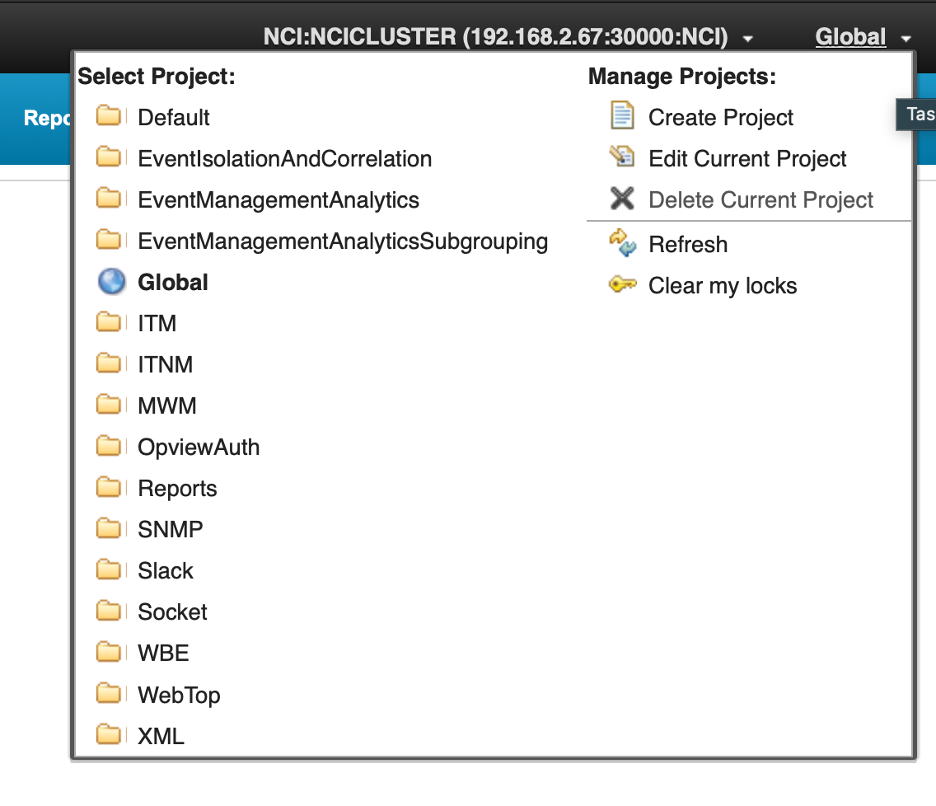
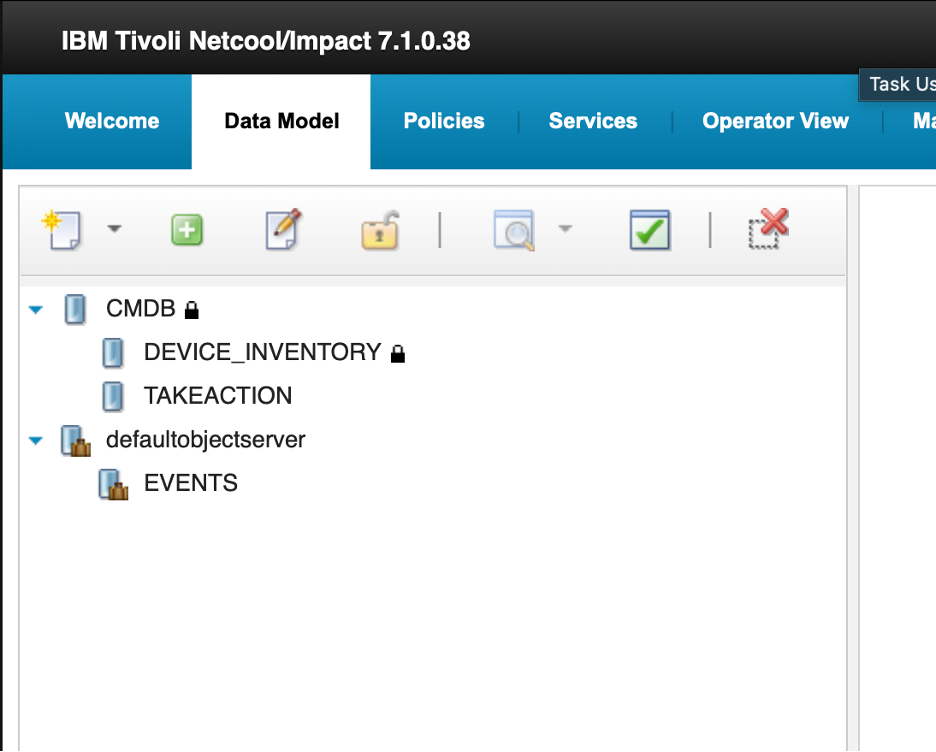
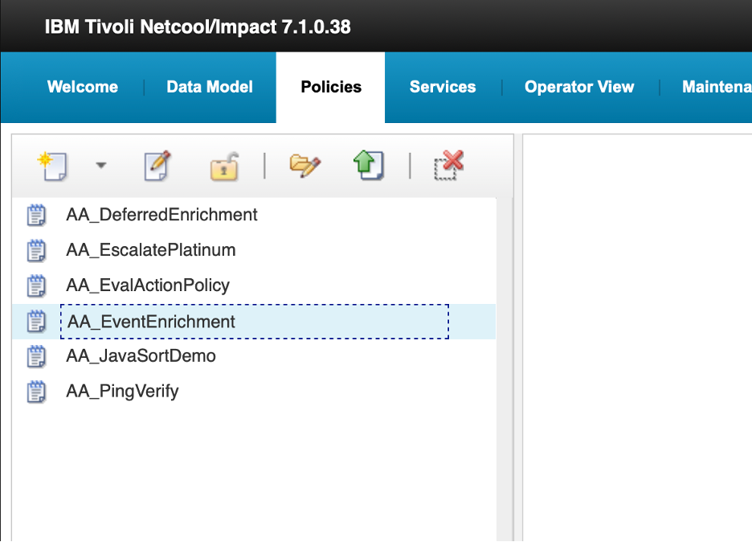
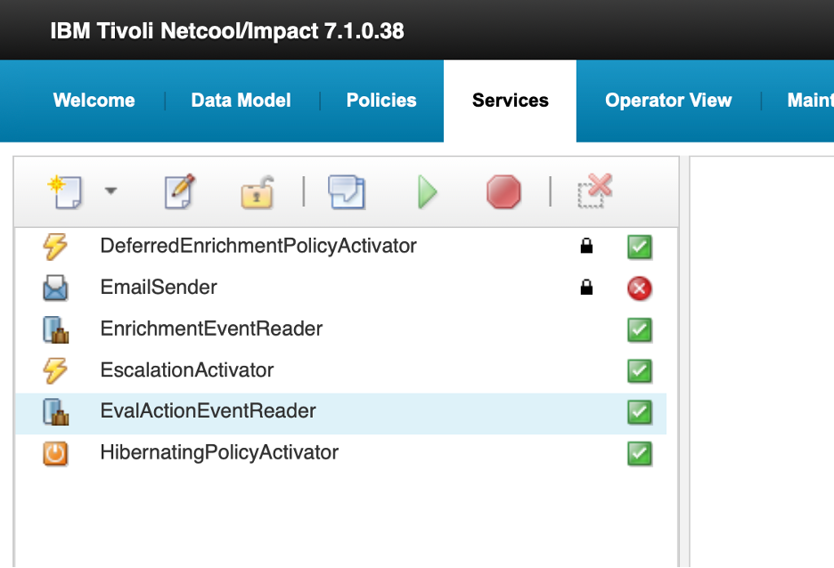
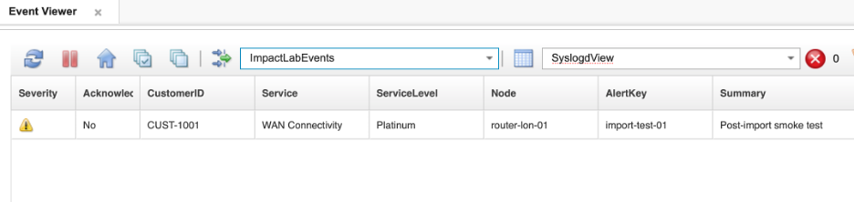

As an Impact environment grows, the set of policies, services, and data types that make it work becomes a significant asset in its own right. Impact **projects** give you a way to organize that set of artifacts into named scopes, keeping related configuration together and making it straightforward to work on one area of the system without the clutter of everything else. Projects also serve as the unit of export and import — packaging a project produces a ZIP archive that can be transferred to another server, stored as a backup, or used to promote configuration from a test environment to production.

Every Impact server has a built-in scope called **Global**. Policies, services, and data types that are not assigned to a named project live in Global and are always visible regardless of which project is selected. All of the artifacts created in this lab currently live in Global.

This section walks through the full project lifecycle: understanding how the project selector works, creating a project and populating it with the lab artifacts, and exporting and re-importing the project to understand how the import process handles existing artifacts.

### 10.1 Create a project and add lab artifacts

#### Objective

In this exercise, you will open the project selector, create a new project, and populate it with all of the data sources, data types, policies, and services from this lab. By the end of the exercise, you will understand how the project selector scopes the Policies and Services views and how to build a project that captures a complete lab configuration.

#### Prerequisites

- Completion of sections 4 through 9.
- All lab policies and services are present: `AA_EnrichAlert`, `AA_DeferredEnrichment`, `AA_EscalatePlatinum`, `AA_PingVerify`, `AA_JavaSortDemo`, `AA_EvalActionPolicy`.
- You are logged in to the Impact GUI.

#### Background

##### The project selector

The project selector is a dropdown in the top-right area of the Impact GUI header bar, immediately to the right of the server name (for example, `NCI:NCICLUSTER (192.168.2.67:30000:NCI)`). It is labelled with the name of the currently active project — **Global** by default.

Clicking the dropdown opens a two-panel menu:

- **Select Project** (left panel): lists all projects defined on this server, including **Global**. Click any entry to switch the active scope. The currently active project is shown in bold.
- **Manage Projects** (right panel): provides the available actions.

| Action | Purpose |
|---|---|
| **Create Project** | Opens the Create Project dialog |
| **Edit Current Project** | Opens the current project's configuration for export or import |
| **Delete Current Project** | Permanently removes the current project and all its artifact references (the artifacts themselves are not deleted) |
| **Refresh** | Refreshes the project list |
| **Clear my locks** | Releases any editor locks held by your current session |

##### What switching projects does

When you switch to a named project, the **Policies** and **Services** tabs show only the artifacts assigned to that project. This is a view filter — artifacts in other projects or in Global are not deleted; they are simply not displayed in the current scope. Switching back to **Global** shows all artifacts on the server.

##### What a project contains

A project holds references to policies, services, operator views, data sources, and data types. The underlying artifacts remain on the server; the project records which ones belong to it. Removing an artifact from a project removes the reference only — the artifact itself is unaffected.

A project export/import includes the Impact objects associated with the project, including data-source definitions, data types, policies, services, and project metadata. After import, validate and, where necessary, update environment-specific data-source settings — such as hostnames, ports, database names, credentials, certificates, driver files, filesystem paths, and external endpoints — before enabling services in the target environment. The target Impact server must also have the required DSA implementation, drivers, and supporting configuration installed.

##### The Create Project dialog

The **Create Project** dialog is a single page with:

- **Project Name**: the name for the new project.
- **List By**: a dropdown that switches which type of artifact is shown in the picker below. Available options include **Services**, **Policies**, **Data Types**, **Data Sources**, and others.
- **Available Members** (left column): all artifacts of the selected type that are not yet in the project. Click an item to move it to **Project Members**.
- **Project Members** (right column): artifacts assigned to the project. Click an item to move it back to **Available Members**.
- **Execute**: creates the project with the current member list.
- **Close**: cancels without creating the project.

You work through each member type in turn using the **List By** dropdown, moving items into **Project Members** before clicking **Execute**.

#### Tasks

1. Locate the project selector in the top-right of the Impact GUI header bar. It currently reads **Global**.

2. Click the **Global** dropdown to open the project selector menu. Take a moment to observe the layout:
   - The **Select Project** panel on the left lists the available projects. **Global** is shown in bold as the active project.
   - The **Manage Projects** panel on the right lists the available actions.

   

3. Click **Create Project** in the **Manage Projects** panel.

   The Create Project dialog opens. Enter `ImpactLabProject` in the **Project Name** field.

4. Use the **List By** dropdown to select **Data Sources**. The **Available Members** list will populate with all data sources defined on this server. Move the following items to **Project Members** by clicking each one:

   - `CMDB`
   - `defaultobjectserver`

5. Use the **List By** dropdown to select **Data Types**. A **Data Source** dropdown appears below it to filter which data source's types are listed.

   First, select `CMDB` in the **Data Source** dropdown. Move the following items to **Project Members**:

   - `DEVICE_INVENTORY`
   - `TAKEACTION`

   Then select `defaultobjectserver` in the **Data Source** dropdown. Move the following item to **Project Members**:

   - `EVENTS`

6. Use the **List By** dropdown to select **Policies**. Move the following items to **Project Members**:

   - `AA_EnrichAlert`
   - `AA_DeferredEnrichment`
   - `AA_EscalatePlatinum`
   - `AA_PingVerify`
   - `AA_JavaSortDemo`
   - `AA_EvalActionPolicy`

7. Use the **List By** dropdown to select **Services**. Move the following items to **Project Members**:

   - `EnrichmentEventReader`
   - `DeferredEnrichmentActivator`
   - `EscalationActivator`
   - `HibernatingPolicyActivator`
   - `EvalActionEventReader`
   - `EmailSender`

8. Review the **Project Members** column for each member type to confirm all items are present, then click **Execute** to create the project.

   `ImpactLabProject` now appears in the project selector dropdown.

9. Click the project selector dropdown and select `ImpactLabProject` to switch to that scope. The header label changes from **Global** to **ImpactLabProject**.

   Select the **Data Model** tab. Confirm that `DEVICE_INVENTORY`, `EVENTS`, and `TAKEACTION` are listed under their respective data sources.

   

10. Select the **Policies** tab. Confirm that all six lab policies are listed.

     

11. Select the **Services** tab. Confirm that all six lab services are listed.

    

12. Click the project selector dropdown and select **Global** to return to the full scope view.

#### Validation

The exercise is successful when all of the following are true:

- `ImpactLabProject` appears in the project selector dropdown.
- Switching to `ImpactLabProject` shows the six lab policies and six lab services in their respective tabs.
- Switching back to **Global** restores the full artifact list.
- You can describe what the **Global** scope is and why it exists.
- You can explain the purpose of each step in the **Create Project** dialog.

#### Expected result

You have a populated project that captures all of the lab data sources, data types, policies, and services in a single named scope. The next exercise exports this project as a portable archive.

---

### 10.2 Export and import the project

#### Objective

In this exercise, you will export `ImpactLabProject` to a directory on the server using the `nci_export` command-line tool, inspect the output, then deliberately delete two lab artifacts to simulate a configuration loss, and restore them using `nci_import`. By the end of the exercise, you will have directly observed how export and import can be used for rollback and recovery, and you will understand the broader use cases for these tools in production environments.

#### Prerequisites

- Completion of section 10.1.
- `ImpactLabProject` is populated with all lab artifacts.
- SSH access to the lab server.
- The Impact server is running.

#### Background

##### nci_export and nci_import

Export and import of Impact projects are performed from the command line using `nci_export` and `nci_import`, located in `$IMPACT_HOME/bin`.

`nci_export` connects to the running Impact server instance and writes the project's artifact definitions — data sources, data types, policies, services, and project metadata — to a directory on the filesystem. The export must be run on the primary Impact server; it will fail on a secondary cluster member.

The basic syntax for a single-project export is:

```bash
nci_export <server_name> --project <project_name> <output_directory>
```

To import, `nci_import` reads from a previously exported directory and loads the artifacts back into the running Impact server:

```bash
nci_import <server_name> <export_directory>
```

After import, validate and where necessary update any environment-specific data-source settings — such as hostnames, ports, database names, and credentials — before starting services on the target server.

##### Typical use cases

- **Rollback**: A configuration change to an exported Impact artifact introduced a problem. After stopping or controlling affected services and assessing conflicts, import a verified earlier export to restore the exported object definitions to a known-good state. Revalidate services, data-source connectivity, and policy behavior afterward.
- **Promotion**: Policies and their associated project artifacts developed and validated in a lower environment are exported and imported into the next environment, such as staging to production. Before enabling imported services, review target-specific endpoints, credentials, certificates, drivers, local configuration files, and external dependencies.
- **Bootstrap**: A new or otherwise empty Impact environment receives an initial project import so that the project's exported artifacts are created there. Configure and validate server-local and external dependencies before activating services.
- **Configuration backup**: Run a scheduled or pre-change `nci_export` to preserve a point-in-time copy of exported Impact repository artifacts for recovery, comparison, migration, or rollback.
- **Audit and change control**: Export a project before and after a planned change, retain both versions under controlled storage, and compare or review them as evidence of what changed.

#### Tasks

1. SSH into the lab server and change to the Impact binary directory:

   ```bash
   cd $IMPACT_HOME/bin
   ```

2. Create an export destination directory:

   ```bash
   mkdir -p /tmp/impact-exports
   ```

3. Run the export for `ImpactLabProject`:

   ```bash
   ./nci_export NCI --project ImpactLabProject /tmp/impact-exports/ImpactLabProject
   ```

   The command connects to the running Impact server instance `NCI` and writes the project artifacts to the specified directory. You should see output confirming the export completed successfully.

4. Verify the export directory is populated:

   ```bash
   find /tmp/impact-exports/ImpactLabProject -type f | sort
   ```

   The listing will show individual files for each exported artifact — data sources, data types, policies, and services are each written as separate files. Confirm the file count matches the number of artifacts you added to the project.

5. Before importing, simulate a configuration loss by removing two artifacts from the server. In the Impact GUI, select the **Services** tab.

   Right-click `EnrichmentEventReader` and select **Stop**. Wait for the state to change to **Stopped**, then right-click it again and select **Delete**. Confirm the deletion. `EnrichmentEventReader` should no longer appear in the Services list.

6. Select the **Policies** tab. Right-click `AA_EnrichAlert` and select **Delete**. Confirm the deletion. `AA_EnrichAlert` should no longer appear in the Policies list.

7. Confirm both artifacts are gone. Switch to `ImpactLabProject` in the project selector — `AA_EnrichAlert` should be absent from the Policies tab and `EnrichmentEventReader` should be absent from the Services tab. Switch back to **Global** before continuing.

8. Return to the terminal and run the import:

   ```bash
   ./nci_import NCI /tmp/impact-exports/ImpactLabProject
   ```

   The command restores all exported artifacts. `AA_EnrichAlert` and `EnrichmentEventReader` were absent on the server, so they will be created. Artifacts that were already present will be skipped or overwritten. Review the command output and confirm both deleted artifacts appear in the import log.

   > **If the import reports lock errors**, one or more artifacts are held by a version-control lock. Resolve this before retrying:
   >
   > **1.** Check which items are currently locked:
   > ```bash
   > cat "$IMPACT_HOME/etc/NCI_versioncontrol.locks"
   > ```
   > **2.** Clear all version-control locks on instance `NCI`:
   > ```bash
   > "$IMPACT_HOME/bin/nci_version_control" NCI uncoall ""
   > ```
   > **3.** Confirm the lock list is clear or reduced as expected:
   > ```bash
   > cat "$IMPACT_HOME/etc/NCI_versioncontrol.locks"
   > ```
   > Then re-run the `nci_import` command above.

9. Back in the Impact GUI, confirm the two deleted artifacts have been restored:

   - Select the **Policies** tab and confirm `AA_EnrichAlert` is present.
   - Select the **Services** tab and confirm `EnrichmentEventReader` is present.

10. Start `EnrichmentEventReader`. Right-click it and select **Start**. Confirm it returns to **Running** state.

11. Confirm that all other services that should be running are also in **Running** state. If any were stopped by the import, right-click each and select **Start**:

    - `DeferredEnrichmentActivator`
    - `EscalationActivator`
    - `EvalActionEventReader`

12. Insert a smoke-test event to confirm the enrichment pipeline is intact after the restore:

    ```bash
    $OMNIHOME/bin/nco_sql -server AGG_P -user root -password netcool << 'EOF'
    INSERT INTO alerts.status (Node, Summary, AlertKey, AlertGroup, Severity, Type, Identifier, Manager, OwnerUID)
    VALUES ('router-lon-01', 'Post-import smoke test', 'import-test-01', 'TrainingAlerts', 3, 1, 'router-lon-01:import-test-01:TrainingAlerts', 'ImpactLab', 65534);
    go
    EOF
    ```

13. Check the enrichment policy log:

    ```bash
    tail -10 $IMPACT_HOME/logs/NCI_policylogger_AA_EnrichAlert.log
    ```

    You should see an entry for `router-lon-01` showing `CUST-1001` and `ImpactFlag = 1`, confirming the restored policy is running correctly.

14. Switch to the OMNIbus Web GUI in your private/incognito browser. Select the **ImpactLab Events** filter and the **SyslogdView** view. Locate the `router-lon-01` smoke-test event and confirm the enrichment fields are populated — `CustomerID`, `CustomerName`, `Service`, and `Location` should all reflect the values from the CMDB, and `ImpactFlag` should be `1`.

    

#### Validation

The exercise is successful when all of the following are true:

- The `nci_export` command completed without errors and the export directory is populated with artifact files.
- `AA_EnrichAlert` and `EnrichmentEventReader` were successfully deleted before the import.
- The `nci_import` command completed without errors and the import log confirms both deleted artifacts were recreated.
- `EnrichmentEventReader` is running and the smoke-test event was enriched correctly.
- You can describe a real-world scenario for each of the five use cases: rollback, promotion, bootstrap, configuration backup, and audit and change control.
- You can explain what must be validated in the imported data-source definitions before enabling services on a new target server.
- You can state where `nci_export` must be run in a clustered Impact environment and why.

#### Expected result

You have completed the full project lifecycle: create, populate, export, and import. By deliberately removing artifacts and restoring them via `nci_import`, you directly observed how the import behaves when artifacts are missing — exactly the pattern used for rollback and recovery in production. You also understand how the project selector scopes the Policies and Services views to show only the artifacts relevant to the work at hand.
