Data source adapters (DSAs) are the connectors that give Impact policies access to external systems. In most cases, when a policy needs to look up data from a database, query an API, read from LDAP, or interact with an OMNIbus ObjectServer, it does so through a named DSA. There are a few exceptions — for example, policies can make direct HTTP calls or execute inline logic without a DSA — but for the majority of integration scenarios a DSA is the standard mechanism. Without at least one DSA configured, a policy has no way to reach any data outside of the event it received when it was triggered.

DSAs are defined once at the server level and then referenced by name in policy code. This means policies do not need to include connection strings, credentials, or hostname details — those are managed centrally in the DSA configuration, and policies simply call the DSA by name. If the target system changes, only the DSA configuration needs to be updated, rather than every policy that uses it. This also improves security, since credentials are stored and managed in one place rather than embedded in policy code where they could be more easily exposed or overlooked during a rotation.

Impact ships with a set of built-in adapter types that cover the most common integration scenarios. The most frequently used adapter types in OMNIbus environments are:

- **ObjectServer DSA**: Connects to a Netcool/OMNIbus ObjectServer. Used both to receive triggering events and to write enriched values back to `alerts.status`.
- **JDBC DSA**: Connects to any relational database with an available JDBC driver, including MySQL, DB2, Oracle, and Microsoft SQL Server.
- **HTTP/REST DSA**: Connects to REST APIs over HTTP or HTTPS, supporting GET, POST, PUT, and DELETE operations.
- **LDAP DSA**: Connects to an LDAP directory, such as Microsoft Active Directory or IBM Directory Server.
- **File DSA**: Reads data from a delimited flat file, useful for simple lookup tables that do not require a live database connection.

### 2.1 The ObjectServer DSA

#### Objective

In this exercise, you will review the pre-configured ObjectServer DSA and verify that Impact can connect to the OMNIbus ObjectServer. By the end of the exercise, you will understand what the ObjectServer DSA is used for, how to inspect its configuration, and how to confirm that the connection state is active.

#### Prerequisites

- Completion of section 1.6.
- The Impact Server is running.
- The OMNIbus ObjectServer (`EVENTS`) is running.

#### Background

The ObjectServer DSA is one of the most important DSAs in any Impact deployment because it provides the primary link between Impact and the OMNIbus event stream. It serves two distinct purposes:

1. **Event source**: Services that monitor the ObjectServer use the ObjectServer DSA to receive a stream of events that match a defined filter condition. When a new alert arrives or an existing alert is updated in `alerts.status`, the service receives the event data and passes it to the configured policies.
2. **Write-back target**: After a policy has looked up enrichment data or performed automation, it uses the ObjectServer DSA to write results back to `alerts.status`. This is how Impact-enriched fields such as `CustomerID`, `Service`, or `CircuitID` appear on an alert in the OMNIbus event list.

The ObjectServer DSA is typically pre-configured during Impact installation and should already point to the `EVENTS` ObjectServer used in this lab.

#### Tasks

1. Open the Impact GUI at `http://<your-server>:17311/ibm/console` and log in as `impactadmin` with password `netcool`.
2. Select the **Data Model** tab from the top navigation bar. In the data source list on the left, locate the `defaultobjectserver` entry and double-click it. The DSA configuration will open as a tabbed window in the workspace on the right.

   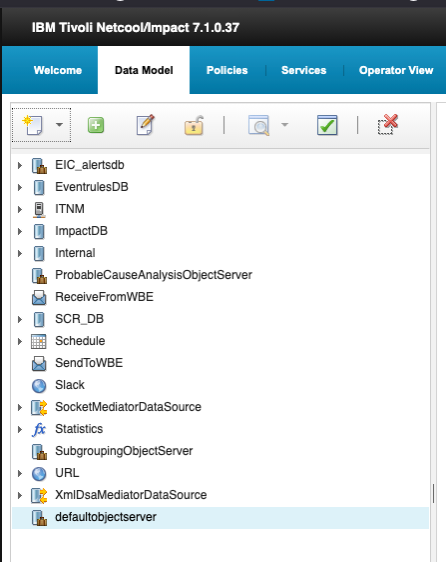

3. Review the configuration tabs that open in the workspace on the right.

   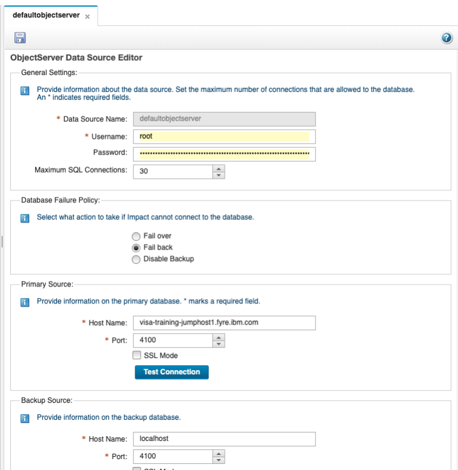

   The ObjectServer Data Source Editor configures how Netcool/Impact connects to the default ObjectServer. It is organized into three main sections: **General Settings**, **Database Failure Policy**, and **Primary/Backup Source** connection details.

   - **Data Source Name**: `defaultobjectserver` — the internal name by which Impact policies refer to this data source.
   - **Username and Password**: The database credentials Impact uses to authenticate to the ObjectServer. The configured username is `root`, while the password is masked.
   - **Maximum SQL Connections**: Set to `30`, this limits the number of concurrent SQL connections that Impact can open to this data source.
   - **Database Failure Policy**: Controls Impact's behavior if it cannot connect to the ObjectServer. **Fail back** is selected, meaning Impact will attempt to return to the primary source after using the backup source.
   - **Primary Source**: Defines the main ObjectServer connection. The host is `visa-training-jumphost1.fyre.ibm.com` on port `4100`. SSL Mode is available but not selected. The **Test Connection** button can be used to validate the supplied primary connection settings.
   - **Backup Source**: Defines a secondary ObjectServer connection for resilience if the primary source becomes unavailable. In the screenshot, it points to `localhost` on port `4100`.

   > **Note:** Fields marked with an asterisk are required.


4. Click the **Test Connection** button in the **Primary Source** section. Impact uses the username and password configured in the **General Settings** section to attempt a live connection to the ObjectServer at the specified host and port. A popup window will appear with the result of the connection attempt. Confirm that it displays **Connection OK**.

   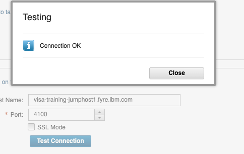

   If the result does not say **Connection OK**, verify that the `EVENTS` ObjectServer is running on the lab server before retrying.

5. The `defaultobjectserver` data source provides the underlying connection to the ObjectServer database. On its own, it can be used by policies to execute direct SQL calls against any table that the configured user has access to — for example, querying `alerts.status` or updating fields on specific alerts.

   In addition to direct SQL access, Impact also supports **data types**. A data type is defined on top of a data source and targets a specific table or view. It exposes that table to policies through simplified built-in functions such as `GetByFilter`, `GetByKey`, `AddDataItem`, and `DeleteDataItem`, without requiring the policy to write raw SQL. This makes policy code cleaner, easier to read, and less prone to errors.

   The distinction is important:
   - A **data source** defines the connection — the server, credentials, and database to connect to.
   - A **data type** defines a structured view of a specific table within that connection, giving policies a higher-level interface to work with.

   To create a new data type on this data source, right-click on `defaultobjectserver` in the data source list on the left and select **New Data Type**.

   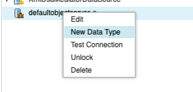

6. A new tab labelled **New Data Type for defaultobjectserver** will open in the workspace on the right, showing the **SQL Data Type Config Page**. Configure the new data type as follows:

   - **Data Type Name**: `EVENTS`
   - **Data Source Name**: leave as `defaultobjectserver`
   - **Base Table**: `alerts.status`

   Once the base table is entered, click the **Refresh Fields** button. Impact will query the ObjectServer and populate the field list below with the structure of the `alerts.status` table. Each row in the list shows the field **ID**, **Field Name**, **Format**, **Display Name**, **Description**, and a **Key Field** column.

   The **Key Field** setting identifies which field uniquely identifies a record in this data type. Impact uses this field when performing key-based lookups with functions such as `GetByKey`. Scroll through the field list to locate the **Identifier** field and set its **Key Field** column to **Yes**.

   When complete, your configuration should match the following screenshot:

   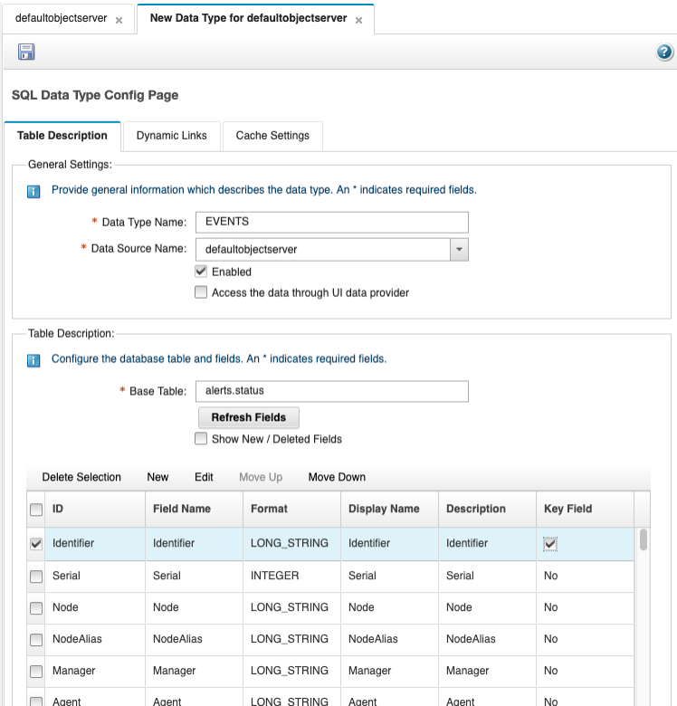

7. Save the data type by clicking the floppy disk icon at the top left of the configuration tab. Once saved, the `EVENTS` data type will appear nested under `defaultobjectserver` in the data source list on the left.

   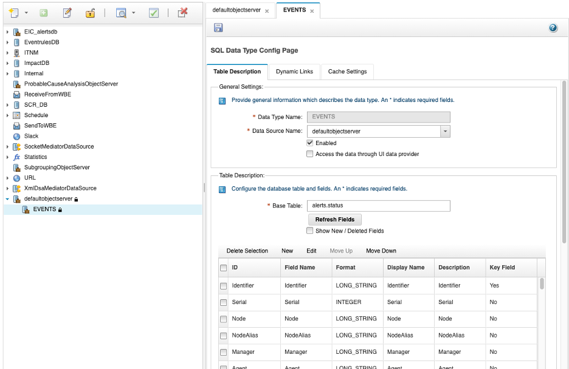

#### Validation

The exercise is successful when all of the following are true:

- You can navigate to the **Data Model** tab and locate the `defaultobjectserver` entry in the data source list.
- You can open the DSA configuration by double-clicking and identify the **General Settings**, **Database Failure Policy**, and **Primary/Backup Source** sections.
- The **Test Connection** result displays **Connection OK** for the primary source.
- You can explain the difference between a data source and a data type.
- You can explain that the `defaultobjectserver` DSA serves both as an event source and as a write-back target for enrichment results.
- A new `EVENTS` data type has been created targeting the `alerts.status` table, with `Identifier` set as the key field.
- The `EVENTS` data type is saved and visible nested under `defaultobjectserver` in the data source list.

#### Expected result

At the end of this exercise, you will understand the role of the ObjectServer DSA in an Impact deployment, know how to inspect and test its configuration, and be able to explain the difference between a data source and a data type. You will also have created the `EVENTS` data type targeting `alerts.status` with `Identifier` as the key field — a foundation that will be used by policies in later exercises to query and update alerts directly through a structured, simplified interface.

### 2.2 Creating a JDBC DSA for event enrichment

#### Objective

In this exercise, you will create an enrichment database in DB2, populate it with sample device inventory data, and then connect Impact to that database by creating a JDBC DSA and a corresponding data type. By the end of the exercise, you will have a working enrichment data source that Impact policies can query in later exercises to look up customer and service information for incoming alerts.

#### Prerequisites

- Completion of section 2.1.
- SSH access to the lab server as `root`.
- DB2 is installed on the lab server and the `db2inst1` instance is available.
- The DB2 JDBC driver (`db2jcc4.jar`) is available to the Impact server.

#### Background

A common use case for Impact is **event enrichment** — the process of adding contextual information to an alert that the probe could not provide on its own. For example, a probe may insert an alert with a `Node` value of `router-lon-01`, but an operator needs to know which customer owns that device, what service it supports, and who to contact. Rather than building that knowledge into the probe rules, Impact can look it up at runtime from an external database and write the results directly back to the alert.

To support this pattern, the lab environment will use a DB2 database named `CMDB` with a single enrichment table called `DEVICE_INVENTORY`. This table maps device hostnames to customer and service context. Once the table is created and populated, Impact will connect to it through a JDBC DSA, and a data type will be defined on top of that connection so that policies can query the table using simplified built-in functions.

The `DEVICE_INVENTORY` table has the following structure:

| Column | Type | Description |
|--------|------|-------------|
| `NODE_NAME` | VARCHAR(128) | Device hostname — matches the `Node` field in OMNIbus alerts |
| `CUSTOMER_ID` | VARCHAR(64) | Customer identifier associated with the device |
| `CUSTOMER_NAME` | VARCHAR(128) | Full customer name |
| `SERVICE` | VARCHAR(64) | Business service supported by the device |
| `LOCATION` | VARCHAR(64) | Physical or logical location of the device |
| `CONTACT` | VARCHAR(128) | On-call contact name for the device |

#### Tasks

1. SSH into the lab server as `root`. Switch to the DB2 instance user:
   ```bash
   su - db2inst1
   ```
   Then verify that the DB2 instance is running:
   ```bash
   db2gcf -s
   ```
   The output should show the instance status as `Available`. If the instance is not running, start it before proceeding:
   ```bash
   db2start
   ```


2. Create the enrichment database from the bash shell — do not open the `db2` interactive session yet:
   ```bash
   db2 CREATE DATABASE CMDB
   ```
   Wait for the command to complete. You should see:
   ```
   DB20000I  The CREATE DATABASE command completed successfully.
   ```

3. Now connect to the new database and create the `DEVICE_INVENTORY` table. Run the following as a single script by saving it to a file and executing it:
   ```bash
   db2 CONNECT TO CMDB
   db2 "CREATE TABLE DEVICE_INVENTORY ( \
       NODE_NAME     VARCHAR(128) NOT NULL, \
       CUSTOMER_ID   VARCHAR(64), \
       CUSTOMER_NAME VARCHAR(128), \
       SERVICE       VARCHAR(64), \
       LOCATION      VARCHAR(64), \
       CONTACT       VARCHAR(128), \
       PRIMARY KEY (NODE_NAME) )"
   ```
   Confirm that the output includes:
   ```
   DB20000I  The SQL command completed successfully.
   ```

4. Populate the table by writing the INSERT statements to a script file and running it with `db2 -tf`. Create the file with the following command:
   ```bash
   cat > /tmp/load_cmdb.sql << 'EOF'
   CONNECT TO CMDB;
   INSERT INTO DEVICE_INVENTORY VALUES ('router-lon-01', 'CUST-1001', 'Acme Corporation',  'WAN Connectivity',   'London DC',    'noc@acme.com');
   INSERT INTO DEVICE_INVENTORY VALUES ('router-lon-02', 'CUST-1001', 'Acme Corporation',  'WAN Connectivity',   'London DC',    'noc@acme.com');
   INSERT INTO DEVICE_INVENTORY VALUES ('switch-nyc-01', 'CUST-1002', 'Globex Industries', 'LAN Infrastructure', 'New York DC',  'ops@globex.com');
   INSERT INTO DEVICE_INVENTORY VALUES ('switch-nyc-02', 'CUST-1002', 'Globex Industries', 'LAN Infrastructure', 'New York DC',  'ops@globex.com');
   INSERT INTO DEVICE_INVENTORY VALUES ('server-fra-01', 'CUST-1003', 'Initech Solutions', 'App Hosting',        'Frankfurt DC', 'support@initech.com');
   INSERT INTO DEVICE_INVENTORY VALUES ('server-fra-02', 'CUST-1003', 'Initech Solutions', 'App Hosting',        'Frankfurt DC', 'support@initech.com');
   INSERT INTO DEVICE_INVENTORY VALUES ('fw-sin-01',     'CUST-1004', 'Pinnacle Networks', 'Network Security',   'Singapore DC', 'security@pinnacle.com');
   INSERT INTO DEVICE_INVENTORY VALUES ('db-tok-01',     'CUST-1005', 'Soylent Systems',   'Database Services',  'Tokyo DC',     'dba@soylent.com');
   COMMIT;
   EOF
   ```
   Then run the script:
   ```bash
   db2 -tf /tmp/load_cmdb.sql
   ```
   Each INSERT statement should return `DB20000I  The SQL command completed successfully.`

5. Verify that the data was inserted correctly:
   ```bash
   db2 CONNECT TO CMDB
   db2 "SELECT * FROM DEVICE_INVENTORY"
   ```
   Confirm that eight rows are returned with the expected values.

6. Return to the Impact GUI at `http://<your-server>:17311/ibm/console` and log in as `impactadmin` with password `netcool`. Select the **Data Model** tab from the top navigation bar. Click the **New Data Source** icon (the star/page icon at the top left of the data source toolbar) and from the dropdown menu select **Database (SQL) → DB2**.

   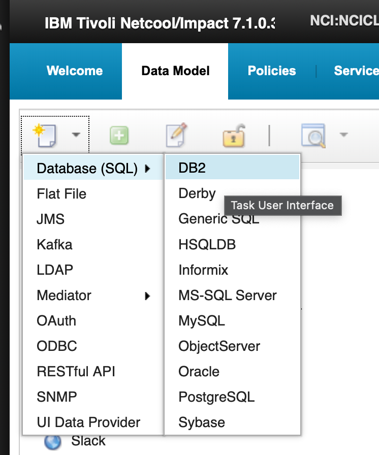

7. The **SQL Data Source Config Page** will open as a new tab in the workspace. Configure the DB2 JDBC connection with the following settings:
   - **Data Source Name**: `CMDB`
   - **JDBC URL**: `jdbc:db2://localhost:50000/CMDB`
   - **JDBC Driver**: `com.ibm.db2.jcc.DB2Driver`
   - **Username**: `db2inst1`
   - **Password**: `N3tc00l2024N3tc00l20204!`
   - **Maximum SQL Connections**: `10`

   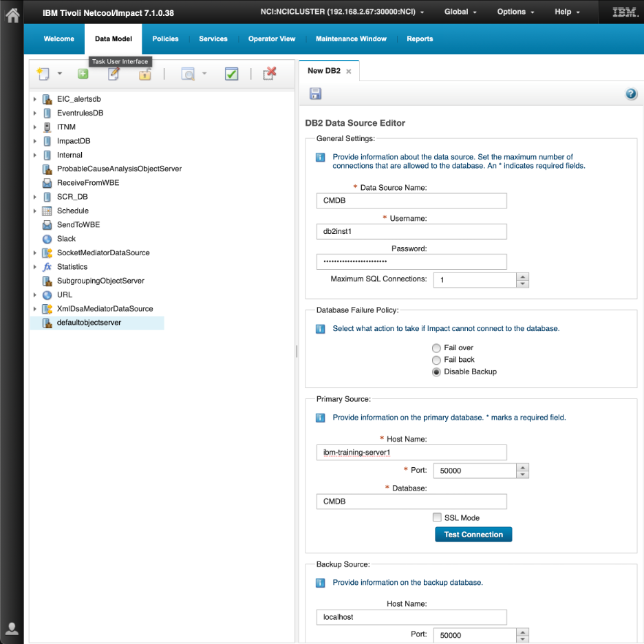

8. Click the **Test Connection** button. Confirm that the result popup displays **Connection OK**. If it does not, verify that the DB2 instance is running and that the database `CMDB` was created successfully in the previous steps.

9. Save the data source by clicking the floppy disk icon at the top left of the configuration tab. Confirm that `CMDB` now appears in the data source list on the left.

10. Right-click on `CMDB` in the data source list and select **New Data Type** to create a data type for the enrichment table.

    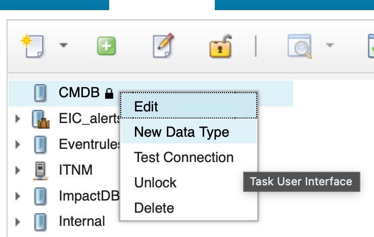

11. Configure the new data type on the **SQL Data Type Config Page** as follows:
    - **Data Type Name**: `DEVICE_INVENTORY`
    - **Data Source Name**: leave as `CMDB`
    - **Base Table**: `DEVICE_INVENTORY`

    Click **Refresh Fields** to populate the field list with the table structure. Locate the `NODE_NAME` field and set its **Key Field** column to **Yes**, since `NODE_NAME` is the unique identifier that policies will use to look up enrichment data by device hostname.

    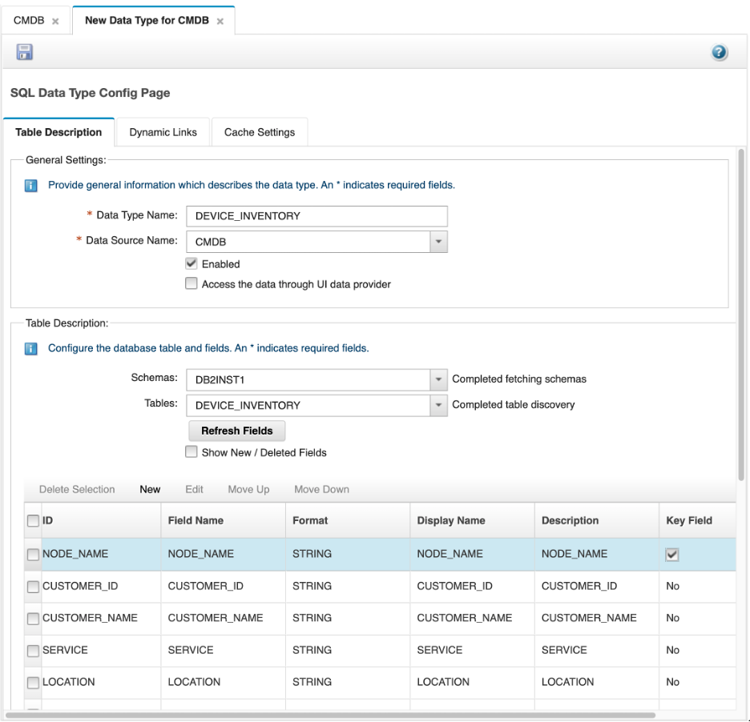

12. Save the data type by clicking the floppy disk icon. Confirm that `DEVICE_INVENTORY` appears nested under `CMDB` in the data source list.

    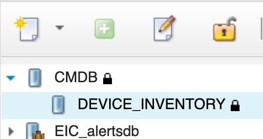

#### Validation

The exercise is successful when all of the following are true:

- The `CMDB` database exists in DB2 and the `DEVICE_INVENTORY` table contains eight rows of sample enrichment data.
- The `CMDB` JDBC DSA is configured and the **Test Connection** result shows **Connection OK**.
- The `CMDB` data source appears in the Data Model data source list.
- The `DEVICE_INVENTORY` data type is created with `NODE_NAME` set as the key field.
- The `DEVICE_INVENTORY` data type is saved and visible nested under `CMDB` in the data source list.

#### Expected result

At the end of this exercise, you will have a fully configured enrichment data source in Impact. The `CMDB` JDBC DSA connects Impact to the DB2 enrichment database, and the `DEVICE_INVENTORY` data type provides policies with a structured, key-based interface to look up customer and service data by device hostname. This data source and data type will be used directly in the policy enrichment exercises in later sections.

### 2.3 Validating the CMDB data source and data type

#### Objective

In this exercise, you will validate that the `CMDB` data source and `DEVICE_INVENTORY` data type created in section 2.2 are working correctly and are ready for use in policies. You will test the data source connection directly from the Data Model tab, confirm that the data type can return rows from the enrichment table, and review the data type performance report.

#### Prerequisites

- Completion of section 2.2.
- The `CMDB` JDBC DSA and `DEVICE_INVENTORY` data type are configured.
- The DB2 instance is running and the `CMDB` database is available.

#### Background

Before using a data source in a policy, it is good practice to verify that both the data source and its data types are working as expected. In Impact, these are two distinct layers that can be validated independently.

The **data source** represents the physical connection to the external system — in this case, the DB2 `CMDB` database. Validating the data source confirms that Impact can reach the database using the configured credentials and connection settings. If the data source connection fails, no policy that depends on it will be able to retrieve or write data.

The **data type** sits on top of the data source and defines the structure of a specific table or view. Validating the data type confirms that Impact can query the underlying table and that the field definitions are correct. The **View Data Items** function executes a live query against the table through the data type and returns the current rows, giving you immediate confirmation that the data type is functional and the enrichment data is accessible to policies.

The **Performance Report** provides a view of how the data type has been used over time, including query counts, response times, and error rates. While this is most useful in a production environment where policies are actively querying the data type, reviewing it after initial setup establishes a baseline and confirms that the data type is being tracked by the Impact monitoring framework.

Understanding both layers — and knowing how to validate each one — is an important part of working with Impact data sources. A data source that connects successfully does not guarantee that a data type defined on top of it will return data correctly; the table may not exist, the field mapping may be wrong, or the key field may be misconfigured. Validating each layer separately makes it straightforward to isolate the cause of any issue.

#### Tasks

1. In the Impact GUI, select the **Data Model** tab from the top navigation bar. In the data source list on the left, locate the `CMDB` data source entry. To test the connection, either right-click on `CMDB` and select **Test Connection**, or select `CMDB` and click the green check icon in the toolbar at the top of the data source list. A popup will appear with the result — confirm that it displays **Connection OK**. If it does not, verify that the DB2 instance is running and that the `CMDB` database exists before continuing.

   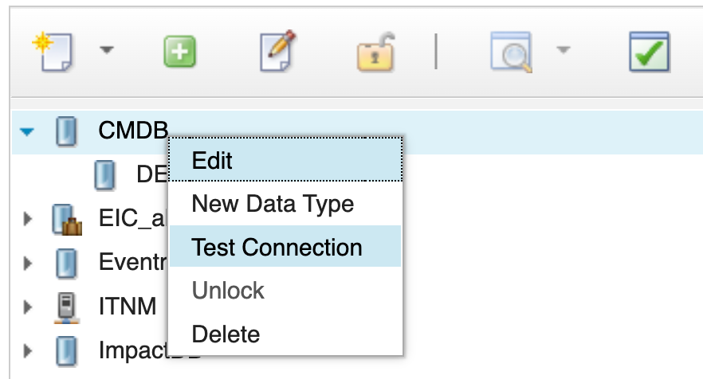

2. Now validate the data type. In the data source list, expand `CMDB` to reveal the `DEVICE_INVENTORY` data type nested beneath it. Right-click on `DEVICE_INVENTORY` and select **View Data Items**.

   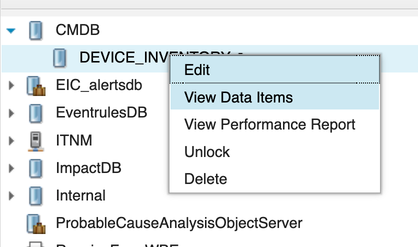

3. A results panel will open displaying the current rows in the `DEVICE_INVENTORY` table. Confirm that all eight rows inserted in section 2.2 are returned, with the correct values for `NODE_NAME`, `CUSTOMER_ID`, `CUSTOMER_NAME`, `SERVICE`, `LOCATION`, and `CONTACT`.

   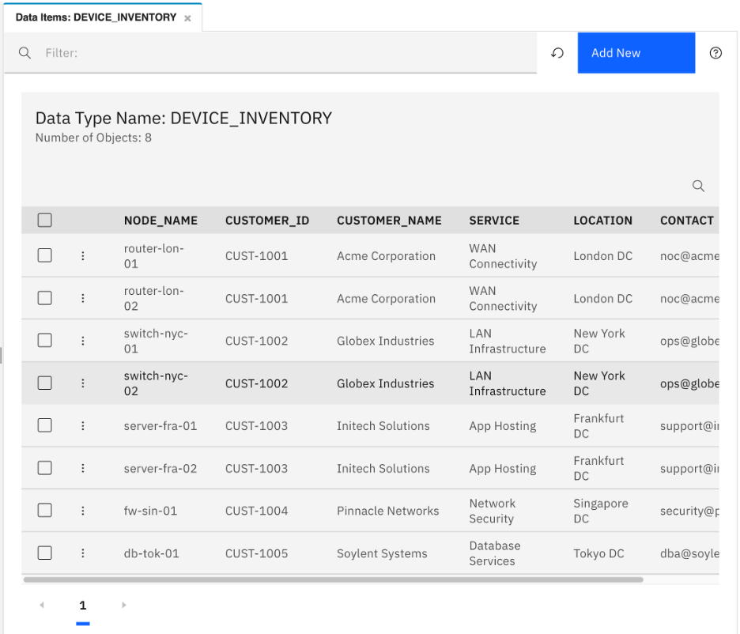

4. Right-click on `DEVICE_INVENTORY` again and select **Show Performance Report**.

   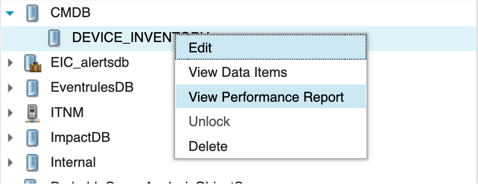

5. The performance report displays utilization and performance metrics for this data type, including query counts, average response times, and any errors encountered. Review the report and note the available metrics. At this stage the counts will be low since the data type has not yet been used by any policies — this report will become more informative once enrichment policies are actively running in later exercises.

#### Validation

The exercise is successful when all of the following are true:

- Right-clicking `CMDB` and selecting **Test Connection** returns **Connection OK**.
- Right-clicking `DEVICE_INVENTORY` and selecting **View Data Items** returns all eight enrichment rows.
- The **Show Performance Report** option opens the performance report for the data type without error.
- You can explain the difference between validating a data source and validating a data type.

#### Expected result

At the end of this exercise, you will have confirmed that the `CMDB` data source has an active connection to the DB2 database and that the `DEVICE_INVENTORY` data type can successfully retrieve enrichment data. Both layers are now validated and ready to be used by Impact policies in the exercises that follow.
