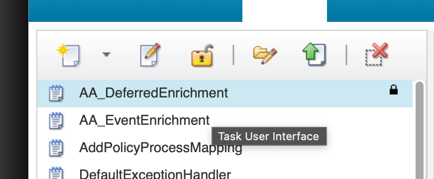
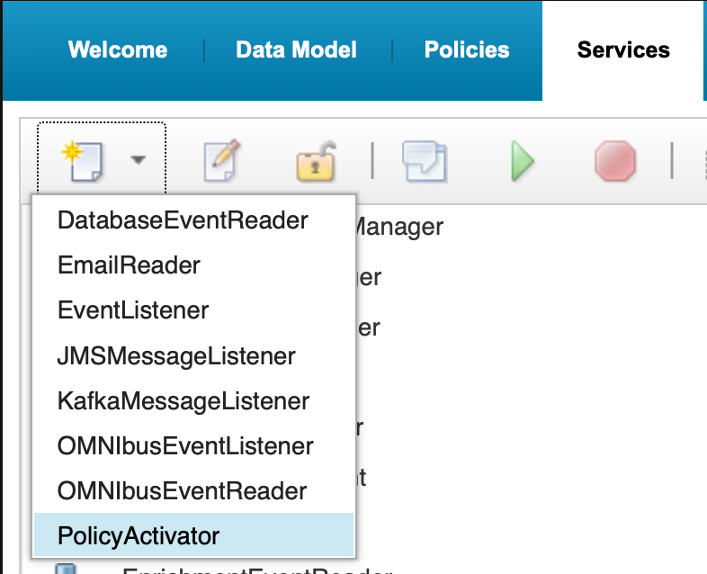
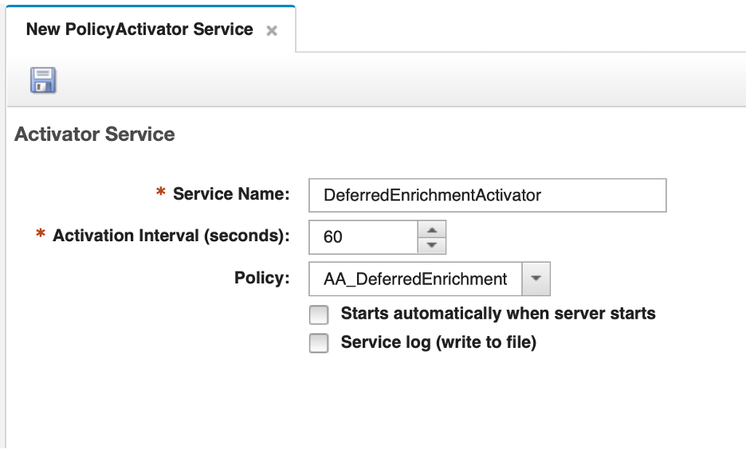
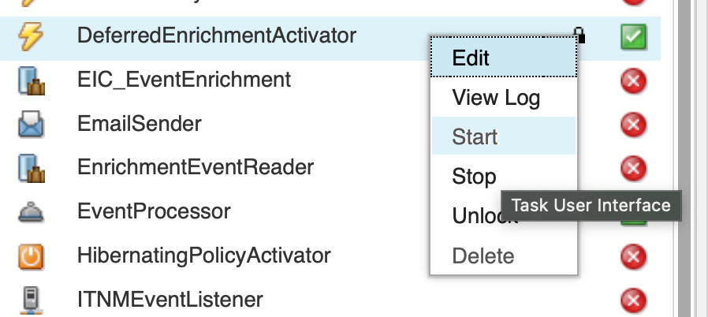
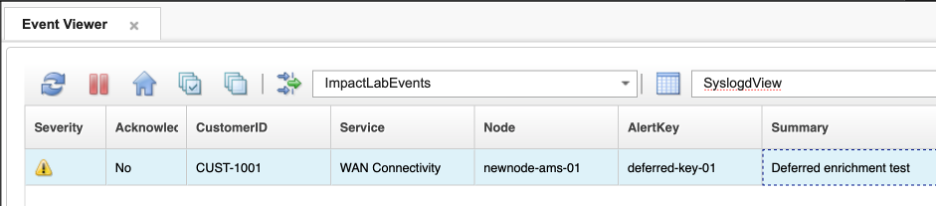
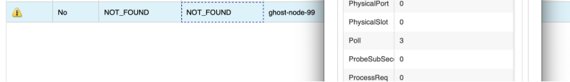

Some automation tasks need to run on a schedule rather than in response to a specific event. Impact's **PolicyActivator** service fills this role. It runs an assigned policy at a defined interval, independently of any inbound event, making it the Impact equivalent of a scheduled task or cron job.

Common use cases include:

- **Deferred or retry enrichment**: Reprocess unresolved events whose initial lookup failed because a CMDB, DNS, REST endpoint, or data source was temporarily unavailable at insert time.
- **Aging and escalation**: Query active events based on `FirstOccurrence`, `LastOccurrence`, severity, ownership, or acknowledgment state, then add journal context, change severity, send a notification, or create and update a ticket.
- **Periodic reconciliation**: Compare ObjectServer event state with an external ITSM, inventory, maintenance window, or CMDB source and repair drift.
- **Maintenance and retention**: Purge stale Impact reporting data or perform controlled cleanup. IBM specifically documents attaching a recurring reporting purge policy to a PolicyActivator for this purpose.
- **Batch state evaluation**: Run a periodic health or compliance calculation across a population of devices or services, then update event fields or trigger downstream automation.

Unlike the OMNIbusEventReader, the PolicyActivator has a **1:1 relationship** with its policy — each PolicyActivator service runs exactly one policy. The policy is selected from a dropdown on the service configuration page and there is no event filter or mapping table.

In this section, you will implement **deferred enrichment** — a scheduled policy that retries CMDB lookups for alerts that previously failed enrichment because the data source was unavailable. This is one of the most common practical uses of the PolicyActivator in production OMNIbus environments.

### 5.1 Write the deferred enrichment policy

#### Objective

In this exercise, you will create a policy that scans the ObjectServer for alerts where enrichment previously failed and retries the CMDB lookup for each one. By the end of the exercise, you will have a policy that uses `GetByFilter` to find a specific population of alerts and acts on each result.

#### Prerequisites

- Completion of section 4.
- The `defaultobjectserver` ObjectServer DSA is configured and connected.
- The `EVENTS` data type is configured against the `alerts.status` table (section 2.1).
- The `CMDB` DB2 DSA and `DEVICE_INVENTORY` data type are configured (section 2.2).
- The `ImpactFlag`, `CustomerID`, and `Service` columns exist in `alerts.status` (section 4.1).

#### Background

Recall from section 4 that the enrichment policy sets `ImpactFlag = 2` when no inventory record is found for an alert's `Node` value. There are two reasons an alert might reach this state:

1. The node genuinely does not exist in the CMDB — it is unknown or out of scope.
2. The CMDB was temporarily unavailable at the time the alert arrived — a database restart, a network blip, or a DSA reconnection in progress.

In the second case, the alert was not enriched through no fault of its own. A scheduled deferred enrichment policy handles this by periodically retrying the CMDB lookup for all `ImpactFlag = 2` alerts. If the CMDB is now available and the record is found, enrichment is applied and `ImpactFlag` is updated to `1`. If the record still cannot be found, the alert remains at `ImpactFlag = 2` for the next cycle.

A PolicyActivator policy does not receive a triggering event — there is no `EventContainer` passed in by the service. Instead, the policy queries the ObjectServer directly using `GetByFilter` to build the list of alerts to process. Write-back to each alert is done using `ReturnEvent` on the individual row objects returned from the query.

#### Tasks

1. In your private browser window, ensure you are logged in to the Impact GUI. If your session has expired, navigate to `http://<your-server>:17311/ibm/console` and log in as `impactadmin` with password `netcool`.

2. Select the **Policies** tab from the top navigation bar. In the toolbar at the top of the policy list, click the **dropdown arrow** next to the New Policy icon and select **IPL Policy**. A blank IPL code editor opens titled **New IPL Policy**.

3. Before entering any code, click the **Save** icon (floppy disk, top-left). A **Save** dialog appears with a single **Policy Name** field. Enter `AA_DeferredEnrichment` and click **Save**.

4. In the IPL code editor, enter the following policy code:

   ```ipl
   /*
   * Policy: AA_DeferredEnrichment
   * Purpose: Retry CMDB enrichment for alerts where ImpactFlag = 2
   *          (previous enrichment attempt failed — no record found).
   * Trigger: PolicyActivator (scheduled, not event-driven).
   */

   // Find all alerts where enrichment previously found no record
   pendingAlerts = GetByFilter("EVENTS", "ImpactFlag = 2", False);

   //Get the number of rows returned 
   alertCount = Length(pendingAlerts);

   Log("AA_DeferredEnrichment: found " + alertCount + " alert(s) pending re-enrichment");

   if (alertCount > 0) 
   {
      counter = 0; // set a counter as an index to loop through the returned alerts
      while(counter < alertCount)
      {
         nodeValue = pendingAlerts[counter].Node;

         nodeFilterValue = Replace(nodeValue, "'", "''"); 
         filter = "NODE_NAME = '" + nodeFilterValue + "'"; 
         inventoryRows = GetByFilter("DEVICE_INVENTORY", filter, False);

         if (Length(inventoryRows) > 0) 
         {
            inventoryRow = inventoryRows[0]; // for simplicty only assume 1 return

            Log("AA_DeferredEnrichment: enrichment applied for Node=" + nodeValue
               + ", CustomerID=" + inventoryRow.CustomerID );
         
            // Update this alert using the Identifier as our where clause:
 
            DirectSQL("defaultobjectserver", "update alerts.status set CustomerID='"
               + inventoryRow.CUSTOMER_ID + "', Service='" 
               + inventoryRow.SERVICE + "', ImpactFlag=1 where Identifier='"
               + pendingAlerts[counter].Identifier + "'", false);  
 
         } 
         else 
         {
 
            Log("AA_DeferredEnrichment: still no record for Node=" + nodeValue
               + "; leaving ImpactFlag=2");     
         }
 
         counter = counter + 1; 
 
      }
   }
   else 
   {
      Log("AA_DeferredEnrichment: no alerts pending re-enrichment");
   }
   ```

   > **Note:** In a PolicyActivator policy there is no `EventContainer` — the service does not pass a triggering event. Instead, each row returned by `GetByFilter` is its own object. Field assignments are made directly on the referenced row (`pendingAlerts[counter].CustomerID = ...`) and we use `DirectSQL` function against the **data source** for our ObjectServer (`defaultobjectserver`), not against the data type `EVENTS`. This is purely to illustrate that you can run queries, inserts, and updates using Impact functions such as GetByFilter(), AddDataItem(), and BatchUpdate(), but you can also construct SQL queries and run those queries against the data source itself.

 

5. Click the **Syntax Check** icon in the toolbar. Confirm the **Syntax check successful** dialog appears, then click **Close**.

6. Click the **Save** icon to save the policy code. Confirm that `AA_DeferredEnrichment` appears at the top of the policy list in the left pane.

   

#### Validation

The exercise is successful when all of the following are true:

- The `AA_DeferredEnrichment` policy is saved and appears at the top of the policy list.
- The syntax check passes with no errors.
- You can explain why this policy uses `GetByFilter` rather than `EventContainer`.
- You can describe what happens when a retry succeeds versus when no record is still found.
- You can explain the difference between `ReturnEvent(EventContainer)` in the enrichment policy and `ReturnEvent(alert)` here.

#### Expected result

You now have a deferred enrichment policy that can recover alerts missed by the real-time enrichment pipeline. The next exercise creates the PolicyActivator service and connects it to this policy.

### 5.2 Create and configure the PolicyActivator service

#### Objective

In this exercise, you will create a PolicyActivator service and configure it to run the `AA_DeferredEnrichment` policy every 60 seconds.

#### Prerequisites

- Completion of section 5.1.
- The `AA_DeferredEnrichment` policy is saved.

#### Tasks

1. Select the **Services** tab from the top navigation bar.

2. In the toolbar at the top of the services list, click the **dropdown arrow** next to the New Service icon and select **PolicyActivator**. The **New PolicyActivator Service** configuration page opens.

   

3. Configure the following fields:
   - **Service Name**: `DeferredEnrichmentActivator`
   - **Activation Interval (seconds)**: `60`
   - **Policy**: select `AA_DeferredEnrichment` from the dropdown
   - Leave **Starts automatically when server starts** unchecked.

   

4. Click the **Save** icon (floppy disk, top-left) to save the service.

5. Select your new service in the service, and click the **Start** button (green triangle in the toolbar) to start the service. Alternatively, right-click on the service and select "Confirm the state changes to **Running**.

   

#### Validation

The exercise is successful when all of the following are true:

- The `DeferredEnrichmentActivator` service is saved with activation interval `60` seconds.
- The policy is set to `AA_DeferredEnrichment`.
- The service state is **Running**.
- You can explain the difference between this service and the `EnrichmentEventReader` in terms of what triggers the policy.

#### Expected result

The deferred enrichment pipeline is now active. Every 60 seconds, the PolicyActivator will invoke `AA_DeferredEnrichment`, which scans for `ImpactFlag = 2` alerts and retries the CMDB lookup for each one.

### 5.3 Validate deferred enrichment

#### Objective

In this exercise, you will simulate a failed enrichment by inserting a test alert for an unknown node, then update the CMDB to add that node, and confirm that the deferred enrichment policy picks it up on its next cycle.

#### Prerequisites

- Completion of section 5.2.
- The `DeferredEnrichmentActivator` service is running.
- The `EnrichmentEventReader` service from section 4 is also running.

#### Tasks

1. Insert a test alert for a node that does not exist in the CMDB. The enrichment policy will process it, fail to find a record, and set `ImpactFlag = 2`:

   ```bash
   $OMNIHOME/bin/nco_sql -server EVENTS -user root -password netcool << 'EOF'
   INSERT INTO alerts.status (Node, Summary, AlertKey, AlertGroup, Severity, Type, Identifier, Manager, OwnerUID)
   VALUES ('newnode-ams-01', 'Deferred enrichment test', 'deferred-key-01', 'TrainingAlerts', 3, 1, 'newnode-ams-01:deferred-key-01:TrainingAlerts', 'ImpactLab', 65534);
   go
   EOF
   ```

2. In the OMNIbus Web GUI, locate the `newnode-ams-01` alert in your `ImpactLabEvents` filter, and switch to your `SyslogdView`. Within a few seconds the `EnrichmentEventReader` should process it. Confirm that `Customer` and `Service` both show `NOT_FOUND` and that `ImpactFlag` shows `2` in the event details.

3. Now add `newnode-ams-01` to the CMDB so the next deferred enrichment cycle can find it. The DB2 commands must be run as the `db2inst1` user:

   ```bash
   su - db2inst1
   ```

   Then run:

   ```bash
   db2 "CONNECT TO CMDB" && \
   db2 "INSERT INTO DEVICE_INVENTORY (NODE_NAME, CUSTOMER_ID, CUSTOMER_NAME, SERVICE, LOCATION, CONTACT) \
        VALUES ('newnode-ams-01', 'CUST-1001', 'Acme Corporation', 'WAN Connectivity', 'Amsterdam DC', 'noc@acme.com')"
   ```

   You should see:

   ```
   DB20000I  The SQL command completed successfully.
   ```

   Then type `exit` to return to your root shell.


4. Wait up to 120 seconds for the `DeferredEnrichmentActivator` to fire. Then refresh the event in the OMNIbus Web GUI and confirm:
   - `Customer` now shows `CUST-1001`
   - `Service` now shows `WAN Connectivity`
   - `ImpactFlag` now shows `1`

5. Check the policy log to confirm the retry succeeded:

   ```bash
   tail -30 $IMPACT_HOME/logs/NCI_policylogger_AA_DeferredEnrichment.log
   ```

   Look for: `AA_DeferredEnrichment: enrichment applied for Node=newnode-ams-01, CustomerID=CUST-1001`

   

#### Validation

The exercise is successful when all of the following are true:

- The `newnode-ams-01` alert initially shows `NOT_FOUND` and `ImpactFlag = 2`.
- After adding the node to the CMDB, the deferred enrichment policy updates the alert to `ImpactFlag = 1` with correct customer and service values.
- The policy log confirms the enrichment retry message.
- You can explain the difference between `ImpactFlag = 1` (enriched at arrival) and `ImpactFlag = 1` after a deferred retry — from the alert's perspective, the outcome is identical.
- You can describe a real-world scenario where deferred enrichment would recover alerts that the real-time policy could not process.

#### Expected result

You have now seen how the PolicyActivator complements the OMNIbusEventReader. The real-time enrichment pipeline handles the normal path; the scheduled deferred pipeline handles recovery. Together they ensure that all alerts eventually carry the context operators need, regardless of whether the CMDB was available at the moment each alert arrived.

### 5.4 Add a retry limit to the deferred enrichment policy

#### Objective

In this exercise, you will update the `AA_DeferredEnrichment` policy to limit the number of times it will retry a failed enrichment. By the end of the exercise, the policy will use the standard `Poll` field as a retry counter, and alerts that have been attempted three times will be automatically excluded from further processing.

#### Background

The policy as written will retry every `ImpactFlag = 2` alert on every cycle, indefinitely. In most cases this is fine — a transient CMDB outage resolves quickly and the alert is enriched on the next attempt. But for alerts whose `Node` value will never exist in the CMDB, this creates unnecessary processing overhead that compounds over time as more unknown-node alerts accumulate.

The solution is to use the `Poll` field — a standard integer field already present on every `alerts.status` row — as a retry counter. On each failed lookup, the policy increments `Poll` by 1 and uses `DirectSQL` to write that value back to the ObjectServer immediately. The `GetByFilter` query is updated to include `AND Poll < 3`, which means alerts that have already been attempted three times are never retrieved in the first place. Filtering at the query level is more efficient than pulling all `ImpactFlag = 2` alerts and checking `Poll` inside the loop — alerts beyond the limit simply never enter the processing path.

#### Prerequisites

- Completion of section 5.3.
- The `DeferredEnrichmentActivator` service is running.

#### Tasks

1. In the Impact GUI, select the **Policies** tab and open `AA_DeferredEnrichment` for editing. Replace the entire policy body with the following:
   ```ipl
   /*
   * Policy: AA_DeferredEnrichment
   * Purpose: Retry CMDB enrichment for alerts where ImpactFlag = 2
   *          (previous enrichment attempt failed — no record found).
   * Trigger: PolicyActivator (scheduled, not event-driven).
   */

   // Find all alerts where enrichment previously found no record
   pendingAlerts = GetByFilter("EVENTS", "ImpactFlag = 2 AND Poll < 3", False);

   //Get the number of rows returned 
   alertCount = Length(pendingAlerts);

   Log("AA_DeferredEnrichment: found " + alertCount + " alert(s) pending re-enrichment");

   if (alertCount > 0) 
   {
      counter = 0; // set a counter as an index to loop through the returned alerts
      while(counter < alertCount)
      {
         nodeValue = pendingAlerts[counter].Node;

         nodeFilterValue = Replace(nodeValue, "'", "''");
         filter = "NODE_NAME = '" + nodeFilterValue + "'";
         inventoryRows = GetByFilter("DEVICE_INVENTORY", filter, False);

         if (Length(inventoryRows) > 0) 
         {
            inventoryRow = inventoryRows[0]; // for simplicty only assume 1 return

            Log("AA_DeferredEnrichment: enrichment applied for Node=" + nodeValue
               + ", CustomerID=" + inventoryRow.CustomerID );

            // Update this alert using the Identifier as our where clause:
 
            DirectSQL("defaultobjectserver", "update alerts.status set CustomerID='"
               + inventoryRow.CUSTOMER_ID + "', Service='" 
               + inventoryRow.SERVICE + "', ImpactFlag=1 where Identifier='"
               + pendingAlerts[counter].Identifier + "'", false);  
 
         } 
         else 
         {
 
            currentPollValue = pendingAlerts[counter].Poll;
            newPollValue = currentPollValue + 1;
 
            DirectSQL("defaultobjectserver", "update alerts.status set Poll="
               + newPollValue + " where Identifier='"
               + pendingAlerts[counter].Identifier + "'", false);

               Log("AA_DeferredEnrichment: still no record for Node=" + nodeValue
                  + "; Poll=" + pendingAlerts[counter].Poll); 

    
         }
     
     
         counter = counter + 1; 
 
      }    
   } 
   else 
   {
      Log("AA_DeferredEnrichment: no alerts pending re-enrichment");
   }
   ```

2. **Save** your updated policy, then review the changes in the updated policy against the original. For each of the following, identify where it appears in the code and explain its purpose:

   | Change | Where | Why |
   |---|---|---|
   | `"ImpactFlag = 2 AND Poll < 3"` added to `GetByFilter` | The `GetByFilter` filter string at the top of the policy | Excludes alerts that have already been retried three times before they are even retrieved. Filtering at the query level means those alerts never enter the loop — no wasted iterations. |
   | `Poll` increment in the failure branch | `currentPollValue` / `newPollValue` calculation in the `else` block | Tracks how many times enrichment has been attempted for this alert. Each failed lookup advances the counter by 1. |
   | `DirectSQL` in the failure branch | `DirectSQL("defaultobjectserver", "update alerts.status set Poll=...")` | Writes the incremented `Poll` value directly back to the ObjectServer using a SQL `UPDATE` statement. 
   | `Poll` is only incremented in the failure branch | Success branch updates `CustomerID`, `Service`, and `ImpactFlag = 1` via `DirectSQL` — `Poll` is left untouched | Once an alert is successfully enriched, `ImpactFlag` changes to `1` and it will never be retrieved by this policy again (`ImpactFlag = 2 AND Poll < 3` will not match). There is no need to increment `Poll` on the success path. |


3. Click the **Syntax Check** icon. Confirm the **Syntax check successful** dialog appears, then click **Close**.

4. Click the **Save** icon to save the updated policy (in case you forgot to save it as directed in task 2).

#### Validation

The exercise is successful when all of the following are true:

- The `GetByFilter` filter string reads `"ImpactFlag = 2 AND Poll < 3"`.
- `Poll` is incremented only on the failure path.
- `DirectSQL` is used on both paths to write changes back to the ObjectServer.
- The syntax check passes with no errors.
- You can explain why `DirectSQL` is used instead of `ReturnEvent` in a PolicyActivator context.
- You can explain why filtering `Poll < 3` at the query level is more efficient than checking it inside the loop.

#### Expected result

The policy now limits itself to three attempts per alert. Alerts that cannot be enriched are retried up to three times and then silently excluded from further processing, keeping the policy focused on alerts that still have a realistic chance of recovery.

### 5.5 Validate the retry limit

#### Objective

In this exercise, you will confirm that the updated policy correctly limits retries to three attempts for an alert that will never have a CMDB entry.

#### Prerequisites

- Completion of section 5.4.
- The `DeferredEnrichmentActivator` service is running.
- The `EnrichmentEventReader` service from section 4 is running.

#### Tasks

1. Insert a test alert for a node that does not exist in the CMDB and will not be added — this simulates a genuinely unknown node:

   ```bash
   $OMNIHOME/bin/nco_sql -server EVENTS -user root -password netcool << 'EOF'
   INSERT INTO alerts.status (Node, Summary, AlertKey, AlertGroup, Severity, Type, Identifier, Manager, OwnerUID)
   VALUES ('ghost-node-99', 'Retry limit test', 'retry-limit-01', 'TrainingAlerts', 3, 1, 'ghost-node-99:retry-limit-01:TrainingAlerts', 'ImpactLab', 65534);
   go
   EOF
   ```

2. In the OMNIbus Web GUI, locate the `ghost-node-99` alert in the `ImpactLabEvents` filter. Confirm that `EnrichmentEventReader` processes it and sets `Customer = NOT_FOUND`, `Service = NOT_FOUND`, and `ImpactFlag = 2`. Note that `Poll` starts at `0`.

3. Watch the policy log over the next three minutes. Each time the `DeferredEnrichmentActivator` fires you should see a log entry with the `Poll` counter incrementing:

   ```bash
   tail -f $IMPACT_HOME/logs/NCI_policylogger_AA_DeferredEnrichment.log
   ```

   After the first attempt: `Poll=1`  
   After the second attempt: `Poll=2`  
   After the third attempt: `Poll=3`

4. After the third attempt, open the `ghost-node-99` alert in the Web GUI and confirm `Poll` shows `3` and `ImpactFlag` still shows `2`.

5. Wait for at least one more `DeferredEnrichmentActivator` cycle (60 seconds). Confirm that `ghost-node-99` no longer appears in the policy log output — it is now excluded by the `Poll < 3` filter.

   

#### Validation

The exercise is successful when all of the following are true:

- `ghost-node-99` is retried exactly three times, with `Poll` incrementing from `0` to `3`.
- After `Poll` reaches `3`, the alert no longer appears in the policy log on subsequent cycles.
- `ImpactFlag` remains `2` — the alert is preserved as unenriched for operator visibility.
- You can explain why filtering at the query level is more efficient than retrieving all `ImpactFlag = 2` alerts and checking `Poll` inside the loop.

#### Expected result

The retry limit ensures that genuinely unknown nodes do not generate processing overhead indefinitely. Alerts with `Poll = 3` and `ImpactFlag = 2` remain visible in the event list so operators can investigate, but they are silently excluded from further automated retry attempts.
