Not every alert that arrives in the ObjectServer demands immediate action. But an alert that has been sitting open and unacknowledged for an extended period is a signal that something has been missed. Impact can automate the response to that condition — detecting aged, unacknowledged events and escalating them by raising their severity or setting a visual flag to draw operator attention.

This section extends the enrichment pipeline from sections 4 and 5 with a service-level dimension: a `SERVICE_LEVEL` field is added to both the CMDB and the ObjectServer, the enrichment policy is updated to populate it, and a new scheduled escalation policy targets only `Platinum`-tier events that have aged past a threshold without acknowledgment.

This section introduces two important ideas that extend what you have already learned:

- **Scheduled escalation with a PolicyActivator**: Alerts that age past a threshold do not generate an ObjectServer update event — time simply passes. A PolicyActivator polls on a fixed interval and queries for qualifying alerts, making it the right tool for age-based escalation.
- **Severity modification and the `Flash` flag**: Writing back to `Severity` and `Flash` using `DirectSQL` to change how an alert appears to operators.

In production, a reasonable escalation threshold might be 10 minutes or more. For this lab, you will use **60 seconds** so the behavior is immediately observable.

### 6.1 Preparing the scenario

#### Objective

In this exercise, you will extend the existing enrichment data model and pipeline to carry a service level classification. You will add a `SERVICE_LEVEL` field to the DB2 CMDB table and the ObjectServer schema, re-discover the affected data types in Impact, populate the CMDB with test data, and update the enrichment policy to write the new field to each alert.

#### Prerequisites

- Completion of sections 4 and 5.
- The `defaultobjectserver` ObjectServer DSA is configured and connected.
- The `CMDB` DB2 DSA is configured and connected.
- The `AA_EnrichAlert` policy exists and is working correctly.

#### Tasks

1. SSH into the lab server and switch to the DB2 instance user:

   ```bash
   su - db2inst1
   ```

2. Add the `SERVICE_LEVEL` column to the `DEVICE_INVENTORY` table in DB2:

   ```bash
   db2 connect to CMDB
   db2 "ALTER TABLE DEVICE_INVENTORY ADD COLUMN SERVICE_LEVEL VARCHAR(32)"
   db2 connect reset
   exit
   ```

   You should see `DB20000I  The SQL command completed successfully.` after the `ALTER TABLE` statement.

3. Add the `ServiceLevel` field to the `alerts.status` table in the ObjectServer:

   ```bash
   $OMNIHOME/bin/nco_sql -server AGG_P -user root -password netcool << 'EOF'
   ALTER TABLE alerts.status ADD COLUMN ServiceLevel VARCHAR(32);
   go
   EOF
   ```

4. Verify that the `ServiceLevel` column was added successfully:

   ```bash
   $OMNIHOME/bin/nco_sql -server AGG_P -user root -password netcool << 'EOF'
   describe alerts.status;
   go
   EOF
   ```

   Confirm that `ServiceLevel` appears in the output as a `VARCHAR(32)` column.

5. In the Impact GUI, re-discover the `DEVICE_INVENTORY` data type so Impact picks up the new `SERVICE_LEVEL` column.

   - Select the **Data Model** tab from the top navigation bar.
   - Locate the `CMDB` data source in the DSA list and open it by clicking on the arrow to the left of the titel. Double-click `DEVICE_INVENTORY` to open it.
     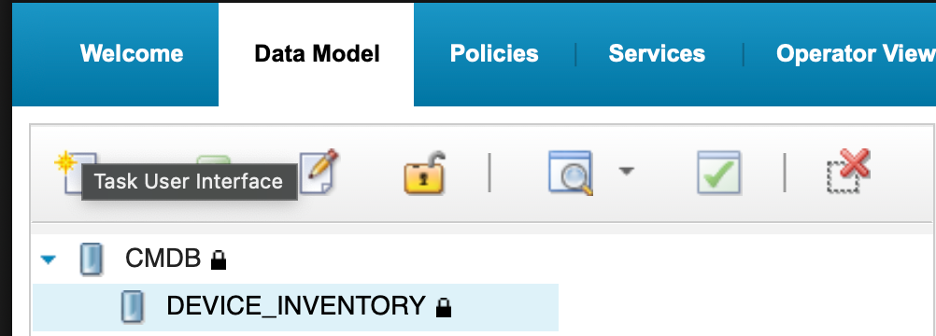
   - Click the **Refresh Fields** button in the `Table Description` section of the data type configuration window.
   - Confirm that `SERVICE_LEVEL` now appears in the field list.
      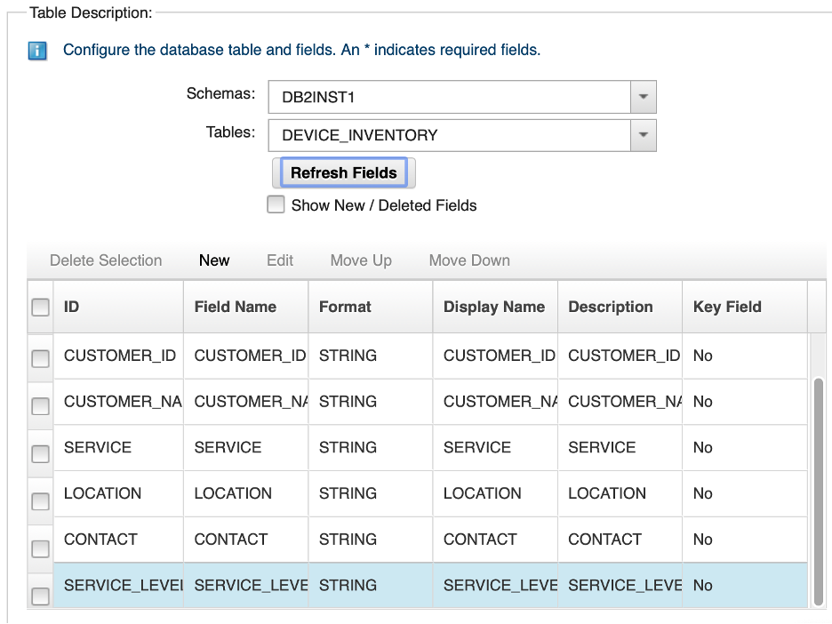
   - Click **Save** to save the updated data type using the disk icon at the top-left of the data type config window.

 

6. Next, in the same `Data Model` tab, re-discover the `EVENTS` data type to pick up the new `ServiceLevel` column from `alerts.status`.

   - Locate the `defaultobjectserver` DSA, open the tree view and double-click on the `EVENTS` data type to open it.
   - Click the **Refresh Fields** button in the `Table Description` section of the data type configuration window.
   - Confirm that `ServiceLevel` now appears in the field list.
   - Click **Save** by clicking on the disk icon.

   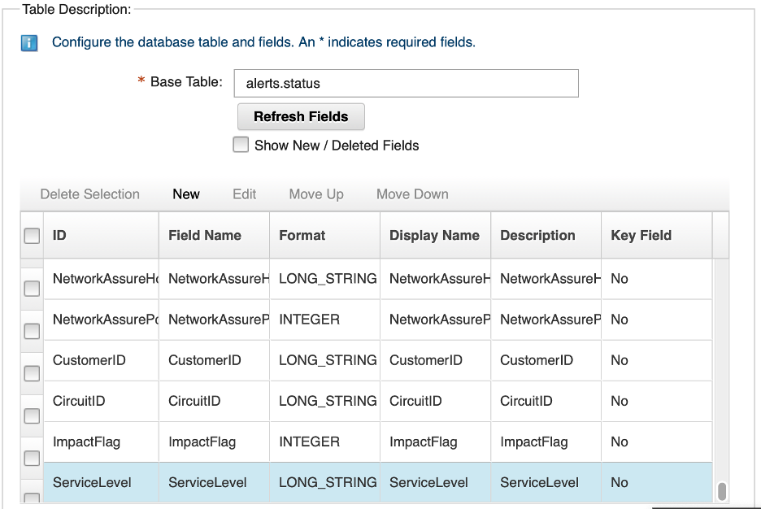

7. Populate the `SERVICE_LEVEL` field in the CMDB for **Acme Corporation** nodes. In the lab, Acme Corporation holds nodes `router-lon-01` and `router-lon-02` (customer `CUST-1001`):

   First, switch to the `db2inst1` user:
   ```bash
   su - db2inst1
   ```
   Next, populate the **Acme Corporation** nodes with the **Platinum** service level:
   ```
   db2 connect to CMDB
   db2 "UPDATE DEVICE_INVENTORY SET SERVICE_LEVEL = 'Platinum' WHERE CUSTOMER_ID = 'CUST-1001'"
   db2 connect reset
   ```

   You should see `DB20000I  The SQL command completed successfully.`

   Verify the update:

   ```bash
   db2 connect to CMDB
   db2 "SELECT NODE_NAME, CUSTOMER_NAME, SERVICE_LEVEL FROM DEVICE_INVENTORY"
   ```


   Confirm that `router-lon-01` and `router-lon-02` show `Platinum` in the `SERVICE_LEVEL` column. All other rows should show a null value.

   Exit the `db2inst1` user to return to the `root` user:

   ```
   exit
   ```

8. Open the `AA_EnrichAlert` policy in the Impact GUI and add `ServiceLevel` to the enrichment write-back.

   - Select the **Policies** tab and click `AA_EnrichAlert` in the policy list to open it.
   - In the `if (Length(inventoryRows) > 0)` branch, add the following line immediately after the existing `EventContainer.Service` assignment:

     ```ipl
     EventContainer.ServiceLevel = inventoryRow.SERVICE_LEVEL;
     ```

   - In the not-found `else` branch, add:

     ```ipl
     EventContainer.ServiceLevel = "NOT_FOUND";
     ```

   - Click **Syntax Check**. Confirm the check passes, then click **Save**.

   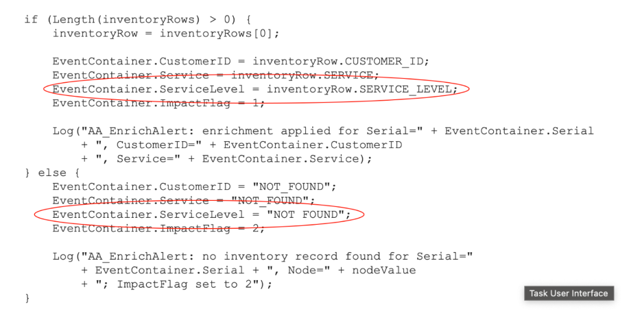

#### Validation

The exercise is successful when all of the following are true:

- `SERVICE_LEVEL VARCHAR(32)` exists in the `DEVICE_INVENTORY` DB2 table.
- `ServiceLevel VARCHAR(32)` exists in `alerts.status`.
- Both `DEVICE_INVENTORY` and `EVENTS` data types in the Impact Data Model show the new field.
- `router-lon-01` and `router-lon-02` have `SERVICE_LEVEL = 'Platinum'` in the CMDB.
- The `AA_EnrichAlert` policy includes `ServiceLevel` in both the found and not-found branches, and the syntax check passes.

#### Expected result

The enrichment pipeline now carries service level classification. Any alert from a Platinum-tier node will have `ServiceLevel = 'Platinum'` set at enrichment time. The next exercise uses this field to build a targeted escalation policy.

### 6.2 Write the escalation policy

#### Objective

In this exercise, you will create a policy that runs on a schedule, queries the ObjectServer for unacknowledged Platinum-tier alerts that have been open longer than the age threshold, and escalates each one — either raising its severity by one level or, if it is already at severity 5, setting `Flash = 1`. By the end of the exercise, you will understand how to apply the `GetByFilter` and `DirectSQL` pattern to targeted, time-based escalation.

#### Prerequisites

- Completion of section 6.1.
- The OMNIbus ObjectServer is running.
- You are logged in to the Impact GUI.

#### Background

##### Time calculations in IPL

IPL provides several functions for working with time. One that is particularly useful in working with events is:

- **`GetDate()`** — returns the current server time as a Unix epoch integer (seconds since 1 January 1970).

ObjectServer timestamp fields such as `FirstOccurrence` and `LastOccurrence` are also stored as Unix epoch integers, so you can compare them directly against `GetDate()` using plain arithmetic. For example, to calculate how many seconds an alert has been open:

```ipl
ageSeconds = GetDate() - alert.FirstOccurrence;
```

This arithmetic is used directly in the `GetByFilter` filter to select only alerts that have been open long enough to qualify for escalation.

##### Severity and Flash

`Severity` in `alerts.status` is an integer field with values from 1 (Indeterminate) to 5 (Critical). The policy checks the current value before acting — if it is below 5, severity is raised by one; if it is already at 5, the policy sets `Flash = 1` instead. Write-back is done with `DirectSQL`:

```ipl
if (alert.Severity < 5) 
{
    DirectSQL("defaultobjectserver", "update alerts.status set Severity=" + (alert.Severity + 1)
        + " where Identifier='" + alert.Identifier + "'", false);
} 
else 
{
    DirectSQL("defaultobjectserver", "update alerts.status set Flash=1"
        + " where Identifier='" + alert.Identifier + "'", false);
}
```

`Flash` is a standard integer field in `alerts.status`. Setting it to `1` signals to compatible event consoles that the alert row should flash to attract attention. It is also a useful filter condition — once `Flash = 1` is set on a severity 5 alert, the `GetByFilter` filter excludes it from future cycles.

##### Why a PolicyActivator, not an OMNIbusEventReader

An OMNIbusEventReader fires when an alert is inserted or updated. An alert that is simply aging — sitting unacknowledged with no field changes — will not trigger an update event, so an OMNIbusEventReader would never see it cross the time threshold.

A PolicyActivator runs on a fixed schedule regardless of event activity. On each cycle it queries the ObjectServer using `GetByFilter` with a filter that includes the age condition, finds all currently qualifying alerts, and processes each one. This is the correct pattern for any escalation logic where the trigger is the passage of time rather than a field change.

#### Tasks

1. Select the **Policies** tab from the top navigation bar. In the toolbar, click the **dropdown arrow** next to the New Policy icon and select **IPL Policy**.

2. Click the **Save** icon, enter `AA_EscalatePlatinum` in the **Policy Name** field, and click **Save**.

3. Enter the following policy code in the editor:

   ```ipl
   /*
    * Policy: AA_EscalatePlatinum
    * Purpose: Escalate unacknowledged Platinum-tier alerts open longer than
    *          the age threshold.
    *          - Severity < 5: raise severity by 1.
    *          - Severity = 5: set Flash = 1 (already at maximum severity).
    * Trigger: PolicyActivator (scheduled — not event-driven).
    */

   ageThreshold = 60;

   filter = "ServiceLevel = 'Platinum'"
       + " AND Acknowledged = 0"
       + " AND Severity >= 3"
       + " AND FirstOccurrence < getdate() - " + ageThreshold
       + " AND NOT (Severity = 5 AND Flash = 1)";

   alerts = GetByFilter("EVENTS", filter, False);
   alertCount = Length(alerts);

   Log("AA_EscalatePlatinum: " + alertCount + " Platinum alert(s) qualify for escalation");

   if (alertCount > 0) {

       counter = 0;
       while (counter < alertCount) {

           alert = alerts[counter];
           ageSeconds = GetDate() - alert.FirstOccurrence;

           if (alert.Severity < 5) {

               DirectSQL("defaultobjectserver",
                   "update alerts.status set Severity=" + (alert.Severity + 1)
                   + " where Identifier='" + alert.Identifier + "'", false);

               Log("AA_EscalatePlatinum: severity raised to " + (alert.Severity + 1)
                   + " for Node=" + alert.Node
                   + " (age=" + ageSeconds + "s)");

           } else {

               DirectSQL("defaultobjectserver",
                   "update alerts.status set Flash=1"
                   + " where Identifier='" + alert.Identifier + "'", false);

               Log("AA_EscalatePlatinum: Flash set for Node=" + alert.Node
                   + " (Severity=5, age=" + ageSeconds + "s)");
           }

           counter = counter + 1;
       }

   } else {
       Log("AA_EscalatePlatinum: no Platinum alerts qualify — nothing to do");
   }
   ```

   > **Note:** The `ageThreshold` variable is defined at the top of the policy so it is easy to find and change. In a production deployment you would set this to `600` (10 minutes) or higher. For this lab, `60` seconds allows you to observe the escalation without waiting. To escalate different service tiers at different rates, create separate policies — one per tier — each with its own `GetByFilter` filter and `ageThreshold`, and bind each to its own PolicyActivator service with an independent polling interval.

4. Click the **Syntax Check** icon. Confirm the **Syntax check successful** dialog appears, then click **Close**.

5. Click the **Save** icon to save the policy. Confirm that `AA_EscalatePlatinum` appears near the top of the policy list.

   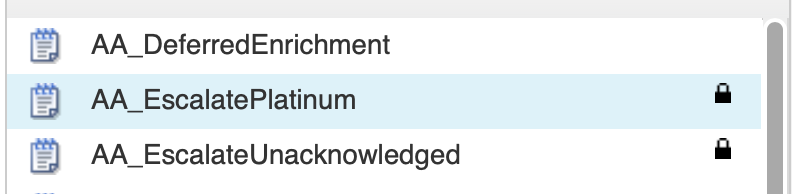

#### Validation

The exercise is successful when all of the following are true:

- The `AA_EscalatePlatinum` policy is saved and the syntax check passes.
- You can describe the two escalation paths — severity bump for alerts below 5, Flash for alerts already at 5.
- You can explain why a PolicyActivator is used instead of an OMNIbusEventReader for age-based escalation.
- You can explain why `DirectSQL` is used for write-back rather than `ReturnEvent`.
- You can explain what each clause of the `GetByFilter` filter does.

#### Expected result

You have a scheduled escalation policy that queries for qualifying Platinum-tier alerts on each cycle and escalates each one. The next exercise creates the PolicyActivator service that runs it.

### 6.3 Create and configure the escalation service

#### Objective

In this exercise, you will create a PolicyActivator service that runs the `AA_EscalatePlatinum` policy on a 60-second interval.

#### Prerequisites

- Completion of section 6.2.
- The `AA_EscalatePlatinum` policy is saved.

#### Background

The PolicyActivator service is deliberately simple: it invokes one assigned policy when the service starts, if configured to do so, and then at a fixed activation interval. Unlike an OMNIbusEventReader, it does not process an inbound event stream and therefore has no event filter or event-to-policy mapping table. The policy receives no triggering event, so it must select the records it will process. In this lab, the escalation policy uses `GetByFilter` to identify Platinum alerts that are eligible for escalation.

This lab uses a 60-second activation interval so you can observe the escalation workflow promptly. The activation interval determines the policy’s evaluation cadence, not the escalation threshold itself. In production, select an interval based on the acceptable delay after an alert becomes eligible: with a 300-second interval, an alert that crosses the threshold immediately after a run may not be evaluated until nearly five minutes later. IBM notes that smaller PolicyActivator intervals provide more accurate timing for scheduled work.

#### Tasks

1. Select the **Services** tab from the top navigation bar.

2. In the toolbar, click the **dropdown arrow** next to the New Service icon and select **PolicyActivator**.

   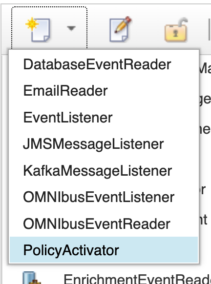

3. Configure the following fields:
   - **Service Name**: `EscalationActivator`
   - **Activation Interval (seconds)**: `60`
   - **Policy**: select `AA_EscalatePlatinum` from the dropdown
   - Leave **Starts automatically when server starts** unchecked.

   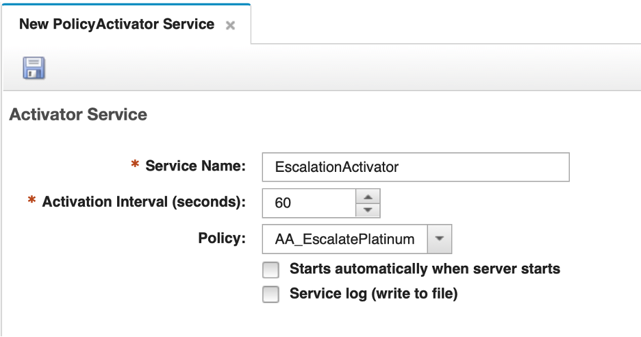

4. Click the **Save** icon to save the service.

5. Right-click on your new `EscalationActivator` serice and select the **Start** menu item to start the service. Confirm the state changes to **Running**.

   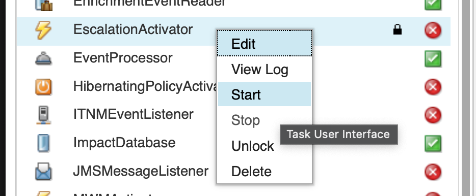

6. The `EnrichmentEventReader` service caches the `alerts.status` schema at startup. Because you added the `ServiceLevel` column after it was started, it needs to be restarted to pick up the new field — otherwise it will not populate `ServiceLevel` when writing events back to the ObjectServer.

   In the services list, right-click `EnrichmentEventReader` and select **Stop**. Wait for the state to change to **Stopped**, then right-click again and select **Start**. Confirm the state returns to **Running**.

   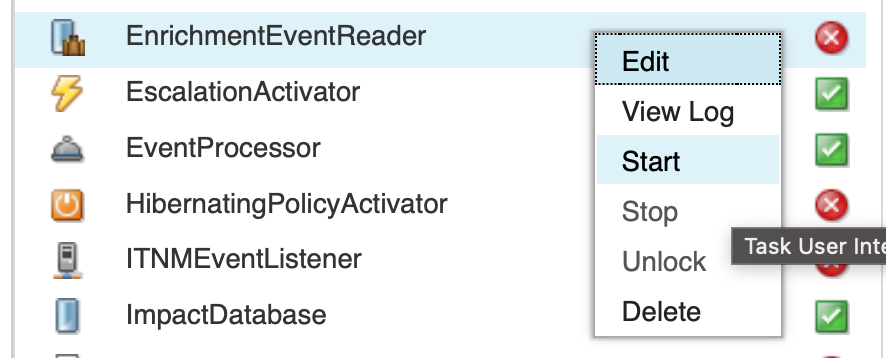

#### Validation

The exercise is successful when all of the following are true:

- The `EscalationActivator` service is saved with a 60-second activation interval and `AA_EscalatePlatinum` assigned.
- Both `EscalationActivator` and `EnrichmentEventReader` are in **Running** state.
- You can explain why the PolicyActivator has no filter or event mapping, and where the targeting logic lives instead.
- You can explain why the `EnrichmentEventReader` needed to be restarted.

#### Expected result

The escalation pipeline is now active. Every 60 seconds the `EscalationActivator` wakes up and runs `AA_EscalatePlatinum`, which queries for qualifying Platinum-tier alerts and escalates each one found.

### 6.4 Validate event escalation

#### Objective

In this exercise, you will insert test alerts for a Platinum-tier node and confirm that the escalation policy correctly raises severity for aged alerts and sets `Flash` for severity 5 alerts. You will also confirm that alerts from non-Platinum nodes are not escalated.

#### Prerequisites

- Completion of section 6.3.
- The `EscalationActivator` service is running.

#### Tasks

1. In the OMNIbus Web GUI, enable Flash notifications in your event viewer so you will see the visual effect when `Flash = 1` is set on an alert:

   - Click the **Workspace Preferences** icon in the event viewer toolbar (the slider/equaliser icon to the left of the quick filter text box).
   - Click the **Notifications** tab.
   - Check **Enable Notifications** and **Flashing**.
   - Click **Apply and Save** button at the bottom of the **Workspace Preferences** window.

   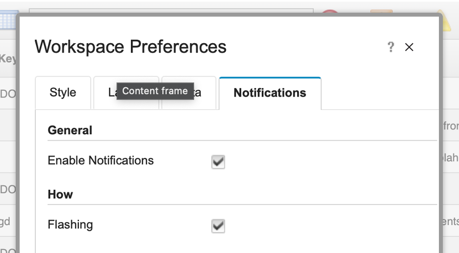

2. In the OMNIbus Web GUI, set up your event view to show the `ServiceLevel` field:

   - Navigate to the **Event Viewer** and select the **ImpactLab Events** filter.
   - Select the **SyslogdView** view.
   - Click the **Edit View** icon to open the view editor.
   - In the column list, locate the `Service` field. Add a new column for `ServiceLevel` immediately after it.
   - Set the column width to `10` characters.

   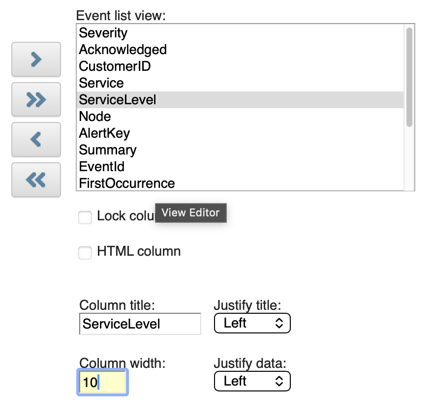

   - Save and close the view editor.

   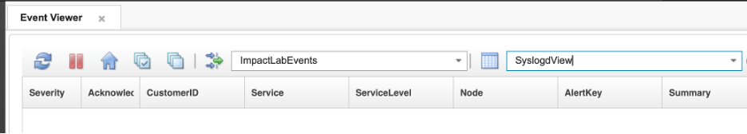

3. Insert a severity 3 test alert for `router-lon-01` — a Platinum-tier node:

   ```bash
   $OMNIHOME/bin/nco_sql -server AGG_P -user root -password netcool << 'EOF'
   INSERT INTO alerts.status (Node, Summary, AlertKey, AlertGroup, Severity, Type, Identifier, Manager, OwnerUID)
   VALUES ('router-lon-01', 'Escalation test — Platinum node', 'escalate-platinum-01', 'TrainingAlerts', 3, 1, 'router-lon-01:escalate-platinum-01:TrainingAlerts', 'ImpactLab', 65534);
   go
   EOF
   ```

4. Insert a severity 3 test alert for `switch-nyc-01` — a non-Platinum node — to confirm it is not escalated:

   ```bash
   $OMNIHOME/bin/nco_sql -server AGG_P -user root -password netcool << 'EOF'
   INSERT INTO alerts.status (Node, Summary, AlertKey, AlertGroup, Severity, Type, Identifier, Manager, OwnerUID)
   VALUES ('switch-nyc-01', 'Escalation test — non-Platinum node', 'escalate-nonplatinum-01', 'TrainingAlerts', 3, 1, 'switch-nyc-01:escalate-nonplatinum-01:TrainingAlerts', 'ImpactLab', 65534);
   go
   EOF
   ```

5. Insert a severity 3 test alert for `router-lon-02` — the second Platinum-tier node:

   ```bash
   $OMNIHOME/bin/nco_sql -server AGG_P -user root -password netcool << 'EOF'
   INSERT INTO alerts.status (Node, Summary, AlertKey, AlertGroup, Severity, Type, Identifier, Manager, OwnerUID)
   VALUES ('router-lon-02', 'Escalation test — Platinum node', 'escalate-platinum-02', 'TrainingAlerts', 3, 1, 'router-lon-02:escalate-platinum-02:TrainingAlerts', 'ImpactLab', 65534);
   go
   EOF
   ```

6. Wait 60–90 seconds for the enrichment service to process all three alerts. In the OMNIbus Web GUI, locate them in the `ImpactLab Events` filter. Confirm:
   - `router-lon-01` and `router-lon-02` both have `ServiceLevel = Platinum`.
   - `switch-nyc-01` has `ServiceLevel` populated with its own service level (or `NOT_FOUND` if not in the CMDB).

   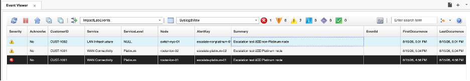

7. Wait a further 60–90 seconds for the `EscalationActivator` to fire. Once the Platinum alerts have been open for more than 60 seconds, they will match the `GetByFilter` query and their severity will be raised.

   Confirm in the event list that:
   - `router-lon-01` and `router-lon-02` severity has changed from `3` to `4`.
   - `switch-nyc-01` severity remains at `3`.


8. Wait another 60–90 seconds. Confirm both `router-lon-01` and `router-lon-02` severity raises again from `4` to `5`.

9. Wait another 60–90 seconds. Both Platinum alerts are now at severity 5. The policy will set `Flash = 1` on each. Double-click one of them and confirm `Flash` shows `1` in the event details.

   On the next cycle both alerts no longer match the `GetByFilter` filter (`NOT (Severity = 5 AND Flash = 1)` excludes them), so escalation stops.

   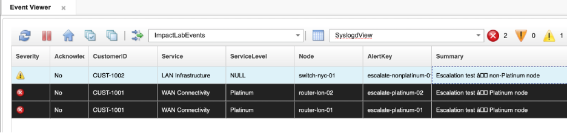

10. Check the policy log to review the escalation trail:

    ```bash
    tail -50 $IMPACT_HOME/logs/NCI_policylogger_AA_EscalatePlatinum.log
    ```

    You should see log entries for `router-lon-01` and `router-lon-02` at each cycle showing severity being raised, then the Flash entries, then silence as both alerts drop out of the filter. You should see no entries for `switch-nyc-01`.

11. Acknowledge `router-lon-01` in the event list. Confirm that on the next cycle the alert does not appear in the policy log — it no longer matches `Acknowledged = 0` in the `GetByFilter` filter.

#### Validation

The exercise is successful when all of the following are true:

- `router-lon-01` progresses from severity 3 → 4 → 5 → Flash=1 across successive polling cycles.
- `switch-nyc-01` is not escalated at any point.
- Once `Flash = 1` is set on `router-lon-01`, the alert no longer matches the `GetByFilter` filter and escalation stops.
- After acknowledgment, `router-lon-01` is excluded from the `GetByFilter` filter and no longer appears in the policy log.
- The policy log shows entries only for Platinum-tier alerts.
- You can describe the complete escalation path and explain why each step stops at the right point.

#### Expected result

You have now built a service-level-aware, scheduled escalation pipeline. The PolicyActivator fires on a fixed interval, the policy queries for qualifying Platinum-tier alerts, and each one is escalated one step per cycle until it reaches maximum escalation state or is acknowledged. Non-Platinum alerts are unaffected. This pattern extends naturally to more complex scenarios: tiered escalation across multiple service levels, on-call notifications, ticket creation, or routing alerts to different teams based on service classification.
