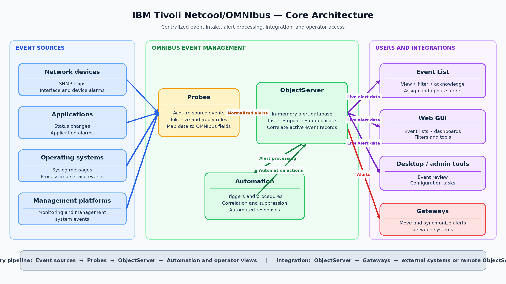

### 1.1 OMNIbus overview

IBM Tivoli Netcool/OMNIbus is an event management platform that collects event data from many different sources and consolidates it into a centralized alerting system. It is commonly used to reduce noise, normalize incoming event data, and give operations teams a single place to monitor and manage alerts.

The core of OMNIbus is the ObjectServer, an in-memory alert database that stores active event records and supports automation and operator interaction. Probes acquire events from source systems, apply rules to transform them into OMNIbus fields, and then forward them to the ObjectServer as alerts.

Gateways extend the platform by moving alerts between ObjectServers or integrating alert data with external systems such as databases, ticketing tools, and other management platforms. Operators and administrators then interact with alert data through desktop tools or the Web GUI, using filters, views, and updates to manage the event stream.

In practical terms, OMNIbus should be viewed as a pipeline: event source, probe, ObjectServer, automation, and operator view. The rest of this lab guide builds on that model by first explaining how alerts are stored and processed, and then showing how probes and gateways feed and move those alerts through the environment.

### 1.2 Core architecture and components

The OMNIbus architecture is easiest to understand as a flow of event intake, event processing, alert storage, integration, and operator access. At a high level, event sources send data to probes, probes transform that data into OMNIbus alerts, the ObjectServer stores and manages those alerts, gateways move alert data between ObjectServers or external systems, and user-facing clients connect directly to the ObjectServer to view and manage events.

**Primary pipeline:** Event sources → Probes → ObjectServer → Automation and operator views.

**Integration path:** ObjectServer → Gateways → Remote ObjectServers and external systems.

Key architecture components:

- **Event sources**: Devices, applications, management platforms, and operating systems that generate raw event data such as syslog messages, SNMP traps, process alarms, or application status changes.
- **Probes**: Collection and transformation components that receive source data, tokenize it, apply rules logic, and populate OMNIbus event fields before forwarding alerts to the ObjectServer.
- **ObjectServer**: The central in-memory alert database where events are inserted, updated, deduplicated, correlated, and made available for automation and operator action.
- **Gateways**: Components used to move alert data between ObjectServers or between OMNIbus and external systems such as ticketing tools, databases, or other management platforms.
- **Event List**: A client interface used by operators to connect directly to the ObjectServer and view, filter, acknowledge, assign, and update alerts.
- **Web GUI**: A browser-based interface that presents event lists, filters, tools, and dashboards while obtaining event data from one or more ObjectServers.
- **Operator or desktop client tools**: Administrative or operational clients that connect directly to the ObjectServer for event review, configuration tasks, and day-to-day alert handling.

### 1.3 Event lifecycle in OMNIbus

The OMNIbus event lifecycle begins when a monitored source generates an event that indicates a condition requiring action, such as a syslog message, SNMP trap, application alarm, or process status change. In most environments, that source data is received by a probe, which parses the input, extracts tokens, applies rules logic, and maps the result into OMNIbus alert fields before sending it to the ObjectServer.

When the alert reaches the ObjectServer, OMNIbus determines whether the incoming event should be inserted as a new alert or treated as another occurrence of an existing alert. This behavior is usually controlled by the Identifier field, which allows the ObjectServer to recognize duplicate events and update the existing alert instead of inserting a separate one.

If the event is new, it is inserted into the ObjectServer and becomes visible for display, automation, and operator action. If the event matches an existing alert, deduplication occurs, the existing alert is updated, and the recurrence count is maintained instead of creating additional duplicate rows.

Correlation logic can then further refine the lifecycle by linking related alerts, such as associating a recovery event with an earlier fault event. This helps reduce noise and makes the alert stream more meaningful from an operational perspective.

Scope-based correlation — for example, matching on fields such as `Node`, `AlertKey`, `AlertGroup`, or a custom `Identifier` — restricts correlation to a defined context so only alerts within the same scope are linked and processed together.

After the alert is stored in the ObjectServer database, operators interact and work with it through the OMNIbus client tools such as the event list and event viewer. Typical actions an operator may take on an event include acknowledging an event to indicate that the fault is being worked on, assigning the event to another user or group, changing the priority of the event to manage triage, adding notes through the use of the event journal, and other controlled updates, with all changes recorded as part of the alert history.

### 1.4 Key processes and terminology

OMNIbus uses a core set of terms and processes that appear throughout administration, event handling, probe development, and operator workflows. Understanding these concepts early makes it easier to follow how alerts are collected, processed, stored, and managed throughout the rest of the lab guide.

Key terms:

- **Event**: A record of something that happened in the monitored environment, such as a fault, status change, threshold violation, or system message.
- **Alert**: The OMNIbus representation of an event after it has been processed and stored for operational use in the ObjectServer.
- **ObjectServer**: The central in-memory alert database where alerts are stored, updated, deduplicated, correlated, and made available to clients and automation.
- **Probe**: A collection component that receives event data from an external source, parses it, applies rules, and forwards the resulting alert to the ObjectServer.
- **Gateway**: A component that transfers alert data between ObjectServers or between OMNIbus and external systems.
- **Rules file**: Probe logic that controls parsing, token handling, field population, event enrichment, deduplication keys, and correlation-related values.
- **Trigger**: ObjectServer-side logic that runs automatically in response to database activity or scheduled conditions and can be used for automation, enforcement, and auditing.
- **Property**: A configurable setting that controls the behavior of OMNIbus components.
- **Journal**: A record associated with an alert that captures operator or automated updates over time.
- **Details**: Supplemental information associated with an event that provides additional context beyond the primary alert fields.

Key processes:

- **Event ingestion**: The process of receiving data from a source and bringing it into OMNIbus through a probe.
- **Normalization**: The mapping of source-specific event data into standard OMNIbus fields so events from different sources can be handled consistently.
- **Deduplication**: The process of recognizing repeated occurrences of the same event and updating an existing alert rather than inserting a new one.
- **Correlation**: The process of linking related events so OMNIbus can present a more meaningful operational picture.
- **Acknowledgement**: An operator action indicating that an alert has been seen and is being handled.
- **Audit**: The recording of administrative or configuration changes so those changes can be reviewed later.

### 1.5 Lab environment and assumptions

This lab environment is based on pre-built virtual machines that provide the software components needed for the OMNIbus exercises. Each student will work against an assigned lab server and will use that server for most command-line administration, process control, and validation tasks.

The lab virtual machines include the following pre-installed components:

- OMNIbus core.
- Web GUI, Jazz for Service Management, and WebSphere Application Server.
- MTTrapd probe.
- Syslogd probe.
- IBM Tivoli Network Manager and Netcool/Impact for additional labs outside the OMNIbus core sections.

Each student is expected to connect to their own assigned lab server by using SSH with the IP address, username, and password provided for the lab. Students should be comfortable logging in remotely, navigating the server filesystem, editing text files, starting and stopping processes, and validating results from the command line.

In addition to the server-side lab environment, each student should have OMNIbus core installed locally on their Windows workstation. This local installation is required so the student can use administrative and support tools such as `OMNIbus Administrator` and `MIB Manager`. `OMNIbus Administrator` is a Windows graphical administration tool used to manage ObjectServer users, groups, triggers, automation, databases, and properties. On the Unix/Linux platform it is known as **nco_config** and runs as an X-Windows application.

The local Windows installation is used primarily for tooling access rather than for hosting the main lab environment. The primary ObjectServer, probes, and web components used in these exercises run on the assigned lab virtual machine, while the local workstation provides convenient access to graphical administration tools and MIB-related utilities.

