### 2.1 Environment access and tool validation

#### Objective

In this exercise, you will verify your access to the assigned lab environment and confirm that the primary Netcool/OMNIbus components and client tools are functioning correctly. By the end of this exercise, you will be able to:

- Connect to the lab server using SSH
- Start the ObjectServer and JazzSM Web GUI services
- Configure the Netcool Servers Editor on your Windows workstation
- Connect to the ObjectServer using the Windows native event list client
- Connect to the ObjectServer using the Netcool/OMNIbus Administrator tool
- Access and navigate the browser-based Web GUI

#### Prerequisites

- Assigned lab server IP address.
- SSH credentials.
- OMNIbus core installed on the local Windows workstation.
- Access to a web browser on the workstation.
- Access to Netcool/OMNIbus Administrator and the OMNIbus desktop event list on the workstation.

#### Background

The Windows client tools — including the native Windows Event List and Netcool/OMNIbus Administrator — connect to the ObjectServer over the network using a configured server entry. Before these tools can connect, the student must add an entry to the OMNIbus Servers Editor on the Windows workstation that tells the client tools where the ObjectServer is and how to reach it.

The Servers Editor is a small Windows utility included with the OMNIbus core installation. It maintains a list of known ObjectServers and their connection details. Each entry in the list requires the following information:

- **Server name** — the logical name of the ObjectServer, which in this lab is `AGG_P`.
- **Hostname or IP address** — the hostname or IP address of the lab server where the ObjectServer is running. Either format is accepted.
- **Port** — the port on which the ObjectServer listener is running. The default listener port is `4100`, however it is not unusual to have multiple ObjectServers in an environment running on different ports.

Once the entry is saved, all OMNIbus client tools on the workstation will be able to connect to `AGG_P` by name, without needing to specify the hostname or port each time.

#### Tasks

1. Connect to the assigned lab server by using SSH as the `root` user. It is typical to install Netcool/OMNIbus software as a non-root administrative user such as `ncoadmin`, but for convenience this lab environment is installed as root and the exercises are performed as the root user.
2. Before starting the ObjectServer, set the required OMNIbus environment variables on the lab server. These are standard Netcool environment variables used by OMNIbus commands:
   ```bash
   export NCHOME=/opt/IBM/tivoli/netcool
   export OMNIHOME=$NCHOME/omnibus
   ```
3. To persist these values across new shell logins (bash), add the same lines to your `~/.bash_profile` or `~/.bashrc`:
   ```bash
   echo 'export NCHOME=/opt/IBM/tivoli/netcool' >> ~/.bash_profile
   echo 'export OMNIHOME=$NCHOME/omnibus' >> ~/.bash_profile
   source ~/.bash_profile
   ```
4. Add `$OMNIHOME/bin` to your PATH for convenience. This eliminates the need to type the full path for OMNIbus commands throughout the lab:
   ```bash
   export PATH=$OMNIHOME/bin:$PATH
   ```
   To persist this change across new shell logins, add the same line to your `~/.bash_profile` or `~/.bashrc`:
   ```bash
   echo 'export PATH=$OMNIHOME/bin:$PATH' >> ~/.bash_profile
   source ~/.bash_profile
   ```
5. Stop the nco systemd service so that we can run the ObjectServer independently for this lab:
   ```bash
   systemctl stop nco
   ```
   Now start the Netcool Process Agent daemon (nco_pad), which is a service that manages and monitors OMNIbus processes. The Netcool Process Agent is a lightweight process supervisor that starts, monitors, and automatically restarts OMNIbus components (such as the ObjectServer and probes) if they crash or terminate unexpectedly. It provides a convenient way to manage multiple processes as a group and logs process status information for troubleshooting.
   ```bash
   nco_pad -authenticate NONE
   ```
   Verify that the MasterObjectServer process is running by executing the following command:
   ```bash
   nco_pa_status
   ```
   When prompted for a password, press Enter. The expected output should display the MasterObjectServer process status:
    ```text
   [root@ibm-training-server1 ~]# nco_pa_status
   Login Password: 
   ----------------------------------------------------------------------------------------------------------------
   Service Name         Process Name         Hostname                           User        Status           PID
   ----------------------------------------------------------------------------------------------------------------
   Core                 MasterObjectServer   ibm-training-server1.dcimusic.com  root        RUNNING       432517
   ----------------------------------------------------------------------------------------------------------------
   [root@ibm-training-server1 ~]# 
   ```
   Confirm that the MasterObjectServer status shows **RUNNING**.
6. Run the following command to verify that the ObjectServer named AGG_P is available:

   ```bash
   nco_ping AGG_P
   ```

   The nco_ping utility contacts the specified Netcool/OMNIbus server and checks whether it can accept connections. In this example, AGG_P is the ObjectServer name defined in the OMNIbus interfaces configuration. A successful response confirms not only that the ObjectServer process is running, but also that the client can locate and communicate with it using its configured host and port.

   Confirm that the output includes: `NCO_PING: Server available.`

7. Ensure that the JazzSM application server is running, which hosts the Web GUI and provides the browser-based OMNIbus user interface. First, verify that the JazzSM server is running by checking its status:
   ```bash
   /opt/IBM/JazzSM/profile/bin/serverStatus.sh server1 -username smadmin -password netcool123
   ```
   If the server is already running, the status command will output:
    ```text
   ADMU0508I: The Application Server "server1" is STARTED
   ```
   If this message does not appear or the server is not running, start it with the following command:
   ```bash
   /opt/IBM/JazzSM/profile/bin/startServer.sh server1
   ```
   Wait for startup to complete and confirm that the output includes all of the following lines:

   ```text
   ADMU0116I: Tool information is being logged in file
              /opt/IBM/JazzSM/profile/logs/server1/startServer.log
   ADMU0128I: Starting tool with the JazzSMProfile profile
   ADMU3100I: Reading configuration for server: server1
   ADMU3200I: Server launched. Waiting for initialization status.
   ADMU3000I: Server server1 open for e-business; process id is 1047344
   ```
   
8. On your Windows client workstation, open the OMNIbus Servers Editor tool:

   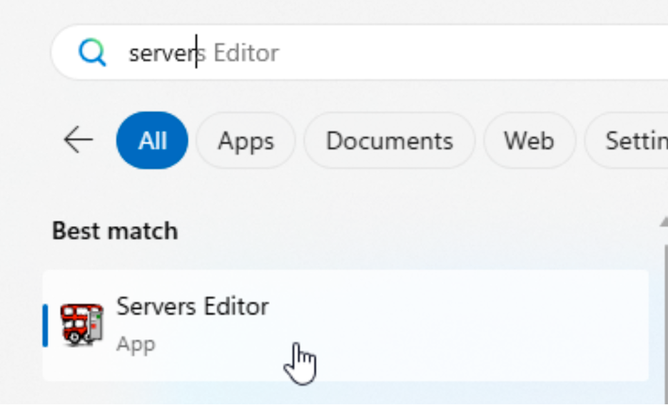

   Locate the existing `NCOMS` server entry and edit both the server and listener settings:
   - **Server name**: `AGG_P`
   - **Hostname or IP address**: the hostname or IP address of your assigned lab server as provided by the instructor
   - **Port**: `4100`

   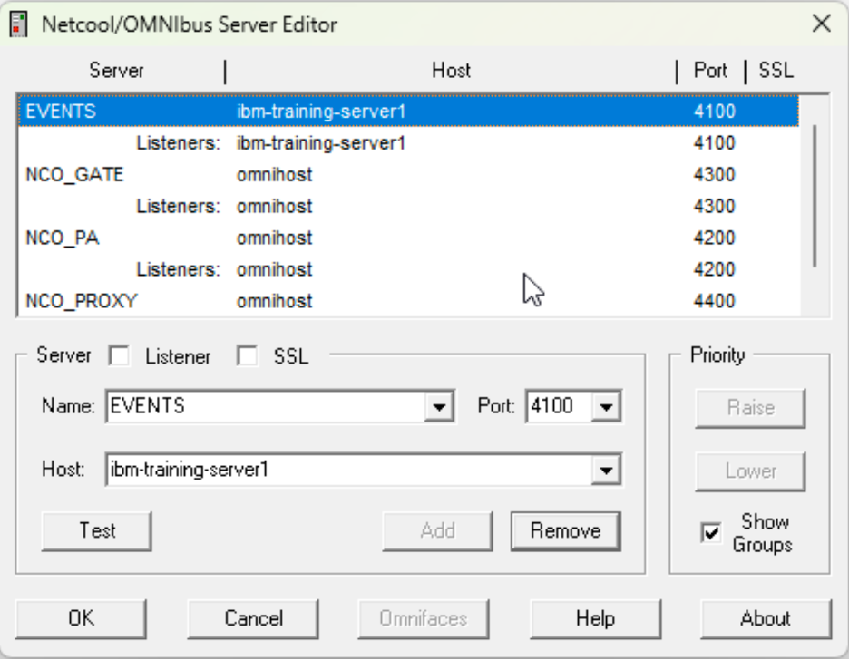

   The server entry defines the ObjectServer logical name and connection details, while the listener setting controls which network port the OMNIbus connection is actually established on. Before saving, validate the connection by selecting the `AGG_P` entry and clicking the **Test** button to verify that the ObjectServer is reachable.

   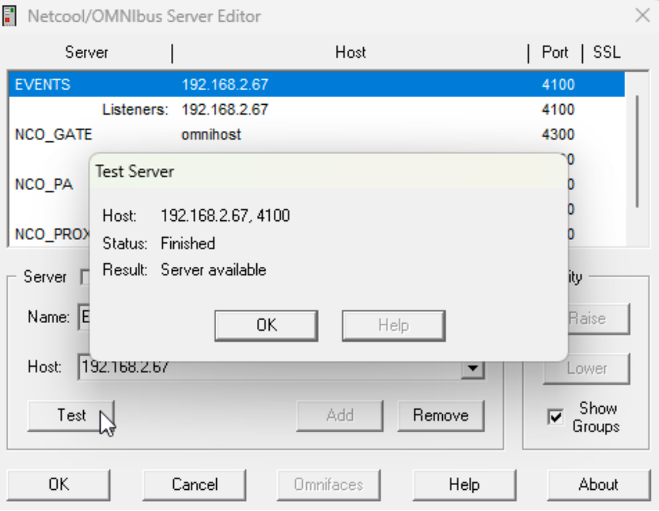

   Confirm that the test result returns **"Server available"**, indicating that the client can successfully connect to the ObjectServer. Once validated, save the updated entry by clicking **OK** to save the updates and exit the Servers Editor tool. All OMNIbus client tools can now connect to `AGG_P` by name.

   Change the remaining entries in the Server Editor from ``omnihost`` to the hostname of your lab server before continuing:

    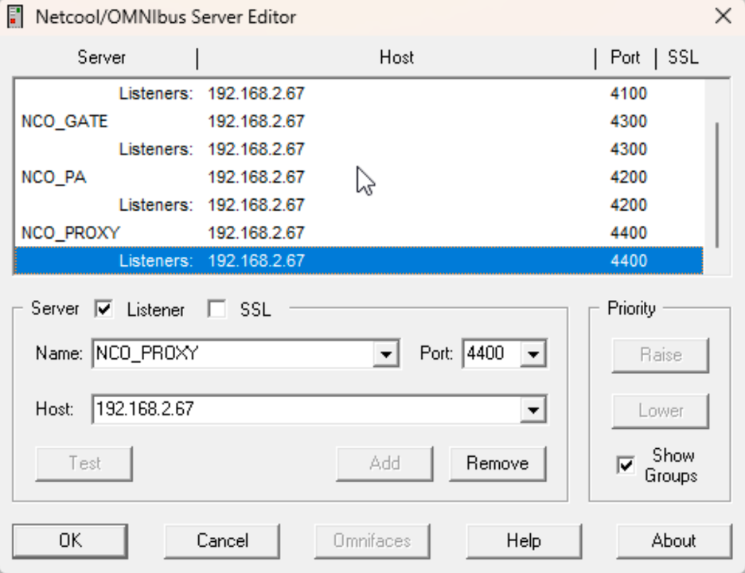


9. Locate and launch the Windows event list client:

   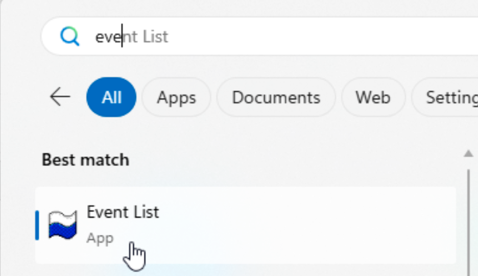

   - Ensure that `AGG_P` is selected as the server and log in with the following credentials:
     - **User**: `root`
     - **Password**: `netcool`

     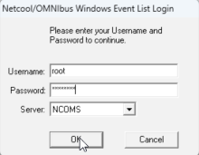

   - Confirm that the event list opens successfully and connects to the lab ObjectServer:

     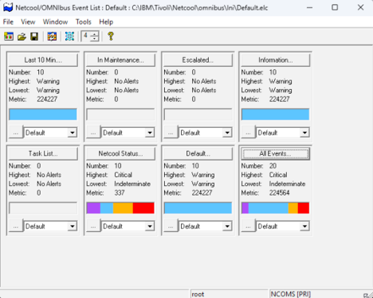

10. Launch Netcool/OMNIbus Administrator tool:

      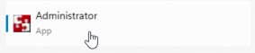

   - If you are asked to import the connection details (the `sql.ini` file that is saved from the Servers Editor in the previous step). Click **Yes** to load our updates.

     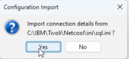

   - Since we want to import all as a first run, select **Finish** here.

     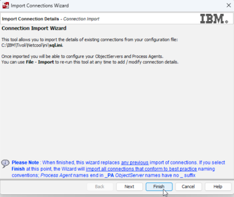

   - You will see two windows, one for Process Agents and the other for Object Servers. For now, find your `AGG_P` object server and double-click the entry or right-click and select **Connect As...**

     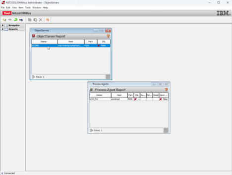

   - Enter the administrator credentials `root` and `netcool`. Note that this user is distinct from the operating system `root` user; it is the Netcool administrator user.

     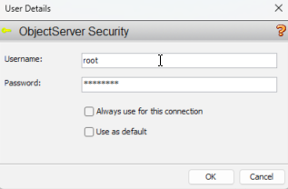

   - You will be presented with the following screen on successful login, with menu drawers on the left you can open to configure various aspects of the solution.

     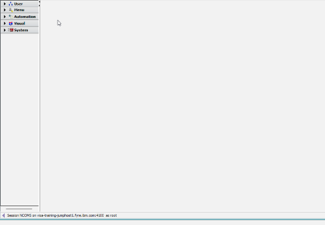

11. Now that we have validated local tool access, we will verify Web GUI access from a browser:

- Open a browser and navigate to the following URL:
   `https://<your-server>:16311/ibm/console`
   If presented with a certificate warning, click **Advanced** and then **Continue to (url above)** to proceed.

   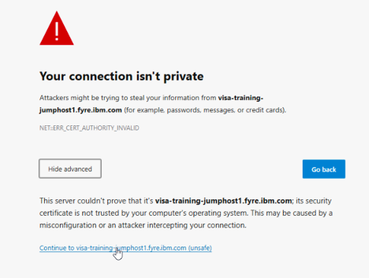

- Log in to the Web GUI using the administrative account for this lab:
   - **User**: `ncoadmin`
   - **Password**: `netcool`

   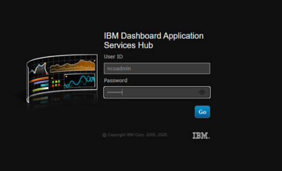

   Note: `ncoadmin` is the default administrative user for the Web GUI (this is an application account, not an operating-system account).

- After a successful login you will arrive at the "About Netcool/OMNIbus Web GUI" page and see the left-hand menu icons:

   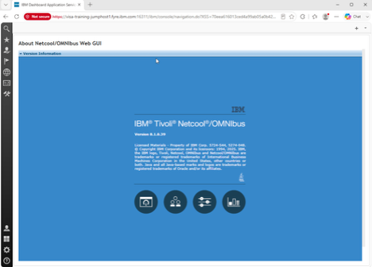

#### Validation

The exercise is successful when all of the following are true:

- SSH login to the assigned lab server succeeds.
- `nco_ping AGG_P` returns `NCO_PING: Server available.` after starting the ObjectServer.
- The JazzSM application server reports `ADMJ3000I: Server server1 open for e-business`.
- The Windows event list opens and connects to `AGG_P`.
- `Netcool/OMNIbus Administrator` connects successfully to `AGG_P`.
- The browser-based Web GUI opens to the landing page for IBM Tivoli Netcool OMNIbus.

#### Expected result

By completing this exercise, you have successfully established a fully functional Netcool/OMNIbus lab environment. You now have:

- **Server-side services** running and operational: the ObjectServer (AGG_P) is actively processing events and the JazzSM application server is hosting the Web GUI.
- **Verified connectivity** from multiple client interfaces: SSH terminal access to the lab server, the Windows native event list client, the Netcool/OMNIbus Administrator tool, and the browser-based Web GUI all successfully connect to your ObjectServer.
- **Confirmed network connectivity** between your workstation and lab server by testing the server connection in the Servers Editor tool.
- **A foundation for advanced exercises**: this baseline environment is now ready for the rest of Chapter 2, where you will explore event handling, the ObjectServer database, event deduplication, and automation rules.

### 2.2 Basic event interaction

#### Objective

In the following labtaskss, you will use the OMNIbus event list to locate and examine events, interpret their severity and key fields, and perform basic event-management actions. The goal is to become familiar with how an operator moves from seeing an alert to understanding the reported condition and recording or taking the appropriate response. By the end of this exercise, you will be able to:

- Inspect and examine detailed event information
- Modify event severity levels to reprioritize alerts
- Acknowledge alerts to indicate ownership and status
- Apply filters to focus on specific subsets of events
- Switch between different event view layouts
- Observe real-time event generation and deduplication behavior as events arrive from the Simnet probe

#### Prerequisites

- Completion of section 2.1.
- The ObjectServer is running.
- The Web GUI application server is running.
- The student can log in to the Web GUI and open an event list.

#### Background

IBM Netcool/OMNIbus collects event information from monitored infrastructure and presents it in the event list for operator review and action. An event represents a condition detected by a monitoring source, such as a device fault, an application problem, a threshold breach, or a change in service status.

Each event includes fields that help an operator understand what happened, where it occurred, when it was detected, and how urgently it should be addressed. Common fields include the event summary, source, node, event type, timestamp, and severity. Operators use this information to assess the impact of the condition, identify related events, and determine the appropriate response.

OMNIbus uses a numeric severity scale to indicate the operational priority of an alert. The severity values used throughout the event list and in probe rules are as follows:

- **0 — Clear**: The condition has been resolved.
- **1 — Indeterminate**: The severity is unknown or has not yet been assessed.
- **2 — Warning**: A condition exists that may require attention.
- **3 — Minor**: A minor fault or degradation has occurred.
- **4 — Major**: A significant fault has occurred that is likely to affect service.
- **5 — Critical**: A severe fault has occurred that is affecting or will affect service immediately.

Severity helps operators prioritize their work. Critical and major events normally require prompt investigation because they may indicate a service-impacting condition. Warning and minor events may require review, trend analysis, or follow-up, while indeterminate events often require additional assessment before their impact can be determined. Clear events indicate that the monitored condition is no longer active.

In the event list, severity levels are typically shown using distinct colors, allowing high-priority events to be identified quickly. Severity can also be used in filters, views, automations, and probe rules to determine how events are displayed, routed, escalated, or processed.

#### Tasks

1. Return to the Web GUI login. If you are not already logged in as the administrative Web GUI user, open a browser and navigate to:
   `https://<your-server>:16311/ibm/console`

   Log in with the following credentials for this lab:
   - **User**: `ncoadmin`
   - **Password**: `netcool`
2. Locate the flag menu icon in the upper-left corner of the Web GUI and select it. In the menu that appears, choose **Event Viewer** to open the event list.

   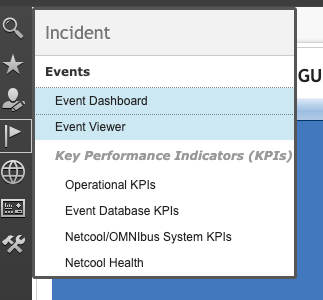

3. Observe the rows currently displayed in the event list. Note that each row in the event list represents an event stored in the ObjectServer, and that the displayed columns correspond to event fields.

   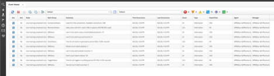


4. Right-click a single event and in the popup menu choose **Prioritize -> Critical**. Confirm that the severity value and row color change in the event list.

   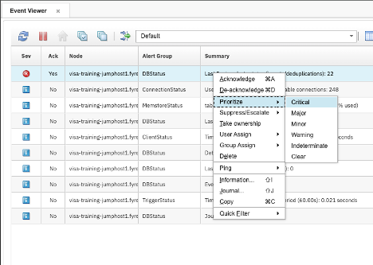

5. The event list typically shows a subset of all available event fields. To see every field and its current value, either right-click the event and select **Information...** from the popup tools, or double-click the event to open the full event details. 

   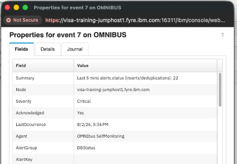

   Note: You can create views that include or exclude any of these fields in your event list layout, and switch between different saved event layouts as needed. We will work with views and layouts in an upcoming section.

6. If the event details or Information window is still open, close it. Then right-click the same event and select **Acknowledge** from the popup menu. After acknowledging, double-click the event to re-open the details and confirm the **Acknowledged** field shows the acknowledging user and timestamp.

   **Acknowledged** indicates that an operator has seen the alert and is taking ownership or actively working on it; acknowledgement records the operator and time but does not clear the event.

7. In the same event properties/details window, select the **Journal** tab. Note the journal entry indicating that user `ncoadmin` acknowledged the alert at the shown time (automation tools sometimes add journal entries automatically). You can also add freeform notes: type text into the **New Journal entry** field, click **Apply**, and confirm a new journal row appears showing the user, timestamp, and entry text.

   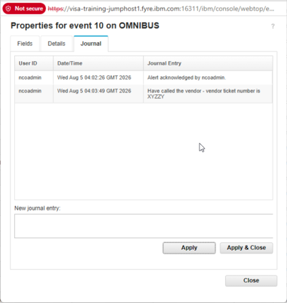

   The event journal provides a shared, time-stamped record of investigation notes, actions taken, and resolution details for an event. It helps operators coordinate work across shifts and teams, avoid duplicated troubleshooting, and maintain an auditable history that can be used for incident review and follow-up.

8. If the event details or Information window is still open, close it now. Then locate the filter selector dropdown at the top of the event list (near the icon with the three arrows) and choose the **Escalated** filter. If no events have been escalated yet, the event list will be empty.

   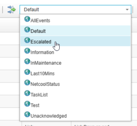

   An **event filter** is a saved condition that limits which alerts are shown in the event list (it behaves like a SQL WHERE clause against `alerts.status`). Filters are useful because they let you instantly switch between different sets of events, for example by event type, by time window, by customer or service, or by escalation or acknowledgement state. This is especially helpful in a busy operations environment where you may need to focus on only critical incident alerts, only recent events, or only alerts for a specific customer or business service. You will be working with this in a upcoming tasks.

9. Return to the **Default** filter. Right-click an event, select **Suppress/Escalate**, and choose **Escalated** from the submenu. Escalation levels can be used in several ways:
   - Manually by an operator to raise an alert’s visibility and route it to a higher-level support queue or incident management workflow.
   - Automatically by rules or automation when an alert meets an operational condition, for example if a high-severity alert has not been acknowledged within 10 minutes.
   - To trigger secondary actions such as notifications, paging, or promotion to a management dashboard for elevated handling.

   This makes escalation levels useful for both immediate operator attention and timed visibility workflows.

   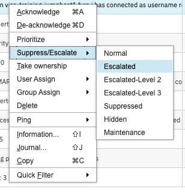

   Once an event is escalated, the selected escalation level becomes part of the event state and can be used by filters, views, and dashboards to identify alerts requiring elevated handling. In OMNIbus, escalation levels can distinguish events that have entered different stages of attention, enabling operators to focus on conditions that have exceeded normal response thresholds or require additional coordination. Depending on the organization’s configuration, automations can detect escalated events and perform follow-up workflow tasks such as notifying an on-call team, creating or updating an incident ticket, assigning the event to an appropriate support group, adding a journal entry, increasing its priority, or forwarding relevant event details to another management system. This helps ensure that important unresolved conditions receive timely visibility and are handled according to established operational procedures.

10. Return to the **Escalated** filter and confirm that the selected event now appears in the filtered event list.

11. Locate the views dropdown box. It is located to the right of the icon that looks like a spreadsheet. Select the **Self-Monitoring** view and observe how the displayed event columns change when the view changes.

    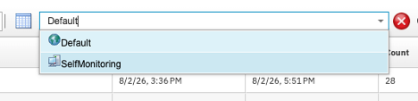

      A **view** controls how event information is presented in the event list. It determines which event fields appear as columns, the order in which those columns are displayed, their width, and whether field values are left-, center-, or right-justified. Views can also define how events are sorted—for example, by severity to place the most urgent alerts first, or by last occurrence time to show the most recently updated events. In addition, views can group related events by a common field such as location, customer, service, node, or alert group, making patterns and areas of impact easier to identify.

      Different views are useful when operators need to focus on different types of information. For example:

    - A troubleshooting view may show `Summary`, `Node`, `AlertKey`, `Severity`, `FirstOccurrence`, `LastOccurrence`, and `Count` so an operator can quickly understand the issue, when it appeared, and how often it has recurred.
    - A service-level view may show `CustomerID`, `Service`, `AlertGroup`, and `LastOccurrence` so a manager can track impact by business service or customer.
    - A network view may show `Node`, `AlertGroup`, `AlertKey`, `Summary`, `CircuitID`, and related fields that are useful when troubleshooting connectivity or infrastructure issues.

    Changing a view does not change which alerts are returned by the active filter. The filter determines the set of events shown in the event list, while the view determines how the fields from those events are displayed, sorted, grouped, and organized for the operator.

12. Next, we will generate some simulated events to see what more realistic externally generated alerts might look like. The Simnet probe is included in a base install of OMNIbus and is used to generate synthetic alert traffic for testing and demonstration purposes. SSH into the lab server if you are not already connected, then start the Simnet probe with the following command:

    ```bash
    $OMNIHOME/probes/nco_p_simnet -server AGG_P &
    ```

    Verify that the Simnet probe continues to run by executing the following command:

    ```bash
    ps -ef | grep simnet
    ```

    The expected output should show the Simnet probe process running and connected to the AGG_P server:

    ```text
    root      434536  432237  1 10:23 pts/1    00:00:00 /opt/IBM/tivoli/netcool/omnibus/platform/linux2x86/probes64/nco_p_simnet -server AGG_P
    ```

    Confirm that the process is actively running before proceeding to the next step.

13. Return to the Web GUI event list and observe new simulated events flowing in. Note the differences in **Severity**, **Summary**, and **Node** values as the simulated events arrive.

    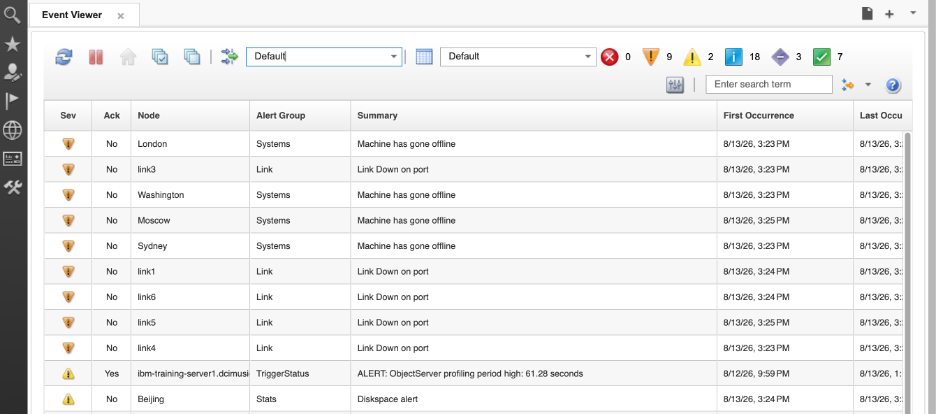

    Pay particular attention to the FirstOccurrence, LastOccurrence, and Count fields. These fields demonstrate OMNIbus deduplication behavior, which prevents repeated reports of the same condition from creating a separate event-list row each time they are received. Instead, when an incoming alert matches an existing event according to the configured deduplication criteria, OMNIbus updates the existing event record. The FirstOccurrence field retains the time that the event was initially received, while LastOccurrence is updated to show the most recent matching occurrence. The Count field increases with each repetition, showing how often the condition has been reported. This gives operators one consolidated event to manage while still showing both the duration and recurrence of the underlying condition. The standard deduplication trigger, for example, updates LastOccurrence and increments the event tally when a matching event is reinserted.

14. Columns are sortable by clicking on the sort icon in the column heading. Sort the event list by **LastOccurrence**, and note how newly arriving Simnet events move within the list as fresh activity is received.

    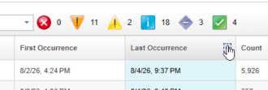

15. Use the quick-severity colored icons at the top of the event list to filter by severity level, then switch the event list back to the **Default** view before ending the exercise so the next lab begins from a known state.

#### Validation

The exercise is successful when all of the following are true:

- You are able to log in to the Web GUI and open the event list.
- A selected event can be changed to **Critical** by using the event tools.
- A selected event can be acknowledged in the Web GUI event list.
- The event details display shows the updated values.
- A journal entry can be added to an alert and displays the user, timestamp, and entry text.
- The **Escalated** filter is empty before escalation and shows the selected event after escalation.
- The **Self-Monitoring** view changes the displayed event columns.
- Starting `nco_p_simnet` causes new events to appear in the Web GUI event list.
- The student can identify **FirstOccurrence**, **LastOccurrence**, and **Count** as indicators of repeated occurrences of the same event.

#### Expected result

By completing this exercise, you now understand how to effectively work with events in the Netcool/OMNIbus Web GUI. You have gained hands-on experience with:

- **Event inspection and modification**: viewing detailed event properties and updating event severity to prioritize alerts based on operational impact
- **Event management**: acknowledging alerts to mark ownership and adding journal entries to track investigation progress and actions
- **Event filtering and views**: using saved filters to focus on specific subsets of events and switching between different view layouts to highlight relevant information for different operational contexts
- **Event deduplication**: observing how the FirstOccurrence, LastOccurrence, and Count fields track event recurrence and consolidation, preventing alert fatigue from repeated occurrences of the same condition
- **Real-time event monitoring**: watching synthetic events arrive in real-time from the Simnet probe and understanding how new events integrate into the existing event list

You now have the practical foundation needed to manage alert traffic in a real Netcool/OMNIbus environment and are ready to explore the ObjectServer database architecture and event automation rules in the subsequent exercises.

