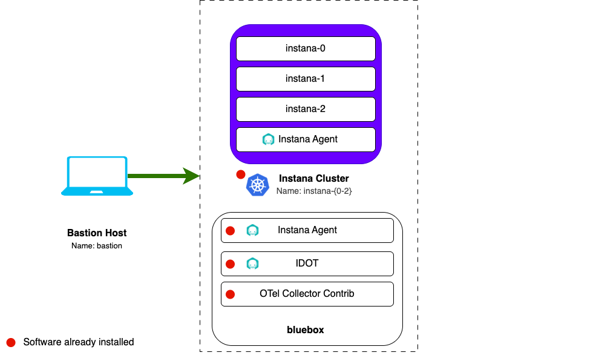

import LicenseInfo from "@site/src/components/Instana/LicenseInfo"
import RequestingLabEnvironment from "@site/src/components/requestingLabEnvironment/RequestingLabEnvironment"
import CreateIbmId from "@site/src/components/createIbmId/CreateIbmId"
import WorkshopAdhocPlaybook from "@site/src/components/workshop/AdhocPlaybook"

# Lab environment

The lab environment has six independant sandboxed VMs.

| VM | Purpose |
| --- | --- |
| `bastion-gym-lan` | Primary workstation. Use the browser for the Instana UI and the terminal for SSH access to other VMs. |
| `instana-0`  `instana-1`  `instana-2` | Self hosted Instana (Standard Edition on K3s) |
| `bluebox` | RHEL VM. Includes:   - Instana agent   - otelcol-contrib   - IDOT    |

## Prerequisites

<CreateIbmId />

<LicenseInfo />

## Requesting a lab environment

<RequestingLabEnvironment
   environmentName="Jam-in-a-Box: Instana - OpenTelemetry Foundations"
   environmentUrl="https://techzone.ibm.com/my/reservations/create/6acc3cf4c0000614cea553c1"
/>