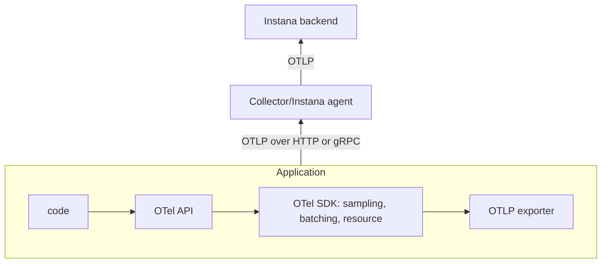
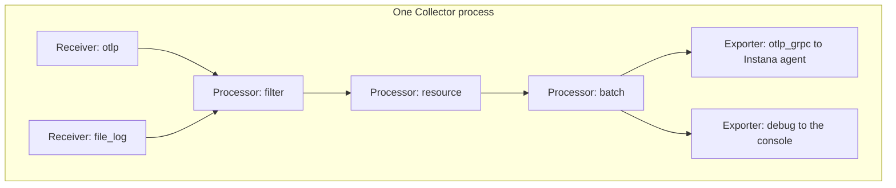
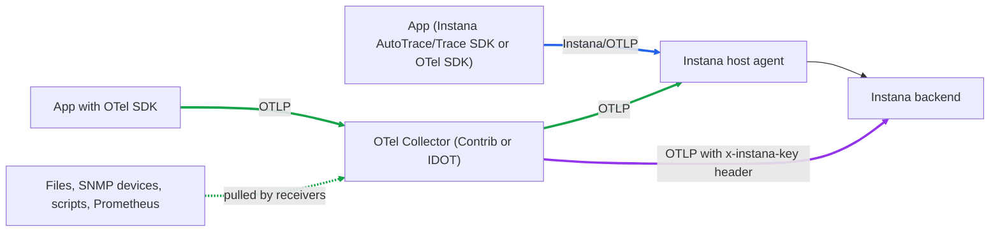

# OpenTelemetry Vocabulary

In this lesson you will get up to speed with OpenTelemetry (OTel) vocabulary so the following lessons make sense. You won't make any changes to the environment in this lesson so if you are already comfortable with OTel vocabulary you can move to the next lesson.

## Why OpenTelemetry

OTel aims to address the issue of every monitoring product shipping its own agents, formats and libraries. It is an open source [CNCF](https://www.cncf.io/projects/opentelemetry/) that standardised telemetry so you can instrument once and send your telemetry to any backend that supports OpenTelemetry.


:::info Instana OpenTelemetry documentation

OpenTelemetry does not analyse, report, store or alert on data, these tasks are left to the backend system like Instana. [Read the Instana OpenTelemetry docs here](https://www.ibm.com/docs/en/instana-observability/standard/latest?topic=opentelemetry)

:::

## The three signals

**Telemetry** is behavioral data a system produces about itself. [**Signals**](https://opentelemetry.io/docs/concepts/signals/) are the different categories of telemetry. The signals we will be working with in Instana are::

| Signal | What it is | Example | Question it answers |
| --- | --- | --- | --- |
| **Traces** | Spans that make up a single request or workflow | A checkout that calls a payment service | Where did the request spend time or fail? |
| **Metrics** | Measurements over time | Requests per second or CPU load | How often is something happening. Trends. |
| **Logs** | Timestamped events | An event that says "UserId ABC declined req 123" | What happened and why |

:::tip Telemetry vs Signal

- A `CPU utilisation` measurement is telemetry and it belongs to the `metrics` signal.
- A `request` trace is telemetry and it belongs to the `traces` signal.

Combined signals can give a complete picture. For example:
- A metric can tell you something has changed
- A trace shows you an example of the change
- A log can record the reason

The three signals can share an id so Instana can link them which we will see in a later lesson.

:::


:::info Instana documentation

- You can read more about [Signals in the OpenTelemetry Instana documentation](https://www.ibm.com/docs/en/instana-observability/standard/latest?topic=opentelemetry-signals)

:::

OTel and Instana have minor naming naming differences for the similar concepts. The table below shows the OTel term and how that appears in Instana:

| OpenTelemetry signal | Maps to Instana |
| --- | --- |
| **Traces** | An OTel trace is also a [**trace**](https://www.ibm.com/docs/en/iofgs?topic=applications-analyzing-traces-calls#trace-view) in Instana. A span is called a [**call**](https://www.ibm.com/docs/en/instana-observability/standard/1.0.327?topic=applications-analyzing-traces-calls#calls__title__1) which are associated with [services](https://www.ibm.com/docs/en/instana-observability/standard/latest?topic=applications-services). <br /> Traces can be explored in: <br /> - [Analytics](https://www.ibm.com/docs/en/instana-observability/standard/latest?topic=applications-analyzing-traces-calls) <br /> - [Application Perspectives](https://www.ibm.com/docs/en/instana-observability/standard/latest?topic=applications-creating-using-application-perspectives) |
| **Metrics** | OTel metrics get attached to [entities](https://www.ibm.com/docs/en/instana-observability/standard/1.0.327?topic=opentelemetry-infrastructure-entities) as [**Custom metrics**](https://www.ibm.com/docs/en/SSO4JPD/src/pages/ecosystem/opentelemetry/metrics.html). <br /> They can be explored and used in: <br /> - [Analyze Infrastructure](https://www.ibm.com/docs/en/SSO4JPD/src/pages/analyze_infrastructure/index.html) <br /> - [custom dashboards](https://www.ibm.com/docs/en/SSO4JPD/src/pages/custom_dashboards/index.html). |
| **Logs** | An OTel log is a [**log**](https://www.ibm.com/docs/en/instana-observability/standard/1.0.327?topic=instana-logging) in Instana. They can be viewed in [Log Analytics](https://www.ibm.com/docs/en/instana-observability/standard/1.0.327?topic=logging-analyzing-logs). |

## Telemetry Flow

The flow of telemetry looks something like this:



| OpenTelemetry Component | What it does | Who uses it |
| --- | --- | --- |
| **OTel API** | The API that records telemetry. Examples; "start a span" or "add 1 to counter". | Developers |
| **OTel SDK** | The APIs runtime, effectively applies configuration, processes input, potentially batches data and outputs to exporters. | Developers/Ops teams (env vars / auto instrumentation) |
| **OTel Instrumentation** | Code that uses the API/SDK. It could be auto instrumentation (no code), a library or implemented manually with your own business logic. | Everyone |
| **OpenTelemetry Protocol (OTLP)** | OTLP is the OpenTelemetry Protocol which carries all signals over HTTP or gRPC. Anything that sends OTLP can send to anything that accepts it. | Anything that sends or receives OTel data |
| **OTel Exporter** | Sends telemetry from the process to another system like an OTel Collector or observability backend like Instana. | Developers/Ops teams |
| **OTel Collector** | A process that receives telemetry. The process optionally processes and transports data using one or more exporters. Collectors can also be used to pull data from things that don't support OTLP, like SNMP devices and log files. | Ops teams |

## Resources and conventions

All telemetry is associated with a [**resource**](https://opentelemetry.io/docs/specs/semconv/resource/) which contain attributes that describe the resource creating the data. Some examples:

| Resource attribute | Example | How it is used by Instana |
| --- | --- | --- |
| `service.name` | `checkout` | **Service** in Instana |
| `service.instance.id` | ID per process | Differentiates between two copies of the same service |
| `host.name`, `host.id` | `bluebox` | Links telemetry to the host |
| `k8s.pod.uid`, `container.id`, `process.pid` | | Links telemetry in Kubernetes containers and entities that Instana already knows. |

:::tip Attribute Names

The attribute names come form the [OpenTelemetry semantic conventions](https://opentelemetry.io/docs/specs/semconv/). When these standard names are used backends like Instana can understand the data without custom mapping.

More information on the [Instana service mappings can be found here](https://www.ibm.com/docs/en/instana-observability/standard/latest?topic=opentelemetry-related-service-mappings-infrastructure-correlation)

:::

## The Collector pipeline model

Later in this lab we will read and write the Collector configuration. To do that effectively we need a good mental model of how the collector process flows:



| Component type | Purpose | Examples you will use |
| --- | --- | --- |
| **Receivers** | Data going into the Collector. Example; listening for OTLP or pulling things like files, SNMP or shell command output | `otlp`, `file_log`, `snmp`, `shell`, `host_metrics` |
| **Processors** | Change data as it moves through. Example; add/remove attributes, filter, redact, batch | `resource`, `transform`, `filter`, `batch` |
| **Exporters** | Data leaving the collector after being processed | `otlp_grpc`, `otlp_http`, `debug` |
| **Extensions** | Introduce capabilities to the pipeline that are not part of the data flow. Example; an HTTP endpoint for a health check so an external system can check on the collectors health. | `health_check` |
| **Connectors** | Join two pipelines. Example; a `span_metrics` connector that takes traces from one pipeline, extracts metrics (error count/latency/requests per second) and feeds them back into a metrics pipeline for export | `span_metrics` (Contrib only) |


The OTel configuration file has a section per component type and a `service` section which wires them together:

```yaml title="Basic collector configuration"
receivers:
  otlp: { ... }
processors:
  batch: {}
exporters:
  debug: {}
service:
  pipelines:    # connect them here... Nothing will run unless it is configured here.
    traces:
      receivers: [otlp]
      processors: [batch]  # order of the array matters, each processor gets the output of the previous
      exporters: [debug]
```

Rules for defining the collector configuration:

1. A receiver or exporter does nothing until it is listed in the pipeline.
2. Pipelines are set per signal
3. Component IDs tale tje shape `type/name`. For example `otlp_grpc/custom_agent` is an `otlp_grpc` exporter named `custom_agent`.

## Collector Distributions

An OpenTelemetry distribution is a pre-built set of receivers, processors and exporters. Different distributions contain different components.

| Distribution | Built by | Contents |
| --- | --- | --- |
| `otelcol` | OpenTelemetry project | The standard OpenTelemetry Collector (core). |
| `otelcol-contrib` | OpenTelemetry project | Core, including most community receivers/processors/exporters |
| `otelcol-k8s` (and [others](https://github.com/open-telemetry/opentelemetry-collector-releases/tree/main/distributions)) | OpenTelemetry project | Tailored to specific platforms |
| Instana Distribution of OpenTelemetry Collector **IDOT** | IBM | Custom Instana Collector that includes components, IBM integrations, installers and other features tailored to Instana. |
| Custom Build | Create your own with the [OpenTelemetry Collector Builder](https://opentelemetry.io/docs/collector/custom-collector/) | Build with the exact components required for your use case |

## OpenTelemetry & Instana Agents

[**Instana host agents**](http://ibm.com/docs/en/instana-observability/standard/latest?topic=agents-installing-host) use sensors to discover, monitor and collect data for many technologies and runtimes automatically. Instana Agents can also trace applications automaticlaly with [Instana AutoTrace](https://www.ibm.com/docs/en/instana-observability/standard/latest?topic=instana-autotrace) requiring no code changes. OTel is not a replacement for the agent, it is an optional additional *open* way to send data into Instana where it is treated as a first-class citizen.

This diagram shows an example architecture Where both OpenTelemetry and the Instana Agent are used. The coloured paths correspond to the scenarios in the table below:



| Colour | Scenario | When it fits |
| --- | --- | --- |
| <span style={{ color: '#2563eb' }}>Blue</span> | [App directly to the Instana agent](https://www.ibm.com/docs/en/instana-observability/standard/1.0.327?topic=instana-agent) | An app is already configured to emit OTLP and no Collector is needed in between. The Instana agent can receive the telemetry and automatically associate it with host it is running on. |
| <span style={{ color: '#16a34a' }}>Green</span> | **App to Collector to Instana Agent** | You require a Collector to either; process the telemetry from the app first, or to collect data from other sources such like files or SNMP. The Collector then processes and outputs everything to the Instana agent which then does the same as the above. This is what we will be doing in these labs. |
| <span style={{ color: '#9333ea' }}>Purple</span> | [Collector directly to the Instana backend](https://www.ibm.com/docs/en/instana-observability/standard/1.0.327?topic=instana-backend) | You are unable to run an Instana Agent where you need it. For example on a network devices or a heavily locked-down hosts. The Collector can send directly to the Instana Backend and use the Instana agent key to authenticate. |
---

