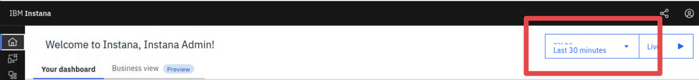
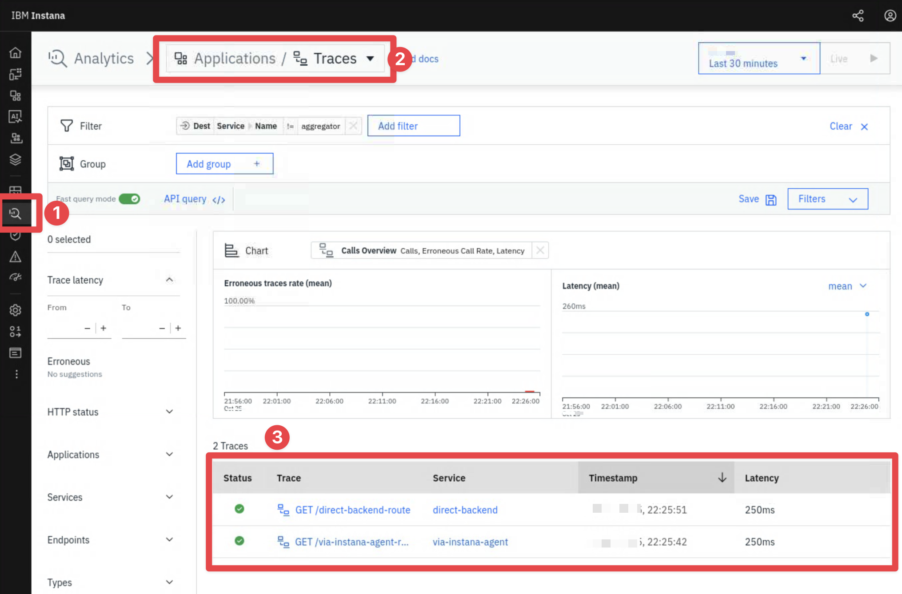
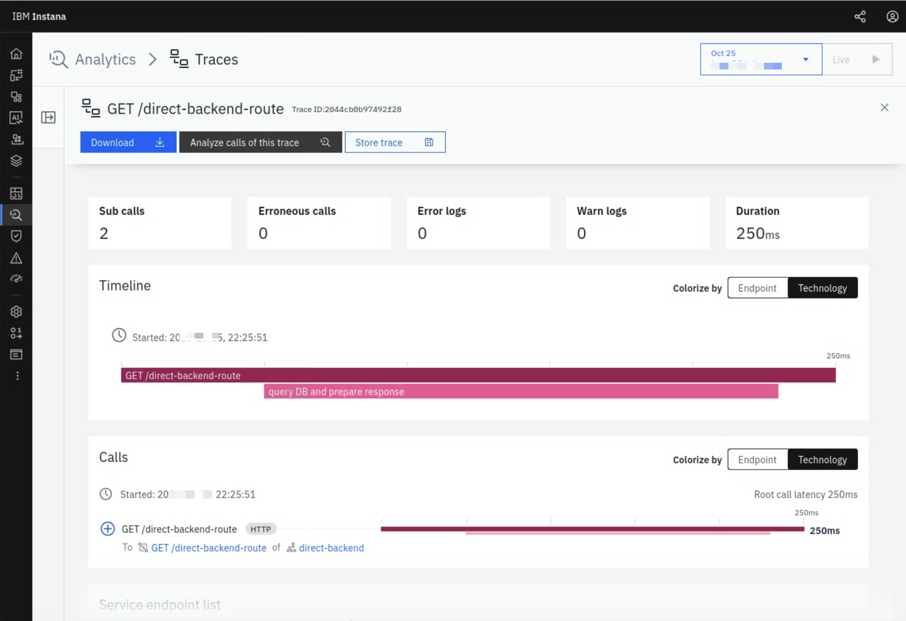

import OpenTerminalOnBastion from "@site/src/components/openTerminalOnBastion/OpenTerminalOnBastion"
import OpenInstanaInFirefox from "@site/src/components/openInstanaInFirefox/OpenInstanaInFirefox"

# Instana agent as an OTLP endpoint

## Connect to the Bluebox host

In this lesson we will predominantly be using the host named **Bluebox**. From your bastion host following the below instruction to connect to **Bluebox**:

<OpenTerminalOnBastion hostname="bluebox" />

:::tip Agent installation

The Instana agent has been pre-installed for you on the Bluebox host in this lab. If you want to learn more about doing this yourself you can check out the [Agent Installation lab](/labs/instana/server-and-agent-install-lab/agent-installation/).

:::

Lets first look at the status of the Instana agent running on Bluebox and start it:


```bash title="Host: bluebox"
systemctl status instana-agent --no-pager

# You can start it with this:
systemctl start instana-agent
```

Now that the Instana agent is running we can see that it doesn't just run its own sensors, it also acts as an **OTLP receiver** listening on ports `4317` & `4318`. You can see this yourself by running:

```bash title="Host: bluebox"
sudo ss -ltnp '( sport = :4317 or sport = :4318 )'
```

Any Collector or OTel SDK that runs on this host can send logs, metrics and traces to the agent which can then be forwarded to the Instana backend with everything else collected by the agent. This provides a simple preconfigured destination for OTel traffic using standard ports on any host that already runs an Instana agent.

## Configure the Instana Agent

### Instana agent backend configuration

You may want to check where data that you send to these pre-configured OTLP ports will be sent, the Instana agents backend connection configuration is located in a different file to the general configuration, you can view the backend connection details with:

```bash title="Host: bluebox"
# Agents backend sending endpoint
grep -E '^(host|port|protocol)=' /opt/instana/agent/etc/instana/com.instana.agent.main.sender.Backend.cfg

# Agent key used for auth (in this case just a count to show its there)
grep -c '^key=' /opt/instana/agent/etc/instana/com.instana.agent.main.sender.Backend.cfg
```

The first command above shows where the agent is configured to report to. The second confirms the presence of the **agent key**, which is the key that a collector configured to send directly to the Instana backend would require to authenticate itself.

Any collector that uses the agents local listening OTLP ports to send into this agent does not have to worry about this configuration because the Instana agent already handles it on its behalf.

### Instana agent OTLP configuration

The agents OTLP configuration lives in the agent's **configuration.yaml** file which can be found at `/opt/instana/agent/etc/instana/configuration.yaml`.

You can modify the opentelemetry section of the configuration file to make changes to the default OTel config:

```bash title="Host: bluebox"
grep -n -A16 'com.instana.plugin.opentelemetry' /opt/instana/agent/etc/instana/configuration.yaml
```

## Instana OTLP Endpoints

Instana hosts OTLP endpoints on both the Instana agent and the Instana backend. In the next two sections we will take a look at both:

### 1. OTLP via the Instana Agent

We are going to take a look at how we can send telemetry data to the Instana backend via the Instana agent.

Fortunately OTLP supports both gRPC and HTTP, using HTTP we can _"speak OTLP"_ with the help of [`curl`](https://developer.ibm.com/articles/what-is-curl-command/). A helper script that creates a small trace payload has already been copied to your _Bluebox_ host. Run the following command to view the sample trace JSON payload it produces:

```bash title="Host: bluebox (root)"
/opt/otel-lab/bin/generate-trace.sh
```

It looks similar to this:

```json title="Example: payload"
{
  "resourceSpans": [{
    # highlight-start
    "resource": {
      "attributes": [
        {"key": "service.name", "value": {"stringValue": "demo-service"}},
        {"key": "service.instance.id", "value": {"stringValue": "bluebox-demo"}},
        {"key": "host.name", "value": {"stringValue": "bluebox"}}
      ]
    },
    # highlight-end
    "scopeSpans": [{
      # highlight-next-line
      "scope": {"name": "generate-trace.sh", "version": "1.0.0"},
      # highlight-start
      "spans": [
        // spans removed for brevity..
      ]
      # highlight-end
    }]
  }]
}
```
You will notice there are three primary keys:

1. A **resource** with the `service.name` resource attribute and some others.
2. A **scope** which conveys the creator of the spans.
3. A **spans** array, each containing a trace ID, span ID, kind, attributes and timestamps. You can see the child span also contains the `parentSpanId` which Instana can use to build a tree.

This specific payload generated by the script is designed to demonstrate a single trace that contains exactly two spans:

1. A parent span, demonstrating an inbound HTTP GET request
2. A child span, aims to show an _internal operation_ resulting from the parent request which in this case has the hardcoded name `query DB and prepare response` (for demonstration purposes). In an instrumented application the name would accurately describe the purpose/functionality of the task that creates the span.

We previously checked the running OTLP ports for the instana agent and know that the **HTTP OTLP port is listening locally** on port **4318** so lets now use that endpoint to send this demo trace to the Instana backend via the Instana agent:

:::info Trace naming

- `OTEL_ROUTE`: The name of the route that gets hit in our demo data, we never make a request to this route, we just provide demo data as though someone has.
- `OTEL_SERVICE_NAME`: A service name would typically be something like _payment-service_ which describes the service the trace originated from. Strictly speaking **via-instana-agent** isn't a service, however for demonstration purposes we are using this name to make it easier to follow as we get familiar with the Instana UI.

:::

```bash title="Host: Bluebox"
OTEL_ROUTE=via-instana-agent-route \
OTEL_SERVICE_NAME=via-instana-agent \
/opt/otel-lab/bin/generate-trace.sh | \
curl -i http://127.0.0.1:4318/v1/traces \
  -H 'Content-Type: application/json' \
  --data-binary @-
```

This sets the **route** to `via-instana-agent-route` and the **service name** to `via-instana-agent`, it uses the sample payload generated by the `generate-trace.sh` script and  sends the payload locally to the Instana agents listening port as JSON on `127.0.0.1:4318`.

Later when we look at the Instana backend we can expect to see a `GET /via-instana-agent-route` trace with two calls, the first, a call with the same name and the second, a child call named _query DB and prepare response_.

:::tip

You might have noticed that by default the agent accepts OTLP on `127.0.0.1`. This restricts inbound OTLP coming only from processes running on the same host as opposed to the process running on `0.0.0.0` which will accept all inbound traffic from the network.

Kubernetes is different where the Instana agent is reached through a service named `instana-agent`. You can [read more about sending directly to agents here](https://www.ibm.com/docs/en/instana-observability/standard/1.0.327?topic=instana-agent).

:::

### 2. OTLP direct to the Instana backend

You might find yourself in a situation where you cannot install the Instana Agent to collect telemetry as a middleman, for example on a network device or a locked down server. If you are able to output OTel you also have the option of going direct to the Instana backend which provides its own OTLP acceptor. As long as you have an OTLP producer or can deploy a Collector where you need it (we will look at this in the upcoming lessons), it can be configured to send directly to the Instana backend. A few details on how a Collector must be configured to do this:

1. Must use TLS with the OTLP endpoint
2. Must reference the **agent key** in the `x-instana-key` header to authenticate
3. Must identify the source with an _identifier resource attribute_ so Instana has something to identify it with. Something like `host.id`/`device.id`/`faas.id`, alternatively an HTTP header `x-instana-host` can be used.

The backends OTLP acceptor addresses look like the following depending on where the Instana backend is hosted:

| Instana deployment | OTLP/gRPC endpoint | OTLP/HTTP endpoint |
| --- | --- | --- |
| Self-hosted Standard or Custom Edition (this lab environment) | `otlp-grpc.<base_domain>:443` | `https://otlp-http.<base_domain>:443` |
| SaaS | `otlp-grpc-<region>-saas.instana.io:443` | `https://otlp-http-<region>-saas.instana.io:443` |

:::tip

- For self-hosted the `<base_domain>` is the domain of the Instana installation. The two `otlp-*` DNS names must resolve to it.
- For SaaS the region is displayed under **More -> About Instana**.

Self-hosted deployments use a self-signed certificate by default, this means the OTel exporter also needs the backend CA file.

:::

Based on the above information the configuration for a direct OTel exporter will look similar to the following:

```yaml title="Example OTLP/HTTP direct to Instana backend"
exporters:
  otlp_http/instana:
    endpoint: https://otlp-http.instana-0.ibmdte.local
    headers:
      x-instana-key: ${env:INSTANA_AGENT_KEY}
      x-instana-host: ${env:HOSTNAME}
```

Lets now send another demonstration trace using `curl` like we did earlier but this time we will go directly to the Instana backend and bypass the local Instana agent. We need to do a little more than previously because we don't have the local agent helping us out by authenticating on our behalf and identifying the host:

```bash
INSTANA_AGENT_KEY=$(sudo sed -n 's/^key=//p' /opt/instana/agent/etc/instana/com.instana.agent.main.sender.Backend.cfg)

OTEL_ROUTE=direct-backend-route \
OTEL_SERVICE_NAME=direct-backend \
/opt/otel-lab/bin/generate-trace.sh | \
curl -i https://otlp-http.instana-0.ibmdte.local/v1/traces \
  --insecure \
  -H 'Content-Type: application/json' \
  -H "x-instana-key: ${INSTANA_AGENT_KEY}" \
  -H "x-instana-host: $(hostname)" \
  --data-binary @-
```

We first gather the **agent key** to authenticate with and then use it in the HTTP header. We also supply a way for Instana to identify the source via the **x-instana-host** header, in this case we are using the hostname as the identifier. Apart from this we have changed the route to **direct-backend-route** and the service name to **direct-backend** to differentiate from the previous trace.

You should see a **HTTP 200** response

## Inspect the traces in the Instana Dashboard

We have now sent two traces to the Instana backend. Lets login to the dashboard and take a look at our first telemetry sent over OTLP.

<OpenInstanaInFirefox />

------------

:::info

Future labs will cover OpenTelemetry traces in much more detail, the purpose of this exercise is to demonstrate that we have created our own telemetry and used the Instana OTLP endpoints exposed via both the Instana agent and the backend to ingest our data directly into Instana. We will be doing much more of this in the upcoming labs.

:::

Once logged in, it is important to adjust the time time range to include the duration for when you sent the two sample traces. For example the **Last 30 minutes**.



Navigate to the **Analytics traces page**, you should see the two manual traces you recently sent. If you don't try increasing the timeframe to something larger or go back to the previous steps and re-send them.



Navigate to one of the traces, for example `GET /direct-backend-route`.

You'll be taken to the trace page:



Take a moment to explore the information on this page:

1. **Timeline:** Showing both the spans generated in our `generate-trace.sh` helper script visually. The inbound HTTP GET request and the internal _query DB and prepare response_ call. You would have noticed that the child call is nested beneath the parent/root call in the timeline. This is because both calls share the same **trace ID** and the child call references the parent using its **parent span ID**. This is how Instana is able to understand the two operations are related to the same trace.
2. **Calls:** Shows similar information with more detail, try expanding the twistie to see more.
3. **Service endpoint list:** Shows the service name we gave out demo request, in this case `direct-backend` which comes from the `service.name` resource attribute we included in the OTLP payload.


## Conclusion

This has been a basic introduction into getting OTLP data into Instana using two different paths; via the agent and direct to the backend.

Hopefully manually sending demonstration traces has be helpful for you to gain an understanding about what OTLP Collectors are doing for you behind the scenes. In the upcoming lessons we'll introduce two OpenTelemetry Collector distributions;

- **otelcol-contrib** (the OpenTelemetry Collector Contrib distribution)
- **IDOT** (the Instana Distribution of the OpenTelemetry Collector).

We are going to configure and use these Collectors to gather real telemetry, process it and forward it to Instana where you'll see it provide valuable insight into the the monitored systems.