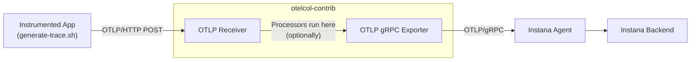
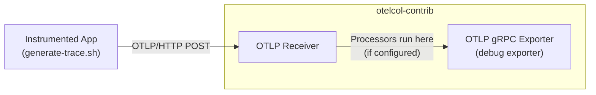
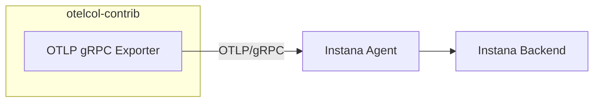
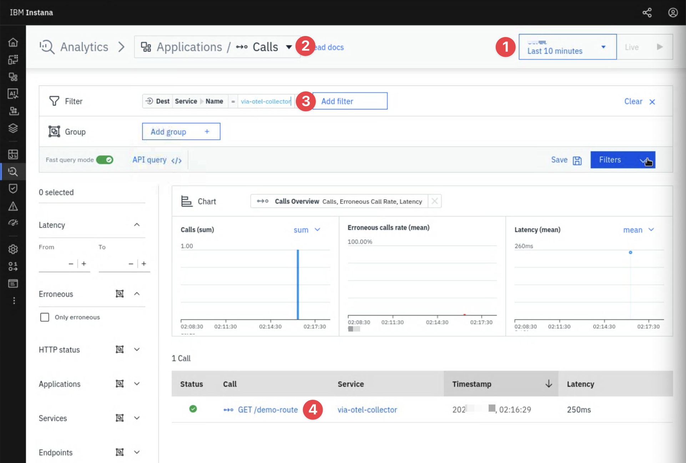
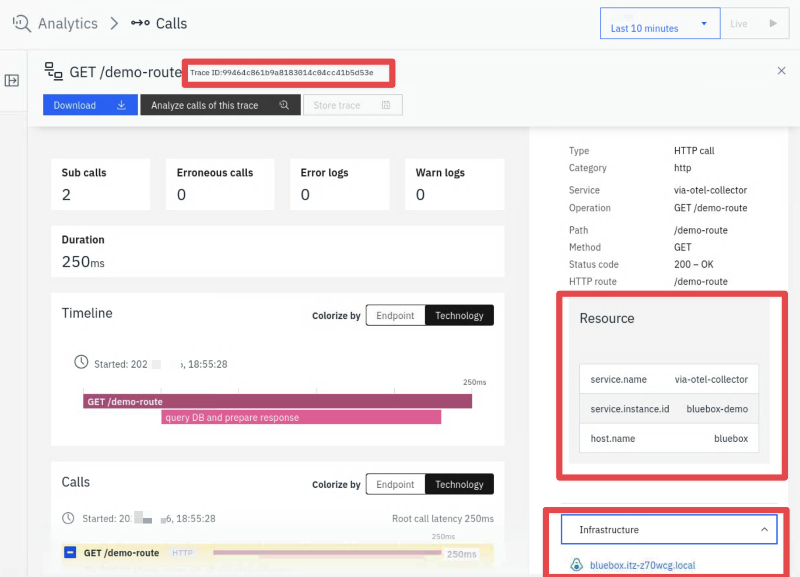
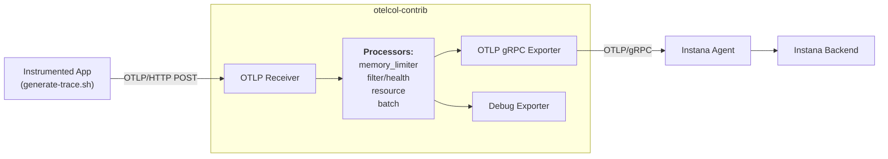
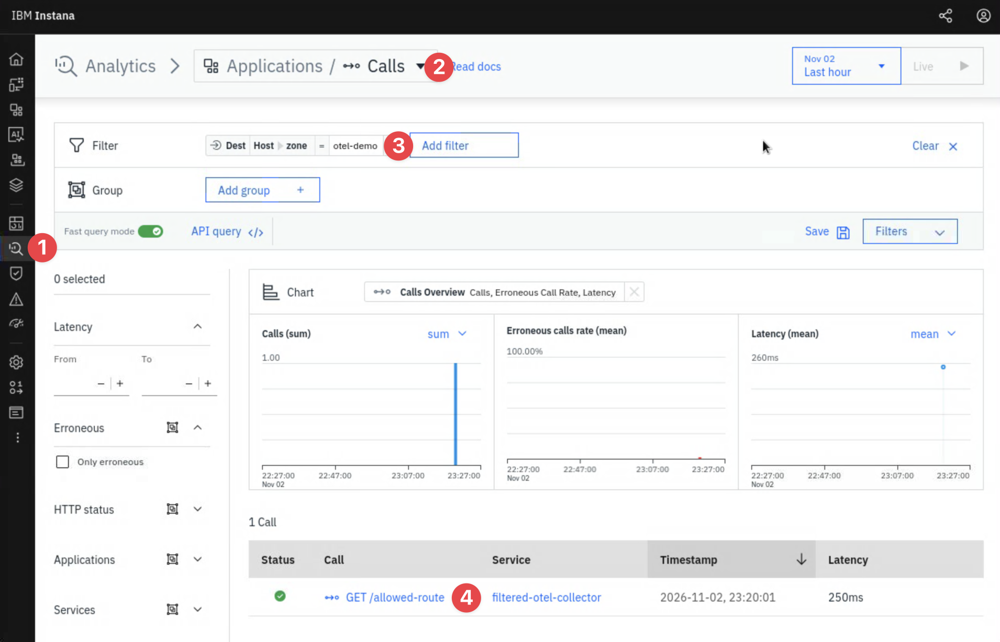
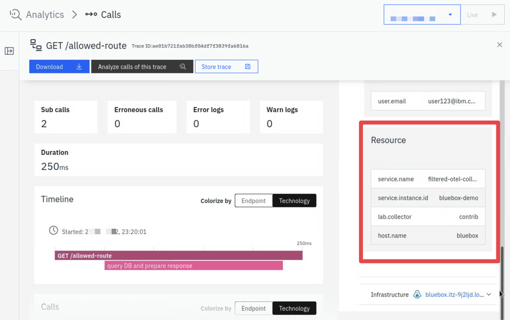

import Link from '@docusaurus/Link'

# Explore otelcol-contrib

The `otelcol-contrib` is the OpenTelemetry project's complete or "batteries included" distribution of an OpenTelemetry Collector. In this lesson we are going to explore the package and see what it has to offer.

The [otelcol-contrib package](https://opentelemetry.io/docs/collector/install/) has already been downloaded and installed for you on the **Bluebox** host. If you have closed the tab you can follow these instructions again to <Link to="/labs/instana/opentelemetry-foundations/instana-agent-otlp/#connect-to-the-bluebox-host" target="_blank">connect to Bluebox</Link>.

Once back on the **Bluebox** host you can check the installed version of the otelcol-contrib using the following:

```bash title="Host: bluebox (root)"
/usr/bin/otelcol-contrib --version
rpm -q otelcol-contrib
```

The package has installed the following for us:

| Item | Location |
| --- | --- |
| Binary | `/usr/bin/otelcol-contrib` |
| Collector Configuration | `/etc/otelcol-contrib/config.yaml` |
| Service startup options | `/etc/otelcol-contrib/otelcol-contrib.conf` |
| systemd service | The collector runs as an unprivileged user **otelcol-contrib** |
| Service log | `journalctl -u otelcol-contrib` |

## Start the Collector

By default the service does not start automatically. Try starting it yourself, the following will start the service and query the services status:

```bash title="Host: bluebox (root)"
systemctl start otelcol-contrib
sleep 5
systemctl status otelcol-contrib --no-pager
```

You will see the error: **Failed to start OpenTelemetry Collector Contrib**.

Let's troubleshoot the issue with the Collector. A good place to start is the Collectors service log. Run the following to see more detail:

```bash title="Host: bluebox (root)"
journalctl -u otelcol-contrib --no-pager | grep -m1 -i 'address already in use'
```

Can you see the error? **"error": "listen tcp 0.0.0.0:4317: bind: address already in use"**.

The issue is that we already have the Instana agent running on this host, as we discovered in the previous lesson it has its own OTLP listeners on **4317** and **4318**. We can't have two processes listening on the same ports so the Collector refuses to start.

Let's address this issue by stopping the service and taking a look at how to customise the Collector for our environment.

```bash title="Host: bluebox (root)"
systemctl stop otelcol-contrib
```

## Configure the Collector

Before making any changes, let's first take a look at the default configuration installed by the otelcol-contrib RPM:

```bash title="Host: bluebox (root)"
cat /etc/otelcol-contrib/config.yaml
```

Take a look at the **receivers** section, you might need to scroll up a little. Specifically look for the OTLP section, it looks like this:

```bash title="Example: Receivers config"
receivers:
  otlp:
    protocols:
      grpc:
        endpoint: 0.0.0.0:4317
      http:
        endpoint: 0.0.0.0:4318
```

The HTTP endpoint has been configured to listen on `0.0.0.0:4318` and the gRPC endpoint on `0.0.0.0:4317`. This explains the **address already in use** startup failure. We have now confirmed the Collector by default is configured to listen on the same ports the Instana agent uses for OTLP traffic. If we fixed just the _"4317 port in use error"_ the same would happen for port 4318 as well so let's get both updated now by running the following command:

```bash title="Host: bluebox (root)"
sed -i \
  -e 's/0\.0\.0\.0:4317/127.0.0.1:14317/' \
  -e 's/0\.0\.0\.0:4318/127.0.0.1:14318/' \
  /etc/otelcol-contrib/config.yaml
```

:::caution Security Note - Limit unauthorised access

It is important to note the default configuration uses the bind address `0.0.0.0`, which means all network interfaces. This isn't a good idea on a production server because it effectively allows unauthenticated telemetry intake from anywhere on the network, not just the localhost. The configuration file itself warns about this on the very first line. Best practice is to do what the above command does and configure the binds to use `127.0.0.1` instead.

:::

Now let's try starting the Collector again:

```bash title="Host: bluebox (root)"
systemctl start otelcol-contrib
sleep 5
systemctl status otelcol-contrib --no-pager
```

You should now see **Active: active (running)**.

## Explore the distribution

The Collector can list each of the components compiled into it's distribution. To get an understanding of how many different options the distribution supports we can count the number of **receivers** bundled by running the following:

```bash title="Host: bluebox (root)"
/usr/bin/otelcol-contrib components | sed -n '/^receivers:/,/^processors:/p' | grep -c -- '- name:'
```

You will see that the current installed version of the **otelcol-contrib** distribution has **107** receivers bundled. This means there are 107 different ways to receive telemetry into the Collector from a range of sources like applications, databases, network devices and other infrastructure.

You can see more specifics about these these receivers and search search them by running something like the following which will list **file_log**, **syslog**, **snmp** and **shell**:

```bash title="Host: bluebox (root)"
/usr/bin/otelcol-contrib components | grep -E -- '- name: (file_log|syslog|snmp|shell)$'
```

```text title="Example: Output"
- name: file_log
- name: snmp
- name: syslog
- name: syslog
```

Notice in this case there is no **shell** receiver returned, we will come back to that in the next lesson on IDOT.

## Basic Collector Pipeline

We will now introduce the collector into our OTel workflow to begin understanding how the collector can be configured. Just like the previous lesson once configured we will send a manually created _demo trace_ to the collector, through the Instana Agent and into the Instana backend.

The flow looks like this:



### Step 1: Receive OTLP and log

Our first step will be to focus on getting the data into **otelcol-contrib** and working with the telemetry. We will receive OTLP generated by the helper script we used last lesson and print the resulting OTLP using the Collectors included **debug exporter**. Printing locally using the debug exporter will help us prove that the receiving half of our pipeline works well prior to us introducing the network and Instana backend.



Update the `otelcol-contrib` configuration by running the following:

```bash title="Host: bluebox (root)"
cat > /etc/otelcol-contrib/config.yaml <<'EOF'
# highlight-start
extensions:
  health_check:
    endpoint: 127.0.0.1:13134
# highlight-end

receivers:
  otlp:
    protocols:
      grpc:
      # highlight-start
        endpoint: 127.0.0.1:14317
      # highlight-end
      http:
      # highlight-start
        endpoint: 127.0.0.1:14318
      # highlight-end

# highlight-start
exporters:
  debug:
    verbosity: detailed
# highlight-end

service:
  extensions: [health_check]
  pipelines:
    traces:
      receivers: [otlp]
      exporters: [debug]
    metrics:
      receivers: [otlp]
      exporters: [debug]
    logs:
      receivers: [otlp]
      exporters: [debug]
EOF
```

| Setting | Description |
| --- | --- |
| OTLP on `127.0.0.1:14317` and `14318` | We are using the loopback address (not 0.0.0.0 anymore) and ports that no longer clash with the Instana agent (or with IDOT which we will configure soon) |
| `health_check` on `127.0.0.1:13134` | An extension that will help us check if the collector process is up, it exposes a HTTP endpoint we can query. |
| `debug` exporter <br />`verbosity: detailed` | Prints received telemetry to the services log so we can see what has made it to the collector |

Once the new configuration has been applied we can validate it using:

```bash title="Host: bluebox (root)"
/usr/bin/otelcol-contrib validate --config=/etc/otelcol-contrib/config.yaml && echo "Configuration is valid"
```

Enable and restart the service so the new config takes effect:

```bash title="Host: bluebox (root)"
systemctl enable otelcol-contrib
systemctl restart otelcol-contrib
systemctl is-active otelcol-contrib
```

And finally let's query the **health_check** endpoint extension we added to check the health of the collector:

```bash title="Host: bluebox (root)"
curl -s http://127.0.0.1:13134/ ; echo
```

You should see something similar to:

```text title="Example Output"
{"status":"Server available","upSince":"XXX-10-21T01:46:14.863008415-04:00","uptime":"15.24511891s"}
```

### Step 2: Send a trace

We have adjusted the config, we can now trigger the pipeline by sending the test data. Just like in the previous lesson lets send a manual trace again, this time we will be sending it locally to the **otelcol-contrib** collector rather than to an Instana component.

First let's follow the Collectors log so we can see the trace come in live. Open a new tab in your terminal and connect to `bluebox` again:

```bash title="Host: bluebox (root), second terminal"
ssh jammer@bluebox
sudo -i
```

And follow the collectors log:

```bash title="Host: bluebox (root), second terminal"
journalctl -u otelcol-contrib -f -o cat
```

Back in the first tab you can now send the trace. Give your fake service a test name and send. Remember we are sending locally to the collectors local port:

```bash
OTEL_SERVICE_NAME=via-otel-collector \
/opt/otel-lab/bin/generate-trace.sh | \
curl -i http://127.0.0.1:14318/v1/traces \
  -H 'Content-Type: application/json' \
  --data-binary @-
```

:::tip HTTP OTLP Specification

We are once again using the URL path `/v1/traces`. We used this in the previous lesson when sending direct to the Instana backend and via the Instana agent too. This is a built in default from the OTLP specification, so even though we are using different collectors we are sending to the same path because we are using **OTLP**. The equivalent also exists for metrics `/v1/metrics` and logs `/v1/logs`.

:::

Once run the script will show the status code `HTTP 200` and the `partialSuccess` status, which should be an empty object `({})` indicating that there were no rejected spans.

In the second tab take a look at what the collectors **debug exporter** has printed to the log based on the received trace:

- **service.name:** `Str(via-otel-collector)` in the resource attributes
- **host.name:** `Str(bluebox)` in the resource attributes
- Two spans with the same _Trace ID_
- **Kind: Server** for `GET /demo-route` and **Kind: Internal** for `query DB and prepare response`.
- The child's **Parent ID** is equal to the server span's **ID**.

```text title="Example Output"
2026-10-26T01:20:01.553-0400	info	Traces	{"resource": {"service.instance.id": "0a9978a0-ffb0-4faf-9701-a41df236fe0b", "service.name": "otelcol-contrib", "service.version": "0.162.0"}, "otelcol.component.id": "debug", "otelcol.component.kind": "exporter", "otelcol.signal": "traces", "resource spans": 1, "spans": 2}
2026-10-26T01:20:01.553-0400	info	ResourceSpans #0
Resource SchemaURL:
# highlight-start
Resource attributes:
     -> service.name: Str(via-otel-collector)
     -> service.instance.id: Str(bluebox-demo)
     -> host.name: Str(bluebox)
# highlight-end
ScopeSpans #0
ScopeSpans SchemaURL:
InstrumentationScope generate-trace.sh 1.0.0
Span #0
# highlight-start
    Trace ID       : 36f06104f65eb0a883b6c2c959f644f2
    Parent ID      :
# highlight-end
    ID             : 8ce3237d1f8ffb1e
# highlight-start
    Name           : GET /demo-route
    Kind           : Server
# highlight-end
    Start time     : 2026-10-26 05:20:01.299097297 +0000 UTC
    End time       : 2026-10-26 05:20:01.549097297 +0000 UTC
    Status code    : Ok
    Status message :
    DroppedAttributesCount: 0
    DroppedEventsCount: 0
    DroppedLinksCount: 0
Attributes:
     -> http.request.method: Str(GET)
     -> http.route: Str(/demo-route)
     -> url.path: Str(/demo-route)
     -> http.response.status_code: Int(200)
     -> user.email: Str(user123@ibm.com)
Span #1
# highlight-start
    Trace ID       : 36f06104f65eb0a883b6c2c959f644f2
    Parent ID      : 8ce3237d1f8ffb1e
# highlight-end
    ID             : d5d8a0707282ceef
# highlight-start
    Name           : query DB and prepare response
    Kind           : Internal
# highlight-end
    Start time     : 2026-10-26 05:20:01.349097297 +0000 UTC
    End time       : 2026-10-26 05:20:01.529097297 +0000 UTC
    Status code    : Unset
    Status message :
    DroppedAttributesCount: 0
    DroppedEventsCount: 0
    DroppedLinksCount: 0
Attributes:
     -> greeting.language: Str(en)
	{"resource": {"service.instance.id": "0a9978a0-ffb0-4faf-9701-a41df236fe0b", "service.name": "otelcol-contrib", "service.version": "0.162.0"}, "otelcol.component.id": "debug", "otelcol.component.kind": "exporter", "otelcol.signal": "traces"}
```

The debug exporter is helping us see the type of information available to us in the pipeline from the telemetry data. Depending on the receivers and processors being used there could be a lot more or less, the debug exporter helps us see.

:::tip Having issues?

If you run into any issues make sure you:

1. Check you are using the right port and copying and pasting the command correctly.
2. Check the journal for errors `journalctl -u otelcol-contrib -n 20 --no-pager`

:::

All this information has come from the trace we sent. Now that we can see the above output when sending the demo trace to the collector we have proven that we have a working receiving half of the pipeline. Specifically we can see that OTLP arrives into the collector, it is decoded and reaches an exporter, debug exporter in our case.

Everything we have done above is still all local though, next we will look at sending that data out to the Instana backend.

### Step 3: Forward telemetry to Instana backend

In the previous step we proved the pipeline is working locally, now let's substitute the debugging exporter for the actual Instana backend. This time we will use the gRPC exporter to send to the Instana agent to show the flexibility of the Collector.



:::tip

Sending via the Instana agent is the simplest path when available but remember you can <Link to="/labs/instana/opentelemetry-foundations/instana-agent-otlp/#2-sending-to-instana-directly" target="_blank">configure a direct connection</Link> to the Instana backend too if required.

:::

Press **Ctrl+C** in the second tab to stop following the collector log. Run the following command to update the Collectors configuration with the latest changes, take a look at the highlighted lines to see what changed:

```bash title="Host: bluebox (root)"
cat > /etc/otelcol-contrib/config.yaml <<'EOF'
extensions:
  health_check:
    endpoint: 127.0.0.1:13134

receivers:
  otlp:
    protocols:
      grpc:
        endpoint: 127.0.0.1:14317
      http:
        endpoint: 127.0.0.1:14318

exporters:
# highlight-start
  otlp_grpc:
    endpoint: 127.0.0.1:4317
    tls:
      insecure: true
# highlight-end

service:
  extensions: [health_check]
  pipelines:
    traces:
      receivers: [otlp]
# highlight-start
      exporters: [otlp_grpc]
# highlight-end
    metrics:
      receivers: [otlp]
# highlight-start
      exporters: [otlp_grpc]
# highlight-end
    logs:
      receivers: [otlp]
# highlight-start
      exporters: [otlp_grpc]
# highlight-end
EOF
```

:::important Exporter Configuration to the Instana agent

`tls: insecure: true` is correct here because we are "exporting" to the local Instana agent listening on **127.0.0.1:4317**. The Instana agent's local OTLP port doesn't use TLS and the traffic only operates over the loopback interface.

:::

Validate the new configuration and restart the collector

```bash title="Host: bluebox (root)"
/usr/bin/otelcol-contrib validate --config=/etc/otelcol-contrib/config.yaml && systemctl restart otelcol-contrib
sleep 3; systemctl is-active otelcol-contrib
```

Send another trace with a new service name this time `via-otel-collector-2`:

```bash title="Host: bluebox (root)"
OTEL_SERVICE_NAME=via-otel-collector-2 \
/opt/otel-lab/bin/generate-trace.sh | \
curl -i http://127.0.0.1:14318/v1/traces \
  -H 'Content-Type: application/json' \
  --data-binary @-
```

Take note of the printed trace ID, you can use this to help find the trace in the Instana backend.

### Step 4: Find your telemetry in Instana

Let's now find the telemetry you sent in the Instana UI:

1. Open **Analytics** -> **Applications** / **Calls**.
2. Set the time range to the last 10 minutes.
3. Select **Add filter**, choose **Service name**, and enter `via-otel-collector-2`.
4. Open the `GET /demo-route` call.



:::tip

If you cannot see your trace or calls in the Instana UI make sure that you restarted your Collector after making the configuration changes.

You can also try extending the time range and searching by the **Trace ID** that the _generate-trace.sh_ script returned.

:::

The call details show the trace it belongs to. Open the trace to see the timeline, including the `query DB and prepare response` span underneath it.

In the call and trace details, look for:

- The **trace ID**, the same ID generated and returned by the script
- The **Resource** section which includes resource attribute key value pairs. We saw earlier that the _trace helper script_ sets these for us in the _resource.attributes_ section.
- The **infrastructure** section associating `bluebox` with the trace. The trace itself specified `host.name` set in our _resource.attributes_ but in this case the linking comes from the Instana agent that forwarded the trace.



We have just created a trace, sent it through the Collector's pipeline and into the Instana backend. This process has been useful to get an introduction to a Collectors pipeline configuration but apart from seeing the telemetry data printed to the screen we haven't improved the functionality above what we had sending directly to the Instana agent. In the next section we will take a look at where a Collector earns its place, **transforming & filtering telemetry before it ever leaves the host**.

## Advanced Collector Pipeline: Filtering noise

Not all telemetry needs to be kept and sent to the backend, a common example of this would be **health checks**. Health checks for load balancers and Kubernetes probes will often call an endpoint like `GET /health` frequently to confirm a service is still alive. If left as is, all of these probes will be sent to Instana and will produce a trace that will likely just clutter the system and give us very little insight.

In this section we are going to use an otelcol-contrib **processors** to:

1. Drop all health check traces before they ever leave _Bluebox_.
2. Label all telemetry that isn't dropped so we know which Collector it came from.

:::info OpenTelemetry Processors

You can think of Processors like _middleware_, they sit between receivers and exporters in a pipeline. They run in the order added to the processor list and the output of one feeds the input of the next. There are [many processors](https://opentelemetry.io/docs/collector/components/processor/) available in the distribution.

:::

To demonstrate this we will once again use the `generate-trace.sh` helper script. You might have noticed earlier the script handles the route `health` like a real health check, a single span with no child or user.

The flow once we are done will look like this:



### Step 1: Add processors to the pipeline

We will be adding the following Processors:

| Processor | Why it is there |
| --- | --- |
| [`memory_limiter`](https://github.com/open-telemetry/opentelemetry-collector/blob/main/processor/memorylimiterprocessor/README.md#memory-limiter-processor) | Refuse data if the Collector will run out of memory as a result of receiving the telemetry. It helps keep the collector alive in the case there is a massive unexpected influx of inbound telemetry. It is a _best practice_ and [should always be first in the processor list](https://github.com/open-telemetry/opentelemetry-collector/blob/main/processor/memorylimiterprocessor/README.md#best-practices). |
| [`filter/health`](https://github.com/open-telemetry/opentelemetry-collector-contrib/blob/main/processor/filterprocessor/README.md) | We will configure it to drops all spans where the **http.route** is `/health` |
| [`resource`](https://github.com/open-telemetry/opentelemetry-collector-contrib/blob/main/processor/resourceprocessor/README.md) | Insert `lab.collector: contrib` into the resource attributes so we will be able to tell in Instana where the data came through. |
| [`batch`](https://github.com/open-telemetry/opentelemetry-collector/tree/main/processor/batchprocessor) | Make fewer, larger requests for better performance. Like the _memory_limiter_ this isn't required for the lab but is good practice to improve Collector efficiency. |

:::tip Best Practice

**memory_limiter**, **resource** and **batch** are all good practice to put in any pipeline:

- **memory_limiter**: A burst of telemetry can take out a Collector by using too much memory and crash it, losing everything it was holding. It has to go first so it can refuse data before any other processor work on it.
- **batch**: Sending many small requests is more expensive in network and CPU than sending fewer larger batches. It has to go last so that it only batches data that has already been processed.
- **resource**: Better record keeping and can make troubleshooting easier especially when several collectors are all sending to the same backend.

[The OpenTelemetry Collector recommendations](https://github.com/open-telemetry/opentelemetry-collector/blob/main/processor/README.md#recommended-processors)

:::

The highlighted lines below are newly added to support the new processors. One other thing to pay attention to is in the **traces** pipeline which now exports to both the _Instana agent_ (otlp_grpc) and the _debug exporter_ so we will be able to watch the log still and see what telemetry makes it through the new filter.

Run the following to update the configuration:

```bash title="Host: bluebox (root)"
cat > /etc/otelcol-contrib/config.yaml <<'EOF'
extensions:
  health_check:
    endpoint: 127.0.0.1:13134

receivers:
  otlp:
    protocols:
      grpc:
        endpoint: 127.0.0.1:14317
      http:
        endpoint: 127.0.0.1:14318

# highlight-start
processors:
  memory_limiter:
    check_interval: 1s
    limit_mib: 256
    spike_limit_mib: 64
  filter/health:
    error_mode: ignore
    traces:
      span:
        - 'span.attributes["http.route"] == "/health"'
  resource:
    attributes:
      - key: lab.collector
        value: contrib
        # `insert` adds the key if it isn't already set to prevent overwrites of a value the application sets.
        action: insert
  batch: {}
# highlight-end

exporters:
  otlp_grpc:
    endpoint: 127.0.0.1:4317
    tls:
      insecure: true
# highlight-start
  debug:
    verbosity: detailed
# highlight-end

service:
  extensions: [health_check]
  pipelines:
    traces:
      receivers: [otlp]
# highlight-start
      processors: [memory_limiter, filter/health, resource, batch]
      exporters: [debug, otlp_grpc]
# highlight-end
    metrics:
      receivers: [otlp]
      processors: [memory_limiter, resource, batch]
      exporters: [otlp_grpc]
    logs:
      receivers: [otlp]
      processors: [memory_limiter, resource, batch]
      exporters: [otlp_grpc]
EOF
```

The processor named **filter/health** has its filter condition written in **OpenTelemetry Transformation Language** (**OTTL**). Any span that matches the condition is dropped.

:::tip Naming component instances

Look at the processor name `filter/health`. The prefix `filter` is the **component type**, and the suffix is a name you choose, in this case `health`. Naming components like this lets you run several differently configured instances of the same component.

:::

Validate the configuration and restart the Collector:

```bash title="Host: bluebox (root)"
/usr/bin/otelcol-contrib validate --config=/etc/otelcol-contrib/config.yaml && systemctl restart otelcol-contrib
sleep 3; systemctl is-active otelcol-contrib
```

### Step 2: Send health checks and a real request

From the second tab follow the Collector's log again:

```bash title="Host: bluebox (root), second tab"
journalctl -u otelcol-contrib -f -o cat
```

Back in the first tab send five health checks by running the following loop:

```bash title="Host: bluebox (root)"
for i in 1 2 3 4 5; do
  OTEL_ROUTE=health \
  OTEL_SERVICE_NAME=filtered-otel-collector \
  /opt/otel-lab/bin/generate-trace.sh | \
  curl -s -o /dev/null -w '%{http_code}\n' http://127.0.0.1:14318/v1/traces \
    -H 'Content-Type: application/json' \
    --data-binary @-
done
```

Each send will return a **200** success response to show the Collector has accepted all five requests. Take a look at the logging tab and you should notice that nothing has been printed bu the _debug exporter_.

Now let's follow up with a real request to another route like `allowed-route`:

```bash title="Host: bluebox (root)"
OTEL_ROUTE=allowed-route \
OTEL_SERVICE_NAME=filtered-otel-collector \
/opt/otel-lab/bin/generate-trace.sh | \
curl -i http://127.0.0.1:14318/v1/traces \
  -H 'Content-Type: application/json' \
  --data-binary @-
```

Look back at the logging tab and this time you'll see the debug exporter has printed the trace to the log including its additional resources that the _resource_ processor added:

```text title="Example Output (trimmed)"
Resource attributes:
#highlight-start
     -> service.name: Str(filtered-otel-collector)
     -> service.instance.id: Str(bluebox-demo)
     -> host.name: Str(bluebox)
#highlight-end
# highlight-next-line
     -> lab.collector: Str(contrib)
ScopeSpans #0
ScopeSpans SchemaURL:
InstrumentationScope generate-trace.sh 1.0.0
Span #0
    Trace ID       : 2678c407327ea776244be622bb249738
    Parent ID      :
    ID             : aa54a60785aa73c7
# highlight-next-line
    Name           : GET /allowed-route
    Kind           : Server
...
Span #1
...
    Name           : query DB and prepare response
    Kind           : Internal
```

The _debug exporter_ is now only logging what made it through the processors pipeline.

There is another way to double confirm things in our pipeline are working the way we expect rather than the possibility the health checks were simply _lost_. All Collectors publish metrics about themselves, the default endpoint is `127.0.0.1:8888`.

Run the following to see the Collectors stats:

```bash title="Host: bluebox (root)"
curl -s http://127.0.0.1:8888/metrics | grep -E '^otelcol_(receiver_accepted_spans|processor_filter_spans_filtered|exporter_sent_spans)'
```

```text title="Example Output"
otelcol_exporter_sent_spans{exporter="debug"} 2
otelcol_exporter_sent_spans{exporter="otlp_grpc",server_address="127.0.0.1",server_port="4317"} 2
otelcol_processor_filter_spans_filtered{filter="filter/health"} 5
otelcol_receiver_accepted_spans{receiver="otlp",transport="http"} 7
```

Assuming you followed the exact instructions you'll notice the receiver accepted **7** spans (five health checks & two spans that made up the `allowed-route` trace). The filter dropped **5** and each exporter sent **2**. The counters reset and start from 0 when the collector restarts.

:::info Filters judge individual spans

In our example the health check is a single span so it dropped it entirely. If the request had one or more child spans the filter would have dropped the parent but allowed the children, unless they also satisfied the filter rule. Keep this in mind because you could end up creating orphan spans.

If you need to make a decision to either drop or keep an entire trace rather than a single span you'll likely need to consider a different approach. For example the [tail sampling processor](https://github.com/open-telemetry/opentelemetry-collector-contrib/blob/main/processor/tailsamplingprocessor/README.md) which groups spans of the same trace, waits a configurable amount of time and then decides what to do with all the related spans.

:::

### Step 3: Find your trace in Instana

1. Open **Analytics**, you can optionally set the time range to something recent like last 10 minutes.
2. Ensure **Applications** / **Calls** is selected.
3. Select **Add filter**, choose **Host Zone**, and enter `otel-demo`.
4. See that your `allowed-route` call has made it to the Instana backend.



Key points:

- You will only see the `GET /allowed-route` call
- You will not see any of the five `GET /health` calls
- You will see in the resource section of the call the attributes that were added by the processor.



We have now successfully dropped telemetry that would otherwise clutter the system before it left the host, labelled everything that did leave and used the Collector's own metrics to prove the pipeline was working as expected.

Importantly none of what was done required any changes to the underlying applications/hosts being monitored which is why a Collector is especially useful.
