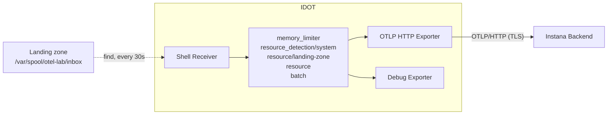
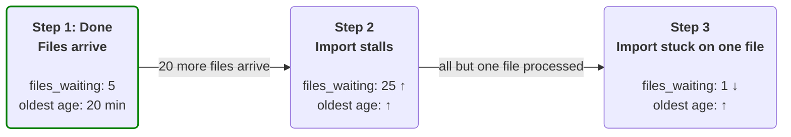
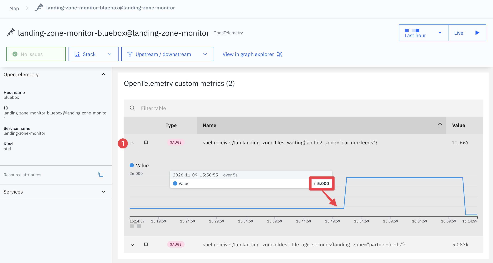
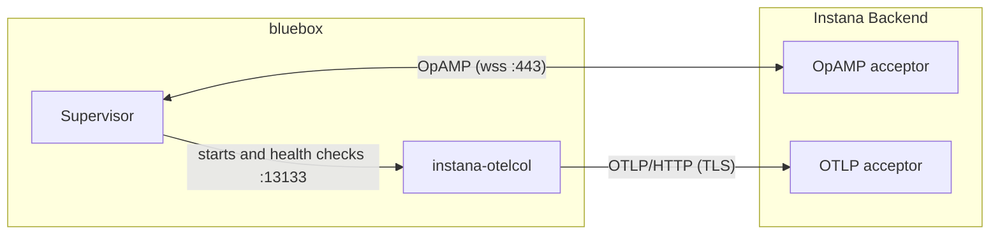
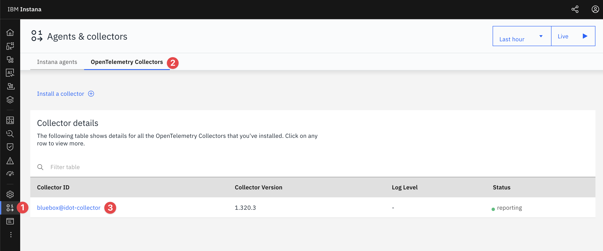
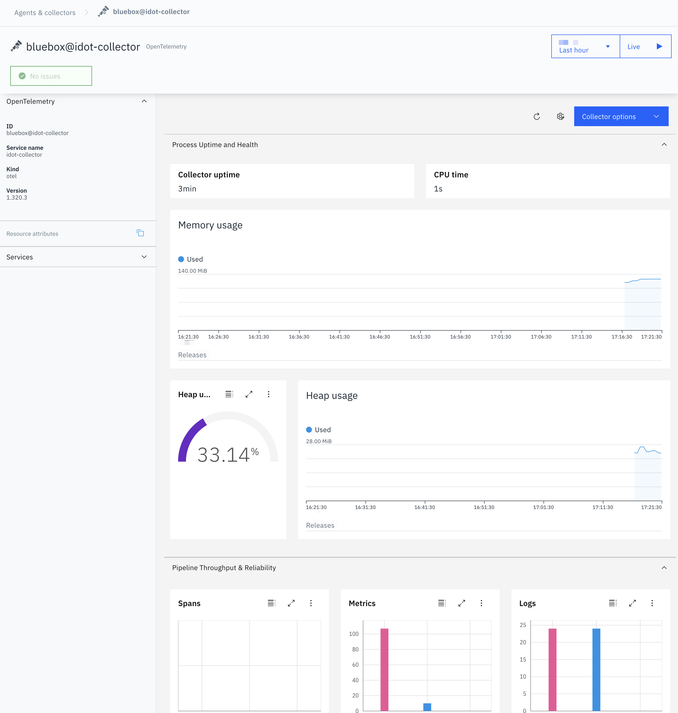
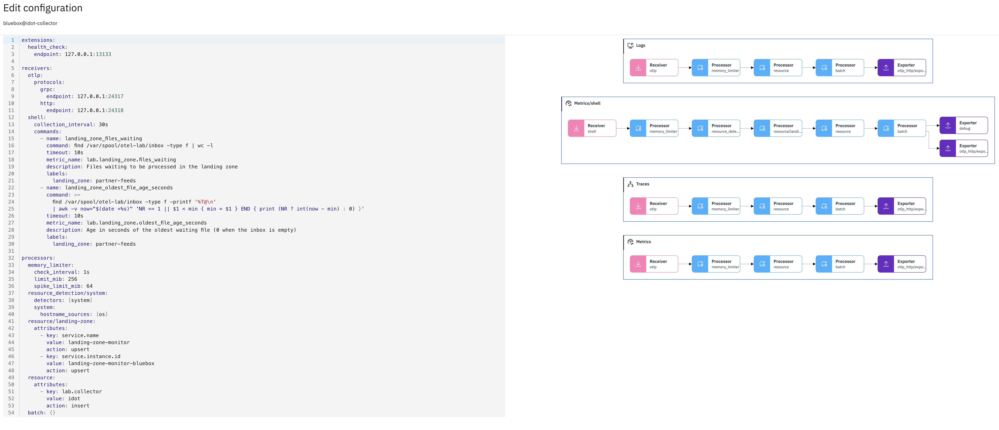

import Link from '@docusaurus/Link'

# Explore IDOT

The [Instana Distribution of OpenTelemetry Collector](https://www.ibm.com/docs/en/instana-observability/standard/latest?topic=collectors-instana-distribution-opentelemetry-collector-idot) (**IDOT**) is a [custom build](https://opentelemetry.io/docs/collector/extend/ocb/) of an OpenTelemetry Collector tailored for use with Instana. Being a custom build of the Collector we used in the previous lesson means it shares the same configuration and pipeline setup. The primary difference between the two collectors are:

- Pre-configured components for sending telemetry to Instana
- IBM maintained with security fixes
- Compatibility testing with Instana
- Streamlined installation

:::tip Installing it yourself

[IDOT ships as a self extracting installer script](https://github.com/instana/instana-otel-collector). In this lab IDOT has already been installed for you on the **Bluebox** host in the default location `/opt/instana/collector`.

:::

:::warning BlueBox

Once again we will be working on the **Bluebox** host. If you have closed the tab you can follow these instructions again to <Link to="/labs/instana/opentelemetry-foundations/instana-agent-otlp/#connect-to-the-bluebox-host" target="_blank">connect to Bluebox</Link>.

:::

Let's first check the installed version of IDOT:

```bash title="Host: bluebox (root)"
/opt/instana/collector/bin/instana-otelcol --version
```

Now let's discover more information by looking at the services config:

```bash title="Host: bluebox (root)"
systemctl cat instana-collector
```

```bash title="Example Output"
# highlight-next-line
# /etc/systemd/system/instana-collector.service
[Unit]
Description=Instana Collector Service
After=network.target

[Service]
# highlight-start
ExecStart=/opt/instana/collector/bin/instana-otelcol --config config/config.yaml
EnvironmentFile=/opt/instana/collector/config/config.env
# highlight-end
Restart=always
# highlight-next-line
User=root
WorkingDirectory=/opt/instana/collector

[Install]
WantedBy=multi-user.target
```

Some important information for us to take note of here:

- **Binary**: `/opt/instana/collector/bin/instana-otelcol`
- **IDOT Configuration file**: `/opt/instana/collector/config/config.yaml`
- **Environment**: The endpoints and agent key the configuration reads are in `/opt/instana/collector/config/config.env`
- **User**: By default it runs as `root`.
- **Service name**: The service name is `instana-collector`. Later we can use this to read the services logs like `journalctl -u instana-collector`.

## Overview: IDOT

### Starting IDOT

Just like `otelcol-contrib` in the previous lesson, the IDOT service hasn't been started for you. Unlike the Contrib package though, IDOT's installer ships a configuration that uses its own ports so it shouldn't clash with the Instana agents the same way Contrib did.

Let's start it and query the service's status:

```bash title="Host: bluebox (root)"
systemctl start instana-collector
sleep 5
systemctl status instana-collector --no-pager
```

The service should say it is **active (running)**.

### Configuring IDOT

IDOT was pre-installed for you but the default configuration was kept. By default it sends telemetry **direct to the Instana backend**. We can take a look at the Collectors configuration without comments:

```bash title="Host: bluebox (root)"
grep -vE '^\s*(#|$)' /opt/instana/collector/config/config.yaml
```

```yaml title="Example: config.yaml"
extensions:
  health_check:                       # 1
    path: /health
receivers:
  otlp/receiver:                      # 2
    protocols:
      grpc:
        # highlight-next-line
        endpoint: localhost:24317
  filelog:                            # 3
    include: ["/var/log/*.log"]
    include_file_path: true
  hostmetrics:                        # 4
    collection_interval: 1m
    scrapers:
      cpu:
      load:
      filesystem:
      memory:
        metrics:
          system.memory.utilization:
            enabled: true
      network:
      paging:
      process:
        mute_process_exe_error: true
      system:
processors:
  batch: {}                           # 5
  transform/severity_parse:           # 6
    log_statements:
      - context: log
        statements:
          - set(severity_text, "Info")  where IsMatch(body.string, ".*INFO.*")
          - set(severity_text, "Warn")  where IsMatch(body.string, ".*WARN.*")
          - set(severity_text, "Error") where IsMatch(body.string, ".*ERROR.*")
          - set(severity_text, "Fatal") where IsMatch(body.string, ".*FATAL.*")
  resource/host:                      # 7
    attributes:
      - key: service.name
        value: ${env:INSTANA_OTEL_SERVICE_NAME:-otel-collector}
        action: upsert
      - key: host.name
        value: ${env:HOSTNAME:-hostname}
        action: upsert
  filter: {}                          # 8
  tail_sampling: {}                   # 8
  probabilistic_sampler: {}           # 8
  k8sattributes: {}                   # 8
exporters:
  otlphttp/exporter:                  # 9
    # highlight-start
    endpoint: ${env:INSTANA_OTEL_ENDPOINT_HTTP:-http://localhost:4318}
    headers:
      x-instana-key: ${env:INSTANA_KEY:-instanalocal}
      x-instana-host: ${env:HOSTNAME:-hostname}
    # highlight-end
    tls:
      insecure: false
      # highlight-next-line
      insecure_skip_verify: true
service:
  extensions: [health_check]
  pipelines:
    traces/otlp:                      # 10
      receivers: [otlp/receiver]
      processors: [batch]
      exporters: [otlphttp/exporter]
    logs/otlp:                        # 10
      receivers: [otlp/receiver]
      processors: [transform/severity_parse, batch]
      exporters: [otlphttp/exporter]
    metrics/otlp:                     # 10
      receivers: [otlp/receiver]
      processors: [batch]
      exporters: [otlphttp/exporter]
    logs/collector:                   # 11
      receivers: [filelog]
      processors: [resource/host, transform/severity_parse, batch]
      exporters: [otlphttp/exporter]
    metrics/collector:                # 11
      receivers: [hostmetrics]
      processors: [resource/host, batch]
      exporters: [otlphttp/exporter]
  telemetry:                          # 12
    logs:
      level: ${env:INSTANA_OTEL_LOG_LEVEL:-info}
      processors:
        - batch:
            exporter:
              otlp:
                protocol: grpc
                endpoint: http://localhost:24317
    metrics:
      # highlight-next-line
      readers:
        - periodic:
            exporter:
              otlp:
                protocol: grpc
                endpoint: http://localhost:24317
    resource:
      service.name: ${env:INSTANA_OTEL_SERVICE_NAME:-otel-collector}
      service.version: ${env:INSTANA_OTEL_SERVICE_VERSION:-1.320.3}
      service.instance.id: ${env:HOSTNAME:-hostname}
      entity.type: ${env:INSTANA_OTEL_ENTITY_TYPE:-otel-collector}
      log.level: ${env:INSTANA_OTEL_LOG_LEVEL:-info}
```

| # | Part | Purpose |
| :-: | --- | --- |
| 1 | `health_check` | Answers on the default port `13133` (`/health`). |
| 2 | `otlp/receiver` | Receives OTLP/gRPC on `localhost:24317`. There is no OTLP/HTTP receiver. 24317 is IDOT's usual port, chosen **not** to clash with the Instana agent's 4317. |
| 3 | `filelog` | Reads every `/var/log/*.log` file on the host. |
| 4 | `hostmetrics` | Collects CPU, memory, file system, network and process metrics every minute. |
| 5 | `batch` | Groups data into batches before it is exported. |
| 6 | `transform/severity_parse` | Sets the severity from `INFO`, `WARN`, `ERROR` or `FATAL` in the log text. |
| 7 | `resource/host` | Sets `service.name` and `host.name`. |
| 8 | `filter`, `tail_sampling`, `probabilistic_sampler` and `k8sattributes` | Declared empty, no pipeline uses them. |
| 9 | `otlphttp/exporter` | Sends everything over OTLP/HTTP to `INSTANA_OTEL_ENDPOINT_HTTP`, with the `x-instana-key` and `x-instana-host` headers. `insecure_skip_verify: true` accepts the lab backend's self-signed certificate; in production you would give the exporter the backend's CA file instead. |
| 10 | `traces/otlp`, `metrics/otlp` and `logs/otlp` | Forward what the OTLP receiver gets. |
| 11 | `logs/collector` and `metrics/collector` | Send the host's log files and metrics. |
| 12 | `telemetry` | The collector sends its own logs and metrics over OTLP to its own receiver on 24317, so they reach Instana through the same exporter. Because a metrics reader is configured, it does not open the default port 8888 that Contrib is using. |

You can see in the exporters section the backend's endpoint address and the agent key are not stored in the configuration file itself. The installer instead writes them to the `config.env` file. The configuration reads the values with the `${env:...}` syntax.

Take a look at the environment file:

```bash title="Host: bluebox (root)"
cat /opt/instana/collector/config/config.env
```

:::tip Where the environment details come from

When you run the IDOT install you pass the installer the backend's OTLP endpoint and agent key, it automatically then writes them to the `config.env` file as `INSTANA_OTEL_ENDPOINT_GRPC`, `INSTANA_OTEL_ENDPOINT_HTTP` and `INSTANA_KEY`:

```bash Example install command
./instana_otelcol_setup.sh -e <INSTANA_OTEL_ENDPOINT_GRPC> -a <INSTANA_KEY> [-H <INSTANA_OTEL_ENDPOINT_HTTP>]
```

Finding your agent key:

- **In the Instana UI**: Open the agent installation page and choose a platform. You can see the key in the install command.
- **On a host that is already running the Instana agent**: The line starting with `key=` line in `/opt/instana/agent/etc/instana/com.instana.agent.main.sender.Backend.cfg`.

You can change the key or endpoint later if required by editing the `config.env` file and restarting the IDOT service with `systemctl restart instana-collector`.

:::

Print the services log and ensure the Collector reports that _Everything is ready_:

```bash title="Host: bluebox (root)"
journalctl -u instana-collector --no-pager -o cat | grep -m1 'Everything is ready'
```

`Everything is ready` means the pipelines started.

### Exploring the IDOT distribution

Just like we did for Contrib in the previous lesson let's take a quick count of the receivers and search for the same four receivers::

```bash title="Host: bluebox (root)"
/opt/instana/collector/bin/instana-otelcol components | sed -n '/^receivers:/,/^processors:/p' | grep -c -- '- name:'
/opt/instana/collector/bin/instana-otelcol components | grep -E -- '- name: (file_log|syslog|snmp|shell)$'
```

IDOT has **17** receivers bundled. It includes the **shell** receiver that we couldn't find in Contrib, but it does **not** have `syslog` or `snmp` receivers. The shell receiver runs commands on a schedule and converts the output to metrics or logs, we will use this in an upcoming section.

## Collector Pipeline

In the previous lesson we took it one step at a time to build the Contrib pipeline, because the receivers, processors, exporters and pipelines all work the same way in IDOT we can move a little faster. We are going to use IDOT for something Contrib can't do; turn shell commands into metrics using the **shell receiver**.

:::warning Shell Receiver warning

The [Instana documentation includes a warning](https://www.ibm.com/docs/en/instana-observability/standard/latest?topic=collectors-instana-distribution-opentelemetry-collector-idot#optional-configuring-otel-shell-receiver__security-warning__title__1) about the Shell Recevier:

> This receiver executes arbitrary shell commands configured by the user. Use it only in trusted environments where the configuration cannot be manipulated by untrusted parties. Malicious commands could lead to system compromise.

:::

### The scenario

We have a **landing zone** configured on one of our external facing servers (_Bluebox_) that receives orders from our partners. We have a nightly job that picks the orders up and processes them. This is a process done with a script on the host, when the imports stop nobody has visibility until a partner calls asking about their order status. Fortunately two simple shell commands can tell us:

1. How many files are waiting
2. How old the oldest waiting file is.

We know something has gone wrong when here are many files waiting or there are really old files that haven't been processed. We are going to use the **shell receiver** to run both commands on a schedule using IDOT and have it send the scripts results to Instana as metrics we can track.

The overall solution is going to look like this:



:::info The shell receiver user

Every command configured in the Shell receiver runs as the user of IDOT's service which by default is root.

:::

### Step 1: Create the landing zone

Create the landing zone with five files, one of them 20 minutes old, run the following from _bluebox_:

```bash title="Host: bluebox (root)"
mkdir -p /var/spool/otel-lab/inbox
for i in 1 2 3 4 5; do echo "order,$i" > /var/spool/otel-lab/inbox/orders-$i.csv; done
touch -d '20 minutes ago' /var/spool/otel-lab/inbox/orders-1.csv
```

Take a look at what was created by running the following:

```bash title="Host: bluebox (root)"
date +%T
ls -lv --time-style=+%T /var/spool/otel-lab/inbox
```

You should see the current time and the last modified time of each _order file_. All files bar one have the current time. The one file that is 20 minutes old is our sample _bad file_ that has been waiting 20 minutes to process.

```text title="Example Output"
10:42:15
total 20
# highlight-next-line
-rw-r--r--. 1 root root 8 10:22:15 orders-1.csv
-rw-r--r--. 1 root root 8 10:42:15 orders-2.csv
-rw-r--r--. 1 root root 8 10:42:15 orders-3.csv
-rw-r--r--. 1 root root 8 10:42:15 orders-4.csv
-rw-r--r--. 1 root root 8 10:42:15 orders-5.csv
```

In short; the landing zone now holds **5 files**, and the **oldest has been waiting 20 minutes**.

Before we add a command to the collector we should test it. Run the following to check it prints what we need it to:

```bash title="Host: bluebox (root)"
# 1. Number of files waiting in the landing zone
find /var/spool/otel-lab/inbox -type f | wc -l

# 2. Age in seconds of the oldest waiting file
find /var/spool/otel-lab/inbox -type f -printf '%T@\n' \
  | awk -v now="$(date +%s)" 'NR == 1 || $1 < min { min = $1 } END { print (NR ? int(now - min) : 0) }'
```

You should see `5` for the number of files and _at least_ `1200` (20 minutes = 1200 seconds) for age.

### Step 2: Configure the shell receiver

:::tip Syntax in the Shell Receiver YAML

The YAML syntax and Collector has its quirks when working with shell commands:

- **`${...}` belongs to the Collector.** The Collector will expand `${VAR}` and `${env:VAR}` in its configuration before any command runs. So a shell expression using braces will make the configuration fail to load. You can use syntax like `$${...}` or avoid braces like the below commands do.
- For long or complex commands prefer using a folded block (`command: >-`) which joins the indented lines with spaces rather than a colon ()`:`) that can break parsing.

:::


Run the following to replace the IDOT configuration. The highlighted lines are what is new compared to your Contrib configuration:

```bash title="Host: bluebox (root)"
cat > /opt/instana/collector/config/config.yaml <<'EOF'
extensions:
  health_check:
# highlight-next-line
    endpoint: 127.0.0.1:13133           # 1

receivers:
  otlp:
    protocols:
      grpc:
# highlight-next-line
        endpoint: 127.0.0.1:24317       # 1
      http:
# highlight-next-line
        endpoint: 127.0.0.1:24318       # 1
# highlight-start
  shell:
    collection_interval: 30s            # 2
    commands:
      - name: landing_zone_files_waiting
        command: find /var/spool/otel-lab/inbox -type f | wc -l
        timeout: 10s                    # 3
        metric_name: lab.landing_zone.files_waiting  # 4
        description: Files waiting to be processed in the landing zone
        labels:                         # 5
          landing_zone: partner-feeds
      - name: landing_zone_oldest_file_age_seconds
        command: >-
          find /var/spool/otel-lab/inbox -type f -printf '%T@\n'
          | awk -v now="$(date +%s)" 'NR == 1 || $1 < min { min = $1 } END { print (NR ? int(now - min) : 0) }'
        timeout: 10s                    # 3
        metric_name: lab.landing_zone.oldest_file_age_seconds  # 4
        description: Age in seconds of the oldest waiting file (0 when the inbox is empty)
        labels:                         # 5
          landing_zone: partner-feeds
# highlight-end

processors:
  memory_limiter:
    check_interval: 1s
    limit_mib: 256
    spike_limit_mib: 64
# highlight-start
  resource_detection/system:            # 6
    detectors: [system]
    system:
      hostname_sources: [os]
  resource/landing-zone:                # 7
    attributes:
      - key: service.name
        value: landing-zone-monitor
        action: upsert
      - key: service.instance.id
        value: landing-zone-monitor-bluebox
        action: upsert
# highlight-end
  resource:
    attributes:
      - key: lab.collector
# highlight-next-line
        value: idot
        action: insert
  batch: {}

exporters:
# highlight-start
  otlphttp/exporter:                   # 8
    endpoint: ${env:INSTANA_OTEL_ENDPOINT_HTTP}
    headers:
      x-instana-key: ${env:INSTANA_KEY}
      x-instana-host: ${env:HOSTNAME}
    tls:
      insecure_skip_verify: true
# highlight-end
  debug:
    verbosity: detailed

service:
  extensions: [health_check]
  pipelines:
    traces:
      receivers: [otlp]
      processors: [memory_limiter, resource, batch]
      exporters: [otlp_http/exporter]
    metrics:
      receivers: [otlp]
      processors: [memory_limiter, resource, batch]
      exporters: [otlp_http/exporter]
    logs:
      receivers: [otlp]
      processors: [memory_limiter, resource, batch]
      exporters: [otlp_http/exporter]
# highlight-start
    metrics/shell:                      # 9
      receivers: [shell]
      processors: [memory_limiter, resource_detection/system, resource/landing-zone, resource, batch]
      exporters: [debug, otlp_http/exporter]
  telemetry:
    metrics:
      readers:
        - pull:
            exporter:
              prometheus:
                host: 127.0.0.1
                port: 8889              # 1
# highlight-end
EOF
```

| # | Part | Purpose |
| :-: | --- | --- |
| 1 | Health check: `13133`<br/>Internal metrics: `8889`<br/>OTLP: `24317` & `24318` | Each collector needs its own ports so you'll notice none of these conflict with Contrib. |
| 2 | `collection_interval: 30s` | Runs each command every 30 seconds after starting. |
| 3 | `timeout: 10s` | Terminates a hung command after 10 seconds. |
| 4 | `metric_name` | The name applied to the metric collected. |
| 5 | `labels` | Labels become attributes of the metric. Each unique combination of label gets its own series, so you could have another dropzone location tracking the same metrics with a different label and it will show as a different time series in Instana. |
| 6 | `resource_detection/system` | The shell receiver doesn't set any resource attributes by default, so this adds `host.name` and `os.type`. |
| 7 | `resource/landing-zone` | Gives this telemetry its own identifier in Instana, `service.name: landing-zone-monitor` in this case. |
| 8 | `otlp_http/exporter` exporter | Default exporter that sends OTLP/HTTP straight to the backend with the agent key and host name from `config.env`. |
| 9 | `metrics/shell` | Second metrics pipeline used only by the shell receiver so that we can export to both the otlp exporter and the debug exporter for our learning. |

Now we can check if our configuration is valid. Because the configuration uses `${env:...}` variables we will need to load them first using the following:

```bash title="Host: bluebox (root)"
set -a; source /opt/instana/collector/config/config.env; set +a
```

Validate with config IDOT:

```bash title="Host: bluebox (root)"
/opt/instana/collector/bin/instana-otelcol validate --config=/opt/instana/collector/config/config.yaml && echo "Configuration is valid"
```

:::tip Issues?

1. If you see an error **at least one endpoint must be specified** this likely means your shell doesn't have the variables and you will need to run the source command above again.

2. If you see an error like **cannot unmarshal the configuration** be sure you are using IDOT's binary and not `/usr/bin/otelcol-contrib validate`. The Contrib binary cannot be used to validate IDOT config.

:::

Enable and restart the service:

```bash title="Host: bluebox (root)"
systemctl enable instana-collector
systemctl restart instana-collector
sleep 3; systemctl is-active instana-collector
```

Check the health of the collector by using the health check endpoint:

```bash title="Host: bluebox (root)"
curl -s http://127.0.0.1:13133/ ; echo
```

```text title="Example Output"
active
{"status":"Server available","upSince":"2026-11-05T00:39:17.849366222-05:00","uptime":"2.90500023s"}
```

### Step 3: Read the debug output

Open a second tab in the terminal and follow the IDOT log:

```bash title="Host: bluebox (root), second terminal"
journalctl -u instana-collector -f -o cat
```

Now that the Collector has been started within 30 seconds you will see the shell metrics.

Theres quite a bit to look over, take a look at the following extracted output. The highlighted lines show the changes we made to out config are working:

- `host.name` and `os.type` from #6
- `service.name` from #7
- `lab.collector` from the `resource` processor,
- Metric names from #4
- `landing_zone` label from #5

```text title="Example Output (trimmed)" {2-4,6,12,18,20,23,25}
Resource attributes:
     -> host.name: Str(bluebox)
     -> os.type: Str(linux)
     -> service.name: Str(landing-zone-monitor)
     -> service.instance.id: Str(landing-zone-monitor-bluebox)
     -> lab.collector: Str(idot)
ScopeMetrics #0
ScopeMetrics SchemaURL:
InstrumentationScope shellreceiver
Metric #0
Descriptor:
     -> Name: lab.landing_zone.files_waiting
     -> Description: Files waiting to be processed in the landing zone
     -> Unit:
     -> DataType: Gauge
NumberDataPoints #0
Data point attributes:
     -> landing_zone: Str(partner-feeds)
...
Value: 5.000000
Metric #1
Descriptor:
     -> Name: lab.landing_zone.oldest_file_age_seconds
...
Value: 1232.000000
```

:::tip Issues?

If this isn't working for you search the log for `failed to execute command`. If a command exists with a non-zero return code or times out it wont have any output. Double check your command syntax.

:::

### Step 4: Simulate the workflow to demonstrate the metric

To demonstrate the shell receiver in action we are going to now manually _send_ some more orders to the landing zone to simulate what our partners do.



You'll recall we have already done step 1, shortly we will be doing steps 2 and 3:

- Step 1 (Completed) we staged some files in the landing zone with one file 20 minutes older than the others.
- Step 2 will show more orders coming in and stalling until step 3, we expect the metrics for number of files and age of the oldest file to both rise.
- Step 3 will then _process_ (delete) all orders bar one, as a result we will expect the metrics for number of waiting files to drop but the oldest age to continue to rise which is a warning flag indicating something is stuck.

Stop following the log in the second terminal by pressing **Ctrl+C**

The full debug output prints a lot to the screen, it makes the values we care about difficult to quickly pick out. Follow the log again using _grep_ to filter the output to just the metrics names and values:

```bash title="Host: bluebox (root), second terminal"
journalctl -u instana-collector -f -o cat | grep -E 'Name:|Value:'
```

Every 30 seconds IDOT prints newly exported content to the debug log:

```text title="Example Output"
     -> Name: lab.landing_zone.files_waiting
Value: 5.000000
     -> Name: lab.landing_zone.oldest_file_age_seconds
Value: 1342.000000
```

:::info

The age depends on how long ago you created the initial batch of files so it will be slightly different for everyone.

:::

Now let's move to **step 2** and simulate a stalled situation where orders are coming in but not being processed. We will create 20 new files, `orders-{6...25}.csv`:

```bash title="Host: bluebox (root)"
for i in $(seq 6 25); do echo "order,$i" > /var/spool/otel-lab/inbox/orders-$i.csv; done
# Print the current time and the landing zones order state
date +%T
ls -lv --time-style=+%T /var/spool/otel-lab/inbox
```

```text title="Example Output (trimmed)"
10:45:02
total 100
-rw-r--r--. 1 root root 8 10:22:15 orders-1.csv
-rw-r--r--. 1 root root 8 10:42:15 orders-2.csv
-rw-r--r--. 1 root root 8 10:42:15 orders-3.csv
-rw-r--r--. 1 root root 8 10:42:15 orders-4.csv
-rw-r--r--. 1 root root 8 10:42:15 orders-5.csv
-rw-r--r--. 1 root root 8 10:45:02 orders-6.csv
...
-rw-r--r--. 1 root root 9 10:45:02 orders-25.csv
```

Wait another 30 seconds and you will see the next export:

```text title="Example Output (second terminal)"
     -> Name: lab.landing_zone.files_waiting
Value: 25.000000
     -> Name: lab.landing_zone.oldest_file_age_seconds
Value: 1402.000000
```

As expected the landing zone now contains 25 orders and `orders-1.csv` remains the oldest file affecting the metric _oldest_file_age_seconds_.

We can now move to **step 3** and simulate the landing zone behaving as intended and processing the orders as they arrive. We will _process_ the orders by deleting them. We will simulate an issue processing an order by not deleting the oldest file `orders-1.csv` which will continue to cause our metric _oldest_file_age_seconds_ to grow.

Run the following to delete all orders bar _order-1_ and print the current state of the landing zone:

```bash title="Host: bluebox (root)"
find /var/spool/otel-lab/inbox -type f ! -name orders-1.csv -delete
date +%T
ls -lv --time-style=+%T /var/spool/otel-lab/inbox
```

```text title="Example Output"
10:46:02
total 4
-rw-r--r--. 1 root root 8 10:22:15 orders-1.csv
```

Only `orders-1.csv` remains and once again within 30 seconds you will see the updated metrics being exported:

```text title="Example Output (second terminal)"
     -> Name: lab.landing_zone.files_waiting
Value: 1.000000
     -> Name: lab.landing_zone.oldest_file_age_seconds
Value: 1462.000000
```

To recap:

- `lab.landing_zone.files_waiting` went from 5 to 25 and back to 1. Thinking about our scenario, looking at this metric only, the system would look healthy.
- `lab.landing_zone.oldest_file_age_seconds` has continued to grow throughout. So we can use this second metric to catch an issue the first missed.

### Step 5: View the metrics in Instana

1. Open **Infrastructure** -> **Analyze Infrastructure**
2. Select **OpenTelemetry**
3. Search for the new service name we added `landing-zone-monitor` and open it, take a look at the metrics recorded

    :::info

    Instana records each metric using a name built from three parts:

    ```text
    shellreceiver/lab.landing_zone.files_waiting{landing_zone="partner-feeds"}
    ```

    - **shellreceiver** is the **InstrumentationScope** the shell receiver sets.
    - **lab.landing_zone.files_waiting** is the **metric_name** we set.
    - **\{landing_zone="partner-feeds"\}** is from the **labels** we set.

    :::

4. Take a look at the charts. You can increase the time period to the last hour at the top right and you'll notice **lab.landing_zone.files_waiting** started with 5, moved to 25 and then dropped down to 1. If you look at **lab.landing_zone.oldest_file_age_seconds** you'll notice it continues to trend upward the entire time, indicating an issue that there is an order that hasn't been processed.



:::info Reading the values

It is important to remember the **Value** of these metrics is the **average over the selected time range** and not the latest value that was sent from the Collector. You can see this by the fact the file count is show as a fraction. You need to hover over the chart to see the individual data points like in the screenshot above.

This is the same for `oldest_file_age_seconds`. The average tells very little apart from the upward trend in the line. In this particular case it is most helpful to hover the far right of the line to see the current oldest file age.

:::

The metrics are now in Instana, rather than looking at these charts ideally they will be used as widgets on a custom dashboard or to page someone through alerting.


## Remote management with OpAMP

All the changes we have made in this lab have involved connecting to the `bluebox` host to edit configurations and restart services. This probably isn't a big issue for a single host, but when you get tens or hundreds of collectors spread out on as many hosts it can be an issue. Open Agent Management Protocol (**OpAMP**) is the OpenTelemetry project's vendor neutral agent protocol. It allows a collector to report its identity, health and configuration. The server is also able to send back a new configuration and trigger restarts.

IDOT has support for OpAMP. IDOT uses a second process called the **supervisor** which starts the `instana-otelcol` collector, watches its health check and talks OpAMP to Instana's **OpAMP acceptor**. In Instana this concept of using OpAMP to manage OTel collectors is called **fleet management**.



OpAMP is only used for management of the OTel collectors, telemetry still runs through the OTLP acceptors exactly as before.

This lab had installed IDOT with the supervisor turned off to let you familiarise yourself with the collector directly. So in this section we are going to learn to enable OpAMP on the Instana Backend and the supervisor on the _bluebox_ host.

### Step 1: Enable fleet management in Instana

A self-hosted backend like what this lab uses needs the `feature.opamp.enabled` feature flag enabled, let's turn it on.

Open a new terminal window or tab. SSH to the first Instana node and become root:

```bash title="Host: bastion-gym-lan"
ssh jammer@instana-0
```

```bash title="Host: instana-0"
sudo -i
```

In Self-hosted Standard Edition of Instana `stanctl` manages the backend. Use `stanctl` to turn on the OpAMP feature flag:

```bash title="Host: instana-0 (root)"
stanctl backend apply --core-feature-flags feature.opamp.enabled=true
```

The command asks two questions:

1. **Enter TLS certificate file.** Press **Enter**. Note: this means `stanctl` will generate a new self-signed certificate, the next time we connect to Instana we will see the browsers certificate warning again.

2. **An update is available.** Choose **Proceed without installing the update**. For this lab we do not want to upgrade Instana.

`stanctl` will then apply the backend changes and you will see a success message letting you know it has completed.

You can now close the `instana-0` session and tab/window:

### Step 2: Connect the supervisor to Instana

Navigate back to your tab connected to `bluebox`. The IDOT installer has already copied the supervisor's binary and configuration file to _bluebox_.

Let's take a look at the _server section_ which configures connection to Instana:

```bash title="Host: bluebox (root)"
sed -n '/^server:/,$p' /opt/instana/collector/config/supervisor.yaml | grep -vE '^\s*#'
```

```yaml title="Example Output (trimmed)"
server:
  endpoint: ${env:INSTANA_OPAMP_ENDPOINT}                              # OpAMP Server endpoint, e.g., "wss://localhost:4320/v1/opamp"
  instana_key: ${env:INSTANA_KEY}                                      # Instana key to send as x-instana-key header to OpAMP server
  instana_host: ${env:HOSTNAME}                                        # Instana host to send as x-instana-host header to OpAMP server
  tls:
    insecure_skip_verify: true                                         # Set to false in production for TLS enforcement
```

You would be familiar with this templating syntax now, the supervisor reads the same `config.env` as the collector. The supervisor authenticates with the agent key and host just like the `curl` request we made in an <Link to="/labs/instana/opentelemetry-foundations/instana-agent-otlp/#2-otlp-direct-to-the-instana-backend" target="_blank">earlier lesson to send directly to the backend</Link>.

The supervisor was turned off during the IDOT install so the endpoint is empty:

```bash title="Host: bluebox (root)"
grep -E '^INSTANA_(OTEL_ENDPOINT_GRPC|OPAMP_ENDPOINT)=' /opt/instana/collector/config/config.env
```

The OpAMP acceptor follows the same naming pattern as the OTLP acceptors and therefore needs it own DNS entry:

| Instana backend | OTLP gRPC acceptor | OpAMP acceptor |
| --- | --- | --- |
| Self-hosted Standard or Custom Edition (this lab environment) | `otlp-grpc.<base_domain>:443` | `wss://opamp-acceptor.<base_domain>:443/v1/opamp` |
| SaaS | `otlp-grpc-<region>-saas.instana.io:443` | `wss://opamp-<region>-saas.instana.io:443/v1/opamp` |

:::tip Supervisor WebSocket

`wss://` is a WebSocket over TLS. The supervisor keeps the connection between it and Instana open so Instana can reach the collector at any time.

:::

Use the following command to write the correct OpAMP endpoint to the `config.env` file:

```bash title="Host: bluebox (root)"
BASE_DOMAIN=$(sed -n 's|^INSTANA_OTEL_ENDPOINT_GRPC=https://otlp-grpc\.\([^:/]*\).*|\1|p' /opt/instana/collector/config/config.env)
sed -i "s|^INSTANA_OPAMP_ENDPOINT=.*|INSTANA_OPAMP_ENDPOINT=wss://opamp-acceptor.${BASE_DOMAIN}:443/v1/opamp|" /opt/instana/collector/config/config.env
grep '^INSTANA_OPAMP_ENDPOINT=' /opt/instana/collector/config/config.env
```

:::info Installing IDOT with the Supervisor

By default the IDOT installer will enable the Supervisor and fill in these details for you.

:::

### Step 3: Identify the Collector to the Supervisor

When the supervisor connects to the Instana backend the collector identifies itself using the resource attributes in `service.telemetry.resource`:

- **service.name**
- **service.instance.id**
- **entity.type: otel-collector**. ([Instana uses this to list it as a collector](https://github.com/instana/instana-otel-collector/blob/main/docs/troubleshooting.md#collector-not-showing-up-in-instana-ui)).

So we will need to add those to the configuration, apply the following configuration:

```bash title="Host: bluebox (root)"
cat > /opt/instana/collector/config/config.yaml <<'EOF'
extensions:
  health_check:
    endpoint: 127.0.0.1:13133

receivers:
  otlp:
    protocols:
      grpc:
        endpoint: 127.0.0.1:24317
      http:
        endpoint: 127.0.0.1:24318
  shell:
    collection_interval: 30s
    commands:
      - name: landing_zone_files_waiting
        command: find /var/spool/otel-lab/inbox -type f | wc -l
        timeout: 10s
        metric_name: lab.landing_zone.files_waiting
        description: Files waiting to be processed in the landing zone
        labels:
          landing_zone: partner-feeds
      - name: landing_zone_oldest_file_age_seconds
        command: >-
          find /var/spool/otel-lab/inbox -type f -printf '%T@\n'
          | awk -v now="$(date +%s)" 'NR == 1 || $1 < min { min = $1 } END { print (NR ? int(now - min) : 0) }'
        timeout: 10s
        metric_name: lab.landing_zone.oldest_file_age_seconds
        description: Age in seconds of the oldest waiting file (0 when the inbox is empty)
        labels:
          landing_zone: partner-feeds

processors:
  memory_limiter:
    check_interval: 1s
    limit_mib: 256
    spike_limit_mib: 64
  resource_detection/system:
    detectors: [system]
    system:
      hostname_sources: [os]
  resource/landing-zone:
    attributes:
      - key: service.name
        value: landing-zone-monitor
        action: upsert
      - key: service.instance.id
        value: landing-zone-monitor-bluebox
        action: upsert
  resource:
    attributes:
      - key: lab.collector
        value: idot
        action: insert
  batch: {}

exporters:
  otlphttp/exporter:
    endpoint: ${env:INSTANA_OTEL_ENDPOINT_HTTP}
    headers:
      x-instana-key: ${env:INSTANA_KEY}
      x-instana-host: ${env:HOSTNAME}
    tls:
      insecure_skip_verify: true
  debug:
    verbosity: detailed

service:
  extensions: [health_check]
  pipelines:
    traces:
      receivers: [otlp]
      processors: [memory_limiter, resource, batch]
      exporters: [otlp_http/exporter]
    metrics:
      receivers: [otlp]
      processors: [memory_limiter, resource, batch]
      exporters: [otlp_http/exporter]
    logs:
      receivers: [otlp]
      processors: [memory_limiter, resource, batch]
      exporters: [otlp_http/exporter]
    metrics/shell:
      receivers: [shell]
      processors: [memory_limiter, resource_detection/system, resource/landing-zone, resource, batch]
      exporters: [debug, otlp_http/exporter]
  telemetry:
# highlight-start
    resource:                           # 1
      service.name: idot-collector
      service.instance.id: ${env:HOSTNAME}
      entity.type: otel-collector
    logs:                               # 2
      level: ${env:INSTANA_OTEL_LOG_LEVEL:-info}  # 3
      processors:
        - batch:
            exporter:
              otlp:
                protocol: grpc
                endpoint: http://127.0.0.1:24317
# highlight-end
    metrics:
      readers:
        - pull:
            exporter:
              prometheus:
                host: 127.0.0.1
                port: 8889
# highlight-start
        - periodic:                     # 2
            exporter:
              otlp:
                protocol: grpc
                endpoint: http://127.0.0.1:24317
# highlight-end
EOF
```

| # | Part | Purpose |
| :-: | --- | --- |
| 1 | `telemetry.resource` | This resource identifies the collector itself. The supervisor names the collector `<service.instance.id>@<service.name>`, on `bluebox` that is `bluebox@idot-collector`. Important: this does not describe the telemetry passing through the collector, we configured that as an example in `processors.resource/landing-zone.attributes`. |
| 2 | `telemetry.logs`<br/>`periodic` reader | This will send the collector's own logs and metrics to its own OTLP receiver so they go into Instana as regular `logs` and `metrics`. |
| 3 | `level` | The collector's own logging level |

We have updated the config so we should validate it again, load the variables and validate the config:

```bash title="Host: bluebox (root)"
set -a; source /opt/instana/collector/config/config.env; set +a
/opt/instana/collector/bin/instana-otelcol validate --config=/opt/instana/collector/config/config.yaml && echo "Configuration is valid"
```

### Step 4: Use the Supervisor service

We can now use the IDOT supplied Supervisor installation script, run the install:

```bash title="Host: bluebox (root)"
/opt/instana/collector/bin/instana_supervisor_service.sh install
```

When the installation finished take a look at the service configuration again:

```bash title="Host: bluebox (root)"
systemctl cat instana-collector
```

```bash title="Example Output"
# /etc/systemd/system/instana-collector.service
[Unit]
# highlight-next-line
Description=Instana Collector Service (Supervisor)
After=network.target

[Service]
# highlight-start
ExecStart=/opt/instana/collector/bin/supervisor
EnvironmentFile=/opt/instana/collector/config/config.env
# highlight-end
Restart=always
User=root
# highlight-next-line
WorkingDirectory=/opt/instana/collector/bin

[Install]
WantedBy=multi-user.target
```

We can see the service is still called **instana-collector** but we are now starting the **supervisor** which in turn starts the collector:

```bash title="Host: bluebox (root)"
ps -o pid,ppid,args -C supervisor,instana-otelcol
```

```text title="Example Output"
    PID    PPID COMMAND
   4711       1 /opt/instana/collector/bin/supervisor
   4718    4711 ./instana-otelcol --config ../config/config.yaml
```

This means you can continue using `systemctl` to stop or start the service (`systemctl stop instana-collector`).

The supervisor logs to the journal, we can look at some important details by grep'ing the log:

```bash title="Host: bluebox (root)"
journalctl -u instana-collector --no-pager -o cat | grep -m6 -E 'effective config|OpAMP communication provider|Agent process started|Health check'
```

```text title="Example Output"
2026-11-05T02:44:05.119Z	INFO	Loaded effective config from file	{"path": "../config/config.yaml"}
2026-11-05T02:44:05.122Z	INFO	OpAMP communication provider initialized	{"serverURL": "wss://opamp-acceptor.<base_domain>:443/v1/opamp", "agentName": "bluebox@idot-collector"}
2026-11-05T02:44:05.142Z	INFO	Agent process started	{"PID: ": 4718}
2026-11-05T02:44:07.215Z	INFO	OpAMP communication provider started successfully
2026-11-05T02:44:07.633Z	INFO	Health check: healthy	{"endpoint": "http://localhost:13133/health", "pid": 4718, "isRunning": true}
```

You will have noticed the term **agent** being used, in OpAMP that is referring to the collector.

Now with the Supervisor installed the collector's output (which includes the debug exporter in our case) is no longer sent to the journal and instead is written to a file:

```bash title="Host: bluebox (root)"
tail -f /opt/instana/collector/logs/collector.log
```

If you wait up to 30 seconds you'll see the landing zone metrics printed to the screen.

Press **Ctrl+C** to stop.

### Step 5: View the collector in Instana

1. Back in **Firefox** refresh the Instana UI and log in again. We have to do this because we enabled the feature flag for OpAMP and caused a certificate rotation.

2. Open **Agents & collectors** from the navigation menu, select the **OpenTelemetry Collectors** tab and select `bluebox@idot-collector`.

    

3. The collectors dashboard shows the collector's own metrics and pipeline details.

    

4. Select the **Edit configuration** button next to **Collector options**. This is the `config.yaml` that you created in step 3 which can now be edited from here.

    

    Select **Cancel** to close this page without making changes.

5. Select **Collector options** -> **Change log level** and change the **Log Level** to **DEBUG** and then press **Save**.

    This triggers Instana to send the configuration updates over OpAMP to the supervisor which can then apply and restart the service. You can watch it happen on `bluebox`:

    ```bash title="Host: bluebox (root)"
    journalctl -u instana-collector -f -o cat
    ```

    ```bash Example Output"
    INFO	Processing config update request
    INFO	Config validation successful using collector
    INFO	Applied agent config update successfully
    INFO	Config update applied successfully
    INFO	Stopping agent to apply new configuration
    INFO	Agent process started	{"PID: ": 917526}
    ```

    You can now return the log level to **INFO** and **Save** again.

:::warning The Supervisor rewrites `config.yaml`

One thing to keep in mind is that the Supervisor service rewrites the config.yaml file when applying new config. If you `cat /opt/instana/collector/config/config.yaml` you will notice a few things:

- All of our comments have now been removed
- Keys have been sorted
- The debug level is now set to a literal `level: INFO` rather than the previous `${env:INSTANA_OTEL_LOG_LEVEL:-info}`
- File permissions have changed from **600** to **644**

:::


You have just changed an active collectors configuration without connecting to its host.
