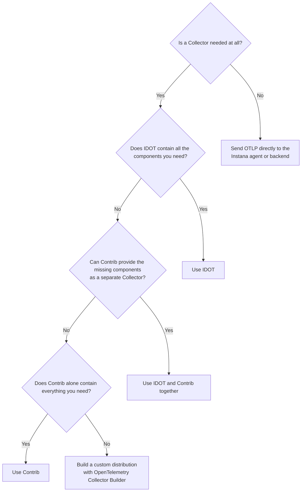

# Choosing a collector

We have just installed both `IDOT` and `otelcol-contrib` to the one _bluebox_ host, so we know they can run together but do they need to? When should you pick one over the other? This short lesson provides a comparison to help you choose.

## Side by side

| Consideration | IDOT | otelcol-contrib |
| --- | --- | --- |
| Support | IBM | OpenTelemetry community |
| Security patches | [IBM maintains and publishes releases](https://www.ibm.com/docs/en/instana-observability/standard/latest?topic=troubleshooting-support-strategy-idot). | Community releases |
| Components | Curated list, fewer components | Many components for many use cases. |
| IBM only receivers | `shell`, `apiscraper`, `s390` |  |
| Contrib-only examples |  | `file_storage`, `kafka`, `redis`, `snmp`, `tls_check` and more |
| Default configuration | Instana read out of the box | Generic config that needs customisation |
| Runs as | `root` (by default, can be changed) | `otelcol-contrib` |
| Remote management from Instana | Yes | Not through Instana fleet management |

## Decision flow

See [OpenTelemetry Collector Builder](https://opentelemetry.io/docs/collector/extend/ocb/) for building custom distributions.